The Payment Concierge section within the dashboard sets up an AI agent that works like a payments analyst on your team, one that sees your entire payment stack and works from wherever your team already does: Slack, WhatsApp, Telegram, or Microsoft Teams. It's available 24/7, so you can ask anything, anytime, and get an answer in seconds. For example:

* *"Why did my approval rate drop in the UK this week?"*
* *"Which PSP should I route Mastercard transactions to in Brazil?"*
* *"What's causing my Adyen rejections, and how do I fix them?"*
* *"Compare all my PSPs over the last 7 days: who's underperforming?"*
* *"Build me a full report of last month's approval performance, broken down by country and provider."*

Your Concierge doesn't just answer. It explains the root cause down to the issuer level, recommends a specific action to take, and can turn any of it into a complete report.

Your Concierge can also work proactively. It monitors your payment stack around the clock and sends scheduled briefings: daily volume and approval rates, a per-provider breakdown, the top decline reasons, and flags on any anomaly, like an approval rate drop across providers or a sudden volume collapse, each with context and specific next steps. You decide what it reports on, how often, and where each report is delivered: Slack, WhatsApp, Telegram, or Microsoft Teams.

## Setting up the Concierge

Before your team can work with the Concierge, an admin activates it for the organization and assigns each person an access level through a custom role.

<Steps>
  <Step title="Request access">
    Open the Payment Concierge section and select **Request access**. In the dialog, choose your **primary communication channel** (Slack, WhatsApp, or Telegram), pick a **desired activation date**, accept the **Terms and Conditions**, and submit. The Yuno team reviews the request and activates the Concierge for your organization.

    <Frame>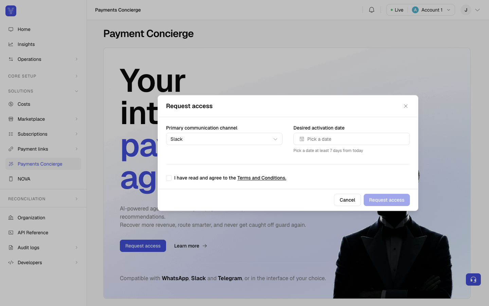</Frame>

    <Note>
    **Admin-only step**

    Only an admin can request access. The activation date must be at least 7 days from today.
    </Note>
  </Step>
  <Step title="Assign access levels with roles">
    Once the Concierge is active, you decide what each person can do. There are two access levels:

    <CardGroup cols={2}>
      <Card title="Admin">
        Sets up the Concierge for the whole organization: connects the communication channels, manages who has access, defines the knowledge the Concierge uses, and creates scheduled tasks for the organization or for individual people.
      </Card>
      <Card title="Member">
        Configures the Concierge only for themselves: sets up their own channels and their own scheduled tasks, without touching organization-wide settings.
      </Card>
    </CardGroup>

    You grant these levels through custom roles. From **Organization → Roles → Create role**, create a role, enable the Payment Concierge permission that matches the level, and assign the role to the person:

    * **20.1 Manage Payment Concierge**: grants the Admin view.
    * **20.2 Manage Member Payment Concierge**: grants the Member view.

    <Frame>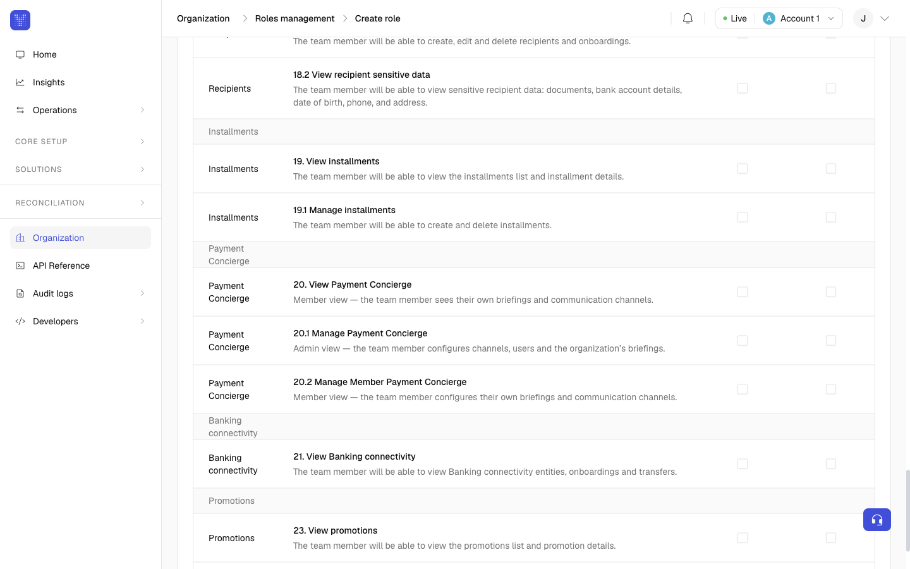</Frame>
  </Step>
</Steps>

<Note>
**Views adapt to the role**

The section adjusts to each person's role automatically, so they only see what applies to them.
</Note>

## For admins

As an admin you see three tabs: **Access**, **Scheduled tasks**, and **Concierge knowledge**.

<Tabs>
  <Tab title="Access">
    This is where you decide where the Concierge can talk and who it can reach.

    **Communication channels.** Select the channels where the Payments Concierge can talk: Slack, WhatsApp, Telegram, and Microsoft Teams.

    <Frame>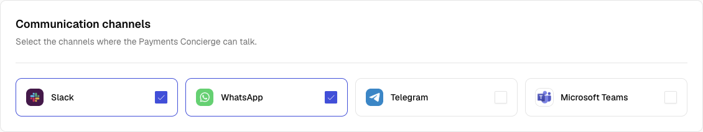</Frame>

    Connecting Microsoft Teams takes a few extra steps. When you connect it, a guided walkthrough shows you how to bring the Concierge into your organization:

    * Create the bot in Azure.
    * Enable the Microsoft Teams channel.
    * Copy the Microsoft App ID and App Tenant ID.
    * Generate and copy a client secret.
    * Grant Microsoft Graph permission, so the Concierge can identify your users by email.
    * Upload the app to Teams, then select **Connect**.

    <Note>
    **Who can connect Microsoft Teams**

    This step touches your Azure app registration and requires tenant-admin consent, so you'll need a Teams admin of your organization or a developer to complete it.
    </Note>

    **Group chats.** Add the shared channels or groups where the Concierge can post: a Slack channel, a Telegram group, or a Microsoft Teams channel. Select **Add group chat**, choose the platform, and paste the channel link (for example `https://acme.slack.com/archives/C0BH7B56GD6`). The panel includes a **How to add the Concierge** walkthrough (with a short video) that shows you where to copy the link from.

    <Frame>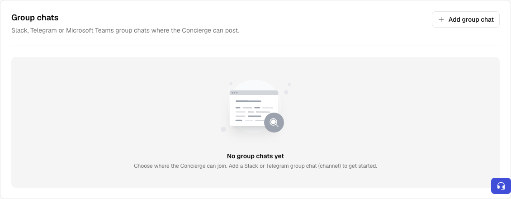</Frame>

    <Frame>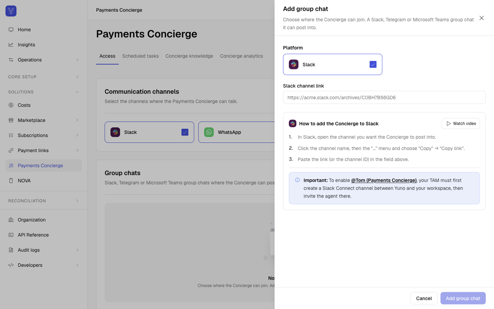</Frame>

    <Note>
    **Slack group chats need a Slack Connect channel**

    To enable **@Tom (Payments Concierge)** in Slack, your TAM must first create a Slack Connect channel between Yuno and your workspace, then invite the agent there.
    </Note>

    **Users with access.** Map each person in your organization to their Slack, WhatsApp, or Telegram identity so the Concierge knows who's writing and can reach them by DM. You don't need to know any special format. Each channel has a **How do I find it?** link that walks the person through getting their own ID:

    * **Slack**: search for **@Tom (Payments Concierge)** in Slack, then add your Slack profile link so the agent can DM you.
    * **WhatsApp**: open a chat with the agent from **Open WhatsApp**, or share the link with your team. Add your phone number with the country code (for example `+573000000000`).
    * **Telegram**: open a chat with the agent from **Open Telegram**, then add your Telegram ID so it can reach you by DM.

    Set each person's identity for their channels directly in the users table. To manage who belongs to your organization and their roles, select **Manage access**.

    <Frame>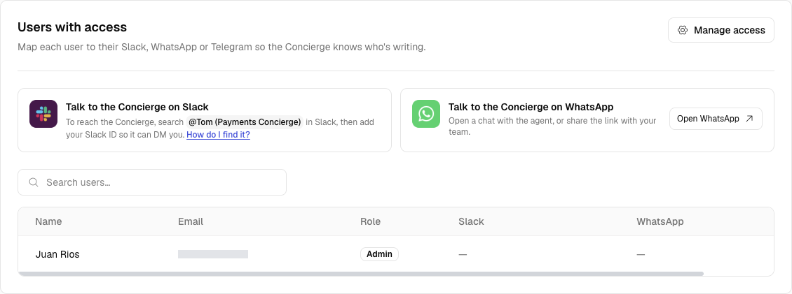</Frame>
  </Tab>
  <Tab title="Scheduled tasks">
    Recurring tasks the Concierge runs and delivers automatically, for the whole organization or for a single person. To add one, select **New scheduled task** and fill in the panel:

    <Steps>
      <Step title="Who is this for?">
        Choose **Whole organization** (everyone with access receives it) or **Just me** (only you receive it).

        <Frame>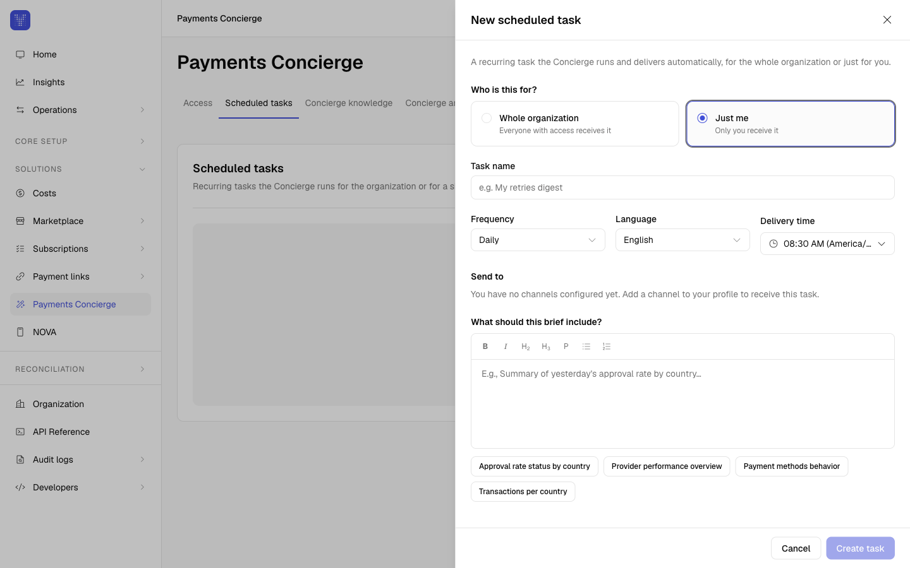</Frame>
      </Step>
      <Step title="Task name">
        Give the task a name, for example *Daily Morning Brief*.
      </Step>
      <Step title="Frequency, Language, and Delivery time">
        Set how often it runs (Daily, Weekly, or Monthly), the language, and when it's delivered. The delivery time uses the timezone configured in your dashboard settings.

        Weekly adds a **Day of the week** field, and Monthly adds a **Day of the month** field.

        <Frame>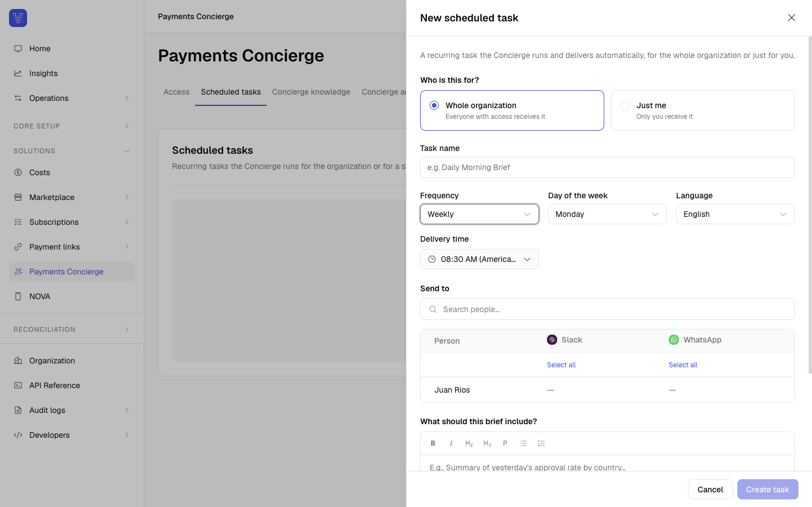</Frame>

        <Frame>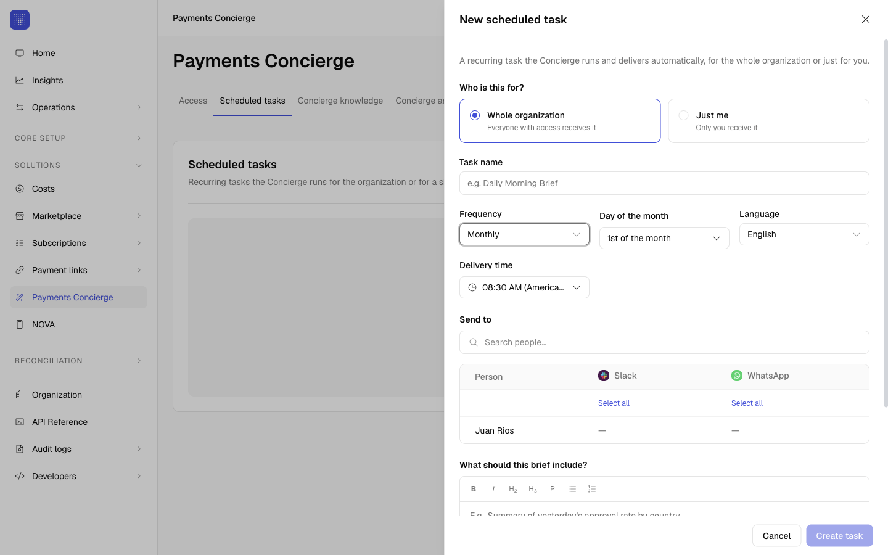</Frame>
      </Step>
      <Step title="What should this brief include?">
        Describe, in plain language, what the report should cover, for example: *"Summary of yesterday's approval rate by country."*

        <Frame>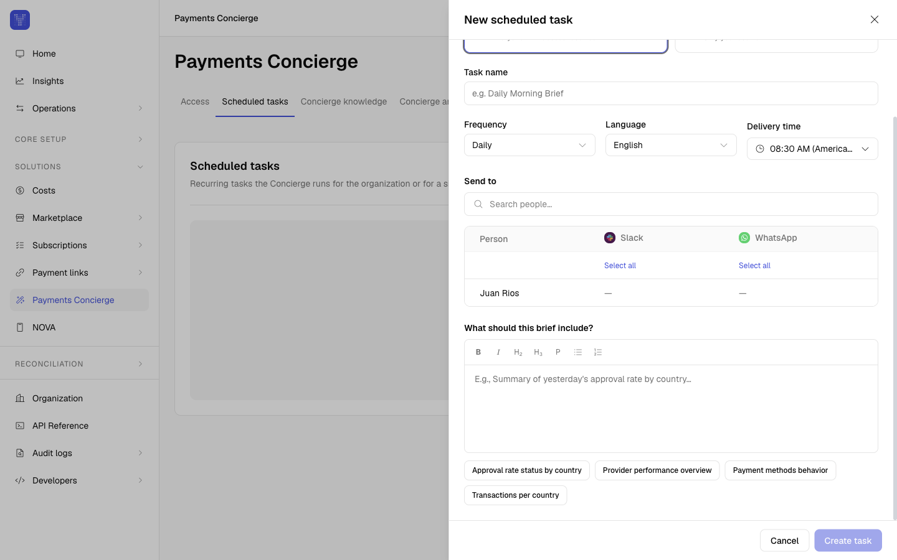</Frame>
      </Step>
      <Step title="Send to">
        Pick the people and group chats that receive it, per channel (Slack, WhatsApp), or use **Select all**.
      </Step>
      <Step title="Create task">
        Select **Create task**.
      </Step>
    </Steps>

    <Frame>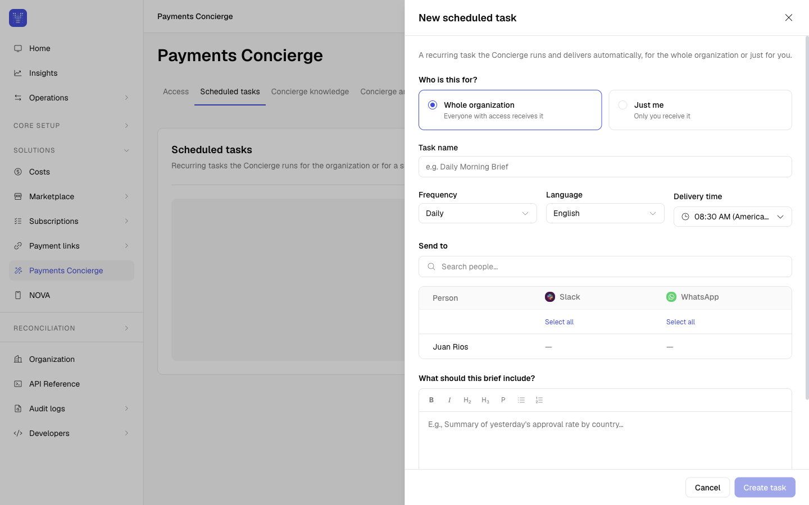</Frame>

    You can edit, pause, resume, or delete any task at any time, and you'll see every task in your organization here.
  </Tab>
  <Tab title="Concierge knowledge">
    The products, tone, and policies the Concierge applies in every conversation. Use this tab to give the Concierge business context, for example the markets you operate in, the payment methods you prioritize, and the tone you want it to use. Write it in the editor and select **Save context**, and the Concierge then applies it everywhere.

    <Frame>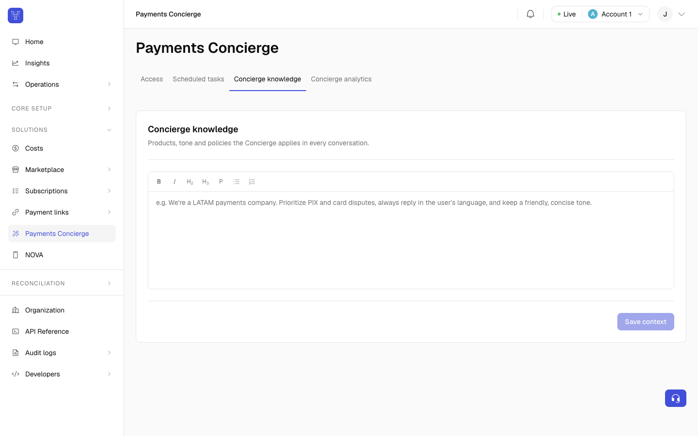</Frame>
  </Tab>
</Tabs>

## For members

As a member, the Payment Concierge section is a single page focused on you: the channels where the Concierge can reach you, and your own scheduled tasks. You don't see the organization-wide Access or Concierge knowledge settings.

<Frame>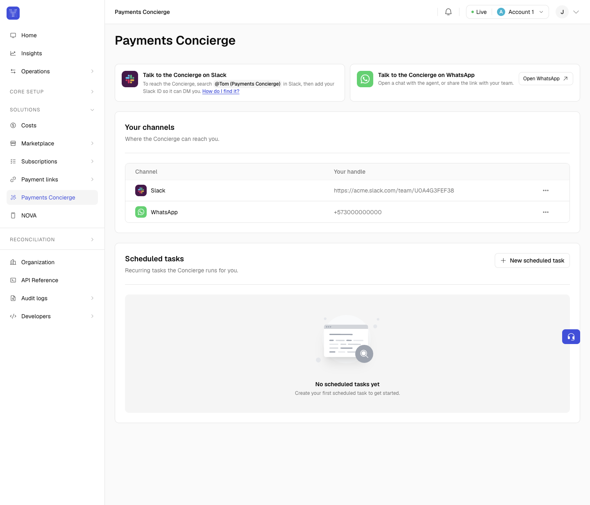</Frame>

**Your channels.** Set up your own identity so the Concierge can reach you on the channels your admin has enabled. You don't need to know any special format. Each channel has a **How do I find it?** link that shows you exactly how to get your ID:

* **Slack**: search for **@Tom (Payments Concierge)**, then add your Slack profile link so it can DM you.
* **WhatsApp**: open a chat with the agent from **Open WhatsApp**, and add your phone number with the country code (for example `+573000000000`).
* **Telegram**: open a chat with the agent from **Open Telegram**, then add your Telegram ID.

These are your personal handles; you don't manage the organization's channels.

**Your scheduled tasks.** Create recurring tasks the Concierge runs for you. You choose the cadence, delivery time, language, and what it reports on, and it's delivered to your channels. You'll only see the tasks that are meant for you: the ones you created, the ones an admin assigned to you, plus any organization-wide briefings that reach everyone. You can edit, pause, resume, or delete your own tasks at any time.

You can access Payment Concierge from the [Yuno dashboard](https://dashboard.y.uno/).
