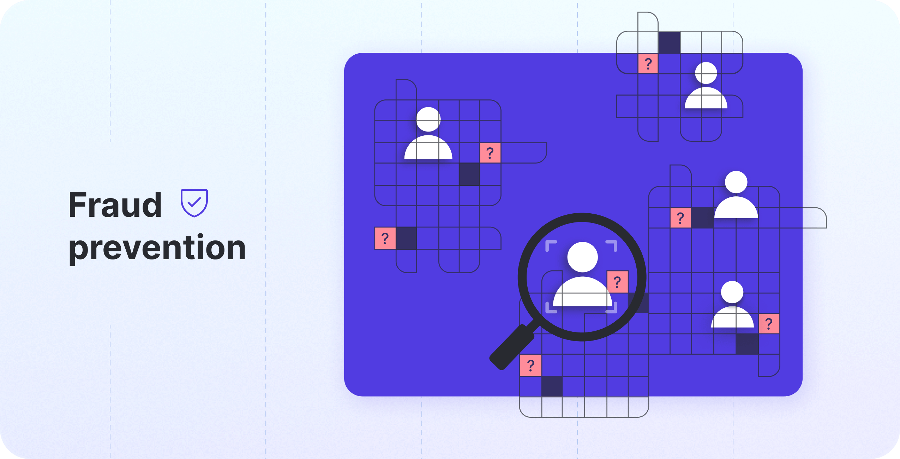

Yuno integrates with external fraud detection services to help prevent fraud in your payment process. You can configure both **pre-authorization** and **post-authorization** fraud screening through your preferred **fraud detection provider**.

### Fraud prevention with Yuno

When using Yuno's SDK, no additional development is required. Simply add the fraud detection provider to the payment route, and Yuno will handle the rest.

<Frame></Frame>

When a payment is created, Yuno generates different transactions based on the payment method route. If fraud verification is enabled in the route, Yuno creates a `FRAUD_SCREENING` transaction and associates it with the payment. This transaction contains details about the fraud verification outcome, which you can also view in the [payment details](/docs/transactions#transaction-types-and-statuses) on your Yuno dashboard.

<Note>
**Session ID collection is route-specific**

The SDK only collects a device fingerprint or `session_id` for fraud providers configured in the merchant's active fraud route. If you need to collect a `session_id` for a specific provider, make sure that provider is added to the route for that payment method on your Yuno dashboard.
</Note>

### Send device fingerprints yourself

Fraud screening providers identify the customer's device with a fingerprint or session ID that their own SDK or script generates. When the Yuno SDK runs the checkout and the provider's module or script, it collects these values and sends them with the one-time token: you do not need to send anything.

Send them yourself, in `customer_payer.device_fingerprints` of the [payment](/reference/payments/create-payment), when the Yuno SDK cannot collect them:

* **Native app with a web card form**: your iOS or Android app shows the card form in a WebView (for example, Secure Fields), so no native antifraud module runs.
* **Hybrid app**: React Native, Flutter, Capacitor or a similar framework, where the provider's native SDK runs outside the Yuno SDK.
* **Direct API integration**: you collect card data with your own form and call the Yuno API directly.

In all three cases:

1. Collect the fingerprint once per checkout session with each provider's own SDK or script.
2. Send one entry per provider in `customer_payer.device_fingerprints`, with the provider ID and the value the provider returned.
3. If the payment comes from a native app, set `customer_payer.browser_info.platform` to `IOS` or `ANDROID`.

An entry you send for a provider replaces the one carried by the one-time token for that provider, and `browser_info.platform` replaces the platform carried by the token.

Use as `provider_id` the ID of the provider in your payment route that needs the value:

* **Fraud screening providers**: `ACCERTIFY`, `CIELO_CYBERSOURCE_FRAUD`, `CLEAR_SALE`, `CYBERSOURCE`, `FORTER`, `KOIN_FRAUD`, `KONDUTO`, `RISKIFIED` and `SIGNIFYD`. The provider receives the value as the device fingerprint.
* **Payment providers**: for example `MERCADO_PAGO` or `OPENPAY`. The provider receives the value as the third-party session ID.

To send one value for every fraud screening or 3DS provider in the route, you can use `customer_payer.device_fingerprint` instead. For payment providers, `customer_payer.third_party_session_id` does the same: one value for every payment provider in the route. An entry in `device_fingerprints` for a provider takes precedence over both.

```json
[...]
"customer_payer": {
    "merchant_customer_id": "1690161049",
    "first_name": "John",
    "last_name": "Doe",
    "email": "john.doe@example.com",
    "device_fingerprints": [
        {
            "provider_id": "SIGNIFYD",
            "id": "20a6c463-dd0c-4323-9115-03668d178856"
        },
        {
            "provider_id": "CLEAR_SALE",
            "id": "92d2ea4b-4bf7-494b-aaea-c48276135941"
        }
    ],
    "browser_info": {
        "platform": "IOS"
    }
},
[...]
```

<Note>
  Some providers need more payment data to score a transaction. For example, Koin rejects a payment that does not include `additional_data.order.items`.
</Note>

### Forter Session Token Capture

If you are using **Forter** for fraud detection, the Yuno SDK provides a reliable way to capture the session token.

To ensure the token is correctly captured and associated with the transaction, you should listen for the `ftr:tokenReady` event. This event is triggered when the Forter session token is generated and ready to be used.

```javascript
window.addEventListener('ftr:tokenReady', (event) => {
  const forterToken = event.detail;
  console.log('Forter Session Token ready:', forterToken);
});
```

Using this listener prevents issues with stale or missing tokens by ensuring you always capture the token at the right moment during the initialization or unmounting of the Forter component.
### Checkout.com Risk.js device session

If you route card payments to **Checkout.com**, its risk engine can score each payment with device data collected on your checkout page by Checkout.com's Risk.js library. The Yuno Web SDK collects that device session for you and Yuno sends it to Checkout.com with the payment as `risk.device_session_id`.

To turn it on, open your Checkout.com connection in the Yuno dashboard (**Connections**) and fill in three fields:

| Field | Value |
| --- | --- |
| **Enable Risk.js device session** | Check it. |
| **Public key (Risk.js)** | Your Checkout.com public API key (`pk_…`). It is a publishable key: the SDK shares it with the shopper's browser. |
| **Merchant-specific sub-domain (Risk.js)** | The first eight characters of your Checkout.com client ID, without the `cli_` prefix (for `cli_vkuhvk4vjn2e…` enter `vkuhvk4v`). Risk.js refuses to start without it. |

No code change is needed on your side. From Web SDK 1.11.43, when a payment method routed to that connection mounts, the SDK loads Risk.js in the background from `risk.checkout.com` (`risk.sandbox.checkout.com` for sandbox keys), publishes the device data and attaches the returned device session ID to the one-time token and the payment. It applies to every payment method routed to the connection (cards, wallets and alternative payment methods) on the Full, Lite and Seamless checkouts, Secure Fields and the wallet buttons.

<Note>
- Risk.js is requested directly from Checkout.com, not through your white-label proxy. If your page sets a Content Security Policy, allow those two hosts in `script-src`.
- Collection never blocks the checkout: if the script fails to load or Checkout.com does not answer in time, the payment goes through without a device session and the SDK logs the failure.
- Checkout.com keeps a device session for 20 minutes. The SDK collects it when the payment method mounts, so a checkout that stays open longer than that pays without it.
- The mobile SDKs do not collect the Risk.js device session.
</Note>
