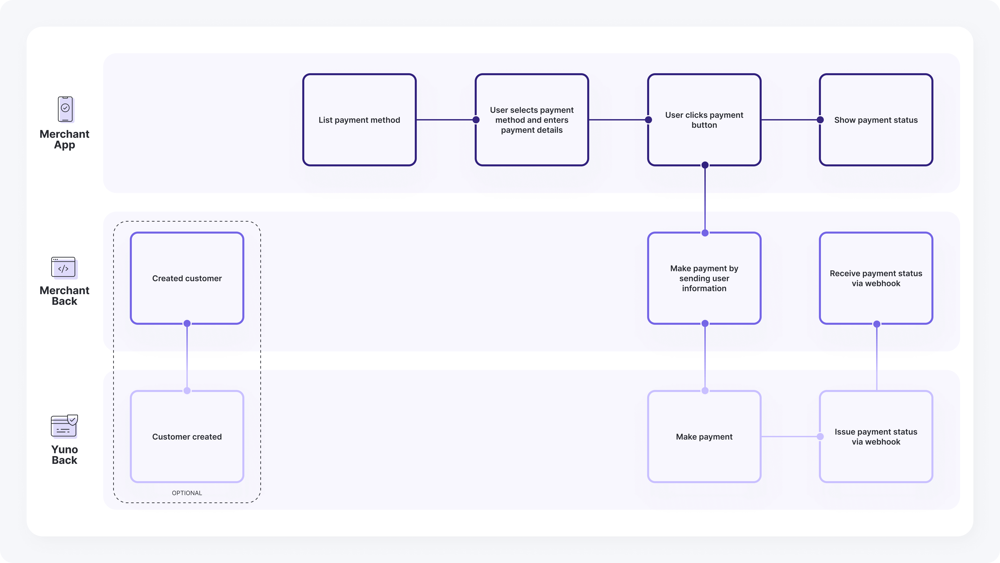
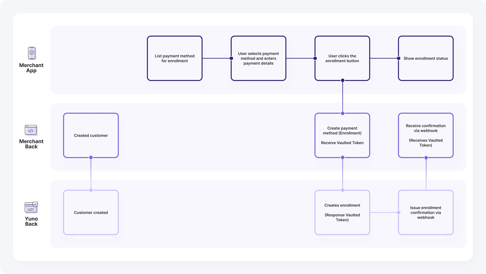

## How it works

If you are a developer, you can use our Direct Flow to continue using your checkout and connect to our services using only a server-to-server connection.

Your company must be PCI-certified to use our server-to-server card payments service. Please forward your AOC certification to your account manager before beginning the implementation.

<Danger>
We always recommend using Yuno's SDKs over Direct Flow integrations. Yuno's SDKs are PCI-compliant and simplify the payment process by managing all complexities, including fraud prevention, 3DS, and payment provider-specific requirements. Direct Flow requires merchants to handle these aspects manually, increasing complexity and risk.
</Danger>

For every implementation, we recommend taking the payment `status` and `sub_status` as the main reference for the [payment's state](/reference/payments/status-and-response-codes/payment). A payment could have different [transactions](/reference/payments/status-and-response-codes/transaction) associated with it, so by focusing on the payment **status/sub\_status**, you can have the latest state regardless of how many transactions were made, giving you clear input for decision-making. With this integration, you can also [enroll credit cards](/docs/direct-integration-use-cases/direct-flow#enrollment) for future purchases (also only available for PCI-compliant merchants).

## Payment

<Frame></Frame>

<Steps>
  <Step title="Create a customer">
    **[Optional]**: The first step is to create a customer to associate payment methods. Use the [Create Customer](/reference/customers/create-customer) endpoint to receive a unique ID.
    * You can skip this step if the customer already exists.
    * You can also send customer info directly in the payment without creating an object.
    <Warning>
      Customer creation is required to generate a `vaulted_token`.
    </Warning>
  </Step>

  <Step title="Create the payment">
    Display the enabled payment methods in your Yuno account. Once selected, create a payment containing order details, customer info, amount, and more using the [Create Payment](/reference/payments/create-payment) endpoint.
    * Reference the [examples section](/reference/payments/payment-examples) for implementation details.
    * Use a `vaulted_token` for previously enrolled methods.
    
    During integration, use the payment **status** and **sub_status** as the primary reference for the payment state.
  </Step>
</Steps>

### DIRECT vs REDIRECT Workflow

While using the Direct integration in Yuno, you have two available `workflow` options:

* **DIRECT**: We return the raw response from the providers so you can build the experience however you like with the unfiltered data.
* **REDIRECT**: While we also return the direct response from the providers, we additionally offer merchants the possibility to use a redirection link provided by Yuno where we handle the payment experience just for that payment. You can find such a URL in the `payment_method.payment_method_detail.<type>.redirect_url` field in the payment's response, where `<type>` is the payment method category: `ticket`, `bank_transfer`, `wallet` or `bnpl`.

Both workflows support Cards (including Cards with 3DS) and Alternative Payment Methods (PSE, Nequi, MercadoPago, PIX, etc.). For cards with 3DS, both workflows require PCI certification.

<Note>
  **PIX payment data**

  For PIX, the payment's response returns the data to show the payer in the `payment_method.payment_method_detail.bank_transfer` object. The [PIX example](/reference/payments/payment-examples/bank-transfer#pix) uses the `REDIRECT` workflow and returns these fields:

  * `provider_image`: URL provided by the provider. In the example, it points to the QR code.
  * `beneficiary_name`, `beneficiary_document_type`, `beneficiary_document`, `bank_name`, `bank_account`: Details of the account holder receiving the payment. These fields can be `null`, as in the PIX example.
  * `payment_instruction`: Payment instructions related to the payment.
  * `redirect_url`: Yuno-hosted payment page, used with the `REDIRECT` workflow.

  With the `DIRECT` workflow, the provider's unfiltered response is also returned in `provider_data.raw_response`. See the [Payment object](/reference/payments/the-payment-object) for the full field descriptions.
</Note>

### Important Add-ons

* **Webhooks**: We recommend configuring [Webhooks](/docs/webhooks) in your Yuno dashboard. Webhooks are the best way to ensure your system stays up-to-date with payment progress and status. Since event notifications are triggered automatically, your system won't need to perform repeated requests to Yuno.

* **Device Fingerprints**: Used by fraud screening providers to identify the customer's device. If the Yuno SDK does not collect them in your integration, send them with the payment as described in [Device fingerprints](#device-fingerprints).

* **three\_d\_secure\_setup\_id**: Use our JS only to get the `three_d_secure_setup_id` and then handle the payment as an only API integration. The Direct workflow is only available for PCI-compliant merchants. It provides a straightforward way to create a payment and validate user information, requiring the merchant to perform just one request to create the payment. To successfully implement the Direct integration, follow the steps outlined in the [Payment](#payment) section above and provide the required information as instructed. This service is not necessary for 3DS implementation using Yuno's SDK.

### Device fingerprints

Fraud screening providers identify the customer's device with a fingerprint or session ID that their own SDK or script generates. When the Yuno SDK runs the checkout and the provider's module or script, it collects these values and sends them with the one-time token: you do not need to send anything.

Send them yourself, in `customer_payer.device_fingerprints` of the [payment](/reference/payments/create-payment), when the Yuno SDK cannot collect them:

* **Native app with a web card form**: your iOS or Android app shows the card form in a WebView (for example, Secure Fields), so no native antifraud module runs.
* **Hybrid app**: React Native, Flutter, Capacitor or a similar framework, where the provider's native SDK runs outside the Yuno SDK.
* **Direct API integration**: you collect card data with your own form and call the Yuno API directly.

In all three cases:

1. Collect the fingerprint once per checkout session with each provider's own SDK or script.
2. Send one entry per provider in `customer_payer.device_fingerprints`, with the provider ID and the value the provider returned.
3. If the payment comes from a native app, set `customer_payer.browser_info.platform` to `IOS` or `ANDROID`.

An entry you send for a provider replaces the one carried by the one-time token for that provider, and `browser_info.platform` replaces the platform carried by the token.

Valid `provider_id` values: `CLEAR_SALE`, `CYBERSOURCE`, `KOIN_FRAUD`, `RISKIFIED`, `SIGNIFYD`, `VESTA`, `KONDUTO`, `BAYONET`, `MERCADO_PAGO` and `OPEN_PAY`.

```json
[...]
"customer_payer": {
    "merchant_customer_id": "1690161049",
    "first_name": "John",
    "last_name": "Doe",
    "email": "john.doe@example.com",
    "device_fingerprints": [
        {
            "provider_id": "SIGNIFYD",
            "id": "20a6c463-dd0c-4323-9115-03668d178856"
        },
        {
            "provider_id": "CLEAR_SALE",
            "id": "92d2ea4b-4bf7-494b-aaea-c48276135941"
        }
    ],
    "browser_info": {
        "platform": "IOS"
    }
},
[...]
```

<Note>
  Some providers need more payment data to score a transaction. For example, Koin rejects a payment that does not include `additional_data.order.items`.
</Note>

## Enrollment

<Frame></Frame>

<Steps>
  <Step title="Create a customer">
    Associate payment methods by creating a customer (if not already existing) using the [Create Customer](/reference/customers/create-customer) endpoint.
  </Step>

  <Step title="Enroll a payment method">
    <Note>
      **Direct Flow Integration**
      
      This feature is only available for enrolling Cards for PCI compliant merchants.
    </Note>
    Enroll the payment method via the [Enroll Payment Method](/reference/payment-methods-direct-workflow/enroll-payment-method-api) endpoint. You will receive a `vaulted_token` for future purchases.
  </Step>
</Steps>