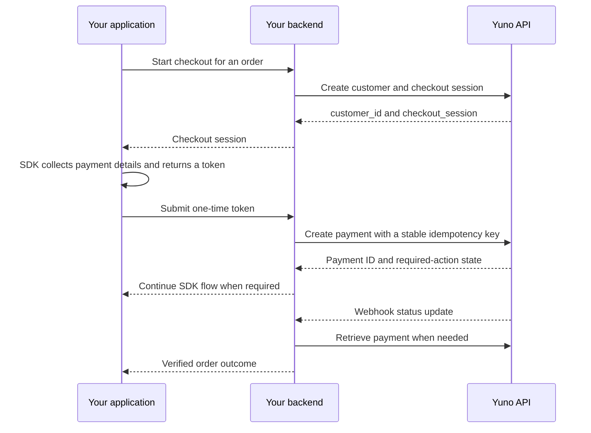

Build a complete sandbox payment flow with the Yuno SDK and your backend. At the end, you will have a payment ID, a verified payment outcome, and a clear path to production.

<Info>
**Already have a sandbox account and want to run an example?** Use the [Web SDK sample project](/docs/how-yuno-works/step-2-your-first-payment). The guide below explains the requests and responsibilities behind the integration.
</Info>

## Before you start

Complete [account setup](/docs/how-yuno-works/step-1-set-up-your-account): select **Test Mode**, connect **Yuno Test Payment Gateway**, publish a Card route, and enable Card in Checkout Builder. Get the public key, private secret key, and account ID from **Dashboard → Developers**.

You need a backend that can send HTTPS requests and a browser or mobile application for the SDK. The cURL examples run on your development machine or server. Replace every placeholder before sending a request. Use synthetic customer data in sandbox.

<Warning>
Keep `private-secret-key` on your server. Do not put it in browser JavaScript, mobile apps, screenshots, logs, or a committed environment file. Load it from your server's secret store or local environment.
</Warning>

## Understand the flow



## Configure your server

Use the sandbox base URL and a matching sandbox key pair:

```bash
export YUNO_BASE_URL="https://api-sandbox.y.uno"
export YUNO_PUBLIC_KEY="YOUR_SANDBOX_PUBLIC_KEY"
export YUNO_SECRET_KEY="YOUR_SANDBOX_PRIVATE_KEY"
export YUNO_ACCOUNT_ID="YOUR_ACCOUNT_ID"
```

All monetary amounts in these examples use **decimal major units**: `value: 25` means **USD 25.00**, not 25 cents. Calculate the final amount on your backend from the stored order; do not trust a client-supplied total.

## Create a customer

Send the following request from your server. Use a unique `merchant_customer_id` from your own customer records.

```bash
curl --fail-with-body --request POST "$YUNO_BASE_URL/v1/customers" \
  --header "Content-Type: application/json" \
  --header "public-api-key: $YUNO_PUBLIC_KEY" \
  --header "private-secret-key: $YUNO_SECRET_KEY" \
  --data '{
    "merchant_customer_id": "sandbox_customer_001",
    "first_name": "Alex",
    "last_name": "Rivera",
    "email": "alex@example.com",
    "country": "US"
  }'
```

**Expected:** HTTP `201` with a customer `id`. Save that value on your server as `YUNO_CUSTOMER_ID` and reuse the customer for later sessions. See the [customer reference](/reference/customers/create-customer) for country-specific fields and the full response.

## Create a checkout session

A session connects the order to its checkout. Use the same account, country, currency, amount, and order ID throughout this flow.

```bash
export YUNO_CUSTOMER_ID="CUSTOMER_ID_FROM_PREVIOUS_RESPONSE"

curl --fail-with-body --request POST "$YUNO_BASE_URL/v1/checkout/sessions" \
  --header "Content-Type: application/json" \
  --header "public-api-key: $YUNO_PUBLIC_KEY" \
  --header "private-secret-key: $YUNO_SECRET_KEY" \
  --data "{
    \"account_id\": \"$YUNO_ACCOUNT_ID\",
    \"customer_id\": \"$YUNO_CUSTOMER_ID\",
    \"merchant_order_id\": \"sandbox_order_001\",
    \"payment_description\": \"My first Yuno payment\",
    \"country\": \"US\",
    \"amount\": { \"currency\": \"USD\", \"value\": 25 }
  }"
```

**Expected:** HTTP `200` with `checkout_session`. Send that value to your frontend. If metadata controls your routing rules, include the metadata on this session. Redirect-based payment methods also need their documented `callback_url` configuration.

See [Create Checkout Session](/reference/checkout-sessions/create-checkout-session) for all fields. Do not confuse `checkout_session` with `checkout_id`.

## Collect payment details

Follow the full SDK guide for your platform. It covers initialization, mounting the UI, the create-payment callback, and required actions.

<CardGroup cols={3}>
  <Card title="Web" icon="browser" href="/docs/sdks/seamless-sdk/web-payments">JavaScript applications</Card>
  <Card title="iOS" icon="apple" href="/docs/sdks/seamless-sdk/ios-payments">Native iOS applications</Card>
  <Card title="Android" icon="android" href="/docs/sdks/seamless-sdk/android-payments">Native Android applications</Card>
</CardGroup>

Initialize the SDK using the **public** key and the checkout session. When the SDK returns a **one-time token**, submit it to your authenticated backend. Bind the request to the correct customer and stored order. Use the [Yuno Testing Gateway test data](/docs/direct-integration-use-cases/yuno-testing-gateway#4-provide-the-payment-method-information) for your configured scenario; test data is provider-specific.

## Create the payment

In your create-payment handler, generate a UUID once for this payment attempt and persist it with the order. Reuse that key and the original request if the outcome is unclear.

```bash
export YUNO_CHECKOUT_SESSION="CHECKOUT_SESSION_FROM_PREVIOUS_RESPONSE"
export YUNO_ONE_TIME_TOKEN="ONE_TIME_TOKEN_FROM_SDK"
export YUNO_IDEMPOTENCY_KEY="UUID_FOR_THIS_PAYMENT_ATTEMPT"

curl --fail-with-body --request POST "$YUNO_BASE_URL/v1/payments" \
  --header "Content-Type: application/json" \
  --header "public-api-key: $YUNO_PUBLIC_KEY" \
  --header "private-secret-key: $YUNO_SECRET_KEY" \
  --header "X-Idempotency-Key: $YUNO_IDEMPOTENCY_KEY" \
  --data "{
    \"account_id\": \"$YUNO_ACCOUNT_ID\",
    \"description\": \"My first Yuno payment\",
    \"merchant_order_id\": \"sandbox_order_001\",
    \"country\": \"US\",
    \"amount\": { \"currency\": \"USD\", \"value\": 25 },
    \"customer_payer\": { \"id\": \"$YUNO_CUSTOMER_ID\" },
    \"checkout\": { \"session\": \"$YUNO_CHECKOUT_SESSION\" },
    \"payment_method\": { \"token\": \"$YUNO_ONE_TIME_TOKEN\" }
  }"
```

Save the returned payment `id`. If `sdk_action_required` is `true`, return the relevant state to your client and complete the SDK's `continuePayment()` flow according to your platform guide. Required actions can include authentication or an external payment flow.

<Note>
An HTTP success code means the request was accepted; it does not by itself prove that money was collected. See [Create Payment](/reference/payments/create-payment) and the [payment lifecycle](/docs/basic-concepts/payments-1).
</Note>

## Verify the payment

[Configure webhooks](/docs/webhooks/configure-webhooks) and [verify their signatures](/docs/webhooks/verify-webhook-signatures-hmac). Process status changes on your server, deduplicate deliveries, and match them to the expected order, account, amount, and currency.

For a manual sandbox check or reconciliation, retrieve the payment:

```bash
export YUNO_PAYMENT_ID="PAYMENT_ID_FROM_CREATE_RESPONSE"

curl --fail-with-body "$YUNO_BASE_URL/v1/payments/$YUNO_PAYMENT_ID" \
  --header "public-api-key: $YUNO_PUBLIC_KEY" \
  --header "private-secret-key: $YUNO_SECRET_KEY"
```

Read the `payment` object in the [retrieve response](/reference/payments/retrieve-payment-by-id-v2), including its status and associated transaction details. A browser redirect or SDK completion callback is not your order-fulfillment authority. For an authorization-only flow, confirm the required capture before treating the payment as collected.

## Your integration is ready for the next step when

- The sandbox payment appears in **Dashboard → Payments** with the expected order and amount.
- Your server has recorded the payment ID and verified the final outcome.
- You can repeat the flow for a decline and a required-action scenario without fulfilling an unpaid order.
- A repeated webhook or uncertain request retry does not create a duplicate order action.

<CardGroup cols={2}>
  <Card title="Something didn't work?" icon="wrench" href="/docs/get-started/troubleshooting">Diagnose credentials, missing methods, pending payments, and retry behavior.</Card>
  <Card title="Prepare for production" icon="list-check" href="/docs/get-started/go-live">Work through the launch checklist before enabling live payments.</Card>
</CardGroup>
