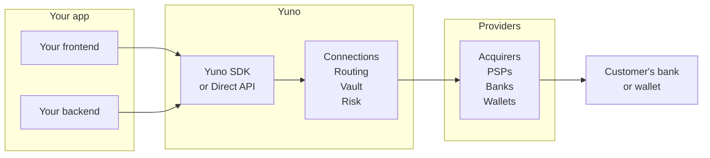

Yuno is a payment orchestration platform. You integrate once with Yuno, and Yuno connects you to payment providers, acquirers, banks, and local payment methods. You add providers and change routing rules in the dashboard without changing your code.

## How Yuno fits in your stack

Your app sends payment requests to Yuno through the SDK or the Direct API. Yuno routes each payment to the right provider based on your rules. The provider processes the payment with the customer's bank or wallet.

## Core concepts

| Concept | What it is | Learn more |
|---------|-----------|------------|
| **Organization** | Your company in Yuno. Contains accounts and team members. | [Organization](/docs/using-yuno/organization/index) |
| **Account** | A business unit or store. Payments belong to an account. | [Accounts](/docs/using-yuno/organization/accounts) |
| **Connection** | A link between your account and a payment provider. Set up in the dashboard. | [Connections](/docs/using-yuno/dashboard-overview/connections) |
| **Routing** | Rules that decide which connection processes each payment. | [Routing](/docs/using-yuno/dashboard-overview/routing) |
| **Payment method** | How the customer pays: card, bank transfer, wallet, or local method. | [Payment methods](/docs/basic-concepts/payment-methods) |
| **Customer** | The payer. Stores their details and saved payment methods for reuse. | [Customers](/docs/basic-concepts/customers) |
| **Checkout session** | A record of one payment attempt. The SDK uses it to show available payment methods. | [Sessions](/docs/basic-concepts/sessions) |
| **Webhook** | A notification Yuno sends to your server when a payment status changes. | [Webhooks](/docs/basic-concepts/webhooks-1) |

## How a payment flows

<Steps>
  <Step title="Create a checkout session">
    Your backend calls `POST /v1/checkout/sessions` with the amount, currency, and country. Yuno returns a session ID.
  </Step>
  <Step title="Show payment methods">
    Your frontend loads the Yuno SDK with the session ID. The SDK shows the payment methods available for this session.
  </Step>
  <Step title="Customer pays">
    The customer selects a payment method and enters their details. The SDK tokenizes the card data and sends it to Yuno.
  </Step>
  <Step title="Yuno routes the payment">
    Yuno picks the connection that matches your routing rules and sends the payment to that provider.
  </Step>
  <Step title="Receive the result">
    The SDK shows the result to the customer. Yuno sends a webhook to your server with the payment status.
  </Step>
</Steps>

For the detailed sequence with API fields, see [How a payment flows](/docs/how-yuno-works/how-yuno-payment-flow-works).

## Choose how to integrate

<CardGroup cols={2}>
  <Card title="Yuno SDK" icon="window" href="/docs/yuno-sdk/get-started">
    Web, iOS, and Android. The SDK renders the checkout form and keeps card data out of your PCI scope. Recommended for most integrations.
  </Card>
  <Card title="Direct API" icon="code" href="/docs/direct-integration-use-cases/direct-flow">
    Server-to-server. Your backend calls the API and owns the full flow. Sending card data requires PCI DSS compliance.
  </Card>
</CardGroup>

<Note>
Older SDKs (Lite, Full, Headless, Seamless) are still supported but not recommended for new integrations. See [Legacy SDKs](/docs/sdks/overview/quickstart) if you need them.
</Note>

## Next steps

<CardGroup cols={2}>
  <Card title="Quickstart" icon="rocket" href="/docs/quickstart">
    Send your first sandbox payment in about 10 minutes.
  </Card>
  <Card title="Connections" icon="plug" href="/docs/using-yuno/dashboard-overview/connections">
    Add a payment provider to your account.
  </Card>
  <Card title="Routing" icon="route" href="/docs/using-yuno/dashboard-overview/routing">
    Create rules that decide which provider handles each payment.
  </Card>
  <Card title="Testing" icon="vial" href="/docs/testing">
    Test cards, sandbox environment, and 3DS testing.
  </Card>
</CardGroup>
