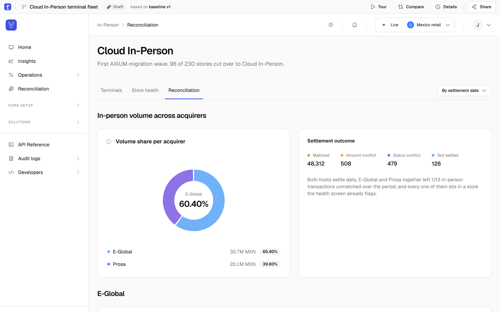
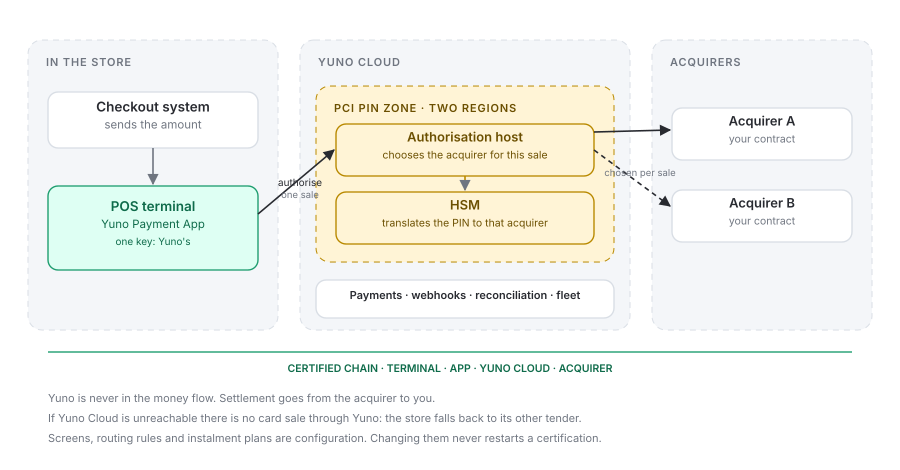

Accept card payments on the POS terminals your stores already own, route each sale to the acquirer you choose, and see everything, in-store and online, in one Yuno account.

<Info>
  **Two words used throughout these docs.** The **POS terminal** is the Android card device on the counter; the **Yuno Payment App** runs on it. The **checkout system** is your cash-register software, where the cashier rings up the basket. In most stores the checkout system tells the POS terminal how much to charge.
</Info>

## What you get

<CardGroup cols={3}>
  <Card title="Your POS terminals">
    The Yuno Payment App runs on the Android POS terminals you own, from vendors such as Verifone and Ingenico. Yuno doesn't sell or lease hardware.
  </Card>
  <Card title="Multi-acquirer routing in store">
    Keep your acquiring contracts. Your routing rules decide, sale by sale, which acquirer processes it: by store, amount, method and acquirer health.
  </Card>
  <Card title="One view, in store and online">
    In-store payments land in the same account as online ones, linked to the same customer. You see who pays, where and how, which your terminals alone never told you.
  </Card>
</CardGroup>

Every in-store sale is a Yuno `payment`, with the same identifier, statuses, events and webhooks as an online one. What changes is the `channel` (`IN_PERSON`) and the store and terminal data that come with it.

<Frame caption="Reconciliation per store and acquirer in the Yuno dashboard.">
  
</Frame>

## Features

<CardGroup cols={3}>
  <Card title="Multi-acquirer routing">
    Per sale, by store, amount, method, card range and acquirer health. A declined sale is never sent to another acquirer; one that times out is reversed with the same one.
  </Card>
  <Card title="Instalments">
    Instalment plans from the catalogue of the acquirer that takes the sale. The plan can be chosen at your checkout system, on the terminal before the PIN, or just before the sale is authorised.
  </Card>
  <Card title="Subscriptions">
    Start a subscription at the counter: the first charge on the POS terminal, the following ones online, on the same Yuno subscription. The message fields this needs are certified in the first release, so turning it on later never means recertifying.
  </Card>
  <Card title="Customer visibility across channels">
    The same card is recognised in store and online, so you know who pays in each channel and can bring store purchases into loyalty, analytics and service.
  </Card>
  <Card title="Payment methods on demand">
    Cards on chip and contactless in the first certified release. Local methods such as QR and wallets are added per market, each with its own certification.
  </Card>
  <Card title="White label">
    Your brand on every screen and receipt, by configuration, never by code and never with a new certification.
  </Card>
  <Card title="Fleet management">
    Every POS terminal by store: online or offline, app version, acquirer IDs, key status, last sale. Updates staged by group.
  </Card>
  <Card title="Reconciliation">
    Authorised, settled and deposited per store and acquirer, matched automatically. It can start before the app is on a single terminal.
  </Card>
  <Card title="Same platform as online">
    Same payment, statuses, webhooks, reports and dashboard. Filter on `channel`.
  </Card>
</CardGroup>

## How it works

<Frame caption="Every sale is authorised through Yuno Cloud, which chooses the acquirer for that sale and translates the PIN. The terminal holds only Yuno's key.">
  
</Frame>

- **The sale starts at your checkout system**, as it does today, or on the POS terminal itself. Your checkout system talks to the terminal inside the store; Yuno never connects to your checkout system, your store network or your central systems.
- **The POS terminal sends one authorisation to Yuno Cloud.** It holds a single key, Yuno's, and never talks to an acquirer itself.
- **Yuno Cloud chooses the acquirer for that sale** with the rules you set: store, amount, payment method, card range and the live health of each acquirer. The PIN is translated inside a hardware security module to the key of whichever acquirer takes the sale, and is never in the clear anywhere.
- **The terminal answers your checkout system** with the result and the receipt data. Yuno records the payment, sends your webhooks, and later matches the acquirer's settlement file against it.

## What runs where

| On the POS terminal (Yuno Payment App) | In Yuno Cloud |
| --- | --- |
| Reads the card with the vendor's certified kernel | Chooses the acquirer for each sale, from the rules you publish |
| Shows the instalment plans pushed from Yuno Cloud | Translates the PIN in a hardware security module to that acquirer's key |
| Takes the PIN on the secure keypad, under Yuno's key | Sends the authorisation over its own link to each acquirer |
| Sends one authorisation, then hands over the receipt lines | Records the payment, sends webhooks, reports and the dashboard |
| Holds no acquirer key and never talks to an acquirer | Reconciles settlement files, and manages customers, fleet and updates |

Yuno Cloud is in every sale, which is what lets one sale go to a different acquirer than the last without touching the terminal. It is also what makes the terminals a fleet: one set of rules, one health signal, one record of every sale, in the same place as your online payments. The host runs in two regions; if it cannot be reached the terminal cannot take a card, and the store falls back to its other tender.

## How a sale flows

<Steps>
  <Step title="The sale starts">
    Your checkout system sends the amount and your reference to the POS terminal.
  </Step>
  <Step title="The customer pays">
    Chip or contactless, instalments where they apply, PIN on the secure keypad under Yuno's key. The terminal sends the sale to Yuno Cloud once.
  </Step>
  <Step title="Yuno Cloud chooses the acquirer and authorises">
    From your rules for that store: amount, method, card range and acquirer health. A hardware security module translates the PIN to that acquirer's key, and Yuno sends one authorisation.
  </Step>
  <Step title="You get the result twice">
    On the checkout system for the receipt, and as a Yuno payment with `channel: IN_PERSON`, with the same webhooks as online.
  </Step>
  <Step title="Yuno reconciles">
    The acquirer's settlement file is matched per store and acquirer, and the differences are listed.
  </Step>
</Steps>

The full sequence, with contactless, instalments, voids, refunds and what happens when a sale fails, is on [Payment flow](/docs/in-person/payment-flow).

## Integration types

|  | Where the sale starts | Availability |
| --- | --- | --- |
| **Local** | Your checkout system, over the store network or a cable | With the first certified chain |
| **Cloud** | Your server, through the Payments API | Planned |
| **Standalone** | On the POS terminal, no integration | Planned |
| **Reconciliation first** | Your current terminals and acquirers, reconciled by Yuno | Available first |

How to choose is on [Integration types](/docs/in-person/ways-to-integrate). How your checkout system talks to the POS terminal is on [Connect your checkout system](/docs/in-person/connect-your-checkout-system). Which package each type belongs to, and what each package needs from you, is on [Solutions](/docs/in-person/solutions).

## On a phone: Tap to Pay

No POS terminal? The merchant's Android phone or iPhone can take contactless payments too, with the same routing, payment object and reconciliation. It is a separate programme with its own certification, and it is paused until an acquirer contract is in place. See [Tap to Pay](/docs/in-person/tap-to-pay/overview).

## Coverage at a glance

|  |  |
| --- | --- |
| **Regions** | Mexico first, then the rest of Latin America and Europe. Each country is its own certification |
| **Acquirers** | The acquirers you work with; Yuno integrates and certifies new acquirers on demand |
| **POS terminals** | Android POS terminals that accept external payment applications. Ingenico first, Verifone next |
| **Payment methods** | Chip and PIN, contactless and instalments in the first certified release; local methods such as QR and wallets per market |

Details and compliance: [Coverage and FAQ](/docs/in-person/coverage-and-faq).

<CardGroup cols={2}>
  <Card title="Solutions" href="/docs/in-person/solutions">
    See, Orchestrate, Unify and Connect: what each package does and what it needs from you.
  </Card>
  <Card title="Get started" href="/docs/in-person/get-started">
    From your Yuno account to a first in-store sale.
  </Card>
  <Card title="Integration types" href="/docs/in-person/ways-to-integrate">
    Local, cloud, standalone or reconciliation first, and how to choose.
  </Card>
  <Card title="Connect your checkout system" href="/docs/in-person/connect-your-checkout-system">
    Pairing, the calls your checkout system makes, recovery after a crash, voids, refunds and batch close.
  </Card>
  <Card title="Payment flow" href="/docs/in-person/payment-flow">
    A chip-and-PIN sale, step by step, and where the acquirer is chosen.
  </Card>
  <Card title="Payments and events" href="/docs/in-person/payments-and-events">
    What an in-store payment looks like, customers and subscriptions, decline codes and webhooks.
  </Card>
  <Card title="POS terminals and fleet" href="/docs/in-person/terminals">
    Which terminals, installation and keys, white label, updates without recertification.
  </Card>
  <Card title="Reconciliation" href="/docs/in-person/reconciliation">
    How each sale is matched against the acquirer's settlement file, and the outcomes.
  </Card>
  <Card title="Coverage and FAQ" href="/docs/in-person/coverage-and-faq">
    Regions, acquirers, terminals, compliance and the questions we get most.
  </Card>
</CardGroup>
