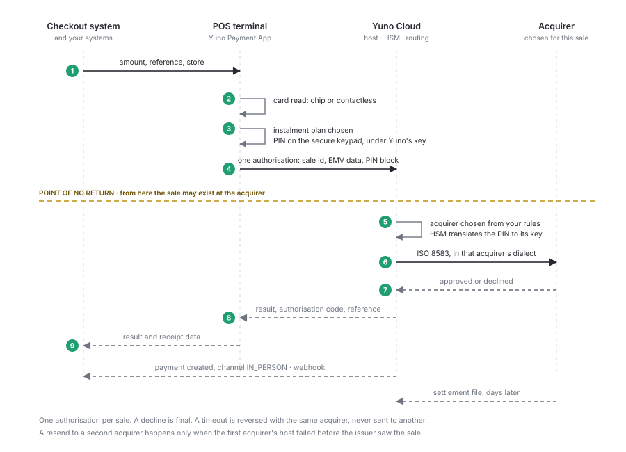
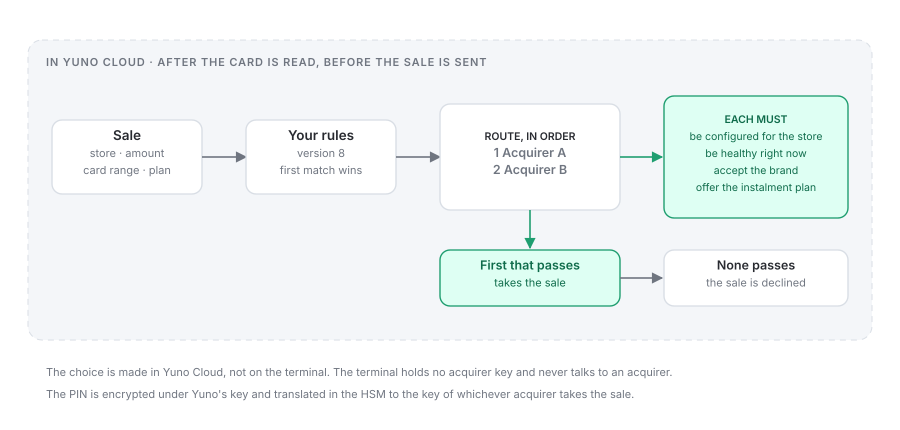
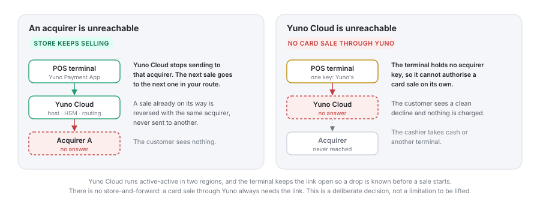

A chip-and-PIN sale, step by step. A contactless tap below the brand's limit follows the same path without the PIN step.

<Frame caption="One chip-and-PIN sale. The amber line is the point of no return: from there the sale may already exist at the acquirer.">
  
</Frame>

<Steps>
  <Step title="Sale starts">
    Your checkout system sends the amount and a reference to the POS terminal (or your server does, in the Cloud type, or the cashier keys it in). The terminal shows the amount and the payment methods enabled for the store.
  </Step>
  <Step title="Card read">
    Chip or contactless, on the terminal's certified kernel. The card range read here is one of the inputs to the acquirer choice.
  </Step>
  <Step title="Instalments">
    The plans available for this card and store are shown; the customer picks one and confirms the monthly amount and total. If your checkout system already sent a plan, the terminal uses it and does not ask.
  </Step>
  <Step title="PIN">
    Entered on the secure keypad and encrypted under Yuno's key. The terminal holds no acquirer key, so the PIN is not yet bound to an acquirer.
  </Step>
  <Step title="One authorisation to Yuno Cloud">
    The terminal sends the sale once: sale id, EMV data and PIN block. This is the point of no return; from here the sale may already exist at the acquirer.
  </Step>
  <Step title="Yuno Cloud chooses the acquirer and authorises">
    Your rules for that store pick the acquirer: amount, method, card range, instalment plan and acquirer health. A hardware security module translates the PIN to that acquirer's key, and Yuno sends one ISO 8583 authorisation in that acquirer's dialect. If the acquirer does not answer, the sale is reversed with that same acquirer, because the issuer may already have seen it.
  </Step>
  <Step title="Result">
    The terminal shows the result and hands the result and receipt lines to your checkout system.
  </Step>
  <Step title="Payment recorded, webhook sent">
    Yuno creates the payment with `channel: IN_PERSON`, stores the acquirer's identifiers, links it to the customer and sends the same events as an online payment. The record is written in Yuno Cloud as the sale is authorised, so nothing has to be reported afterwards.
  </Step>
  <Step title="Batch, settlement and reconciliation">
    The sale joins the open batch for that terminal and business day, which Yuno Cloud holds. The acquirer settles to you directly, and Yuno matches its settlement file against each sale, per store. See [Reconciliation](/docs/in-person/reconciliation).
  </Step>
</Steps>

<Note>
  **A declined card is a new sale.** In store, an issuer decline is final: the customer is standing there, and a second attempt is theirs to make. A sale is resent to a second acquirer in one case only, when the first acquirer's host failed before the issuer ever saw it. Routing improves cost and resilience across sales, not the outcome of one.
</Note>

## How the acquirer is chosen

The choice is made in Yuno Cloud, for every sale, after the card is read and before the sale is sent. The first rule that matches gives an ordered list of acquirers, and the first one that can take the sale wins. Voids and refunds skip this: they go to the sale's original acquirer.

<Frame caption="The acquirer is chosen in Yuno Cloud, from your rules, after the card is read and before the sale is sent.">
  
</Frame>

## Chip and contactless

|  | Chip (insert) | Contactless (tap) |
| --- | --- | --- |
| **PIN** | As the card requires | Not below the brand's contactless limit; above it, the card asks for the PIN on the keypad or for the card to be inserted |
| **Instalments** | Offered when the card and the store's plans allow | Same; chosen before the PIN |
| **Acquirer choice** | In Yuno Cloud, after the card is read | In Yuno Cloud, after the card is read |
| **Typical use** | Larger baskets, instalments | Small baskets, speed at the counter |

The contactless limit is set per market by the card brands and applied by the terminal's kernel configuration.

## Instalments

Instalment plans are offered from the catalogue of the acquirers configured for that store: interest-free plans funded by the merchant, or the issuer's own plans, as each acquirer and card support them. A sale with instalments is only routed to an acquirer that offers the plan. The plan can be chosen at your checkout system, on the terminal before the PIN, or just before the sale is authorised, and the chosen plan is on the payment and on the receipt.

## Other payment methods

Besides cards on chip and contactless, the POS terminal takes the local methods your market uses, such as QR payments and wallets. Each one is added per market, following the provider's API specification, and appears on the terminal as one more option. Its payments follow the same statuses, webhooks and reconciliation as cards.

## Voids, refunds and cancellations

| Action | Where | Result |
| --- | --- | --- |
| Cancel before the card is read | Checkout system, server or terminal | Nothing left the terminal; nothing is charged |
| Reverse after a timeout | Automatic, by the terminal | Sent to the same acquirer; the payment shows `ERROR` / `REVERSED_BY_TIMEOUT`; no charge stands |
| Void before the batch closes | Checkout system, same POS terminal, no card | Sent to the original acquirer; the payment shows `CANCELED` and never settles |
| Refund at the terminal | Checkout system, with the card present | Sent to the original acquirer; linked to the original payment |
| Refund without the card | Dashboard or API | Sent to the original acquirer; linked to the original payment |

Voids and refunds never follow the routing rules: they always go to the acquirer that approved the sale.

## Batch close

Yuno Cloud holds one open batch per terminal and business day. It closes every night at the cut-off set for the store, or when the cashier or your checkout system asks. **A terminal that is switched off at the cut-off is closed by Yuno on its behalf**, and learns its new batch number at its next check-in; the terminal keeps its own batch state locally, which is what decides whether an operation is a void or a refund. Once a batch is closed, its sales can only be refunded, not voided. If the acquirer's totals differ from ours, the difference shows up in reconciliation.

## Two cards on one sale

A basket paid with two cards is two payments with the same order reference, one after the other, each routed and authorised on its own. If the second card declines, the first payment stands; refund it if the sale is abandoned.

## Receipts

The terminal produces the receipt lines (masked card, brand, application label, amount, instalment plan, authorisation code, date and time) and hands them to the checkout system for printing. Receipt text and layout are configuration; they never touch the certified core.

## When something goes wrong

<Frame caption="Two different outages. Losing an acquirer keeps the store selling; losing Yuno Cloud stops card sales through Yuno.">
  
</Frame>

| What happens | What the customer sees | What Yuno does |
| --- | --- | --- |
| Issuer declines | The reason, and "try another card" | Records the declined payment and sends the webhook |
| No answer from the acquirer | "We could not confirm the payment" | Yuno reverses with the same acquirer; no charge stands; the next sale goes to another acquirer |
| Cashier cancels before the card is read | "Payment cancelled" | Nothing left the terminal |
| Card removed mid-read | "Insert your card again" | Nothing was charged |
| Store loses its connection to Yuno | A clean decline, before the card is read | No card sale through Yuno until the link returns; nothing is charged and the cashier takes another tender |
| An acquirer is down | Nothing, if another acquirer can take the sale | Yuno skips that acquirer for new sales until it recovers |
| The store's network is down | A clean decline | Nothing is charged; the cashier takes another method |
