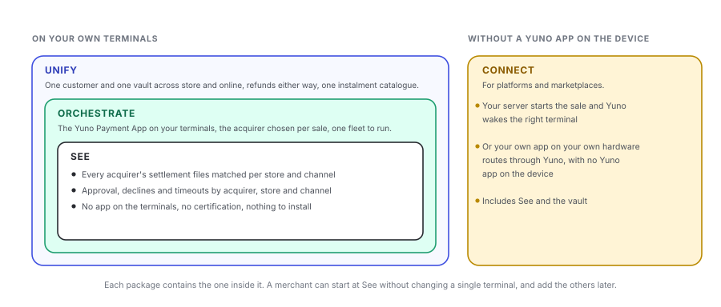

In-Person Payments is sold as four packages. Each one is a step on the same platform, so what you buy first is not thrown away when you buy the next: the same payment object, the same webhooks, the same dashboard and the same reconciliation run underneath all four.

The most useful thing to know before reading on is that **the first package needs nothing installed on your terminals**. You can reconcile your current fleet, across every acquirer and both channels, while your terminals stay exactly as they are.

<Frame caption="Four packages. Each one contains the one inside it; Connect is the shape for platforms, with no Yuno app on the device.">
  
</Frame>

## Compare

|  | See | Orchestrate | Unify | Connect |
| --- | --- | --- | --- | --- |
| **What it does** | Reconciles every acquirer and both channels, and shows approval by acquirer, store and channel | Adds the Yuno Payment App to your terminals and chooses the acquirer per sale | Makes the store and the website one customer, one vault and one set of books | Lets a platform start in-store sales from its own server or its own app |
| **For whom** | Anyone with more than one acquirer or more than one channel, including merchants who do not own their terminals | Merchants who own certified Android terminals and contract two or more acquirers | The same merchants, once their online volume runs on Yuno | Platforms and marketplaces whose merchants operate the devices |
| **On your terminals** | Nothing | The Yuno Payment App | The Yuno Payment App | Nothing, or the app where it fits |
| **You need** | Access to each acquirer's settlement files, and your stores registered | Your hardware, your acquirer contracts, and your checkout system or kiosk integrated | Your online volume on Yuno, or Yuno as your vault | One API call and a webhook handler; for acquirer-owned devices, that acquirer's agreement |
| **Certification** | None | The chain is certified once per acquirer, by Yuno | Included in the chain above | None for cloud-initiated sales |
| **Availability** | First, and independent of everything else | With the first certified chain | With the first certified chain; subscriptions started in store follow | Planned |

<Info>
  **Where to start.** If you are not sure, start at **See**. It is the only package that needs nothing from your stores, it pays for itself in finance hours, and the approval and cost baseline it produces is what tells you whether routing per sale is worth it for your fleet. Every merchant on Orchestrate today started by looking at that baseline.
</Info>

## Each package

<Tabs>
  <Tab title="See">
    **One reconciled view across every acquirer and both channels.**

    Yuno takes each acquirer's settlement file, matches it against the sales for that store, and shows you what agrees, what settled for a different amount, what has not settled yet and what the acquirer has but you do not. Instalments, cash and store credit are accounted for rather than left as noise.

    Alongside it, the same data gives you approval rates, declines and timeouts split by acquirer, by store and by channel, which most merchants with several acquirers have never seen in one place.

    - **What you need:** access to each acquirer's settlement files, and your stores registered in the dashboard.
    - **What changes in store:** nothing. No app, no certification, no new hardware, no change to how a sale is taken today.
    - **What you get:** one view per store across acquirers and online, and the baseline that justifies, or does not justify, the next package.

    See [Reconciliation](/docs/in-person/reconciliation).
  </Tab>
  <Tab title="Orchestrate">
    **See, plus the Yuno Payment App on your terminals.**

    Your terminals run the Yuno Payment App, and every sale is authorised through Yuno Cloud, which picks the acquirer for that sale from the rules you set: store, amount, payment method, card range and the live health of each acquirer. When an acquirer is down, the next sale goes to another one. Instalment plans come from the acquirer that takes the sale.

    It also gives you the fleet: every terminal by store, online or offline, app version, key status and last sale, with the screens in your brand.

    - **What you need:** Android terminals whose vendor allows external payment applications, your own acquirer contracts, and your checkout system or kiosk integrated with the terminal.
    - **What changes in store:** the payment application on the terminal. Your checkout system gains a handful of calls; the cashier's steps do not change.
    - **What you get:** the acquirer chosen per sale, a store that keeps selling when one acquirer is down, and one payment record for store and web.

    See [Integration types](/docs/in-person/ways-to-integrate) and [POS terminals and fleet](/docs/in-person/terminals).
  </Tab>
  <Tab title="Unify">
    **Orchestrate, plus one customer and one vault across channels.**

    The same card presented in store and online is the same customer, matched through the card's payment account reference, without the card number reaching your systems. A card saved at the counter can be charged online and the reverse. A sale taken in store can be refunded from the dashboard, and one taken online can be refunded at the counter. One instalment catalogue serves both channels.

    This is also where subscriptions that start at the counter live: enrol the customer and take the first charge on the terminal, then bill online on the same token. The message fields this needs are certified in the first release, so turning it on later is never a recertification.

    - **What you need:** your online volume on Yuno, or Yuno holding your vault.
    - **What you get:** a tap at the counter and a purchase on the website in the same books, against the same customer.

    See [Payments and events](/docs/in-person/payments-and-events).
  </Tab>
  <Tab title="Connect">
    **For platforms, with no Yuno app required on the device.**

    Two shapes, for platforms and marketplaces whose merchants operate the hardware:

    - **Cloud-initiated.** Your server creates the in-person payment through the Payments API and Yuno delivers it to a registered terminal in that store. One integration covers every market you operate.
    - **Host to host.** Your own payment application on your own hardware sends its authorisations to Yuno, which routes them to the acquirers. No Yuno app on the device at all.

    Connect includes See, so your merchants' acquirers can be reconciled before any device changes, and the vault, for tips, follow-on charges and subscriptions.

    - **What you need:** one API call and a webhook handler. Where the device belongs to an acquirer, that acquirer has to agree before anything can run on it.
    - **What you get:** one integration for every market and device class you operate.

    See [Integration types](/docs/in-person/ways-to-integrate) and [Connect your checkout system](/docs/in-person/connect-your-checkout-system).
  </Tab>
</Tabs>

## Add-ons

These sit across the packages and are agreed on their own, because each carries its own certification or project work.

| Add-on | What it is | Status |
| --- | --- | --- |
| **Phone acceptance** | A white-label app that takes contactless cards on a standard phone, on the same cloud and the same routing as the terminals | Paused. It needs an acquirer contract before it can be offered |
| **A new country** | Every market is its own certification chain, per acquirer, with its own local schemes | Agreed per market |
| **A new terminal vendor** | A new vendor is an adapter to the same certified app | Agreed per vendor |
| **Onboarding orchestration** | Collecting a merchant's KYC once and opening it with each acquirer | Being explored; not a product yet |

## What Yuno does not do

Worth stating plainly, because both come up in every conversation:

- **Yuno is never in the money flow.** Each acquirer settles to you directly, under your own contract, at your own rates. Yuno matches the file; it does not hold the money.
- **A declined sale is not retried with another acquirer.** In store the customer is standing there and an issuer decline is final. Routing is about cost and resilience across sales, not about the outcome of one. See [Payment flow](/docs/in-person/payment-flow).

<CardGroup cols={2}>
  <Card title="How it works" href="/docs/in-person/overview">
    The model underneath all four packages.
  </Card>
  <Card title="Get started" href="/docs/in-person/get-started">
    From your Yuno account to a first in-store sale.
  </Card>
</CardGroup>
