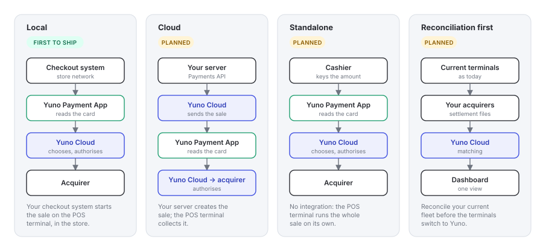
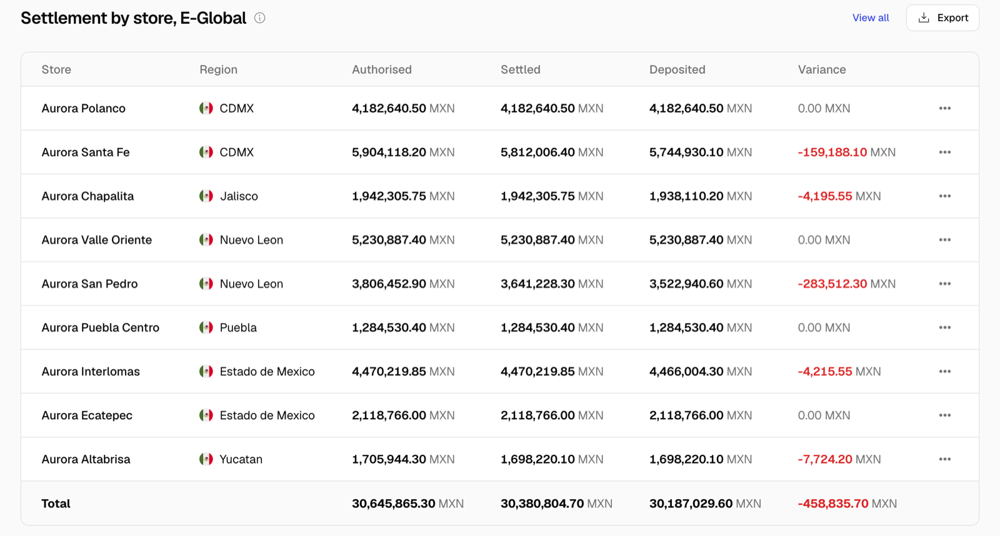

How a sale reaches the POS terminal depends on what you run in store. All four types share the same payment object, webhooks, dashboard and reconciliation, so a merchant can start with one and add another later. In every type the Yuno Payment App reads the card and Yuno Cloud chooses the acquirer and authorises; what changes is who tells the terminal how much to charge.

<Frame caption="Four integration types. They differ in who starts the sale; the authorisation, the routing and the reconciliation are the same. Local is the first to ship.">
  
</Frame>

## Compare

|  | Local | Cloud | Standalone | Reconciliation first |
| --- | --- | --- | --- | --- |
| **Where the sale starts** | Your checkout system | Your server | On the POS terminal | Your current setup |
| **What talks to the POS terminal** | Your checkout system, in the store | Yuno Cloud | Nobody; the cashier | Nothing changes |
| **Runs on** | Your terminals, Yuno Payment App | Your terminals, Yuno Payment App | Your terminals, Yuno Payment App | Your current terminals and app |
| **You build** | The calls on your checkout system | An API call and a webhook handler | Nothing | Nothing |
| **If the store loses its connection to Yuno** | No card sale through Yuno until it returns | No card sale until it returns | No card sale until it returns | Not affected |
| **Multi-acquirer routing** | Yes | Yes | Yes | No |
| **Availability** | First to ship | Planned | Planned | Planned |
| **Best for** | Retail chains with their own checkout software | Cloud checkout systems, platforms, order pickup, mobile checkout | Small counters, pop-ups, fallback | Any fleet, before or alongside the others |

<Info>
  **Which one for you?** If your checkout software runs in the store, go **Local** and keep **Standalone** as the fallback of the same app. If your checkout runs in the cloud, or you are a platform whose merchants own the terminals, go **Cloud**. **Reconciliation first** gives the finance benefit on your current fleet while the terminals switch. The online integration you already have does not change.

  **Local is the first type to ship**, and the other three are designed around the same payment and the same certified app. Talk to your Yuno contact about when each one is available for your market.
</Info>

## Each type in detail

<Tabs>
  <Tab title="Local">
    Your checkout system starts the sale and receives the result through the POS terminal's local interface, over the store network or a cable, the way most cash registers already talk to their terminal.

    <Steps>
      <Step title="The checkout system sends the sale">
        Amount, currency and your reference. Store and lane are already known to the terminal.
      </Step>
      <Step title="The POS terminal runs the payment">
        Card, instalments, PIN, authorisation with the chosen acquirer.
      </Step>
      <Step title="The checkout system receives the result">
        Approved or declined, authorisation code, masked card, instalment plan and the receipt lines. The checkout system prints.
      </Step>
      <Step title="Yuno records the sale">
        Same payment, same webhooks, plus the reference your checkout system sent so you can join it to your own order.
      </Step>
    </Steps>

    | Direction | Fields |
    | --- | --- |
    | Checkout system to POS terminal | amount, currency, reference, cashier, instalment plan (optional) |
    | POS terminal to checkout system | status, reason, authorisation code, masked card, entry mode, instalment plan, acquirer and its IDs, receipt lines |

    **You build:** the calls described in [Connect your checkout system](/docs/in-person/connect-your-checkout-system). **If the link to Yuno drops:** the checkout system and the terminal still talk to each other on the store network, but a card sale cannot be authorised, so the terminal declines cleanly and nothing is charged.

  </Tab>
  <Tab title="Cloud">
    Your server creates the in-person payment through the Payments API and Yuno delivers it to a POS terminal in that store. Use it when your checkout software runs in the cloud and cannot reach the terminal on the store network.

    <Steps>
      <Step title="Your server creates the payment">
        With the store and the lane (or a specific terminal), the amount and your order reference.
      </Step>
      <Step title="Yuno sends it to the POS terminal">
        Every terminal keeps a secure connection open to Yuno Cloud; the sale arrives on that connection and the amount appears on the screen.
      </Step>
      <Step title="The POS terminal runs the payment">
        Exactly as in the other types: the Yuno Payment App reads the card and takes the PIN under Yuno's key, and Yuno Cloud chooses the acquirer, translates the PIN and authorises the sale.
      </Step>
      <Step title="You get the result">
        By webhook, and on the payment through the API.
      </Step>
    </Steps>

    ```bash Create an in-person payment
    curl -X POST https://api.y.uno/v1/payments \
      -H "public-api-key: $PUBLIC_API_KEY" \
      -H "private-secret-key: $PRIVATE_SECRET_KEY" \
      -H "X-Idempotency-Key: $(uuidgen)" \
      -H "Content-Type: application/json" \
      -d '{
        "account_id": "<account_id>",
        "channel": "IN_PERSON",
        "merchant_order_id": "ORD-48213",
        "amount": { "currency": "USD", "value": 125.00 },
        "in_person": { "store_id": "<store_id>", "lane": "3" }
      }'
    ```

    **Options on the request.** `in_person` takes a `terminal_id`, or a `store_id` and `lane` and Yuno picks the terminal on that lane. `options` lets you skip the instalment screen (`"installments": "SKIP"`), choose where the receipt goes (`"receipt": "CHECKOUT" | "TERMINAL" | "NONE"`) and show your own reference on the terminal (`"display_reference": "ORD-48213"`).

    **The sale on the terminal has its own lifecycle.**

    | Status | Meaning |
    | --- | --- |
    | `CREATED` | Accepted by Yuno, not yet on the terminal screen |
    | `IN_PROGRESS` | On the terminal; the customer is paying |
    | `SUCCEEDED` / `DECLINED` | The acquirer answered; the payment carries the result |
    | `CANCELED` | Cancelled from your server or by the cashier before the card was read |
    | `EXPIRED` | Nobody paid within the wait time; nothing was charged |

    **Cancel from your server.** `POST /v1/payments/{id}/cancel` removes a sale that is still `CREATED` or `IN_PROGRESS` from the terminal screen, as long as the card has not been read. After the card is read the sale completes or declines; use a refund instead.

    **Timeouts.** The terminal waits up to 120 seconds for the customer. If you get no webhook within 150 seconds of the request, read the payment by its `id` before retrying, and reuse the same `X-Idempotency-Key` on any retry so a second sale is never created.

    **You build:** one API call and a webhook handler. **If the link to Yuno drops:** a sale cannot start, and a sale already on the terminal cannot be authorised either; nothing is charged.

  </Tab>
  <Tab title="Standalone">
    The POS terminal runs the whole sale on its own: the cashier keys the amount, the customer pays, and the terminal shows the result and hands out the receipt data. The payment appears in the dashboard and your webhooks like any other.

    **You build:** nothing. **Typical use:** small counters, pop-up stores, and the fallback when a checkout system is down.

  </Tab>
  <Tab title="Reconciliation first">
    Connect the acquirers behind your current terminals and get store-level reconciliation before a single terminal runs the Yuno Payment App.

    <Steps>
      <Step title="Acquirer files">
        Your acquirers deliver their settlement files to Yuno over SFTP, per merchant ID.
      </Step>
      <Step title="Sales from your estate">
        Your current authorisations reach Yuno from your existing systems or as exports, per store.
      </Step>
      <Step title="Matched per store">
        Authorised, settled and deposited side by side, with the differences listed. See [Reconciliation](/docs/in-person/reconciliation).
      </Step>
    </Steps>

<Frame caption="Settlement by store for one acquirer: authorised, settled, deposited and the variance.">
      
    </Frame>

    **You build:** nothing beyond giving access to the files. **Typical use:** large fleets that want the finance benefit while the terminal rollout is scheduled.

  </Tab>
</Tabs>

## Design your integration

Decisions in the order they come up. Most take a conversation with your Yuno contact, not code.

<Steps>
  <Step title="Account and stores">
    One Yuno account, the same one you use online. Stores and lanes are registered so every payment carries where it happened.
  </Step>
  <Step title="Acquirers">
    The acquirers each store works with. You keep the contracts and the merchant IDs; Yuno integrates and certifies the Yuno Payment App with each acquirer before routing to it.
  </Step>
  <Step title="POS terminals">
    Android terminals that accept external payment applications. See [POS terminals and fleet](/docs/in-person/terminals).
  </Step>
  <Step title="Integration type">
    Local, Cloud, Standalone or Reconciliation first, from the table above.
  </Step>
  <Step title="Routing rules and payment methods">
    The rules Yuno applies per sale (store, amount, payment method, acquirer health), the instalment plans and the local payment methods for each store.
  </Step>
  <Step title="Webhooks">
    Your existing endpoint receives in-store payments with no change. Filter on `channel` if you want to treat them differently. See [Payments and events](/docs/in-person/payments-and-events).
  </Step>
  <Step title="Reconciliation and dashboard">
    Settlement files from each acquirer are matched per store; terminals, store health and reconciliation are visible in the dashboard. See [Reconciliation](/docs/in-person/reconciliation).
  </Step>
</Steps>
