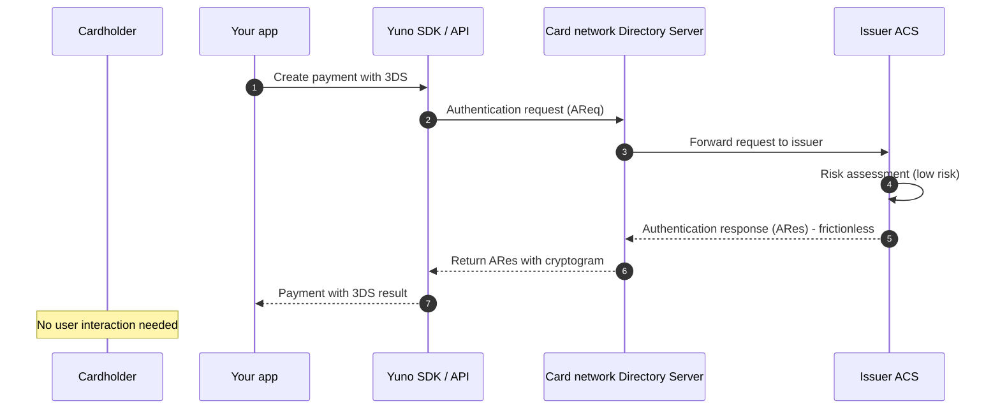
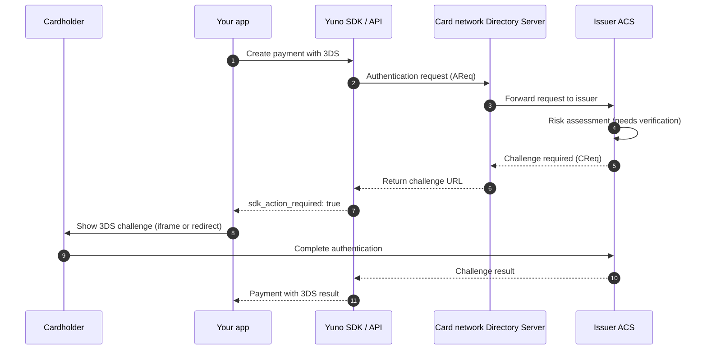

3D Secure (3DS) is a security protocol for card-not-present (CNP) transactions. It adds an authentication step where the cardholder verifies their identity with the card issuer before the payment is authorized. This reduces fraud and can shift liability for fraudulent chargebacks from the merchant to the issuer.

## What is 3D Secure?

3D Secure was introduced in 1999 as a way to reduce fraud in online card payments. The protocol involves three parties: the merchant, the card issuer, and the card network (the "three domains"). When a cardholder pays online, the issuer can ask them to verify their identity before approving the payment.

### 3DS2 (EMV 3DS)

3D Secure 2, also called EMV 3DS, is the current version of the protocol. EMVCo, an organization owned by the major card networks, developed it. 3DS2 replaced the original 3DS1 protocol. All major card networks stopped supporting 3DS1 in October 2022.

3DS2 has several advantages over 3DS1:

- **Frictionless authentication**: The issuer can approve a payment without asking the cardholder for any input. 3DS2 sends more transaction data to the issuer, which helps the issuer decide whether to trust the payment.
- **Better mobile experience**: 3DS2 includes an SDK for native mobile apps. The authentication step happens inside the app instead of a browser redirect.
- **Modern authentication methods**: 3DS2 supports biometrics, one-time passwords, and push notifications. 3DS1 relied on static passwords.

### Scheme brand names

Each card network has its own branded name for 3DS:

| Card network | 3DS brand name |
| :--- | :--- |
| Visa | Visa Secure |
| Mastercard | Mastercard Identity Check |
| American Express | Amex SafeKey |
| JCB | J/Secure |
| Discover | ProtectBuy |
| Diners Club | ProtectBuy |
| UnionPay | UnionPay 3DS |
| Cartes Bancaires | CB Fast'R |
| Elo | Elo 3DS |

### PSD2 and SCA

In the European Economic Area (EEA) and the United Kingdom, the Revised Payment Services Directive (PSD2) requires Strong Customer Authentication (SCA) for most online card payments. 3DS2 is the primary way to meet SCA requirements for card payments.

SCA requires two of the following three factors:

- **Something the cardholder knows** (a password or PIN)
- **Something the cardholder has** (a phone or card)
- **Something the cardholder is** (a fingerprint or face)

3DS2 satisfies this requirement when the issuer challenges the cardholder. In other regions, 3DS is optional but reduces fraud and can shift liability.

## Frictionless vs challenge flows

When a payment goes through 3DS, the issuer decides whether to authenticate the cardholder without any input (frictionless) or to ask the cardholder to verify themselves (challenge).

### Frictionless flow

In a frictionless flow, the issuer approves the authentication based on the transaction data alone. The cardholder does not need to do anything. This happens when the issuer's risk assessment determines that the transaction is low risk.

### Challenge flow

In a challenge flow, the issuer needs additional verification from the cardholder. The cardholder sees an authentication screen where they enter a one-time password, use biometrics, or confirm a push notification on their banking app.

## Liability shift

When a payment is successfully authenticated with 3DS, liability for fraud-related chargebacks usually shifts from the merchant to the card issuer. This means that if a cardholder disputes a payment as fraudulent, the issuer is responsible for the chargeback, not the merchant.

<Warning>
Liability shift rules vary by region, card network, and acquirer. Some scenarios do not qualify for liability shift, even with successful authentication. Check with your acquirer for the specific rules that apply to your transactions.

The payment response includes a `liability_shift` field that indicates whether liability shifted. Treat `null` as "unknown", never as `true`. If you rely on this field for chargeback handling and you receive `null` after a successful authentication, contact Yuno support.
</Warning>

## ECI values

The Electronic Commerce Indicator (ECI) is a code returned by the card network that indicates the result of the 3DS authentication. Different card networks use different ECI values.

### Mastercard

| ECI | Meaning | Liability shift |
| :--- | :--- | :--- |
| 02 | Successful authentication | Yes |
| 01 | Attempted authentication (issuer or cardholder not enrolled) | Sometimes |
| 00 | Failed authentication or not attempted | No |

### Visa, American Express, JCB, Discover, Diners Club, Elo, eftpos

| ECI | Meaning | Liability shift |
| :--- | :--- | :--- |
| 05 | Successful authentication | Yes |
| 06 | Attempted authentication (issuer or cardholder not enrolled) | Sometimes |
| 07 | Failed authentication or not attempted | No |

### Co-badged cards

Some cards are co-badged with multiple networks (for example, Cartes Bancaires with Visa or Mastercard, or UnionPay with Visa). These cards may return ECI values from either network's scheme. For Cartes Bancaires Fast'R and UnionPay International, you may see either the Visa/Amex-style values (05/06/07) or the Mastercard-style values (02/01/00).

For the full list of ECI values by card network and authentication outcome, see the [ECI Indicators List](/reference/eci-indicators-list).

## How 3DS works on Yuno

Yuno supports multiple ways to add 3DS to your payments, depending on your integration type and requirements.

### Option 1: SDK checkout (recommended)

If you use the Yuno SDK (Seamless, Lite, Full, or Headless), the SDK handles 3DS automatically. When a payment requires 3DS, the SDK:

1. Collects device fingerprint data for the 3DS risk assessment.
2. Triggers the authentication with the 3DS provider.
3. Renders the challenge screen (if needed) in a native view on mobile or an iframe/redirect on web.
4. Returns the authentication result to your app.

You configure which payments go through 3DS in the Yuno Dashboard under **Routing > Card Routes > 3DS Step**.

For web integrations, when you call `getThreeDSecureChallenge` and open the returned URL with `embedded=true`, the challenge appears in an iframe instead of a full-page redirect. This reduces drop-off. If you omit `embedded=true`, the challenge opens in a new tab.

For native mobile apps, the challenge runs inside the app using Netcetera's native 3DS SDK. See the [Netcetera 3DS iOS](/docs/sdks/external-native-modules/netcetera-3ds-ios) and [Netcetera 3DS Android](/docs/sdks/external-native-modules/netcetera-3ds-android) guides.

### Option 2: Direct integration

If you use the Direct workflow (server-to-server), you handle the 3DS flow yourself:

1. Create a payment with `workflow: DIRECT`.
2. If 3DS is required, the response has `status: PENDING`, `sub_status: WAITING_ADDITIONAL_STEP`, and `sdk_action_required: true`. The `redirect_url` field contains the URL for the 3DS challenge.
3. Redirect your customer to the `redirect_url` to complete the challenge.
4. After the challenge, the customer returns to your `callback_url`. The payment status updates to `SUCCEEDED` or `DECLINED`.

### Option 3: External 3DS (bring your own authentication)

If you run 3DS authentication with your own 3DS provider or MPI, you can pass the authentication result to Yuno when creating the payment. Include the 3DS fields in `payment_method.detail.card.three_d_secure`:

- `electronic_commerce_indicator`: The ECI value from your 3DS provider.
- `cryptogram`: The CAVV/AAV value (base64-encoded).
- `transaction_id`: The 3DS transaction ID (XID for 3DS1, `threeDSServerTransID` for 3DS2).
- `directory_server_transaction_id`: The DS transaction ID (for 3DS2).
- `version`: The 3DS protocol version used.

This option requires PCI compliance because you handle raw card data.

### Option 4: 3DS Standalone

3DS Standalone runs only the authentication step, with no payment authorization. Use it when you want to authenticate the cardholder and then authorize the payment through a different processor or at a later time.

To trigger standalone authentication:

1. Create a Yuno 3DS connection in the Dashboard with "Yuno 3DS Standalone" enabled.
2. Configure a CARD route that points only to the Yuno 3DS connection (no payment provider).
3. Create a payment; Yuno runs only the authentication and returns the result.

The authentication result (ECI, CAVV, dsTransID) is available on the payment response. You can use this data to authorize the payment with Yuno or another processor.

For the full flow and configuration, see [3DS Standalone](/docs/payment-features/3ds-standalone).

## 3DS Setup for Direct integrations

If you use a server-to-server integration and collect browser/device data on your side, use the [Create 3DS2 Setup](/reference/three-d-secure-setups/create-three-d-secure-setup) endpoint. This registers the device fingerprint data and returns a `three_d_secure_setup_id` that you pass in the payment request.

The 3DS Setup supports two modes:

| Type | Description |
| :--- | :--- |
| `STANDARD` | Yuno handles device data collection. The response returns a `collect_url` and `token`; load the URL to complete collection. |
| `MERCHANT_PROVIDED` | You send `browser_info` and `device_fingerprints` directly. No collection step needed. |

For SDK integrations, you do not need to use this endpoint. The SDK collects device data and creates the setup automatically.

## Request fields that affect 3DS

When creating a payment, the following fields affect 3DS behavior:

### `payment_method.detail.card.three_d_secure`

| Field | Description |
| :--- | :--- |
| `three_d_secure_setup_id` | The setup ID from [Create 3DS2 Setup](/reference/three-d-secure-setups/create-three-d-secure-setup). Use for Direct integrations. |
| `version` | 3DS protocol version (for external 3DS). Values: `1.0`, `2.0`, `2.1.0`, `2.2.0`, `2.2.1`, `2.3.0`, `2.3.1`. |
| `electronic_commerce_indicator` | ECI value from your external 3DS provider (for external 3DS). |
| `cryptogram` | CAVV/AAV from your external 3DS provider (for external 3DS). |
| `transaction_id` | 3DS transaction ID from your external 3DS provider. |
| `directory_server_transaction_id` | DS transaction ID from your external 3DS provider (3DS2 only). |
| `strong_customer_authentication_exemptions` | Array of SCA exemptions to request. See [SCA Exemptions](#sca-exemptions). |

### `payment_method.detail.card.card_data.token_data`

For network token payments, include the cryptogram and ECI from the network token provider:

| Field | Description |
| :--- | :--- |
| `cryptogram` | The cryptogram generated by the network token provider. |
| `electronic_commerce_indicator` | The ECI from the network token provider. |

## Response fields for 3DS results

The 3DS result is in `payment_method.payment_method_detail.card.card_data.three_d_secure`:

| Field | Description |
| :--- | :--- |
| `version` | The 3DS protocol version used (for example, `2.1.0`, `2.2.0`, `2.3.1`). |
| `electronic_commerce_indicator` | The ECI value indicating the authentication result. |
| `cryptogram` | The CAVV/AAV cryptographic value that proves the authentication. |
| `transaction_id` | The 3DS Server Transaction ID (`threeDSServerTransID` for 3DS2, XID for 3DS1). |
| `directory_server_transaction_id` | The DS Transaction ID assigned by the card network (3DS2 only). |
| `pares_status` | The authentication result code from the issuer. |
| `acs_id` | The identifier of the issuer's Access Control Server. |
| `liability_shift` | Boolean indicating whether liability shifted to the issuer. Can be `null`. |
| `has_challenge` | Whether the authentication required a challenge (`true`) or was frictionless (`false`). Present in webhook payloads. |

### `pares_status` values

| Value | Meaning |
| :--- | :--- |
| `Y` | Cardholder successfully authenticated. |
| `N` | Authentication failed. |
| `A` | Authentication attempted but not completed by the issuer. |
| `U` | Authentication could not be performed (technical issue). |
| `R` | Authentication rejected by the issuer. |
| `C` | Challenge required (transitory status). |
| `I` | Informational only / Data Only (no real authentication). |

## SCA exemptions

Under PSD2, certain transactions can be exempted from Strong Customer Authentication. You can request an exemption by passing `strong_customer_authentication_exemptions` in the payment request.

| Exemption | Description |
| :--- | :--- |
| `LOW_VALUE` | Transaction below the low-value threshold (typically under €30). |
| `TRANSACTION_RISK_ANALYSIS` | Transaction Risk Analysis (TRA) indicates low risk. |
| `STRONG_CUSTOMER_AUTHENTICATION` | SCA was performed by a trusted third party. |
| `OUT_OF_SCOPE` | Transaction is out of scope for SCA. |
| `SECURE_CORPORATE` | Payment with a secure corporate card. |
| `TRUSTED_BENEFICIARY` | Merchant is a trusted beneficiary of the cardholder. |
| `RECURRING_PAYMENT` | Fixed-amount recurring payment to the same beneficiary. |

<Warning>
The issuer decides whether to honor the exemption. Even if you request an exemption, the issuer may still require authentication. If an exemption is granted, liability shift may not apply. Check the `liability_shift` field in the response.
</Warning>

For more details, see [SCA Exemptions](/docs/payment-features/sca-exemptions).

## Payment and transaction statuses for 3DS

When a payment requires 3DS, the status progresses through the following states:

| Payment status | Payment sub_status | Description |
| :--- | :--- | :--- |
| `PENDING` | `WAITING_ADDITIONAL_STEP` | Challenge required. The `redirect_url` is available. |
| `SUCCEEDED` | `THREE_D_SECURE_VERIFIED` | Authentication succeeded. |
| `DECLINED` | - | Authentication or authorization failed. |

The 3DS transaction (type `THREE_D_SECURE`) has its own status:

| Transaction status | Response code | Description |
| :--- | :--- | :--- |
| `CREATED` | - | Waiting for SDK session data. |
| `PENDING` | `CHALLENGE_REQUIRED` | Challenge required, waiting for completion. |
| `IN_PROCESS` | - | User is completing the challenge. |
| `SUCCEEDED` | `SUCCEEDED_THREE_D_SECURE` | Authentication succeeded. |
| `DECLINED` | `AUTHENTICATION_FAILED_THREE_D_SECURE` | Authentication failed. |
| `ERROR` | - | Technical error during authentication. |

## Testing 3DS in sandbox

Use the test cards below to validate 3DS in the Yuno sandbox environment. The sandbox uses a simulator that mocks the Directory Server (DS) and Access Control Server (ACS).

### Test cards by network

<AccordionGroup>
<Accordion title="Visa">

| Card number | Expected outcome |
| :--- | :--- |
| `4556557955726624` | Frictionless (authenticated) |
| `4916994064252017` | Challenge required |
| `4234123412340003` | Challenge required |
| `4234123412340000` | Frictionless (authenticated) |
| `4234123412340006` | Frictionless (unavailable) |
| `4234123412340007` | Frictionless (attempted) |
| `4234123412340001` | Not enrolled |

</Accordion>

<Accordion title="Mastercard">

| Card number | Expected outcome |
| :--- | :--- |
| `5333259155643223` | Frictionless (authenticated) |
| `5306889942833340` | Challenge required |
| `5512459816707531` | Frictionless (authenticated) |
| `5424184049821670` | Challenge required |

</Accordion>

<Accordion title="American Express">

| Card number | Expected outcome |
| :--- | :--- |
| `341502098634895` | Frictionless (authenticated) |
| `348638267931507` | Challenge required |
| `347899129656655` | Frictionless (authenticated) |
| `372021106351394` | Challenge required |

</Accordion>

<Accordion title="Diners">

| Card number | Expected outcome |
| :--- | :--- |
| `3095000000000000` | Frictionless (authenticated) |
| `3095000000000001` | Challenge required |

</Accordion>

<Accordion title="JCB">

| Card number | Expected outcome |
| :--- | :--- |
| `3528000000000000` | Frictionless (authenticated) |
| `3528000000000001` | Challenge required |

</Accordion>
</AccordionGroup>

### OTP codes for challenges

Use these one-time password codes to complete challenge scenarios:

| OTP code | Result | ECI (Visa) | ECI (Mastercard) |
| :--- | :--- | :--- | :--- |
| `1234` | Authenticated (Y) | 05 | 02 |
| `1111` | Not authenticated (N) | 07 | 00 |
| `2222` | Rejected (R) | 07 | 00 |
| `3333` | Unavailable (U) | 07 | 00 |
| `4444` | Attempted (A) | 06 | 01 |

For the full list of test cards and error scenarios, see [3DS Configuration and Testing](/docs/direct-integration-use-cases/3ds-configuration-and-testing).

## Dashboard configuration

To enable 3DS for your card payments:

1. **Create a 3DS-enabled connection**: In **Dashboard > Connections**, select your payment provider and enable the 3D Secure credentials. Provide the acquirer BIN, merchant ID, MCC, and other required fields. Each card network requires its own acquirer BIN.

2. **Configure routing**: In **Dashboard > Routing**, edit your CARD route. Add a 3DS step before your payment provider step. You can add conditions to apply 3DS only to specific transactions (by country, amount, BIN range, etc.).

3. **Configure the 3DS provider**: If you use a dedicated 3DS provider like Cybersource 3DS or Netcetera 3DS, create a separate connection for it and reference it in your route.

<Warning>
The acquirer BIN is brand-specific. A BIN registered for Visa does not work for Mastercard. Request one acquirer BIN per card brand you authenticate. The Mastercard ICA number is not an acquirer BIN; use the Mastercard acquiring BIN registered for Identity Check.
</Warning>

## Next steps

- [3DS Configuration and Testing](/docs/direct-integration-use-cases/3ds-configuration-and-testing): Step-by-step guide to configure and test 3DS.
- [3DS Standalone](/docs/payment-features/3ds-standalone): Run authentication only, without authorization.
- [SCA Exemptions](/docs/payment-features/sca-exemptions): Request exemptions from Strong Customer Authentication.
- [Netcetera 3DS iOS](/docs/sdks/external-native-modules/netcetera-3ds-ios): Native 3DS challenges on iOS.
- [Netcetera 3DS Android](/docs/sdks/external-native-modules/netcetera-3ds-android): Native 3DS challenges on Android.
- [Headless SDK (Payment Web)](/docs/sdks/headless-web/payment): Handle 3DS challenges with the Headless SDK.
- [ECI Indicators List](/reference/eci-indicators-list): Full list of ECI values by card network.
- [Create 3DS2 Setup](/reference/three-d-secure-setups/create-three-d-secure-setup): API reference for the 3DS setup endpoint.
- [Create Payment](/reference/payments/create-payment): API reference for creating payments with 3DS fields.

{/* TODO(verify): Confirm with product whether Yuno supports requesting a specific challenge preference (e.g., challenge_indicator field to request NO_PREFERENCE, NO_CHALLENGE, CHALLENGE_REQUESTED, or CHALLENGE_MANDATED). This is a standard EMV 3DS field but not found in the OpenAPI specs. */}

{/* TODO(verify): Confirm the exact list of 3DS providers Yuno supports (Netcetera, Cybersource 3DS, Checkout.com 3DS, Xendit 3DS, Unlimint 3DS are mentioned in SDK code). Which are available for which integration types? */}

{/* TODO(verify): Document Data Only mode more fully if it's a distinct offering. The 3DS Standalone page mentions it but the configuration path is unclear. */}
