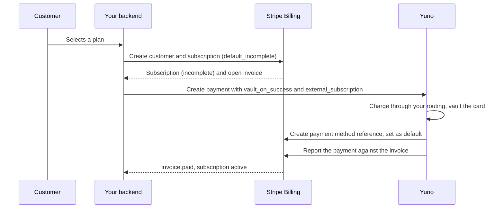
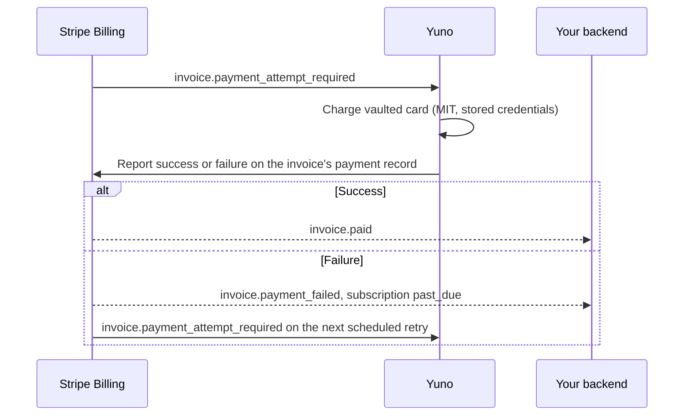

{/* TODO(editorial): confirm the public feature name ("Stripe Billing with Yuno" vs other) and add dashboard screenshots of a bridge payment. */}

Stripe Billing stays your system of record for plans, subscriptions, invoices, tax and proration. Yuno executes every subscription payment: the first charge, each renewal, each retry and each refund. Yuno also makes the Stripe API calls that report each outcome back, so your backend does not call Stripe's payment record APIs.

## Before you start

Check these points against your use case before you integrate:

* **Stripe account.** Billing must have **third-party payment processing** enabled. Request it from your Stripe account team.
* **Countries.** Your business and your payment providers must be in countries Stripe supports for this mode. See Stripe's [supported countries](https://docs.stripe.com/billing/subscriptions/third-party-payment-processing#supported-countries).
* **Checkout.** Customers pay through your Yuno checkout. Stripe Checkout, the Stripe-hosted invoice page and embedded Stripe pricing tables do not work in this mode.
* **Customer emails.** Stripe does not send its revenue recovery emails for these payments. You send failed-payment and card-update emails from your own systems.
* **Retries.** Stripe Smart Retries are not available. You configure a custom retry schedule or Billing automations instead.
* **Disputes and refunds.** You handle both in Yuno. Stripe cannot start a refund or manage a dispute for a payment it did not process.
* **Fees.** Stripe charges Billing fees on the volume Yuno processes. See [Billing fees](#billing-fees).
* **Invoices.** Yuno collects the invoices of Stripe Billing subscriptions. If Stripe asks Yuno to collect an invoice that has no subscription, Yuno does not charge it and reports nothing to Stripe. To collect a one-off invoice with Yuno, create the payment yourself with the `external_invoice` object. See [Pay a Stripe invoice (top-ups)](/docs/payment-features/subscriptions/stripe-billing-top-ups).

## Who does what

| Area | Stripe Billing | Your backend | Yuno |
| --- | --- | --- | --- |
| Plans, prices, tax, proration | Owns | Configures | None |
| Subscription and invoice lifecycle | Owns | Reads webhooks for entitlements | None |
| Retry schedule | Runs it | Configures it | Executes each attempt |
| First payment | Waits for the report | Creates the Yuno payment with `external_subscription` | Charges, vaults, reports to Stripe |
| Renewals | Sends `invoice.payment_attempt_required` | Nothing | Charges as a merchant-initiated transaction, reports to Stripe |
| Payment method reference in Stripe | Stores it | Nothing | Creates it and sets it as default |
| Refunds | Records the refund and credit note | Starts the refund in Yuno | Refunds, reports to Stripe, creates the credit note |
| Disputes | None | Handles them in Yuno | Receives them from the provider |
| Dunning emails and card-update flow | None | Owns | Vaults the new card and updates Stripe |

To collect the payment of one specific Stripe invoice instead, such as a balance top-up, see [Pay a Stripe invoice (top-ups)](/docs/payment-features/subscriptions/stripe-billing-top-ups).

## How it works

Stripe's [third-party payment processing](https://docs.stripe.com/billing/subscriptions/third-party-payment-processing) mode lets an external processor execute the charges for Billing subscriptions. Yuno is that processor.

### Signup and first payment



### Renewals and retries



Your backend keeps listening to the Stripe webhooks it uses today (`invoice.paid`, `customer.subscription.updated` and others) for entitlements.

On the Yuno side, every payment created this way carries the `external_subscription` object in its payment webhook, so you can match a Yuno payment to a Stripe subscription. See [Object and examples](/docs/webhooks/object-and-examples). Trial enrollments are the exception: the enrollment webhook does not include the object, so correlate through the verification payment instead (`verify.payment.id` in the enrollment response).

## Prerequisites

* A Yuno account with your providers connected and routing published.
* A Stripe account with Billing and third-party payment processing enabled.
* A **restricted API key** from your Stripe account, shared with your Yuno contact during onboarding. Yuno uses it to register the webhook endpoint and report payments. Yuno stores it encrypted and uses it only for your account.
* A **custom payment method** that you create in the Stripe Dashboard, under **Settings → Payment methods → Custom payment methods**. Send its ID (it starts with `cpmt_`) to your Yuno contact together with the restricted key. Yuno checks it when you onboard and uses it for the subscription payments of every payment method that has no custom payment method of its own. For PayPal, see [PayPal](#paypal).

### Restricted key permissions

Give the restricted key these permissions for subscription payments, renewals, refunds and card changes. **Write** includes **Read**. The Stripe permission names come from Stripe's [API permissions reference](https://docs.stripe.com/keys/permissions-reference).

| Permission | Level | Stripe permission | What Yuno does with it |
| --- | --- | --- | --- |
| Webhook Endpoints | Write | `webhook_write` | Registers the webhook endpoint when you onboard. |
| Accounts | Read | `connected_account_read` | Reads your account when you onboard. |
| Payment Methods | Write | `payment_method_write` | Checks your custom payment method when you onboard, then creates the payment method reference and attaches it to the customer. |
| Subscriptions | Write | `subscription_write` | Reads the subscription and sets its default payment method. |
| Invoices | Write | `invoice_write` | Reads the invoice and attaches each payment to it. |
| Payment Records | Write | `payment_records_write` | Reports payments, retries and refunds. |
| Credit Notes | Write | `credit_note_write` | Creates the credit note of each refund. |

Onboarding uses only the first three. The others are used for the first time when Yuno reports a payment or a refund, so a missing permission shows up only then, as a report that fails. Set all of them before you share the key.

### Webhook events

When you onboard, Yuno registers one webhook endpoint in your Stripe account. It receives two events:

* `invoice.payment_attempt_required`: Stripe asks Yuno to collect an invoice.
* `customer.subscription.deleted`: the subscription ended, so Yuno stops charging it.

Yuno ignores any other event. Do not delete the endpoint or remove these events: Yuno learns about renewals and retries only through them.

## Step 1: Create the subscription in Stripe

Create the customer and subscription in Stripe as you do today, with `payment_behavior: default_incomplete`. Expand `latest_invoice` in the same call: you need its `amount_due` and `currency` in step 2. Keep the `customer` and `subscription` IDs.

<Warning>
  Create the subscription at checkout time and collect the payment in the same session. Stripe requires the first payment to be reported within **23 hours** of the subscription's creation. Past that deadline Stripe moves the subscription to `incomplete_expired`, and you have to create it again.
</Warning>

## Step 2: Collect the first payment with Yuno

Run your normal Yuno checkout and create the payment from your backend with two additions: `vault_on_success` and the `external_subscription` object that links the payment to your Stripe subscription. See [Create payment](/reference/payments/create-payment).

```json
{
  "account_id": "<your_account_id>",
  "merchant_order_id": "<your_order_id>",
  "description": "Pro plan, first month",
  "country": "US",
  "amount": { "currency": "USD", "value": 99.00 },
  "customer_payer": { "id": "<yuno_customer_id>" },
  "payment_method": {
    "type": "CARD",
    "token": "<one_time_token_from_sdk>",
    "vault_on_success": true
  },
  "external_subscription": {
    "id": "sub_1QwZzz",
    "customer_id": "cus_RplXYZ"
  }
}
```

### Match the amount to the invoice

Charge the invoice's `amount_due`, in the invoice's currency. `amount_due` already includes tax, discounts and proration. If the amount or the currency of the payment differs from the invoice, Yuno does not report the payment: the customer is charged and the invoice stays open.

Stripe and Yuno format amounts differently, so convert both fields:

| Field | Stripe invoice | Yuno payment |
| --- | --- | --- |
| Amount | Minor units: `9900` | Decimal value: `99.00` |
| Zero-decimal currency (for example JPY) | `1000` | `1000` |
| Currency | Lowercase: `usd` | Uppercase ISO 4217: `USD` |

### Request fields

| Field | Required | Notes |
| --- | --- | --- |
| `external_subscription.id` | Yes | The subscription's ID in Stripe (`sub_...`). 3 to 255 characters. |
| `external_subscription.customer_id` | No | The Stripe customer that owns the subscription (`cus_...`). |
| `payment_method.vault_on_success` | For renewals | Yuno takes over the recurring charges only when the payment is approved **and** the card is vaulted. |

<Warning>
  `external_subscription` and the `subscription` object are mutually exclusive: sending both returns `INVALID_REQUEST`. Use `subscription` when Yuno is the recurrence engine, and `external_subscription` when Stripe is.
</Warning>

When the payment is approved, Yuno creates a payment method reference in your Stripe account (no card data), attaches it to the subscription as its default payment method, and reports the payment. Stripe then marks the first invoice as paid and activates the subscription.

### If the report to Stripe fails

Yuno charges first and reports to Stripe afterwards. A report that fails never undoes the payment: it stays approved in Yuno, and Yuno does not cancel or refund it.

* **Retries.** When Stripe cannot be reached or returns an error, Yuno retries the report on its own, with growing waits, for a limited time, and then stops. Yuno does not retry the report of a first payment that Stripe refuses as invalid, or whose amount is not the invoice's `amount_due`. Until a report is delivered, the invoice stays open in Stripe. For a first payment, the subscription also stays `incomplete`, and Stripe expires it 23 hours after you created it.
* **Before the report.** For a first payment, Yuno first creates the payment method reference in Stripe and sets it as the subscription's default. If that fails, Yuno retries for a few seconds and then stops: it reports nothing and does not link the card to the subscription.
* **No notification.** Yuno does not notify you when a report fails. The sign is an invoice that stays open in Stripe after the Yuno payment was approved. If you see one, contact your Yuno contact.

A revoked restricted key, or one without a permission Yuno needs, makes the reports fail while payments are still charged. To change the key, send the new one to your Yuno contact first, and revoke the old one only after Yuno confirms the change.

### Pending payments

Yuno reports a first payment to Stripe only once it is approved. While it is pending, and if it ends declined, expired or canceled, Yuno reports nothing to Stripe and the invoice stays open.

A renewal that comes back pending is reported to Stripe right away, as an attempt without a result. When the payment is approved, Yuno reports it as paid. If the pending renewal ends declined, expired or canceled instead, Yuno does not report that result, and it does not charge the later requests Stripe sends for that invoice. If an invoice stays open with a pending attempt, contact your Yuno contact.

## Free trials

When signup starts a **trial**, there is no first charge. The trigger is the **$0 card verification** of the enrollment flow instead. Create the Stripe subscription with `trial_end` as usual, then enroll the card through the [Enroll payment method](/reference/payment-methods-direct-workflow/enroll-payment-method-api) endpoint with the `external_subscription` object nested inside `verify`:

```json
{
  "account_id": "<your_account_id>",
  "country": "US",
  "type": "CARD",
  "workflow": "DIRECT",
  "card_data": { "...": "..." },
  "verify": {
    "vault_on_success": true,
    "currency": "USD",
    "external_subscription": {
      "id": "sub_1QwZzz",
      "customer_id": "cus_RplXYZ"
    }
  }
}
```

<Info>
  Use the subscription's currency for the verification. Renewals are charged in the subscription's currency.
</Info>

<Warning>
  `verify.vault_on_success` must be `true`. Sending `verify.external_subscription` without it returns `INVALID_PARAMETERS`.
</Warning>

On a successful verification, Yuno links the vaulted card to the trialing subscription: its `default_payment_method` in Stripe becomes the Yuno reference. Nothing is charged or reported, because no invoice is due. At trial end, Stripe issues the first real invoice and Yuno charges it with network-compliant stored credentials, like any renewal.

## Renewals

Renewals need no code on your side. Stripe finalizes the invoice and sends `invoice.payment_attempt_required`. Yuno charges the vaulted card as a merchant-initiated transaction, through your routing and provider cascade, and reports the result. Each charge appears as a normal payment in your Yuno dashboard and reports.

Yuno charges each request from Stripe once. If Stripe sends the same event again, Yuno ignores it. If Stripe sends a new request for an invoice that is already paid, or whose charge is still in progress, Yuno does not charge it again either. A new request for an invoice whose last charge was declined is the next retry, and Yuno charges it.

## Failed payments and retries

When Yuno reports a failed renewal, the invoice stays open and Stripe moves the subscription to `past_due`. Stripe then sends a new `invoice.payment_attempt_required` event on each scheduled retry, and Yuno executes each retry across your routing and provider cascade. Yuno reports every retry against the invoice's existing payment record.

Configure retries in Stripe with a [custom retry schedule](https://dashboard.stripe.com/revenue-recovery/retries) or [Billing automations](https://docs.stripe.com/billing/automations). Stripe's Smart Retries and recovery emails do not work in third-party processing mode. Both are Stripe limitations, unrelated to Yuno's [Smart Retries](/docs/payment-features/subscriptions/retries), which apply to Yuno-managed subscriptions.

### Hard and soft declines

A custom retry schedule runs the same way for every failed invoice. Stripe does not see the decline reason, so a stolen card or a closed account gets the same retries as insufficient funds. Card networks limit retries on declines that cannot succeed, and repeated retries on them can add network fees.

Keep the retry schedule short, and cancel the subscription or mark the invoice `uncollectible` when the decline reason in Yuno shows that a retry cannot succeed.

Yuno does not classify declines as hard or soft, and a failed attempt reaches Stripe without a reason or a code: only that it failed, and when. Yuno also does not skip a retry after a decline: it charges every retry Stripe asks for. Stopping the retries is up to you, from the decline reason in Yuno.

### Detect the final attempt

Stripe has no dedicated "retries exhausted" event. Treat a failure as final when:

1. Your backend receives `invoice.payment_failed`, or `invoice.updated` when you use automations, and
2. The invoice's `next_payment_attempt` is `null`.

Then the subscription moves to the state set in your Stripe retry settings (canceled, unpaid or past due). Start your own dunning flow from this point.

<Warning>
  Stripe does not send `invoice.payment_attempt_required` while an invoice has `auto_advance` set to `false`. Such an invoice never reaches Yuno: nothing is charged and nothing errors. Set `auto_advance` back to `true` to resume collection.
</Warning>

## Change the customer's card

Use this flow to change the card of a subscription, including a `past_due` one:

<Steps>
  <Step title="Bring the customer back to your Yuno checkout">
    Send the customer to your own card-update page. Stripe does not send this email for you.
  </Step>
  <Step title="Collect a new payment or verification">
    Create a verification, as for a [free trial](#free-trials), or a payment, with the same `external_subscription.id` and `vault_on_success: true`. A verification changes the card without charging the customer.
  </Step>
  <Step title="Yuno switches the default in Stripe">
    Yuno vaults the new card and sets it as the subscription's default payment method in Stripe. Renewals continue on the new card.
  </Step>
</Steps>

<Warning>
  A payment in this flow only changes the card. Yuno does not apply it to the open invoice, even when the subscription is `past_due`, and does not report it to Stripe. Stripe retries the invoice on its own schedule, and Yuno charges the new card at that retry. Do not charge the amount due in this payment: the customer would pay twice. To collect the open invoice right away, pay it with `external_invoice` instead. See [Pay a Stripe invoice (top-ups)](/docs/payment-features/subscriptions/stripe-billing-top-ups).
</Warning>

## Customer portal

Stripe's customer portal works with these subscriptions. Customers can update the subscription, switch payment method, set a default payment method and cancel.

<Warning>
  The portal lets customers switch to a **Stripe-supported payment method**. Stripe processes that payment method itself, so the subscription's renewals stop going through Yuno. To keep every renewal on Yuno, turn off payment method updates in your [portal configuration](https://dashboard.stripe.com/settings/billing/portal) and send customers to your Yuno card-update page instead.
</Warning>

The portal also cannot add a discount to a subscription on a custom payment method when the portal session's proration behavior is `always_invoice`.

## What you see in Stripe

Two things in the Stripe dashboard look wrong and are not:

* **A canceled payment on every invoice.** Stripe creates its own PaymentIntent for each `charge_automatically` invoice and cancels it once Yuno reports the payment. Each invoice carries a `Canceled` entry next to the Yuno one. Stripe documents this as expected behavior. It changes neither the invoice nor the subscription status.
* **One payment entry per invoice, not one per attempt.** Yuno reports each retry against the existing payment record. A recovered invoice shows one payment with the history of its attempts, not one failed entry plus one succeeded entry.

If it is enabled for your organization, the `metadata` you send is also copied onto the Stripe payment records. See [Your payment metadata on the Stripe payment record](/docs/payment-features/subscriptions/stripe-billing-top-ups#your-payment-metadata-on-the-stripe-payment-record).

## Refunds

Refund through the Yuno API or dashboard as with any payment. Yuno reports the refund to Stripe and creates the matching **credit note**, so your Stripe records stay consistent. Full and partial refunds are supported. For payments made with `external_invoice` (top-ups), see [Refunds](/docs/payment-features/subscriptions/stripe-billing-top-ups#refunds).

## Disputes

Stripe cannot manage disputes for payments it did not process. A chargeback on one of these payments reaches you through the Yuno provider that processed the charge, and you handle it in Yuno. See [Chargeback Management](/docs/payouts-and-disputes/chargeback-management).

## Billing fees

Stripe counts the volume Yuno processes toward your total Stripe Billing volume and charges for it under your Billing contract. One-off invoices paid through a third-party processor are also billed under Stripe's Invoicing pricing.

## Test in sandbox

* **Link your sandbox.** Onboard your Yuno sandbox account with a restricted key and a custom payment method ID from your Stripe test mode. Yuno handles them, and the invoices of Stripe test clocks, the same way as live ones.
* **Signup and renewals.** Create the subscription on a Stripe [test clock](https://docs.stripe.com/billing/testing/test-clocks), pay the first invoice through your Yuno sandbox checkout, then advance the clock past the renewal date. Check that a new payment appears in Yuno and the invoice is paid in Stripe.
* **Retries.** Use a Yuno test card that declines, then advance the clock past `next_payment_attempt`. If the retry event does not arrive, advance the clock again by about one minute.
* **Dunning in real time.** To validate dunning as production runs it, create a subscription without a test clock on a short custom retry schedule and let it run.

## Integration checklist

<Steps>
  <Step title="Stripe: enable third-party payment processing">
    Ask your Stripe account team, and confirm your business country is supported.
  </Step>
  <Step title="Yuno onboarding: share a restricted Stripe API key and a custom payment method ID">
    Give the key the [permissions Yuno needs](#restricted-key-permissions) and send both to your Yuno contact. Yuno registers the webhook endpoint.
  </Step>
  <Step title="Stripe: configure retries">
    Set a short custom retry schedule or Billing automations, and the final state after the last retry.
  </Step>
  <Step title="Stripe: restrict the customer portal">
    Turn off payment method updates so renewals stay on Yuno.
  </Step>
  <Step title="Backend: create the subscription">
    Use `payment_behavior: default_incomplete` and expand `latest_invoice`.
  </Step>
  <Step title="Backend: create the first Yuno payment">
    Send `vault_on_success: true`, `external_subscription`, and the converted `amount_due` within 23 hours.
  </Step>
  <Step title="Backend: handle trials">
    Enroll the card with `verify.external_subscription` for subscriptions with `trial_end`.
  </Step>
  <Step title="Backend: handle the final failed attempt">
    Detect `next_payment_attempt: null` and start your dunning emails and card-update flow.
  </Step>
  <Step title="Test in sandbox">
    Cover signup, one renewal, one failed renewal with retry, a refund, and a card update.
  </Step>
</Steps>

## Troubleshooting

| Symptom | Cause | Fix |
| --- | --- | --- |
| `INVALID_REQUEST` on Create payment | `external_subscription` and `subscription` sent in the same request | Send only one of them |
| `INVALID_PARAMETERS` on Enroll payment method | `verify.external_subscription` sent without `verify.vault_on_success: true` | Set the flag to `true` |
| Subscription stays `incomplete`, then turns `incomplete_expired` | No payment was reported within 23 hours of creating the subscription | Create the subscription and collect the payment in the same session, then recreate the expired one |
| Renewals stop and no error appears anywhere | The invoice has `auto_advance: false`, so Stripe never sends `invoice.payment_attempt_required` | Set `auto_advance` back to `true` |
| Renewals appear in Stripe but not in Yuno | The customer switched to a Stripe-supported payment method in the customer portal | Turn off payment method updates in the portal and collect a new card through Yuno |
| A `Canceled` payment sits next to each reported payment | Stripe cancels its own PaymentIntent once Yuno reports the payment | Expected behavior, no action needed |
| Payment approved in Yuno, invoice still open in Stripe | Yuno could not report the payment: the restricted key was revoked or lacks a permission, Stripe was unavailable, or the first payment's amount is not the invoice's `amount_due` | Contact your Yuno contact. See [If the report to Stripe fails](#if-the-report-to-stripe-fails) |

## PayPal

You can collect subscription payments with PayPal through the Stripe billing integration. The first payment saves the customer's PayPal account, and each renewal charges that saved account.

PayPal is enabled per organization: your Technical Account Manager turns it on after the steps below.

### Before you start

Complete these steps with your Technical Account Manager (TAM):

1. **Share your PayPal account details.** For both sandbox and live: your PayPal Merchant ID (the payer ID shown in your PayPal dashboard), the business vertical PayPal assigned to your account, and whether PayPal flags your account as high risk. Your TAM sets them on your PayPal connection in Yuno. PayPal subscription payments can't be processed without them.
2. **Enable Vault on PayPal.** In the PayPal apps connected to Yuno, sandbox and live, enable Vault (save payment methods). Renewals charge the saved PayPal account, so Vault is required.
3. **Create a "PayPal" custom payment method in Stripe.** In the Stripe Dashboard, go to **Settings → Payment methods → Custom payment methods** and create one named **PayPal**. If you want card payments to show as **Card**, create a "Card" one as well. Do this in both live mode and test mode, and send the IDs (they start with `cpmt_`) to your TAM.

Yuno registers these IDs and runs a test on your sandbox before PayPal is enabled in live.

### What to expect

- Subscription payments and renewals made with PayPal appear in Stripe under the **PayPal** payment method name. Top-up payments appear as **Yuno**.
- PayPal can't verify an account with a 0.00 payment, as cards do. When a subscription starts with a trial, send a payment of 1.00 in the subscription's currency, with the subscription's `external_subscription` object. Yuno refunds it automatically and doesn't report it to Stripe as a payment. This is enabled per organization; until it is, the 1.00 is not refunded automatically.

## Not supported in this mode

Per Stripe's third-party processing mode: Stripe Checkout, the Stripe-hosted invoice page, Stripe Smart Retries and recovery emails, Stripe-managed disputes, and Stripe-initiated refunds. Embedded Stripe pricing tables are not compatible, because the checkout is Yuno's.
