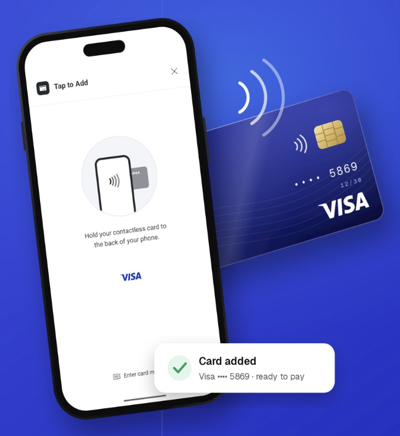
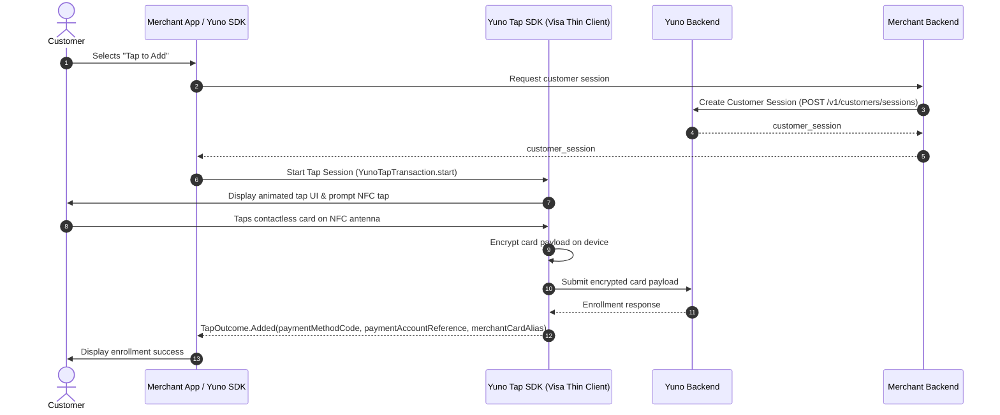
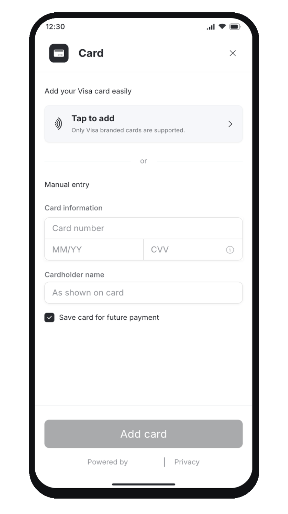
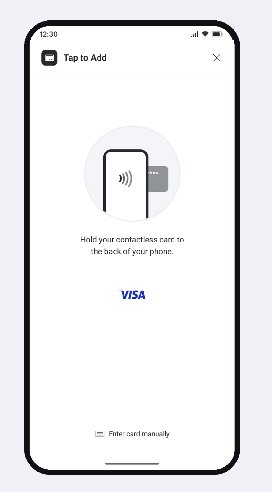
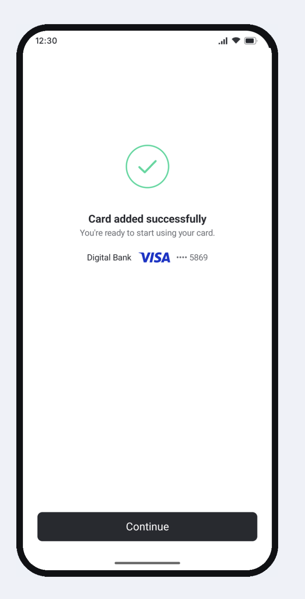

import LegacySdkNotice from '/snippets/LegacySdkNotice.mdx'

<LegacySdkNotice />

*Visa Tap to Add* enables customers to enroll their contactless cards by tapping them against the NFC antenna on their Android device.

<p align="center">
  
</p>

The tap interaction uses Visa's Thin Client Tap SDK under the hood: card details are read directly over NFC, encrypted on device, and submitted securely to Yuno. The merchant application never accesses or handles clear Primary Account Numbers (PANs).



---

## Prerequisites & Requirements

Your Android project must meet the following hardware, system, and toolchain requirements:

* **Hardware & OS**: Android 11.0 (API level 30) or higher with an active NFC antenna and Host Card Emulation (HCE) support.
* **Services**: Google Play Services must be available on the device.
* **Architecture**: 64-bit (`arm64-v8a`) or 32-bit (`armeabi-v7a`) ARM architecture. (x86 / x86_64 emulators are not supported for contactless NFC operations).
* **Toolchain Requirements**:
  * **Compile SDK**: `compileSdk 35`
  * **Java**: Java 17
  * **Kotlin**: 2.1.0 or higher
  * **Android Gradle Plugin (AGP)**: 8.6.0 or higher
  * **Gradle**: 8.7 or higher
  * **Hilt**: 2.56 or higher (if using dependency injection)
  * **Room**: 2.7.0-alpha13 or higher (if using Room in your project)

<Note>
**Supported Brands**: Currently, *Tap to Add* is powered by Visa's Tap SDK. Support for Mastercard and other card schemes will be introduced in subsequent releases.
</Note>

---

## Integration Paths

You can integrate Tap to Add in one of two ways:

1. **Path A: Automatic Enrollment via Yuno Android SDK 3.x (Recommended)**: If you already use Yuno's Full Checkout SDK for Android, adding the `yuno-tap` dependency automatically enables the Tap to Add entrypoint on the enrollment form with zero UI code.
2. **Path B: Standalone Yuno Tap SDK**: If you build custom enrollment screens or headless UI, integrate `com.yuno.payments:yuno-tap` directly with either the pre-built `YunoTapToAddButton` or your own button calling `YunoTapTransaction.start`.

---

## Path A: Automatic Full Checkout Enrollment

When integrating with the Yuno Android Universal SDK (`3.0.0` or later), the SDK automatically inspects whether `yuno-tap` is present on the runtime classpath. If found and the device supports NFC, the SDK displays the **Tap to Add** option directly within the card enrollment form.

<Warning>
**Enrollment Only**: Tap to Add is exclusively supported for card enrollment and saving payment methods to a customer account. It is **never** presented during checkout, one-off payment flows, or direct purchase screens.
</Warning>

### 1. Add Dependencies

Add the Yuno Android SDK and Yuno Tap artifact to your module's `build.gradle.kts`:

```kotlin
dependencies {
    // Yuno Android SDK
    implementation("com.yuno.payments:android-sdk:3.0.0")

    // Yuno Tap SDK for Tap to Add
    implementation("com.yuno.payments:yuno-tap:0.4.0")
}
```

### 2. Configure Manifest for Devices below API 30

The Yuno Tap SDK enforces `minSdk = 30`. If your main application targets a lower `minSdkVersion` (for example, `minSdk = 24`), allow the manifest merger to proceed by adding a `tools:overrideLibrary` declaration in your `AndroidManifest.xml`:

```xml
<manifest xmlns:android="http://schemas.android.com/apk/res/android"
    xmlns:tools="http://schemas.android.com/tools">

    <uses-sdk tools:overrideLibrary="com.yuno.payments.tap" />

    <application>
        <!-- Application components -->
    </application>
</manifest>
```

On devices running Android 10 (API 29) or lower, the Yuno SDK gracefully detects the platform version and hides the Tap to Add option, falling back to manual card entry.

### Visual Flow

<Steps>
  <Step title="Enrollment Form Entrypoint">
    When `yuno-tap` is included in the project, the card enrollment form displays the **Tap to add** entrypoint above manual card entry.

    <p align="center">
      
    </p>
  </Step>

  <Step title="Contactless NFC Prompt">
    Selecting **Tap to add** launches the animated NFC tap interface prompting the customer to hold their contactless card to the back of the device.

    <p align="center">
      
    </p>
  </Step>

  <Step title="Success Confirmation">
    Once the card data is read and encrypted on device, Yuno securely completes the enrollment and returns a success confirmation.

    <p align="center">
      
    </p>
  </Step>
</Steps>


---

## Path B: Standalone Yuno Tap SDK

If you manage your own card capture UI or want custom placement of the Tap to Add action, use the standalone `yuno-tap` library.

### 1. Add Dependency

Add `yuno-tap` to your `build.gradle.kts`:

```kotlin
dependencies {
    implementation("com.yuno.payments:yuno-tap:0.4.0")
}
```

### 2. Obtain Customer Session

Before starting the tap flow, your backend must create a customer session using Yuno's server-to-server API:

```bash
curl -X POST https://api-sandbox.y.uno/v1/customers/sessions \
  -H "public-api-key: YOUR_PUBLIC_API_KEY" \
  -H "private-secret-key: YOUR_PRIVATE_SECRET_KEY" \
  -H "Content-Type: application/json" \
  -d '{
    "country": "US",
    "customer_id": "cust_12345"
  }'
```

The response returns a `customer_session` ID. Pass it to your Android application. The SDK does not create customer sessions; it only consumes one.

### 3. Implement a YunoTapController and build a YunoTapConfig

`YunoTapController` is the interface the SDK uses to report back to your app. `onStatus` receives the single final `TapStatus` of each transaction. `showLoading` is optional and reflects the one-time SDK warm-up:

```kotlin
import com.yuno.payments.tap.YunoTapConfig
import com.yuno.payments.tap.YunoTapController
import com.yuno.payments.tap.YunoTapTransaction
import com.yuno.payments.tap.model.TapStatus

val controller =
    object : YunoTapController {
        override fun onStatus(status: TapStatus) {
            handleTapStatus(status)
        }

        override fun showLoading(loading: Boolean) {
            addCardButton.isEnabled = !loading
        }
    }

val transaction =
    YunoTapTransaction(
        YunoTapConfig(
            customerSession = customerSession,
            controller = controller,
            publicApiKey = "SANDBOX_us_your_public_api_key",
        ),
    )
```

The SDK picks the environment and region from the public API key prefix, so there is no environment parameter: `PROD_…` is production and `SANDBOX_…` is sandbox, and the segment after the prefix is the region (for example `PROD_us_…`).

`publicApiKey` is optional if your app already called `YunoTap.initialize(context, publicApiKey)` earlier in the process. If it is missing and the SDK was never initialized, the transaction reports `ERROR` with `NOT_INITIALIZED`.

### 4. Option 1: Drop-in YunoTapToAddButton

The simplest standalone UI integration uses `YunoTapToAddButton`, a Jetpack Compose composable that renders the Visa Tap to Add entry and starts the flow when pressed:

```kotlin
import com.yuno.payments.tap.ui.YunoTapToAddButton

YunoTapToAddButton(
    transaction = transaction,
    activity = this,
    requestCvv = false, // true only if Yuno enabled CVV2 capture for your account
    modifier = Modifier.padding(horizontal = 16.dp),
)
```

The result arrives on the same `YunoTapController`. By default the button renders nothing on devices that cannot tap (`hideWhenNotEligible = true`). It is Compose-only: on a View-based screen, host it in a `ComposeView`, or use Option 2.

### 4. Option 2: Start the flow from your own button

For a custom trigger, call `start` on the transaction. `activity` must be a `ComponentActivity`:

```kotlin
import com.yuno.payments.tap.model.TapFlow

findViewById<Button>(R.id.btnCustomTap).setOnClickListener {
    transaction.start(activity = this, flow = TapFlow.Add())
}
```

`start` checks device eligibility, initializes the Visa SDK on first use, shows its own secure UI, reads the card over NFC and reports the result through `onStatus`. Only one transaction can run at a time. To dismiss an in-progress transaction, call `transaction.cancel()`; `onStatus` then receives `CANCELED`.

---

## Result Handling & Outcomes

`onStatus` is called exactly once per `start()`, on the main thread, with a `TapStatus`. Its `status` is a `TapStatusCode`, and depending on the code it carries an `outcome` (`TapOutcome`) and/or an `error` (`YunoTapError`):

```kotlin
import com.yuno.payments.tap.model.TapOutcome
import com.yuno.payments.tap.model.TapStatus
import com.yuno.payments.tap.model.TapStatusCode

fun handleTapStatus(status: TapStatus) {
    when (status.status) {
        TapStatusCode.SUCCEEDED -> {
            val added = status.outcome as TapOutcome.Added
            val paymentMethodCode = added.paymentMethodCode
            val par = added.paymentAccountReference // May be null depending on issuer support
            val alias = added.merchantCardAlias // From yuno-tap 0.4.0; pass it to your fraud engine with paymentMethodCode
        }
        TapStatusCode.CANCELED -> {
            if (status.outcome is TapOutcome.ManualEntryRequested) openManualCardForm()
        }
        TapStatusCode.NOT_ELIGIBLE -> showManualCardEntryOnly()
        TapStatusCode.FAILED -> showMessage(status.error?.message)
        TapStatusCode.ERROR -> logTapError(status.error?.code)
    }
}
```

| `TapStatusCode` | `outcome` / `error` | Meaning | What to do |
| :--- | :--- | :--- | :--- |
| `SUCCEEDED` | `outcome` is `TapOutcome.Added` | The card was added. | Store `paymentMethodCode` and refresh the customer's saved cards. |
| `FAILED` | `error` with a Visa or backend code | A card, Visa or backend business failure, for example a declined card. | Show `error.message` and let the customer retry with the same or another card. |
| `CANCELED` | `outcome` is `null`, or `TapOutcome.ManualEntryRequested` | The customer closed the flow, your app called `cancel()`, or the customer chose **Enter card manually**. | Return to your previous screen; on `ManualEntryRequested`, open your manual card form. Not an error. |
| `NOT_ELIGIBLE` | `outcome` is `TapOutcome.NotEligible(reasons)` | The device or app cannot tap. No UI was shown. | Hide the Tap to Add option and use manual card entry. |
| `ERROR` | `error.code` from `YunoTapErrorCodes` | An SDK or integration error, not a card failure. | Log `error.code`; see [Error Codes](#error-codes). |

`TapOutcome.Added` carries these properties:

| Property | Description |
| :--- | :--- |
| `paymentMethodCode: String` | The enrolled payment method. |
| `paymentAccountReference: String?` | The Visa Payment Account Reference (PAR). It identifies the underlying account across tokens and can be `null` depending on the issuing bank. |
| `last4: String?` | Last four digits of the tapped card, as reported by Yuno. `null` when unknown. |
| `issuerName: String?` | Issuing bank of the tapped card, as reported by Yuno. `null` when unknown. |
| `merchantCardAlias: String?` | The alias your own endpoint returned for this card when Yuno called it during the enrollment. This outcome is the only place where it arrives together with `paymentMethodCode`, because the code does not exist yet when your endpoint is called, so hand both to your fraud engine here. `null` when Yuno could not obtain an alias, which is still a successful enrollment. |

`last4`, `issuerName` and `merchantCardAlias` are available from yuno-tap 0.4.0. `TapOutcome.Confirmed` is reserved for Tap to Confirm and is never produced by `TapFlow.Add`.

---

## Error Codes

With `ERROR`, `error.code` is one of `YunoTapErrorCodes`:

| Error Code | Meaning |
| :--- | :--- |
| `NOT_INITIALIZED` | No `publicApiKey` on the `YunoTapConfig` and `YunoTap.initialize` was never called. |
| `TAP_IN_PROGRESS` | Another transaction is already running. Wait for it to finish or call `cancel()` on it. |
| `INIT_TIMEOUT` | The Visa SDK did not finish initializing within 30 seconds. |
| `SDK_ERROR` | The Visa SDK raised an exception. |
| `NETWORK_ERROR` | A call to the Yuno backend failed. |
| `TRANSACTION_INTERRUPTED` | The tap was interrupted, for example the app went to the background or NFC was lost mid-read. |
| `UNEXPECTED_RESULT` | The Visa SDK returned an unexpected result. |
| `NOT_AVAILABLE` | The requested flow is not available yet. |

A reasonable default: let the customer retry for `NETWORK_ERROR`, `INIT_TIMEOUT` and `TRANSACTION_INTERRUPTED`, and fall back to manual card entry for the others.

With `FAILED`, `error.code` carries the backend or Visa code as is:

| Error Code | Raised when | What to do |
| :--- | :--- | :--- |
| `TAP_TO_ADD_CARD_VERIFICATION_FAILED` | Visa could not verify the chip data read from the card. | Ask the customer to tap the card again. |
| `TAP_TO_ADD_CARD_DECLINED` | The issuer or Visa declined provisioning the card. | Ask for another card or use manual entry. |
| `TAP_TO_ADD_CARD_NOT_SUPPORTED` | The card is not eligible for network-token provisioning. | Ask for another card or use manual entry. |
| `TAP_TO_ADD_SESSION_EXPIRED` | The tap session expired before provisioning completed. | Start a new tap. |
| `TAP_TO_ADD_PROVISIONING_FAILED` | Any other provider failure, such as a provider error or timeout. | Retry once, then ask for another card. |
| `TAP_TO_ADD_CONFIGURATION_INCOMPLETE` | Tap to Add is not enabled for this account or country. | Contact Yuno support; retrying fails the same way. |
| `3009` | NFC is turned off in Android settings. | Ask the customer to turn on NFC. |
| `3010` | The card is not supported, for example a non-Visa card. | Ask for a Visa contactless card or use manual entry. |

---

## ProGuard & R8 Configuration

The ProGuard and R8 keep rules ship inside the `yuno-tap` artifact and apply to your release build automatically, so you don't need to add any. The Visa Tap SDK is embedded in `yuno-tap`: don't add Visa's AAR separately.

---

## Upcoming Features

* **Tap to Confirm**: Support for contactless card authentication during checkout transactions is planned for future SDK releases. Currently, only **Tap to Add** (`TapFlow.Add`) for card enrollment is active.
