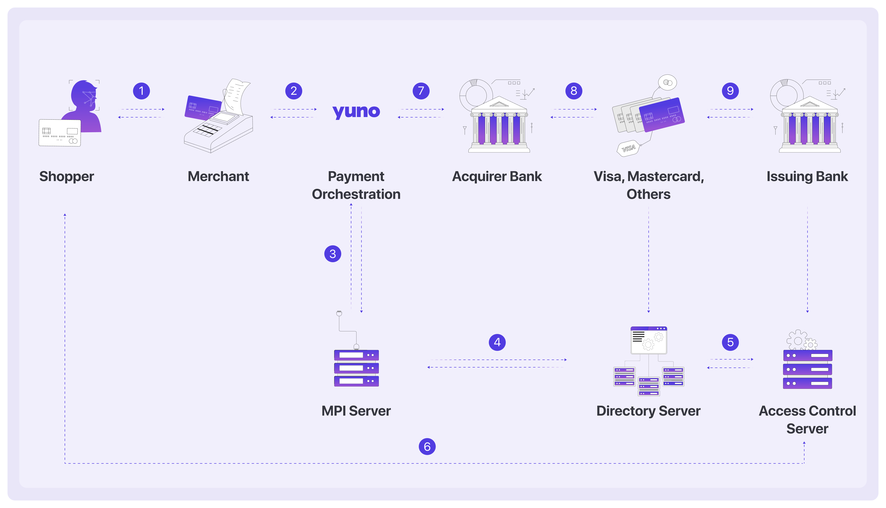
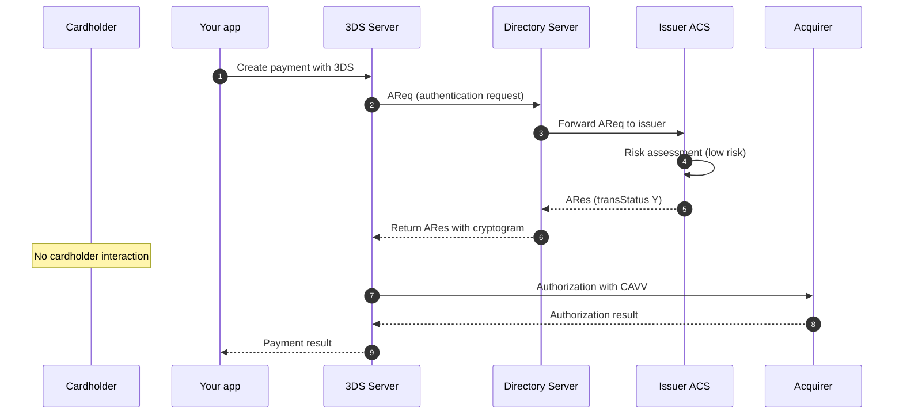
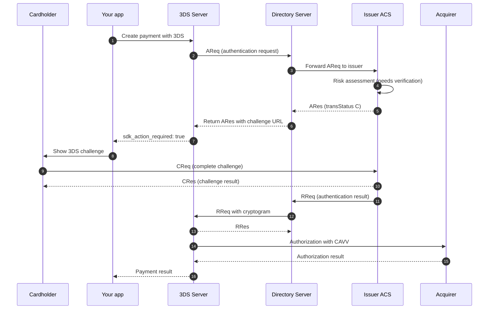
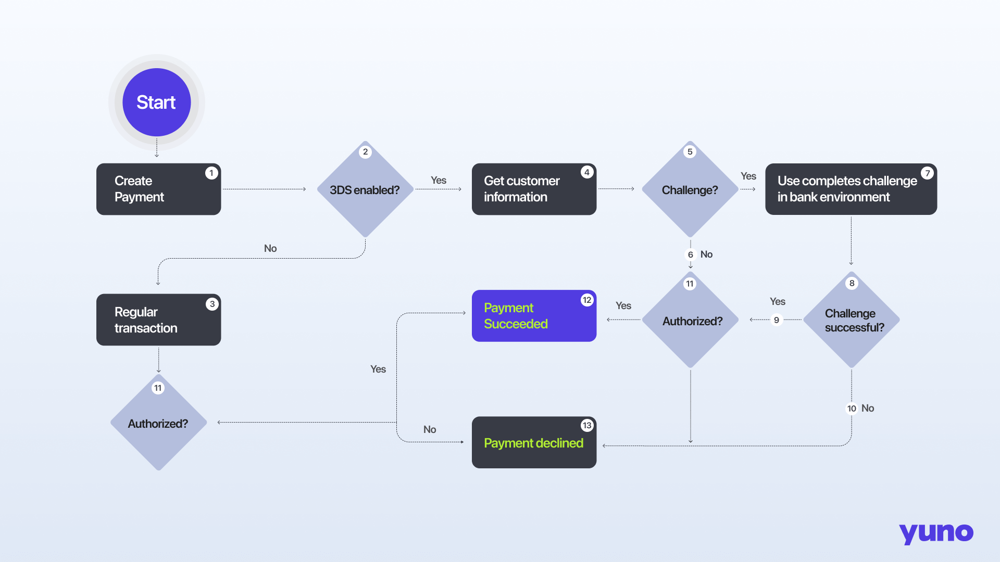

3D Secure (3DS) is a security protocol for card-not-present (CNP) transactions. It adds an authentication step where the cardholder verifies their identity with the issuer before the payment is authorized. This reduces fraud and can shift liability for fraudulent chargebacks from the merchant to the issuer.

## What is 3D Secure?

3D Secure was introduced in 1999 to reduce fraud in online card payments. The name refers to three domains:

- **Issuer domain**: The cardholder's bank that issued the card.
- **Acquirer domain**: The merchant's bank that processes the payment.
- **Interoperability domain**: The card network (Visa, Mastercard, etc.) that connects the issuer and acquirer.

When a cardholder pays online, the issuer can ask them to verify their identity before approving the payment.

<Frame></Frame>

The key components are:

- **Merchant Plugin Interface (MPI)** or **3DS Server**: Initiates the authentication and exchanges data with the Directory Server and issuer.
- **Directory Server (DS)**: The card network's server that routes authentication requests to the correct issuer.
- **Access Control Server (ACS)**: The issuer's server that verifies the cardholder's identity.

## 3DS2 (EMV 3DS)

3D Secure 2, also called EMV 3DS, is the current version of the protocol. EMVCo, an organization owned by the major card networks, developed it. 3DS2 replaced the original 3DS1 protocol. All major card networks stopped supporting 3DS1 in October 2022.

3DS2 has several advantages over 3DS1:

- **Frictionless authentication**: The issuer can approve a payment without cardholder input. 3DS2 sends more transaction data to the issuer for risk assessment.
- **Better mobile experience**: 3DS2 includes an SDK for native mobile apps. The authentication step happens inside the app instead of a browser redirect.
- **Modern authentication methods**: 3DS2 supports biometrics, one-time passwords, and push notifications. 3DS1 relied on static passwords.

### Scheme brand names

Each card network has its own branded name for 3DS:

| Card network | 3DS brand name |
| :--- | :--- |
| Visa | Visa Secure |
| Mastercard | Mastercard IdentityCheck |
| American Express | American Express SafeKey 2.0 |
| JCB | JCB J/Secure 2.0 |
| Discover | Discover ProtectBuy 2.0 |
| Diners Club | Discover ProtectBuy 2.0 |
| Elo | Elo 3DS |
| Cartes Bancaires | Carte Bancaires Fast'r |
| UnionPay | UnionPay International |
| eftpos | eftpos |

<div className="company_card_wrapper">
<Columns cols={3}>
  <Card horizontal title="Visa" icon="https://icons.prod.y.uno/visa_logosimbolo.png" />
  <Card horizontal title="Mastercard" icon="https://icons.prod.y.uno/mastercard_logosimbolo.png" />
  <Card horizontal title="American Express" icon="https://icons.prod.y.uno/amex_logosimbolo.png" />
  <Card horizontal title="JCB" icon="https://icons.prod.y.uno/jcb_logosimbolo.png" />
  <Card horizontal title="Diners Club" icon="https://icons.prod.y.uno/dinnersclub_logosimbolo.png" />
  <Card horizontal title="UnionPay" icon="https://icons.prod.y.uno/unionpay_logosimbolo.png" />
  <Card horizontal title="Cartes Bancaires" icon="https://icons.prod.y.uno/cartabancaire_logosimbolo.png" />
</Columns>
</div>

### PSD2 and SCA

In the European Economic Area (EEA) and the United Kingdom, the Revised Payment Services Directive (PSD2) requires Strong Customer Authentication (SCA) for most online card payments. 3DS2 is the primary way to meet SCA requirements for card payments.

SCA requires two of these three factors:

- **Something the cardholder knows** (a password or PIN)
- **Something the cardholder has** (a phone or card)
- **Something the cardholder is** (a fingerprint or face)

3DS2 satisfies this requirement when the issuer challenges the cardholder. In other regions, 3DS is optional but reduces fraud and can shift liability.

## Frictionless vs challenge flows

When a payment goes through 3DS, the issuer decides whether to authenticate the cardholder without input (frictionless) or to ask the cardholder to verify themselves (challenge).

### Frictionless flow

In a frictionless flow, the issuer approves the authentication based on the transaction data alone. The cardholder does not need to do anything. This happens when the issuer's risk assessment determines that the transaction is low risk.



### Challenge flow

In a challenge flow, the issuer needs additional verification from the cardholder. The cardholder sees an authentication screen where they enter a one-time password, use biometrics, or confirm a push notification.



<Frame></Frame>

## Liability shift

When a payment is successfully authenticated with 3DS, liability for fraud-related chargebacks usually shifts from the merchant to the issuer. If a cardholder disputes a payment as fraudulent, the issuer is responsible for the chargeback, not the merchant.

<Warning>
Liability shift rules vary by region, card network, and acquirer. Some scenarios do not qualify for liability shift, even with successful authentication. Check with your acquirer for the specific rules that apply to your transactions.

A `SUCCEEDED` payment means the authorization was approved. It does not mean that fraud liability shifted to the issuer. Depending on the card scheme rules, an SCA exemption or an attempted authentication (`pares_status` `A`) can leave the liability with you.

The payment response includes a `liability_shift` field that indicates whether liability shifted. Treat `null` as "unknown", never as `true`. If you rely on this field for chargeback handling and you receive `null` after a successful authentication, contact Yuno support.
</Warning>

## ECI values

The Electronic Commerce Indicator (ECI) is a code returned by the card network that indicates the result of the 3DS authentication. Different card networks use different ECI values.

### Mastercard

| ECI | Meaning | Liability shift |
| :--- | :--- | :--- |
| 02 | Successful authentication | Yes |
| 01 | Attempted authentication (issuer or cardholder not enrolled) | Sometimes |
| 00 | Failed authentication or not attempted | No |

### Visa, American Express, JCB, Discover, Elo, eftpos

| ECI | Meaning | Liability shift |
| :--- | :--- | :--- |
| 05 | Successful authentication | Yes |
| 06 | Attempted authentication (issuer or cardholder not enrolled) | Sometimes |
| 07 | Failed authentication or not attempted | No |

### Co-badged cards

Some cards are co-badged with multiple networks (for example, Carte Bancaires Fast'r with Visa or Mastercard, or UnionPay International with Visa). These cards may return ECI values from either network's scheme. You may see either the Visa-style values (05/06/07) or the Mastercard-style values (02/01/00).

For the full list of ECI values by card network and authentication outcome, see the [ECI Indicators List](/reference/eci-indicators-list).

## How 3DS works on Yuno

Yuno supports multiple ways to add 3DS to your payments, depending on your integration type and requirements.

### Option 1: SDK checkout (recommended)

If you use the Yuno SDK (Seamless, Lite, Full, or Headless), the SDK handles 3DS automatically. When a payment requires 3DS, the SDK:

1. Collects device fingerprint data for the 3DS risk assessment.
2. Triggers the authentication with the 3DS provider.
3. Renders the challenge screen (if needed) in a native view on mobile or an iframe/redirect on web.
4. Returns the authentication result to your app.

<Note>
**SDK v1.1 Enhancement**

With SDK v1.1, 3DS logic is handled automatically using the `continuePayment()` method. No separate 3DS setup is required. For more information, see the [Yuno Web SDK documentation](/docs/sdks/full-checkout/web-payments).
</Note>

<Note>
**Yuno 3DS challenge experience (web SDK)**: On web, when you call `getThreeDSecureChallenge` and open the returned URL with `embedded=true`, the challenge appears in an iframe instead of a full-page redirect, on both desktop and mobile web. This reduces drop-off compared to redirecting to a separate URL. This is opt-in: if you omit `embedded=true`, the challenge opens in a new tab instead. See [Step 6](/docs/sdks/headless-web/payment#step-6-get-the-3ds-challenge-url) for the implementation details.

This applies to Yuno's web 3DS provider only. Native mobile apps run the challenge in-app using Netcetera's native 3DS SDKs. See the [iOS](/docs/sdks/external-native-modules/netcetera-3ds-ios) and [Android](/docs/sdks/external-native-modules/netcetera-3ds-android) guides.
</Note>

You configure which payments go through 3DS in the Yuno Dashboard under **Routing > Card Routes > 3DS Step**. You can add conditions to apply 3DS only to specific transactions (by country, amount, BIN range, etc.).

### Option 2: Direct integration

If you use the Direct workflow (server-to-server), you handle the 3DS flow yourself:

1. Create a payment with `workflow: DIRECT`.
2. If 3DS is required, the response has `status: PENDING`, `sub_status: WAITING_ADDITIONAL_STEP`, and `sdk_action_required: true`. The `redirect_url` field contains the URL for the 3DS challenge.
3. Redirect your customer to the `redirect_url` to complete the challenge.
4. After the challenge, the customer returns to your `callback_url`. The payment status updates to `SUCCEEDED` or `DECLINED`.

You are responsible for redirecting your customers to the URL provided by the `redirect_url` so Yuno can gather device information and present the challenge to the customer if necessary. Once the customer successfully completes the 3DS challenge, they are automatically redirected to the `callback_url`, which you provided when creating the payment with the Create Payment endpoint.

### Option 3: External 3DS (bring your own authentication)

If you run 3DS authentication with your own 3DS provider or MPI, you can pass the authentication result to Yuno when creating the payment. Include the 3DS fields in `payment_method.detail.card.three_d_secure`:

- `electronic_commerce_indicator`: The ECI value from your 3DS provider.
- `cryptogram`: The CAVV/AAV value (base64-encoded).
- `transaction_id`: The 3DS transaction ID (XID for 3DS1, `threeDSServerTransID` for 3DS2).
- `directory_server_transaction_id`: The DS transaction ID (for 3DS2).
- `version`: The 3DS protocol version used.

This option is available only for PCI-compliant merchants.

<Note>
**Using an External MPI for Authentication**

If you are using an external MPI to perform the authentication, the following parameters are required for a successful connection with the provider:

- Acquirer BIN
- Acquirer country code
- Merchant ID
- MCC
</Note>

### Option 4: 3DS Standalone

3DS Standalone runs only the authentication step, with no payment authorization. Use it when you want to authenticate the cardholder and then authorize the payment through a different processor or at a later time.

The authentication result (ECI, CAVV, dsTransID) is available on the payment response. You can use this data to authorize the payment with Yuno or another processor.

For the full flow and configuration, see [3DS Standalone](/docs/payment-features/3ds-standalone).

## Configuration requirements

Before using 3DS, you need to enable 3DS in your [Yuno Dashboard](https://dashboard.y.uno/) and specify the scenarios in which you want your customers to use it. Configure this in **Routing > Card Routes > 3DS Step**. These scenarios must be indicated on your CARD route. Additionally, you need the following 3DS setup data in the payment provider connection:

- **Acquirer BIN**: The Bank Identification Number (BIN) used to clear and settle the transaction, along with the country in which it is licensed. This value is brand-specific. Request one per card brand you will authenticate (see the warning below).
- **Merchant ID**: The affiliation number provided by the acquirer.
- **Merchant Category Code (MCC)**: The code representing your merchant category, provided by the acquirer.
- **Merchant's Name**: The official name or business name of the company conducting the transaction.
- **Merchant URL**: The merchant's website or online platform.
- **Country Code**: The country where the payment needs to be processed, following the [ISO 3166-1](/reference/country-reference) Standard Country Codes.

<Warning>
**The acquirer BIN is brand-specific. It is not the ICA or Seller ID.**

Each card scheme's Directory Server only accepts authentication requests that carry an acquirer BIN registered with that specific scheme. When collecting 3DS credentials from your acquirer, keep in mind:

- Request one acquirer BIN **per card brand** you plan to authenticate (Visa, Mastercard, American Express, Discover/Diners). A BIN registered for one brand does not work for another. For example, a Visa acquiring BIN (starting with 4) is not valid for Mastercard authentications.
- For **Mastercard**, acquirers sometimes share their ICA number (a Mastercard membership identifier, often zero-prefixed) instead of an acquirer BIN. The Mastercard Directory Server does not accept the ICA: authentications fail with EMV 3DS error `303` ("Access denied, invalid endpoint / acquirerBIN not recognized"). Ask your acquirer specifically for the **Mastercard acquiring BIN registered for Identity Check (EMV 3DS)**. This is a value within Mastercard's BIN ranges (2-series or 5-series).
- For **American Express and Discover**, the Seller ID or SE number is your merchant identifier in those networks (it maps to the Acquirer Merchant ID). It is not the brand's acquirer BIN. Both values are required.

If an authentication fails with error `303` from the Directory Server, the acquirer BIN configured for that brand is wrong or not registered for 3DS. Request the correct value from your acquirer. For example: *"For each card network (Visa, Mastercard, American Express, Discover), please provide the acquirer BIN registered with the scheme's Directory Server for EMV 3DS authentication with an external 3DS Server, together with our Acquirer Merchant ID and MCC as registered with the scheme."*
</Warning>

## Response fields for 3DS results

After executing 3DS, the authentication result is available in the payment response under `payment_method.payment_method_detail.card.card_data.three_d_secure`:

| Field | Description | Example |
| :--- | :--- | :--- |
| `version` | The 3DS protocol version used. Values: 1.0, 2.0, 2.1.0, 2.2.0, 2.2.1, 2.3.0, 2.3.1. | 2.2.1 |
| `electronic_commerce_indicator` | The ECI value indicating the authentication result. Informs the issuer if the transaction was protected by 3DS. | 05 |
| `cryptogram` | The cryptographic value proving the cardholder was authenticated (CAVV for Visa, AAV/UCAF for Mastercard). Base64-encoded. Max 40 characters. | BA0BB1Z3N5Q4kjkBU3c3ELGUsJY= |
| `transaction_id` | For 3DS v1: the XID (base64-encoded, 28 bytes). For 3DS v2: the `threeDSServerTransID` (UUID, 36 characters). | c4e59ceb-a382-4d6a-bc87-385d591fa09d |
| `directory_server_transaction_id` | The DS transaction ID assigned by the card network during authentication. For 3DS2 only. | f38e6948-5388-41a6-bca4-b49723c19437 |
| `pares_status` | The authentication result from the issuer: Y (authenticated), N (failed), A (attempted), U (unavailable), R (rejected), C (challenge required), I (data only). | Y |
| `acs_id` | Unique identifier from the Access Control Server during authentication. | ACS-1234567890 |
| `liability_shift` | Boolean indicating whether fraud liability shifted to the issuer. Can be `null`. | true |

In Visa transactions, the `cryptogram` represents the Cardholder Authentication Verification Value (CAVV), a cryptographic value generated by the issuer as evidence of payment authentication during the online purchase, used to qualify for chargeback protection. Mastercard transactions carry an equivalent value called the Accountholder Authentication Value (AAV), or the Universal Cardholder Authentication Field (UCAF). When submitting a transaction for authorization, the merchant must include the CAVV or AAV/UCAF to demonstrate that the cardholder has been authenticated.

```json Example
{
  "payment_method": {
    "vaulted_token": "",
    "type": "CARD",
    "vault_on_success": false,
    "token": "",
    "payment_method_detail": {
      "card": {
        "verify": false,
        "capture": false,
        "installments": 1,
        "card_data": {
          "holder_name": "John Doe",
          "iin": "40000000",
          "lfd": "1026",
          "number_length": 16,
          "security_code_length": 3,
          "brand": "VISA",
          "issuer_name": "",
          "category": "STANDARD",
          "type": "CREDIT",
          "three_d_secure": {
            "version": "2.1.0",
            "electronic_commerce_indicator": "05",
            "cryptogram": "BA0BB1Z3N5Q4kjkBU3c3ELGUsJY=",
            "transaction_id": "c4e59ceb-a382-4d6a-bc87-385d591fa09d",
            "directory_server_transaction_id": "f38e6948-5388-41a6-bca4-b49723c19437",
            "pares_status": "Y",
            "acs_id": "z1A6ZTh7NopIhdb2R420",
            "liability_shift": true
          }
        }
      }
    }
  }
}
```

## 3DS transaction statuses

A 3DS transaction progresses through different states that represent the authentication process. Once the 3DS transaction is marked as SUCCEEDED, Yuno proceeds to the processor and generates a PURCHASE transaction to charge the client.

| Status | Description |
| :--- | :--- |
| CREATED | Payment is created and waiting for Yuno's SDK session id. |
| PENDING | The challenge is required, and the `redirect_url` is returned by Yuno. |
| IN_PROCESS | The user is completing the challenge. |
| SUCCEEDED | The challenge was completed correctly. |
| DECLINED | The challenge was completed but declined by the issuer. |
| ERROR | An error occurred while redirecting to the user's challenge. |

If the payment is `PENDING` / `WAITING_ADDITIONAL_STEP`, the 3DS transaction will be PENDING when a challenge is required. After the challenge is completed, either successfully or not, the payment and transaction are updated to the corresponding states (SUCCEEDED or DECLINED).

<Note>
**3DS Standalone status**

For [3DS Standalone](/docs/payment-features/3ds-standalone) (authentication only, no authorization), a successful authentication returns `status: SUCCEEDED` with `sub_status: THREE_D_SECURE_VERIFIED`. This sub-status indicates that only authentication ran. It does not mean a payment was authorized.
</Note>

## Testing 3DS in sandbox

Use the test cards to validate 3DS in the Yuno sandbox environment. The sandbox uses a simulator that mocks the Directory Server (DS) and Access Control Server (ACS).

### OTP codes for challenges

Use these one-time password codes to complete challenge scenarios:

| OTP code | Transaction status | Transaction status reason | ECI | authenticationValue |
| :--- | :--- | :--- | :--- | :--- |
| 1234 | Y | / | 01 | JAmi21makAifmwqo2120cjq1AAA= |
| 1111 | N | 01 | 01 | / |
| 2222 | R | 01 | 01 | / |
| 3333 | U | 01 | 01 | / |
| 4444 | A | 01 | 01 | Qm181okmdyqh6yQmYuq1890QAAA= |

The same OTP codes are valid for Visa, Mastercard, and Amex scenarios.

For the full list of test cards by network, see [3DS Configuration and Testing](/docs/direct-integration-use-cases/3ds-configuration-and-testing).

## SCA exemptions

Under PSD2, certain transactions can be exempted from Strong Customer Authentication. You can request an exemption when creating the payment. For details on available exemptions and how to request them, see [SCA Exemptions](/docs/payment-features/sca-exemptions).

{/* TODO(verify): The OpenAPI spec places strong_customer_authentication_exemptions under payment_method.detail, but docs/payment-features/sca-exemptions.mdx shows it under payment_method.detail.card.three_d_secure. Verify the correct path. Also, the OpenAPI enum includes NO_PREFERENCE and TRANSACTION_RISK_ASSESSMENT values not documented in the SCA page. */}

## Related pages

- [3DS Configuration and Testing](/docs/direct-integration-use-cases/3ds-configuration-and-testing): Step-by-step guide to configure and test 3DS.
- [3DS Standalone](/docs/payment-features/3ds-standalone): Run authentication only, without authorization.
- [SCA Exemptions](/docs/payment-features/sca-exemptions): Request exemptions from Strong Customer Authentication.
- [Netcetera 3DS iOS](/docs/sdks/external-native-modules/netcetera-3ds-ios): Native 3DS challenges on iOS.
- [Netcetera 3DS Android](/docs/sdks/external-native-modules/netcetera-3ds-android): Native 3DS challenges on Android.
- [Headless SDK (Payment Web)](/docs/sdks/headless-web/payment): Handle 3DS challenges with the Headless SDK.
- [ECI Indicators List](/reference/eci-indicators-list): Full list of ECI values by card network.
- [Create 3DS2 Setup](/reference/three-d-secure-setups/create-three-d-secure-setup): API reference for the 3DS setup endpoint.
- [Create Payment](/reference/payments/create-payment): API reference for creating payments with 3DS fields.
- [Payment Status and Response Codes](/reference/payments/status-and-response-codes/payment): Payment and transaction status reference.
