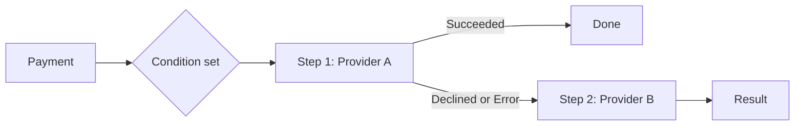

A route sends each payment to a provider based on conditions, and each outcome can lead to a next step.

## How a route works



The first condition set that matches wins. A payment with no match uses the default route.

## Concepts

Each routing covers one payment method on one account. The Dashboard and the API use different names for the same parts.

| Dashboard name | What it does | API field |
|----------------|--------------|-----------|
| Route | Holds all rules for one payment method, such as CARD. | `POST /v1/routing`, `payment_method`, `default_route` |
| Condition set | Selects which payments use a path, by country, amount, card brand, metadata and more. Sets are checked in order. | `condition_sets[]` with `conditions[]`, `sort_number`, `route` |
| Step | Sends the payment to one connection (provider, fraud, 3DS or authentication), or runs an action. | `route.steps[]` with `provider_id` + `connection_id`, or `action` |
| Outcome branch | Sets what happens after a step for Succeeded, Pending, Declined or Error. | `steps[].output[]`: `status` (`APPROVED`, `PENDING`, `DECLINED`, `DECLINE_GROUP`, `INTERNAL_ERROR`) and `next` |
| Traffic split | Sends a percentage of payments to each step. Each payment follows one branch. | `start_split[]`, `output[].next_split[]` (integers that sum to 100) |
| Smart Routing | Picks the provider per payment from 2 to 4 connections. CARD only. | Step with `provider_id: "SMART_ROUTING"` and `smart_routing.type` `LATENCY` or `COSTS` |
| Risk profile | Puts a Fraud, 3DS or Authentication connection at the start of a condition set, before the payment providers. | First step whose `provider_type` is `FRAUD`, `THREE_D_SECURE` or `AUTHENTICATION` |

## Quickstart: your first card route

Do this in Test Mode. You need one active card connection, for example the Yuno Test Payment Gateway.

<Steps>
  <Step title="Turn on Test Mode">
    In the Dashboard, enable **Test Mode** in the top bar.
  </Step>
  <Step title="Open Routing">
    Go to **Routing** and open the **Not published** tab.
  </Step>
  <Step title="Set up CARD">
    Find **CARD** and click **Set up**. Then click **Create new route**.
  </Step>
  <Step title="Name the route">
    Name the route you will build and click **Save**.
  </Step>
  <Step title="Add a condition">
    Click **Add new condition**. Pick one condition type, for example country.
  </Step>
  <Step title="Add a step">
    Click the arrow next to the condition, then **Add step**. Select your connection.
  </Step>
  <Step title="Publish">
    Click **Publish**. CARD now shows under **Published**.
  </Step>
  <Step title="Test it">
    Send one test payment. Retrieve it by ID and check `status` and `sub_status`.
  </Step>
</Steps>

```bash
curl https://api-sandbox.y.uno/v1/payments/$PAYMENT_ID \
  -H "public-api-key: $YUNO_PUBLIC_API_KEY" \
  -H "private-secret-key: $YUNO_PRIVATE_SECRET_KEY"
```

## How-to guides

<AccordionGroup>
  <Accordion title="Add a fallback">
    Open the step. On its **Declined** or **Error** branch, add a step with a second provider. Each fallback is a new payment attempt. It can also fail or stay pending.

    **API:** Add an `output[]` entry such as `{"status":"DECLINED","next":2}`. To retry the same provider once first, set `"retry": true`. To react only to some declines, use `DECLINE_GROUP` with `group_id` or `decline_types[]`.
  </Accordion>

  <Accordion title="Split traffic">
    Select two or more connections in **Add step** and click **Next**. Enter the percentage for each connection.

    **API:** `start_split` at the route entry, or `next_split` on an outcome. Percentages are integers that sum to 100. A value of 0 keeps the step with no traffic.
  </Accordion>

  <Accordion title="Turn on Smart Routing">
    Select two or more connections, click **Next** and turn on **Smart Routing**. Choose what to optimize:
    - **Conversion rate and latency:** Make intelligent decisions to optimize processing time while also achieving the highest conversion rate.
    - **Conversion rate and costs:** Make smart decisions to optimize costs while also achieving the highest conversion rate. Enter each provider's costs in **Connections** first.

    **API:** `smart_routing.type` is `LATENCY` or `COSTS`. One Smart Routing step per route, CARD only. You can add a post-authorization step after it.
  </Accordion>

  <Accordion title="Add or remove a risk profile">
    Payins only. Open the menu (⋮) on a condition in tree view, on a row in List view, or use the bulk action bar in List view.
    - **Add:** Select a Fraud, 3DS or Authentication connection. It becomes the first step. The payment chain and splits stay the same. A second profile goes in front of the first.
    - **Remove:** Its Succeeded branch becomes the start again. Branches that nothing can reach any more are deleted.

    For Yuno Risk Screening you can set block lists, allow lists and velocity rules in the same flow.
  </Accordion>

  <Accordion title="Add 3DS, Preauth or Postauth">
    Click a step to open its panel, then choose a flow under **Antifraud & Authentication**:
    - **3DS:** The cardholder completes authentication during the payment.
    - **Preauth:** Checks the payment method before the transaction.
    - **Postauth:** Checks after authorization. If the check declines, add a cancel action to reverse the authorization.

    Test it with [3DS configuration and testing](/docs/direct-integration-use-cases/3ds-configuration-and-testing).
  </Accordion>

  <Accordion title="Delayed capture">
    {/* TODO: Verify if delayed capture is available in the Routing dashboard interface */}
    
    The Routing dashboard interface may not support delayed capture directly.
    - **Routing API:** After an `APPROVED` outcome, add an action step `{"action":"CAPTURE","action_delay":"PT3H"}`. Delay is 1 minute to 7 days. Use `HOLD_FOR_REVIEW` to keep the authorization for manual review.
    - **Per payment:** Send `capture: false` and `delayed_capture_settings` in Create Payment.

    See [Cancel and capture flow](/docs/payment-features/Cancel-and-capture-flow).
  </Accordion>

  <Accordion title="Use List view">
    Open a route and click **List view**. The table shows condition set ID, name, conditions and primary providers. Filter by ID, search, or click the eye icon for details. Use it for routes with many condition sets.
  </Accordion>
</AccordionGroup>

## Reference

### Outcome types

| Dashboard | API `status` | When |
|-----------|-------------|------|
| Succeeded | `APPROVED` | The provider approved. List it only to continue to a capture, hold or post-auth step. |
| Declined | `DECLINED` / `DECLINE_GROUP` | Any decline, or a decline in a group. `DECLINE_GROUP` needs `group_id` or `decline_types[]`. |
| Pending | `PENDING` | A fraud, 3DS or authentication step left the payment pending. Only on those steps. |
| Error | `INTERNAL_ERROR` | Provider error, connection failure or timeout before the issuer. |

### Editing a published route

You can edit every part of a published route, including monitors. In the API, `PATCH /v1/routing/{routing_id}` replaces the full configuration and is live on success. Retrieve the routing first and send back what you keep.

## Troubleshooting

| Problem | Cause | Fix |
|---------|-------|-----|
| Method missing from Published | It has no route yet. | Open the **Not published** tab and set it up. |
| Every payment is pending | 3DS sits at the start of the whole route, so every payment waits for a challenge. | Add 3DS only to the condition sets that need it. Finish the challenge with the SDK. |
| Split payment shows one part succeeded | One successful part does not mean the whole payment succeeded. | Use the payment's `status` and `sub_status`. Retrieve by ID or use webhooks. |

## Next steps

<CardGroup cols={3}>
  <Card title="Create a Routing" icon="plus" href="/reference/organizations/routing/create-routing">
    Build the same route with the API.
  </Card>
  <Card title="List Decline Groups" icon="list" href="/reference/organizations/routing/list-decline-groups">
    Find group IDs for decline branches.
  </Card>
  <Card title="Routing resource shape" icon="shapes" href="/reference/organizations/routing/routing-resource-shape">
    Every field, rule and limit.
  </Card>
</CardGroup>
