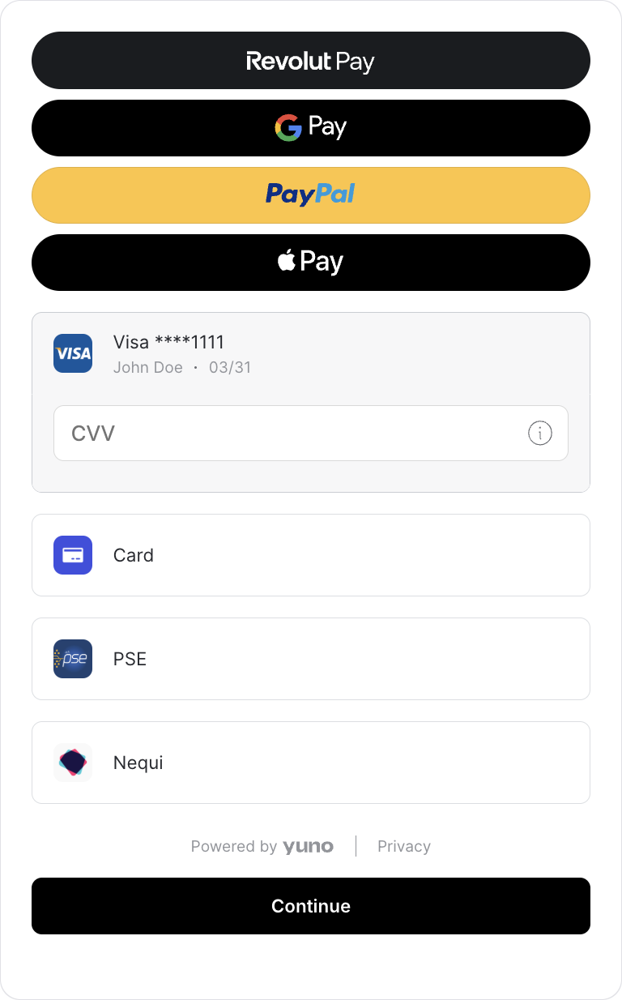

import { ChangelogBadge } from '/snippets/ChangelogBadge.jsx';

Te damos la bienvenida a los aspectos destacados del producto de Yuno. Aquí presentamos las principales capacidades, los nuevos métodos de pago y las actualizaciones de la plataforma diseñadas para ayudarte a optimizar la conversión, agilizar el checkout y escalar globalmente.

Para consultar los cambios técnicos detallados, los cambios de versión de los SDK y las correcciones de errores, explora nuestros [Changelogs de la plataforma](/changelog).

---

## Destacado {#featured-spotlight}

  

    

      

        Destacado
        Web, iOS y Android
        Nueva arquitectura
      

      <h3 className="text-2xl font-bold tracking-tight text-gray-900 dark:text-white">El nuevo Yuno SDK</h3>
      

        Una integración unificada para pagos e inscripción en todas las plataformas cliente. Desarrolla con un único ciclo de vida de la transacción, manejadores de estado consistentes y una inicialización del SDK simplificada, mientras los SDK anteriores siguen con soporte en paralelo hasta su obsolescencia programada en 2027.
      

      

        <a href="/docs/yuno-sdk/introduction" className="inline-flex items-center text-sm font-semibold text-blue-600 dark:text-blue-400 hover:underline">
          Explora la descripción general del nuevo Yuno SDK →
        </a>
      

    

    

      

        
      

    

  

---

## T4 2026 {#q4-2026}

<CardGroup cols={1}>
  <Card title="El nuevo Yuno SDK" icon="code" href="/docs/yuno-sdk/introduction">
    

      Nueva arquitectura
      Web, iOS y Android
    

    Una integración unificada para pagos e inscripción en todas las plataformas cliente. Desarrolla con un único ciclo de vida de la transacción, manejadores de estado consistentes y una inicialización del SDK simplificada, mientras los SDK anteriores siguen con soporte en paralelo hasta su obsolescencia programada en 2027.
  </Card>

  <Card title="Pagos rápidos de Mercado Pago para VTEX" icon="bolt" href="/changelog/plugins/vtex">
    

      Billeteras y plugins
      VTEX
    

    Permite que los compradores de VTEX paguen con las tarjetas y el saldo guardados en su cuenta de Mercado Pago a través de la afiliación de Yuno. Requiere una Payment App en Web SDK 1.11 o posterior; el checkout con redirección (Legacy) aún no es compatible.
  </Card>
</CardGroup>

---

## T3 2026 {#q3-2026}

<CardGroup cols={1}>
  <Card title="Visa Tap to Add (Android)" icon="nfc" href="/es/docs/sdks/card-enrollment/visa-tap-to-add-android">
    

      Nueva función
      Android SDK y Tap SDK
    

    Convierte cualquier teléfono Android con NFC en un lector de tarjetas sin contacto para capturar los datos de la tarjeta e inscribir la tarjeta guardada en segundos, sin ingreso manual y con menos abandono.
  </Card>

  <Card title="Promociones y motor de descuentos" icon="tags" href="/docs/payment-features/promotions">
    

      Nueva función
      Checkout y API
    

    Ejecuta campañas promocionales dinámicas, descuentos instantáneos y promociones con BIN de socios directamente en el checkout. Calcula cotizaciones de descuento en tiempo real antes de crear el pago para aumentar la conversión sin lógica de precios personalizada.
  </Card>

  <Card title="Checkout exprés de Google Pay (Android)" icon="google" href="/es/docs/wallets/google-pay/sdk-integration/express-checkout">
    

      Billeteras
      SDK de Android
    

    Acelera las compras móviles permitiendo que los compradores paguen directamente desde las páginas de producto o el carrito con el checkout exprés de Google Pay, eliminando el ingreso de datos en varios pasos.
  </Card>

  <Card title="Filtros de aceptación de tarjetas de Apple Pay" icon="apple" href="/docs/wallets/apple-pay">
    

      Billeteras
      Web SDK
    

    Filtra las marcas de tarjeta aceptadas y las capacidades de pago directamente en la hoja de pago de Apple Pay, evitando que los compradores seleccionen tarjetas no compatibles antes de la autorización.
  </Card>

  <Card title="Pagos presenciales y conectividad con Smart POS" icon="cash-register">
    

      Comercio unificado
      POS y terminales
    

    Unifica las transacciones digitales y físicas con Yuno In-Person Payments. Conecta sistemas de punto de venta, administra terminales inteligentes, monitorea el estado de las terminales y concilia las ventas omnicanal en una única vista operativa.

    Comunícate con tu key account manager para obtener más información.
  </Card>

  <Card title="Elemento de inscripción y almacenamiento seguro de PayPal" icon="paypal" href="/es/docs/sdks/lite-web/enrollment#paypal-enrollment-with-element-render-mode">
    

      Billeteras y almacenamiento seguro
      Web SDK
    

    Muestra elementos dedicados de inscripción de PayPal y de acuerdo de facturación con botones externos personalizables, lo que agiliza la configuración de billeteras recurrentes y el almacenamiento seguro con un clic.
  </Card>
</CardGroup>

---

## T2 2026 {#q2-2026}

<CardGroup cols={1}>
  <Card title="Pix Automático para suscripciones recurrentes" icon="rotate" href="/es/docs/payment-features/subscriptions/pix-automatico">
    

      Métodos de pago
      Brasil
    

    Ofrece débito bancario automático preautorizado a través de la red Pix de Brasil. Define intervalos recurrentes, administra las autorizaciones de consentimiento y cobra los pagos de suscripción sin problemas y sin tarjetas de crédito.
  </Card>

  <Card title="Integración directa de Samsung Pay y cuotas" icon="mobile-screen" href="/es/docs/wallets/samsung-pay">
    

      Billeteras
      API y SDK
    

    Procesa los tokens de la billetera Samsung Pay directamente mediante pagos de servidor a servidor e integraciones de SDK, con soporte para enrutamiento entre varios adquirentes, descifrado de criptogramas y planes de cuotas nativos.
  </Card>

  <Card title="Checkout rápido y datos de envío dinámicos en billeteras" icon="truck-fast" href="/es/docs/payment-features/fast-checkout-shipping">
    

      Checkout
      Web, iOS, Android
    

    Permite que los clientes elijan direcciones de envío y opciones de entrega directamente dentro de las hojas de pago de las billeteras (Apple Pay y Google Pay), actualizando dinámicamente los totales de la autorización final antes de la confirmación.
  </Card>

  <Card title="Cuotas de Google Pay" icon="credit-card" href="/docs/wallets/google-pay">
    

      Billeteras
      Web y VTEX
    

    Muestra los planes de cuotas disponibles directamente dentro de la hoja de pago de Google Pay, para que los compradores puedan dividir sus compras sin problemas entre emisores de Latinoamérica.
  </Card>

  <Card title="SDK nativo de 3DS de Netcetera" icon="shield-check" href="/es/docs/sdks/external-native-modules/netcetera-3ds-android">
    

      Seguridad
      iOS y Android
    

    Flujo de autenticación nativo de 3D Secure con integración del SDK de Netcetera para una autenticación biométrica en la app sin fricción y altas tasas de autorización.
  </Card>
</CardGroup>

---

## T1 2026 {#q1-2026}

<CardGroup cols={1}>
  <Card title="Click to Pay Golden Flow (Passkeys GA)" icon="key" href="/es/docs/wallets/click-to-pay">
    

      Billeteras y seguridad
      Todas las plataformas
    

    Disponibilidad general de las passkeys y la biometría del dispositivo para Click to Pay de EMVCo. Habilita la autenticación con un toque y el almacenamiento automático de tarjetas en Web, móvil y VTEX.
  </Card>

  <Card title="API de Checkout Builder y gestión del ciclo de vida" icon="layer-group" href="/es/docs/using-yuno/dashboard-overview/checkout-builder">
    

      Checkout
      API
    

    Crea, personaliza y administra de forma programática sesiones de checkout y temas mediante la API de Checkout Builder, lo que permite configuraciones de checkout regionales dinámicas.
  </Card>

  <Card title="Pruebas gratuitas de suscripción y medidores avanzados" icon="calendar-check" href="/es/docs/payment-features/subscriptions">
    

      Suscripciones
      API
    

    Configura intervalos de prueba promocionales en los planes de pago recurrentes, además de medición por niveles y por paquetes para modelos de suscripción flexibles basados en el uso.
  </Card>
</CardGroup>

---

## Mantente al día {#stay-updated}

- Sigue la [Descripción general del Changelog](/changelog) para ver las notas de versión detalladas.
- Suscríbete a las actualizaciones o integra Yuno con tu stack de desarrollo mediante nuestros [Recursos para desarrolladores](/es/docs/developers).
