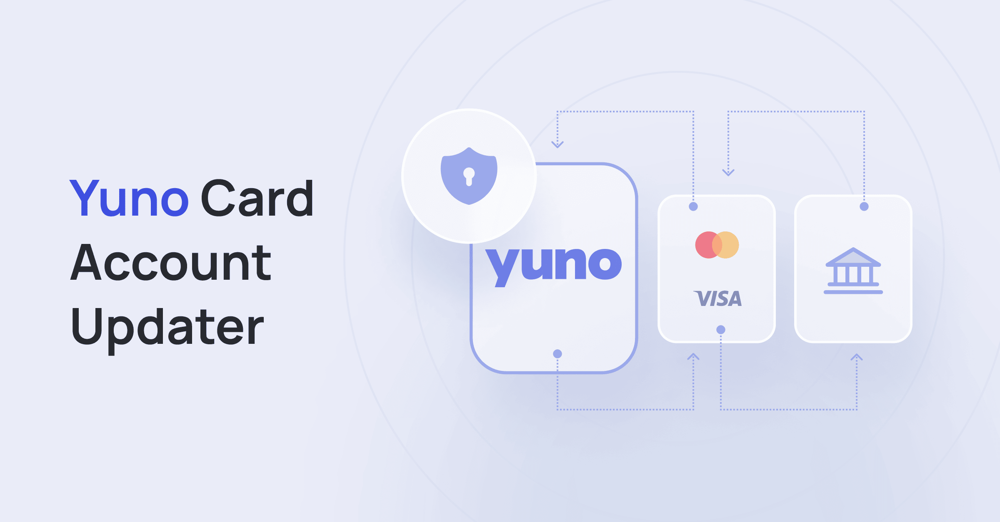

Card Account Updater (CAU) es una función disponible en Yuno para mantener la integridad de las tarjetas de crédito o débito guardadas, evitando los problemas causados por datos de tarjeta vencidos o desactualizados. Cuando los clientes proporcionan los datos de su tarjeta para facturación recurrente o servicios de suscripción, Card Account Updater garantiza que los datos guardados de su tarjeta se mantengan al día. Con el Card Account Updater de Yuno no se requiere desarrollo adicional: los datos de tu tarjeta se actualizan automáticamente en segundo plano.

<Frame></Frame>

## Beneficios de Card Account Updater {#benefits-of-card-account-updater}

* **Mayores tasas de éxito de pago:** actualizar automáticamente los datos de la tarjeta reduce la probabilidad de transacciones fallidas por tarjetas vencidas o reemplazadas, lo que garantiza una mayor tasa de éxito en los pagos recurrentes.
* **Mejor experiencia del cliente:** al asegurar un servicio sin interrupciones, los clientes no necesitan actualizar manualmente los datos de su tarjeta, lo que genera una experiencia más fluida y positiva.
* **Menores costos operativos:** las actualizaciones automáticas reducen la necesidad de intervenciones manuales y de consultas de atención al cliente relacionadas con problemas de pago, lo que ahorra tiempo y recursos.
* **Mayores ingresos:** unas tasas de aprobación de transacciones más altas se traducen en menos pagos perdidos y, potencialmente, en mayores ingresos.
* **Seguridad y cumplimiento:** centralizar las actualizaciones de tarjetas dentro del vault garantiza que los datos sensibles de la tarjeta se gestionen de forma segura y cumplan con las regulaciones y los estándares correspondientes.
* **Eficiencia operativa:** agilizar el proceso de actualización de los datos de la tarjeta ayuda a mantener la eficiencia operativa y la coherencia en los sistemas de pago.
* **Retención de clientes:** minimizar las interrupciones del servicio por fallos de pago puede ayudar a mantener la lealtad y la retención de los clientes.

## ¿Cómo funciona? {#how-does-it-work}

El servicio Card Account Updater opera de forma asíncrona, independiente del flujo de pago. Las actualizaciones de tarjetas se realizan automáticamente, por lo que no es necesario gestionar las respuestas individuales del servicio.

Yuno actualiza los datos de la tarjeta en los siguientes escenarios:

* La tarjeta superó su fecha de vencimiento.
* La cuenta asociada a la tarjeta está cerrada, deshabilitada o marcada.

Cuando la fecha de vencimiento de la tarjeta ha pasado, Yuno puede actualizar todos los datos de la tarjeta o solo la fecha de vencimiento. La opción utilizada dependerá del enfoque del emisor de la tarjeta para su reemplazo.

Una vez que se actualiza una tarjeta, Yuno enviará un webhook para notificarte el cambio. **El`vaulted_token` y el `fingerprint` de la tarjeta inscrita seguirán siendo los mismos, por lo que no necesitas cambiar nada en tu integración**. Este webhook contendrá lo siguiente:

* La fecha de vencimiento más reciente, los últimos cuatro dígitos y el Issuer Identification Number (IIN).
* El motivo de la actualización.
* Los detalles de la tarjeta que se reemplaza.

El siguiente bloque de código presenta un ejemplo de notificación:

```json
{
  "type": "enrollment",
  "type_event": "enrollment.update",
  "account_id": "493e9374-510a-4201-9e09-de669d75f256",
  "retry": 0,
  "version": 2,
  "data": {
    "payment_method": {
      "id": "03c3aae1-ed42-4be6-bc24-de5487f58491",
      "account_id": "493e9374-510a-4201-9e09-de669d75f256",
      "name": "VISA ****1111",
      "description": "VISA ****1111",
      "type": "CARD",
      "category": "CARD",
      "country": "CO",
      "status": "ENROLLED",
      "customer_id": "2f38972e-2427-43b7-95be-ee4cf21cef1b",
      "created_at": "2024-09-10T15:04:10.453741Z",
      "updated_at": "2024-09-10T15:04:10.453745Z",
      "enrollment": {
        "session": null,
        "sdk_action_required": false
      },
      "verify": {
        "vault_on_success": false,
        "currency": null,
        "payment": null
      },
      "detail": {
        "card": {
          "holder_name": "John Doe",
          "expiration_month": 3,
          "expiration_year": 26,
          "iin": "41111111",
          "lfd": "1111",
          "security_code_length": 3,
          "number_length": 16,
          "brand": "VISA",
          "issuer_name": "JPMORGAN CHASE BANK N A",
          "issuer_code": null,
          "type": "CREDIT",
          "category": "CREDIT",
          "country_code": "US",
          "country_name": "United States of America",
          "fingerprint": "d244e20d-43a1-43f7-9b48-0a76423be35e",
          "created_at": "2024-09-10T15:04:10.453799Z",
          "updated_at": "2024-09-10T15:04:10.453800Z"
        },
        "card_data_history": [
         {
          "holder_name": "John Doe",
          "expiration_month": 3,
          "expiration_year": 24,
          "iin": "4222222",
          "lfd": "2222",
          "security_code_length": 3,
          "number_length": 16,
          "brand": "VISA",
          "issuer_name": "JPMORGAN CHASE BANK N A",
          "issuer_code": null,
          "type": "CREDIT",
          "category": "CREDIT",
          "country_code": "US",
          "country_name": "United States of America",
          "fingerprint": "d244e20d-43a1-43f7-9b48-0a76423be35e",
          "provider_data": {
                 "id": "MASTERCARD",
                 "status": "UPDATED"
          },
          "created_at": "2024-09-10T15:04:10.453799Z",
          "updated_at": "2024-09-10T15:04:10.453800Z"
        }
       ]
      }
    }
  }
}

```

## Control de Account Updater por tarjeta {#controlling-account-updater-per-card}

Por defecto, cuando Card Account Updater está habilitado para tu cuenta, cada tarjeta elegible inscrita en ella se mantiene actualizada automáticamente. Puedes anular este comportamiento para una tarjeta individual al momento de la inscripción mediante el campo `account_updater`:

* Define `account_updater` como `false` para **excluir** esa tarjeta específica de Card Account Updater. La tarjeta no recibirá actualizaciones automáticas de sus datos.
* Omite el campo (o defínelo como `true`) para mantener la tarjeta bajo la configuración de Card Account Updater de tu cuenta.

El campo `account_updater` está disponible al inscribir una tarjeta mediante el endpoint [Enroll Payment Method](/es/reference/payment-methods-direct-workflow/enroll-payment-method-api) (flujo Direct), mediante el flujo de inscripción del SDK y en el objeto `payment_method` de la solicitud [Create Payment](/es/reference/payments/create-payment) cuando una tarjeta se guarda en el vault durante un pago.

## Registro de tarjetas guardadas en lote {#registering-stored-cards-in-bulk}

Para las tarjetas que se guardaron antes de habilitar Card Account Updater, o que se inscribieron con la función excluida, puedes registrarlas por lotes con el endpoint [Register Stored Cards for Account Updater](/es/reference/payment-methods-direct-workflow/register-cards-for-account-updater-api). Envía hasta 100 ids de método de pago (`vaulted_token`) por solicitud. La validación es síncrona y de todo o nada, y el registro se ejecuta de forma asíncrona en segundo plano.

## Compatibilidad con las redes de tarjetas {#card-networks-compatibility}

Card Account Updater está disponible actualmente para Visa y Mastercard.

## Activar Card Account Updater {#activating-the-card-account-updater}

Para activar Card Account Updater en tu cuenta de Yuno, contacta al equipo de soporte de Yuno en [support@y.uno](mailto:support@y.uno). Ten en cuenta que el registro se realiza directamente con los Card Schemes y puede tardar hasta 10 días hábiles para clientes nuevos.
