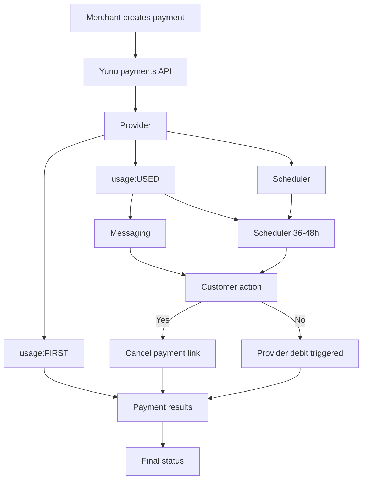

Esta guía describe el soporte de Yuno para pagos recurrentes de UPI Autopay con notificación previa al débito (PDN).

UPI Autopay usa un mandato aprobado por el cliente, que es la autorización permanente del cliente para débitos recurrentes. Una vez establecido el mandato, Yuno puede iniciar débitos programados sin que el cliente tenga que actuar cada vez. Antes de cada débito recurrente, Yuno envía al cliente una notificación previa al débito (PDN) con anticipación. Este período de aviso le da tiempo al cliente para revisar el cargo próximo y cancelarlo si es necesario, y el débito solo se ejecuta si el cliente no opta por cancelarlo.

Para conocer el contexto sobre las transacciones iniciadas por el cliente (**CIT**), las transacciones iniciadas por el comercio (**MIT**) y los valores de uso, consulta [Credenciales almacenadas](/es/docs/payment-features/stored-credentials).

Autopay se integra directamente con los flujos de pago existentes de Yuno mediante el campo `stored_credentials`.

## Cómo funciona {#how-it-works}

* **Primer cargo**: El pago inicial es una transacción iniciada por el cliente (CIT) que se procesa directamente con el proveedor de pago para crear el mandato y autorizar los débitos futuros.
* **PDN**: Para los débitos recurrentes, Yuno envía una notificación previa al débito (PDN) que el cliente recibe por SMS o email, espera el período de aviso requerido y luego ejecuta el débito automáticamente, a menos que el cliente lo cancele.
* **Mensajes y cancelación**: Las PDN incluyen el nombre del comercio, el monto y la fecha programada, además de un enlace de cancelación. Los mensajes están localizados (por ejemplo, inglés, hindi, tamil, telugu, bengalí, maratí). Las plantillas de email son de marca blanca con la identidad visual del comercio.
* **Cancelación por webhook**: Si el cliente hace clic en el enlace de cancelación, Yuno valida la transacción, cancela el débito programado, actualiza el estado del pago y notifica al comercio.
* **Programación y reintentos**: Los débitos se programan para ejecutarse después del período de aviso, dentro de las ventanas IST aprobadas. Si un débito falla, Yuno programa reintentos según el calendario configurado y los límites de reintentos.
* **Estado asíncrono y webhooks**: Las actualizaciones del estado del pago se ejecutan de forma asíncrona y emiten eventos para el comercio: PDN enviada, cancelaciones, éxitos, reintento programado y fallo final.
* **Soporte de proveedores**: Autopay con PDN se lanza inicialmente a través de Adyen y Billdesk.



## Flujos de pago {#payment-flows}

Autopay usa umbrales de monto para determinar si un cargo puede ejecutarse como MIT o si debe gestionarse como un pago iniciado por el cliente (CIT). Esto mantiene los débitos recurrentes en cumplimiento normativo y establece expectativas sobre la acción del cliente.

* **Por debajo del umbral (≤ INR 50,000)**: Yuno envía la PDN al cliente, espera el período de aviso de 36 a 48 horas y luego ejecuta el débito MIT en una ventana IST. Si el cliente cancela durante el período de aviso, el débito no se ejecuta.
* **Por encima del umbral (> INR 50,000)**: Yuno envía una notificación CIT con 72 a 48 horas de anticipación, con una forma de que el cliente complete el pago. El cliente debe pagar activamente; si no lo hace, no se ejecuta ningún débito MIT.

## Campos de `stored_credentials` {#storedcredentials-fields}

Implementa Autopay mediante el campo `stored_credentials`, disponible en endpoints como [Crear pago](/es/reference/payments/create-payment). La ruta completa para crear pagos es `payment_method.detail.bank_transfer.stored_credentials`.

Usa `stored_credentials.usage` para declarar la intención:

| Campo   | Valor   | Comportamiento                                                                       |
| ------- | ------- | ------------------------------------------------------------------------------ |
| `usage` | `FIRST` | Ejecuta el cargo directo (CIT) y almacena la referencia del mandato para débitos futuros. |
| `usage` | `USED`  | Envía la PDN, espera el período de aviso de 24 horas y luego ejecuta el débito MIT.          |

## Notificaciones previas al débito mediante la API {#api-driven-pre-debit-notifications}

Si gestionas tu propio calendario de facturación, activa tú mismo la notificación previa al débito y haz referencia a ella en el débito. Este es el flujo disponible hoy a través de la API:

1. **Envía la notificación** con [Crear notificación previa al débito](/es/reference/pre-debit-notifications/create-pre-debit-notification), indicando el `vaulted_token` del mandato, el `amount` próximo y el `billing_date`. Conserva el `id` devuelto y confirma que el estado sea `SENT`.

```json
{
  "account_id": "<ACCOUNT_ID>",
  "merchant_reference": "subscription-2026-08-INV-00187",
  "description": "Your subscription renews soon",
  "amount": { "currency": "INR", "value": "499.00" },
  "billing_date": "2026-08-01",
  "customer_payer": { "id": "<CUSTOMER_ID>" },
  "payment_method": { "type": "UPI_AUTOPAY", "vaulted_token": "<VAULTED_TOKEN>" },
  "origin_payment_id": "<MANDATE_PAYMENT_ID>"
}
```

2. **Espera el período de aviso de NPCI** (al menos 24 horas antes del débito).

3. **Crea el débito recurrente** con [Crear pago](/es/reference/payments/create-payment), haciendo referencia a la notificación:

```json
{
  "amount": { "currency": "INR", "value": "499.00" },
  "customer_payer": { "id": "<CUSTOMER_ID>" },
  "payment_method": {
    "type": "UPI_AUTOPAY",
    "vaulted_token": "<VAULTED_TOKEN>",
    "detail": {
      "bank_transfer": {
        "pre_debit_notification_id": "<ID_FROM_STEP_1>"
      }
    }
  }
}
```

Yuno valida la notificación referenciada (debe existir, pertenecer a tu cuenta y estar en estado `SENT`) y reenvía la referencia de notificación del proveedor junto con el débito. Si la validación falla, el pago se rechaza con `PRE_DEBIT_NOTIFICATION_NOT_FOUND` o `PRE_DEBIT_NOTIFICATION_NOT_SENT` (HTTP 422) y no se intenta ningún cargo.

## Reclamo de cobro y reintentos {#dunning-and-retries}

Si un débito MIT falla, Yuno reintenta en lugar de marcar el pago de inmediato como fallo final. El calendario de reintentos es configurable por cuenta.

| Intento    | Mensaje                                                                     |
| ---------- | --------------------------------------------------------------------------- |
| 1.er fallo   | "El pago falló. Reintentaremos mañana. No necesitas hacer nada."                   |
| 2.º fallo   | "El pago sigue pendiente. Reintento en 2 días (`link to update payment method`)." |
| 3.er fallo   | "Último reintento programado para `date`. Asegúrate de tener fondos disponibles."      |
| Fallo final | "No se pudo procesar el pago. Contacta a `merchant` para resolverlo."            |

## Cumplimiento normativo {#regulatory-compliance}

Yuno sigue los requisitos de la National Payments Corporation of India (NPCI) para UPI Autopay.

* **Ventana de aviso previo**: Las PDN deben enviarse entre 36 y 48 horas antes del débito. NPCI permite un mínimo de 24 horas.
* **Cancelación por parte del cliente**: La PDN incluye un enlace de webhook entregado por SMS o email. Si el cliente cancela antes del débito programado, Yuno detiene el cargo.
* **Ventanas de ejecución (IST)**: Los débitos se ejecutan solo en ventanas de tiempo aprobadas: antes de las 10:00 AM, de 1:00 a 5:00 PM, o después de las 9:30 PM.
* **Umbral de monto MIT**: Autopay MIT se permite hasta INR 50,000. Cualquier monto superior requiere un pago iniciado por el cliente (CIT).
* **Límites de reintentos**: NPCI permite 1 intento de ejecución más hasta 3 reintentos.

<br />