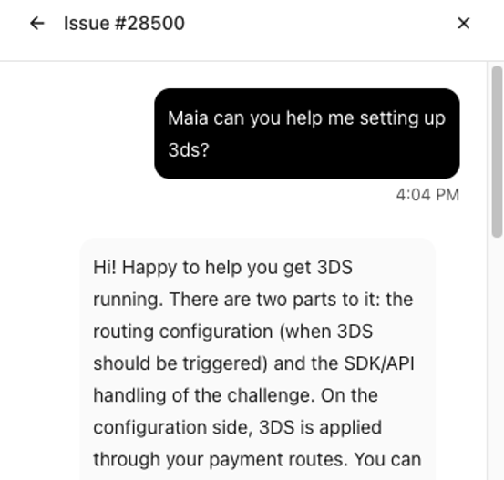
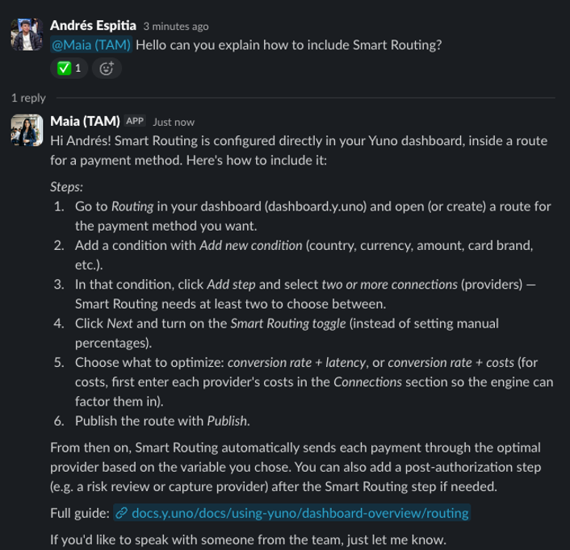

## Qué hace Maia {#what-maia-does}

**Maia** es el Technical Account Manager con IA de Yuno. Trabaja junto con tu equipo de Yuno para responder preguntas técnicas, investigar el comportamiento de los pagos y resolver problemas de integración, usando el contexto de la configuración de tu organización en lugar de respuestas genéricas. Maia investiga antes de responder, recuerda el contexto de tu integración de una conversación a la siguiente y, cuando una pregunta requiere a una persona, la transfiere a tu equipo de Yuno con el diagnóstico ya hecho.

## Dónde encontrarla {#where-to-find-her}

Maia está disponible en los mismos canales donde ya hablas con Yuno, y es la misma Maia en todos: conoce tu organización, tu integración y tu historial sin importar dónde la contactes.

* **Chat widget**: Escribe tu pregunta en el chat de soporte que ya usas e incluye la palabra "Maia" en cualquier parte del mensaje. Ella se une a la conversación y continúa desde ahí.
* **Slack**: Si tu equipo comparte un canal de Slack con Yuno, etiqueta a **@Maia (TAM)** en tu mensaje y ella responde en el hilo.
* **Google Chat**: Si tu equipo trabaja con Yuno en un espacio compartido de Google Chat, escribe tu pregunta allí y Maia responde en el espacio.
* **WhatsApp y email**: Si tu equipo contacta al soporte de Yuno mediante un grupo de WhatsApp o por email, Maia también atiende esas conversaciones y responde en el mismo hilo.

  

    
<strong>Chat Widget</strong>

    <Frame>
      
    </Frame>
  

  

    
<strong>Slack</strong>

    <Frame>
      
    </Frame>
  

## En qué puede ayudar Maia {#what-maia-can-help-with}

### Investigación de pagos {#payment-investigation}

Pregunta por un pago específico y Maia rastrea lo que ocurrió a lo largo del flujo de pago, la solicitud, la respuesta del proveedor y el estado resultante, y te lo explica en términos sencillos: por qué se rechazó un pago, cómo avanzó un reembolso o qué significa para ti el código de respuesta de un proveedor.

<Card title="Pregunta a Maia">
  *"Emitimos un reembolso a través de GCash hace dos días y el cliente no lo ha recibido, ¿puedes revisar su estado?"*
</Card>

**Maia:** El proveedor aceptó el reembolso el 2 de agosto a las 14:07 UTC y figura como liquidado de su lado desde ayer. Los créditos de GCash pueden tardar hasta 3 días hábiles en aparecer en la billetera del cliente, y este está dentro de ese plazo. Si no ha llegado mañana, lo escalaré con el proveedor con la referencia del proveedor ya adjunta.

**Qué se envió al proveedor y qué respondió.** Cuando un proveedor rechaza un pago con un error genérico, Maia lee el intercambio exacto: la solicitud que Yuno envió y la respuesta del proveedor. A partir de eso te dice a qué campo puso objeciones el proveedor y qué espera, por ejemplo datos del navegador faltantes en un pago con 3-D Secure, un número de teléfono con un formato que el proveedor no acepta o credenciales en la conexión que el proveedor ya no reconoce. Los datos de tarjeta y las credenciales nunca salen de los sistemas de Yuno en este proceso; Maia explica el problema en términos sencillos en lugar de pegar payloads.

<Card title="Pregunta a Maia">
  *"Cuatro pagos con 3DS del mismo cliente fallaron esta mañana, pero uno posterior pasó. ¿Qué rechazó el emisor?"*
</Card>

**Maia:** El emisor rechazó el paso de autenticación en los cuatro intentos porque la altura de pantalla del navegador del cliente llegó vacía: esas solicitudes se crearon sin los datos del navegador del comprador. No se cobró nada. Enviar `customer_payer.browser_info` en cada pago con 3DS lo soluciona, y el intento que fue exitoso lo incluía.

**Estado en vivo directo del proveedor.** Para la mayoría de las preguntas, Maia responde con el estado que Yuno ya tiene almacenado. Cuando necesitas el estado actual directamente del proveedor, puede consultarlo en vivo, para los proveedores que admiten una consulta de estado en vivo, y siempre te dice cuál estás viendo: el estado en vivo del proveedor o el último que Yuno tiene registrado. También distingue si el pago está en sandbox o en producción.

<Card title="Pregunta a Maia">
  *"¿Cuál es el estado actual del pago 7b1a... directamente del proveedor?"*
</Card>

**Maia:** Para el proveedor de este pago puedo consultar en vivo: hace un momento reportan que está autorizado, en producción. Algunos proveedores solo nos notifican y no responden a consultas de estado en vivo; para esos te doy el último estado que Yuno tiene almacenado y te lo indico. Este es en vivo.

**Corregir un pago atascado en un estado incorrecto.** A veces el proveedor terminó un pago pero Yuno nunca registró el resultado, así que sigue pendiente de tu lado aunque al cliente ya se le cobró. Cuando el proveedor reporta un estado final que Yuno no tiene, Maia pone a Yuno al día con él: el pago pasa al estado del proveedor y tu webhook se dispara como si la actualización hubiera llegado a tiempo, para que tus sistemas puedan procesar la orden. Solo lo hace cuando el registro del proveedor es final y los montos coinciden; cualquier otro caso pasa a tu equipo de Yuno.

<Card title="Pregunta a Maia">
  *"El proveedor muestra este pago como aprobado, pero en Yuno sigue como pendiente. ¿Qué pasó?"*
</Card>

**Maia:** El proveedor aprobó este pago el 14 de septiembre con la autorización 247684, pero el registro de Yuno nunca pasó de pendiente, por lo que tu webhook nunca se disparó y la orden no se procesó. Actualicé el pago a exitoso para que coincida con el proveedor y volví a disparar tu webhook. También encontré dos pagos más de la semana pasada en el mismo estado; ¿quieres que los actualice también?

### Preguntas de integración y documentación {#integration-and-documentation-questions}

Maia responde preguntas sobre cómo integrar y operar en Yuno, incluidos el comportamiento de la API, los métodos de pago, la tokenización, 3-D Secure, los webhooks y las pruebas en sandbox, basándose en la documentación vigente de Yuno y conociendo cómo está configurada tu integración.

<Card title="Pregunta a Maia">
  *"¿Podemos exigir 3DS por transacción y cómo interactúa eso con nuestras reglas de enrutamiento?"*
</Card>

**Maia:** Sí, 3DS se puede solicitar por transacción al crear el checkout, así que puedes exigirlo solo para los segmentos que elijas. Tus reglas de enrutamiento se evalúan después de la autenticación, por lo que un desafío de 3DS obligatorio no cambia a qué proveedor se enruta el pago. Dada tu configuración actual, exigirlo solo en tarjetas de primera vez agregaría fricción donde más rinde.

### Visibilidad de webhooks y eventos {#webhook-and-event-visibility}

Maia revisa qué te envió Yuno y cuándo: si se disparó un webhook para un pago determinado, qué tipos de evento recibió tu endpoint y si las entregas se están reintentando, para que "nunca recibimos la notificación" deje de ser un misterio.

<Card title="Pregunta a Maia">
  *"¿Recibimos un webhook por el reembolso de la orden 8842? ¿Qué tipo de evento debemos escuchar?"*
</Card>

**Maia:** El reembolso de la orden 8842 sí generó una notificación ayer a las 16:32 UTC y tu endpoint la confirmó. Para los reembolsos, el tipo de evento que debes escuchar es la actualización del estado del reembolso; puedo listar los tipos de evento exactos habilitados para tu cuenta si quieres verificar tu handler.

**Reenvío de un webhook.** Maia no solo revisa si se disparó un webhook, también puede reenviarlo. Si tu endpoint perdió una notificación de un pago específico, ella busca los intentos de entrega de ese pago, te muestra qué ocurrió y vuelve a entregar el que necesitas al endpoint que ya tienes configurado. Sin ticket a ingeniería ni reenvío manual.

<Card title="Pregunta a Maia">
  *"Nunca recibimos el webhook del pago 8842, ¿puedes reenviarlo?"*
</Card>

**Maia:** Encontré 4 intentos de entrega de la notificación del pago 8842; el más reciente, ayer a las 16:32 UTC, agotó el tiempo de espera en tu endpoint. Lo reenvié ahora mismo a tu endpoint configurado; deberías verlo en menos de un minuto. Si vuelve a agotar el tiempo de espera, eso apunta al receptor y no a la entrega, y se lo señalaré a tu equipo de Yuno con los intentos adjuntos.

### Rendimiento y análisis de patrones {#performance-and-pattern-analysis}

Más allá de las transacciones individuales, Maia analiza patrones en tu actividad de pagos de los últimos 3 meses: cambios en la tasa de aprobación, concentraciones de rechazos por método de pago o proveedor y comportamiento del enrutamiento, útil tanto para resolver problemas como para detectar oportunidades de optimización.

<Card title="Pregunta a Maia">
  *"¿Estamos viendo más rechazos con Apple Pay que con tarjetas durante el último mes?"*
</Card>

**Maia:** Tu tasa de aprobación en Perú pasó de 89% a 81% esta semana. La caída se concentra en pagos con billeteras a través de un solo proveedor: las tarjetas están estables y tu mezcla de tráfico no cambió. El patrón apunta al lado del proveedor y no a tu integración; ¿quieres que lo escale a tu equipo de Yuno para que lo confirmen con el proveedor?

### Consultas masivas desde un archivo {#bulk-lookups-from-a-file}

Cuando la pregunta abarca muchos pagos, envíale a Maia la lista en lugar de preguntar uno por uno. Comparte una hoja de cálculo o un CSV con IDs de pago o IDs de orden y ella los consulta todos, agrega el estado, el proveedor y los detalles de rechazo que pidas, y te devuelve el archivo.

<Card title="Pregunta a Maia">
  *"Aquí hay 3,000 IDs de orden de nuestra conciliación, ¿puedes agregar el estado actual y el proveedor de cada uno?"*
</Card>

**Maia:** Listo, el archivo está adjunto con el estado y el proveedor de los 3,000 órdenes. 2,941 fueron exitosos, 47 fueron rechazados y 12 nunca se encontraron en Yuno; los puse al inicio para que tu equipo revise si llegaron siquiera al checkout.

### Triaje de incidentes {#incident-triage}

Cuando algo falla, Maia revisa la actividad reciente de tu integración, incluidos errores, patrones de respuesta inusuales y volumen afectado, y te dice dónde está el problema: del lado del proveedor, del lado de Yuno o en la propia integración, para que la solución empiece en el lugar correcto. Si es el proveedor, lo dice explícitamente y coordina la escalación en consecuencia.

<Card title="Pregunta a Maia">
  *"Estamos recibiendo errores INVALID_CHECKOUT_SESSION desde esta mañana, ¿qué cambió?"*
</Card>

**Maia:** Los errores INVALID_CHECKOUT_SESSION comenzaron a las 09:14 UTC y afectan solo a sesiones de más de 60 minutos: tu checkout está reutilizando sesiones vencidas después de actualizar la página. No cambió nada del lado de Yuno. Crear una sesión nueva al actualizar lo resuelve; anoté el volumen afectado por si lo quieres para tu reporte del incidente.

### Cómo encontrar a tu equipo de cuenta de Yuno {#finding-your-yuno-account-team}

Pregúntale a Maia quién es tu equipo de cuenta de Yuno y te lo dice: las personas asignadas a tu propia organización, por rol, como tu Key Account Manager y tu Technical Account Manager. Solo conoce el equipo de tu organización, y no todas las organizaciones tienen todos los roles asignados, así que te dice lo que hay registrado en lugar de suponer una lista completa.

<Card title="Pregunta a Maia">
  *"¿Quién es mi gerente de cuenta en Yuno?"*
</Card>

**Maia:** Tu equipo de cuenta en Yuno: Alex Rivera es tu Key Account Manager y Sam Delgado es tu Technical Account Manager. Si quieres, puedo incorporar a alguno de ellos a esta conversación.

### Solicitudes de funcionalidades que llegan a tu equipo de cuenta {#feature-requests-that-reach-your-account-team}

Cuando pides algo que Yuno aún no ofrece, o que no está habilitado para tu cuenta, Maia te lo dice con claridad, sugiere lo que puedes usar hoy y transmite la solicitud a tu Key Account Manager con el contexto de lo que necesitas y por qué. No tienes que repetirla en un email aparte.

<Card title="Pregunta a Maia">
  *"¿Pueden entregar nuestros reportes de conciliación en nuestro SFTP todos los días?"*
</Card>

**Maia:** La entrega automática a un SFTP externo no está disponible hoy; los reportes se generan y se descargan desde Yuno. Puedes lograr el mismo resultado con un job diario en la API de Reports: crea el reporte, espera a que esté listo y descárgalo a tu servidor. También pasé tu solicitud a tu Key Account Manager, así que ya está en su radar.

## Cómo trabaja Maia con tu equipo {#how-maia-works-with-your-team}

**Escalación con el trabajo ya hecho.** Maia no reemplaza a tu equipo de Yuno, lo hace más rápido. Cuando una pregunta requiere criterio humano, un cambio en producción o coordinación con un proveedor, la escala con un resumen estructurado: qué se revisó, qué se encontró y hacia dónde apunta el problema. Nunca tienes que repetirte y tu equipo parte de un diagnóstico en lugar de empezar de cero.

**Da seguimiento, para que tú no tengas que hacerlo.** Los tickets escalados no se quedan en silencio. Maia los sigue vigilando: si una escalación pasa sin movimiento, la reactiva, avisando a las personas indicadas y manteniéndote informado del progreso. Cuando escala una caída de un proveedor, sigue revisando al proveedor y tu propio tráfico; cuando ambos muestran que el proveedor se recuperó, te informa la ventana de impacto y si los pagos que fallaron en ella pueden reintentarse.

**Recuerda tu contexto.** Maia conserva el contexto de tu integración y de tus conversaciones anteriores. La segunda vez que hablas del mismo proveedor, del mismo error o del mismo proyecto, no empiezas de nuevo, ella sí lo recuerda.

**En tu idioma.** Pregunta en inglés, español, portugués o en el idioma en que trabaje tu equipo, y Maia te sigue.

## Datos y seguridad {#data-and-security}

* **Limitada a tu organización**: Todo lo que Maia ve y con lo que responde proviene exclusivamente de los datos y la configuración de tu propia organización. El aislamiento entre comercios se aplica a nivel de plataforma; una conversación no puede cambiarlo.
* **Sin credenciales, nunca**: Maia nunca pide contraseñas, API keys ni números de tarjeta, y rechaza las solicitudes de mostrarlos o manejarlos.
* **Solo acciones seguras**: Maia sobre todo investiga y explica. Realiza dos acciones, ambas limitadas a restaurar lo que ya debería ser cierto: reenviar un webhook a tu propio endpoint configurado cuando se perdió una entrega y actualizar el estado de un pago para que coincida con un estado final que el proveedor ya reportó. Más allá de eso, nunca ejecuta pagos, emite reembolsos ni cambia la configuración de tu integración.
* **Siempre hay una persona disponible**: Cualquier conversación puede escalarse a tu equipo de Yuno en cualquier momento, automáticamente cuando Maia lo considere necesario o de inmediato cuando lo pidas.

## Cómo obtener acceso {#getting-access}

Si aún no ves a Maia en el canal donde hablas con Yuno, pide a tu equipo de cuenta de Yuno que la habilite para tu organización. No se requiere ningún trabajo de integración de tu parte.

<Note>
  Maia mejora continuamente. Sus respuestas se basan en la documentación vigente de Yuno y en tu configuración actual, así que lo que te dice refleja la plataforma tal como es hoy, no una instantánea.
</Note>
