La sección Payment Concierge del Dashboard configura un agente de IA que funciona como un analista de pagos en tu equipo: ve todo tu stack de pagos y trabaja desde donde tu equipo ya trabaja: Slack, WhatsApp, Telegram o Microsoft Teams. Está disponible las 24 horas, todos los días, así que puedes preguntarle lo que quieras, cuando quieras, y obtener una respuesta en segundos. Por ejemplo:

* *"¿Por qué bajó mi tasa de aprobación en el Reino Unido esta semana?"*
* *"¿A qué PSP debería enrutar las transacciones de Mastercard en Brasil?"*
* *"¿Qué está causando los rechazos de Adyen y cómo los soluciono?"*
* *"Compara todos mis PSP de los últimos 7 días: ¿quién tiene un rendimiento inferior?"*
* *"Prepárame un reporte completo del rendimiento de aprobación del mes pasado, desglosado por país y proveedor."*

Tu Concierge no solo responde. Explica la causa raíz hasta el nivel del emisor, recomienda una acción específica y puede convertir todo eso en un reporte completo.

Tu Concierge también puede trabajar de forma proactiva. Monitorea tu stack de pagos todo el día y envía resúmenes programados: volumen diario y tasas de aprobación, un desglose por proveedor, los principales motivos de rechazo y alertas sobre cualquier anomalía, como una caída en la tasa de aprobación en varios proveedores o un desplome repentino del volumen, cada una con contexto y próximos pasos específicos. Tú decides sobre qué informa, con qué frecuencia y dónde se entrega cada reporte: Slack, WhatsApp, Telegram o Microsoft Teams.

## Gestiona tus Risk Conditions desde el chat {#manage-your-risk-conditions-from-the-chat}

Tu Concierge puede leer y cambiar tus [Risk Conditions](/es/docs/using-yuno/dashboard-overview/risk-conditions): las listas de bloqueo, las listas de permitidos, las listas de revisión y las reglas de velocidad que el motor antifraude aplica a tus pagos. Pides lo que necesitas en lenguaje natural; el Concierge hace el cambio con el mismo servicio de Risk Conditions que usa el Dashboard y te avisa cuando termina.

### Qué puedes pedir {#what-you-can-ask}

* **Consultar un estado**: *"¿Este email está bloqueado?"*, *"¿Qué listas tenemos?"*, *"Muéstrame qué hay en la lista de card testing."*
* **Agregar o quitar un valor**: bloquear, desbloquear, agregar a una lista de permitidos o enviar a revisión un email, una dirección IP, un BIN de tarjeta, un teléfono, un número de documento, un dispositivo, un cliente y más. Puedes enviar varios valores del mismo tipo a una lista de bloqueo en una sola solicitud.
* **Gestionar listas completas**: crear, renombrar, activar, desactivar o eliminar una lista.
* **Reglas de velocidad**: crear, editar o eliminar una regla que limita cuántos pagos, o qué monto, puede alcanzar un comprador o un valor en una ventana de tiempo. El Concierge puede armar la regla contigo paso a paso.
* **Entender qué está activo**: qué reglas y listas aplica realmente tu enrutamiento, si el paso de Risk Conditions se ejecutó en tus pagos y qué proporción de ellos bloqueó o envió a revisión.
* **Responder a card testing**: cuando el Concierge detecta un patrón de card testing, muestra la evidencia y propone agregar los emails o las direcciones IP marcados a una lista de bloqueo activa. Nada cambia hasta que confirmes.

### Valores que puedes agregar a una lista {#values-you-can-list}

| Tipo | Notas |
| --- | --- |
| BIN de tarjeta | Coincidencia por prefijo o exacta |
| BIN de tarjeta más los últimos cuatro dígitos | Coincidencia por prefijo o exacta |
| Dirección IP | Una sola dirección IP o un rango |
| Email, teléfono, número de documento | |
| ID de cliente de Yuno, tu propio ID de cliente | |
| Nombre del titular de la tarjeta o de la cuenta | |
| ID de dispositivo, fingerprint, dirección de envío | |

### Cómo funciona {#how-it-works}

* **Confirmas antes de cualquier cambio.** El Concierge muestra una vista previa del cambio (lista, valor y tipo) y lo aplica solo después de tu aprobación. Luego informa la fecha, la hora y la zona horaria exactas en que se registró el cambio.
* **Pregunta cuando algo no está claro.** Si no indicas qué lista o qué tipo de valor, pregunta una vez, con las opciones, antes de tocar nada.
* **Las listas de permitidos prevalecen.** Cuando un valor está en una lista de permitidos, esa entrada prevalece sobre cualquier coincidencia en una lista de bloqueo, y el Concierge te lo indica.
* **Las reglas de velocidad siempre están vigentes.** No tienen un interruptor de activación; se aplica cada regla de la lista.

### Quién puede hacer qué {#who-can-do-what}

El acceso sigue los [permisos de Risk Conditions](/es/docs/using-yuno/dashboard-overview/risk-conditions#permissions) que cada persona ya tiene en el Dashboard, y se verifica en cada solicitud para la cuenta dueña de la lista:

| Permiso en el Dashboard | En el Concierge |
| --- | --- |
| Editar Risk Conditions | Consultar estados y hacer cambios |
| Ver Risk Conditions | Solo consultar estados. Las solicitudes de cambio se rechazan. |
| Ninguno | Sin acceso a Risk Conditions. Un admin puede otorgar el permiso mediante un [rol](/es/docs/using-yuno/organization/roles). |

<Note>
  El Concierge nunca decide los permisos a partir de la conversación. Una persona sin permiso de edición no puede lograr que se aplique un cambio pidiéndolo en un canal compartido.
</Note>

## Compara tu tasa de aprobación con el mercado {#compare-your-approval-rate-with-the-market}

Pregunta cómo se compara tu tasa de aprobación con el mercado, y el Concierge te muestra tu posición frente a comercios comparables en Yuno, por país, método de pago y tráfico de tarjetas nacional o transfronterizo.

### Qué puedes pedir {#what-you-can-ask-1}

* *"¿Cómo se compara mi tasa de aprobación con el mercado?"*
* *"¿Estoy por debajo del mercado en tarjetas en Brasil?"*
* *"¿Por qué mi tasa de aprobación transfronteriza está por debajo del mercado en Chile y qué puedo hacer?"*

### Qué obtienes {#what-you-get}

* **Tu posición en la banda del mercado.** Para cada segmento: tu tasa de aprobación, dónde termina el cuartil inferior del mercado, la mediana del mercado y dónde empieza el cuartil superior. Cada segmento se marca como por debajo, dentro o por encima de la banda.
* **El motivo cuando estás por debajo.** Cuando un segmento queda por debajo de la banda, o bajo la mediana, el Concierge explica por qué en la misma respuesta, a partir de tus propios pagos en ese segmento: reintentos de los mismos clientes, la combinación de rechazos y estados, qué proveedor recibió el primer intento y cuál lo completó, los bancos emisores detrás de los rechazos, la hora del día y el ticket.
* **Una recomendación.** Un siguiente paso concreto basado en esos datos, por ejemplo un cambio de enrutamiento, y quién de tu equipo o de Yuno puede aplicarlo.

### Cómo funciona la comparación {#how-the-comparison-works}

* **Período**: los últimos 30 días, en UTC, actualizados a diario. La respuesta indica la fecha de cierre.
* **Métrica**: solo la tasa de aprobación. Los pagos de prueba se excluyen.
* **Segmentos**: país, método de pago y nacional o transfronterizo (el país del emisor comparado con el país del pago). Los métodos de pago que no son tarjetas no tienen la división entre nacional y transfronterizo.
* **Cobertura**: un segmento aparece solo cuando suficientes comercios comparables lo procesan para que la comparación tenga sentido. Si falta un segmento, el mercado ahí es demasiado pequeño para comparar.

<Note>
  **Privacidad**

  Las cifras del mercado nunca incluyen tus propios pagos y nunca identifican a otro comercio. Solo ves los límites de la banda (redondeados), no nombres, volúmenes ni cuántos comercios hay detrás. Los otros comercios ven la misma banda para sus propios segmentos y nunca ven tus datos.
</Note>

## Configuración del Concierge {#setting-up-the-concierge}

Antes de que tu equipo pueda trabajar con el Concierge, un admin lo activa para la organización y asigna a cada persona un nivel de acceso mediante un rol personalizado.

<Steps>
  <Step title="Solicita acceso">
    Abre la sección Payment Concierge y selecciona **Request access**. En el cuadro de diálogo, elige tu **primary communication channel** (Slack, WhatsApp o Telegram), selecciona una **desired activation date**, acepta los **Terms and Conditions** y envía la solicitud. El equipo de Yuno revisa la solicitud y activa el Concierge para tu organización.

    <Frame>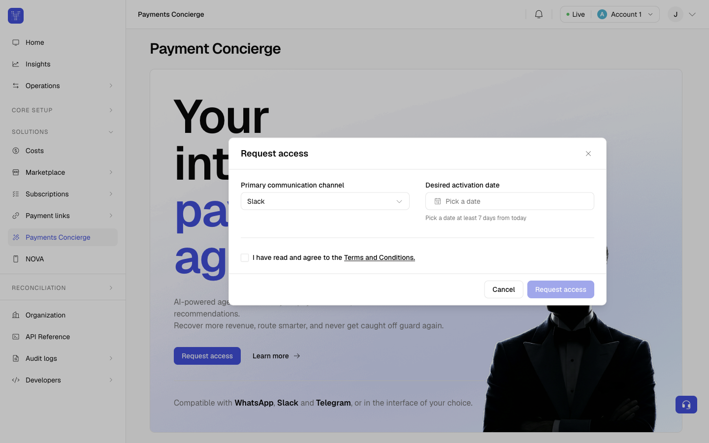</Frame>

    <Note>
    **Paso solo para admins**

    Solo un admin puede solicitar acceso. La fecha de activación debe ser al menos 7 días posterior a hoy.
    </Note>
  </Step>
  <Step title="Asigna niveles de acceso con roles">
    Una vez que el Concierge está activo, tú decides qué puede hacer cada persona. Hay dos niveles de acceso:

    <CardGroup cols={2}>
      <Card title="Admin">
        Configura el Concierge para toda la organización: conecta los canales de comunicación, administra quién tiene acceso, define el conocimiento que usa el Concierge y crea tareas programadas para la organización o para personas individuales.
      </Card>
      <Card title="Miembro">
        Configura el Concierge solo para sí mismo: define sus propios canales y sus propias tareas programadas, sin modificar la configuración de toda la organización.
      </Card>
    </CardGroup>

    Otorgas estos niveles mediante roles personalizados. Desde **Organization → Roles → Create role**, crea un rol, habilita el permiso de Payment Concierge que corresponde al nivel y asigna el rol a la persona:

    * **20.1 Manage Payment Concierge**: otorga la vista Admin.
    * **20.2 Manage Member Payment Concierge**: otorga la vista Member.

    <Frame>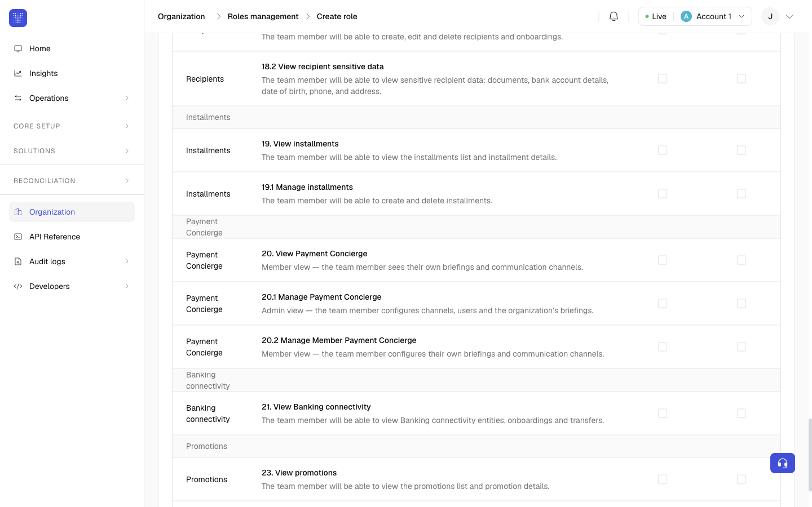</Frame>
  </Step>
</Steps>

<Note>
**Las vistas se adaptan al rol**

La sección se ajusta automáticamente al rol de cada persona, de modo que solo ve lo que le corresponde.
</Note>

## Para admins {#for-admins}

Como admin ves tres pestañas: **Access**, **Scheduled tasks** y **Concierge knowledge**.

<Tabs>
  <Tab title="Access">
    Aquí decides dónde puede hablar el Concierge y a quién puede contactar.

    **Canales de comunicación.** Selecciona los canales donde Payments Concierge puede hablar: Slack, WhatsApp, Telegram y Microsoft Teams.

    <Frame>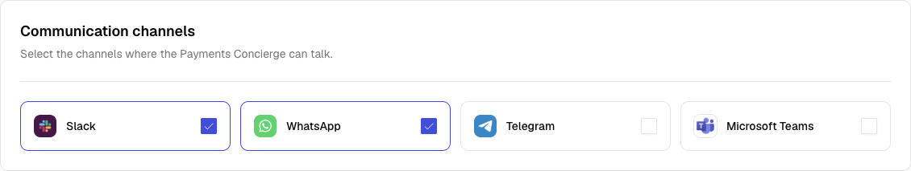</Frame>

    Conectar Microsoft Teams requiere algunos pasos adicionales. Al conectarlo, una guía paso a paso te muestra cómo incorporar el Concierge a tu organización:

    * Crea el bot en Azure.
    * Habilita el canal de Microsoft Teams.
    * Copia el Microsoft App ID y el App Tenant ID.
    * Genera y copia un client secret.
    * Otorga el permiso de Microsoft Graph, para que el Concierge pueda identificar a tus usuarios por email.
    * Sube la app a Teams y luego selecciona **Connect**.

    <Note>
    **Quién puede conectar Microsoft Teams**

    Este paso afecta el registro de tu app de Azure y requiere el consentimiento de un administrador del tenant, por lo que necesitarás a un administrador de Teams de tu organización o a un desarrollador para completarlo.
    </Note>

    **Chats grupales.** Agrega los canales o grupos compartidos donde el Concierge puede publicar: un canal de Slack, un grupo de Telegram o un canal de Microsoft Teams. Selecciona **Add group chat**, elige la plataforma y pega el enlace del canal (por ejemplo `https://acme.slack.com/archives/C0BH7B56GD6`). El panel incluye una guía **How to add the Concierge** (con un video corto) que te muestra de dónde copiar el enlace.

    <Frame>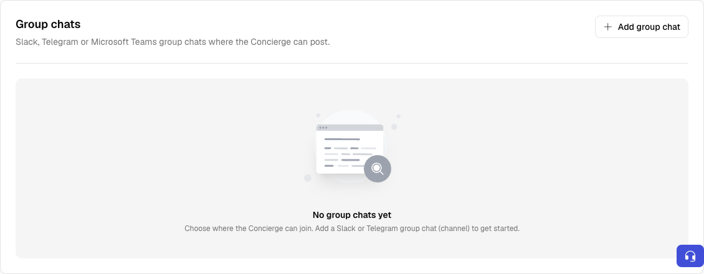</Frame>

    <Frame>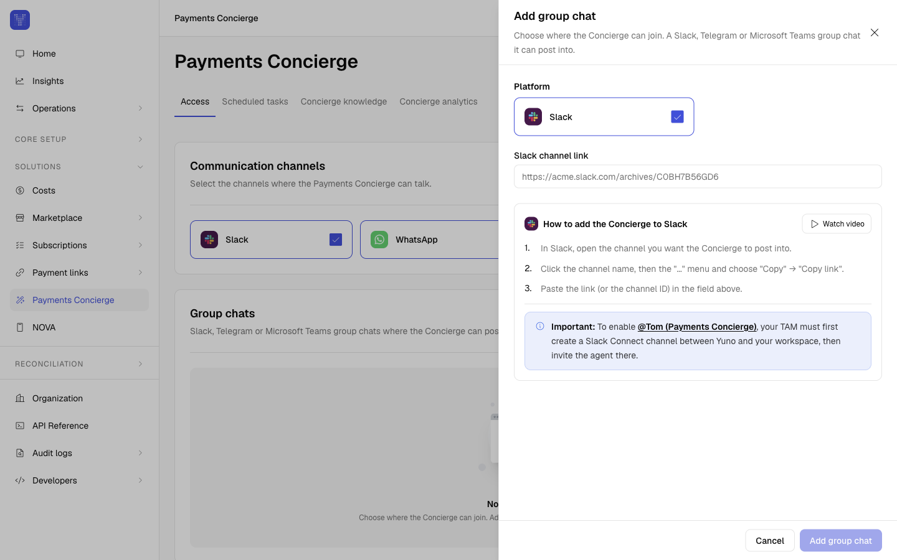</Frame>

    <Note>
    **Los chats grupales de Slack necesitan un canal de Slack Connect**

    Para habilitar **@Tom (Payments Concierge)** en Slack, tu TAM primero debe crear un canal de Slack Connect entre Yuno y tu workspace, y luego invitar al agente allí.
    </Note>

    **Usuarios con acceso.** Asocia a cada persona de tu organización con su identidad de Slack, WhatsApp o Telegram para que el Concierge sepa quién escribe y pueda contactarla por mensaje directo. No necesitas conocer ningún formato especial. Cada canal tiene un enlace **How do I find it?** que guía a la persona para obtener su propio ID:

    * **Slack**: busca **@Tom (Payments Concierge)** en Slack y luego agrega el enlace de tu perfil de Slack para que el agente pueda enviarte mensajes directos.
    * **WhatsApp**: abre un chat con el agente desde **Open WhatsApp** o comparte el enlace con tu equipo. Agrega tu número de teléfono con el código de país (por ejemplo `+573000000000`).
    * **Telegram**: abre un chat con el agente desde **Open Telegram** y luego agrega tu ID de Telegram para que pueda contactarte por mensaje directo.

    Define la identidad de cada persona para sus canales directamente en la tabla de usuarios. Para administrar quién pertenece a tu organización y sus roles, selecciona **Manage access**.

    <Frame>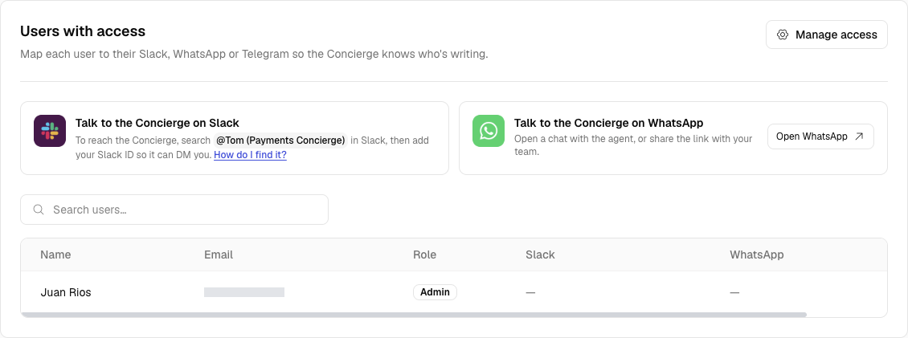</Frame>
  </Tab>
  <Tab title="Scheduled tasks">
    Tareas recurrentes que el Concierge ejecuta y entrega automáticamente, para toda la organización o para una sola persona. Para agregar una, selecciona **New scheduled task** y completa el panel:

    <Steps>
      <Step title="Who is this for?">
        Elige **Whole organization** (todas las personas con acceso la reciben) o **Just me** (solo tú la recibes).

        <Frame>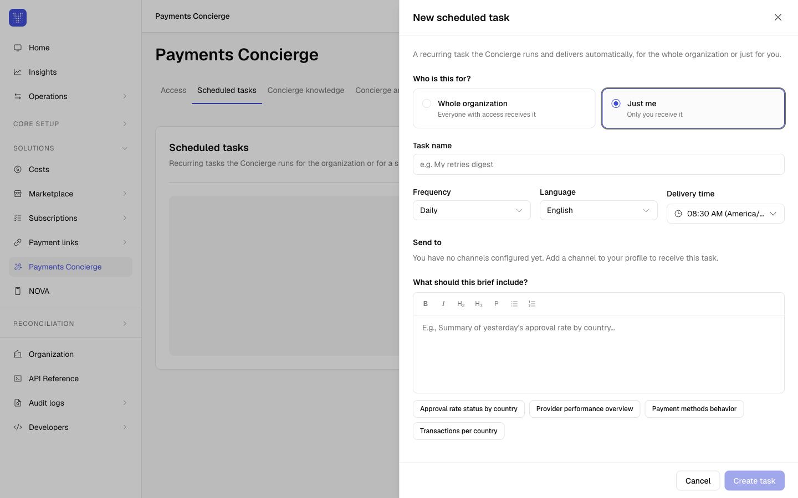</Frame>
      </Step>
      <Step title="Task name">
        Asigna un nombre a la tarea, por ejemplo *Daily Morning Brief*.
      </Step>
      <Step title="Frequency, Language, and Delivery time">
        Define con qué frecuencia se ejecuta (Daily, Weekly o Monthly), el idioma y cuándo se entrega. La hora de entrega usa la zona horaria configurada en los ajustes de tu Dashboard.

        Weekly agrega un campo **Day of the week** y Monthly agrega un campo **Day of the month**.

        <Frame>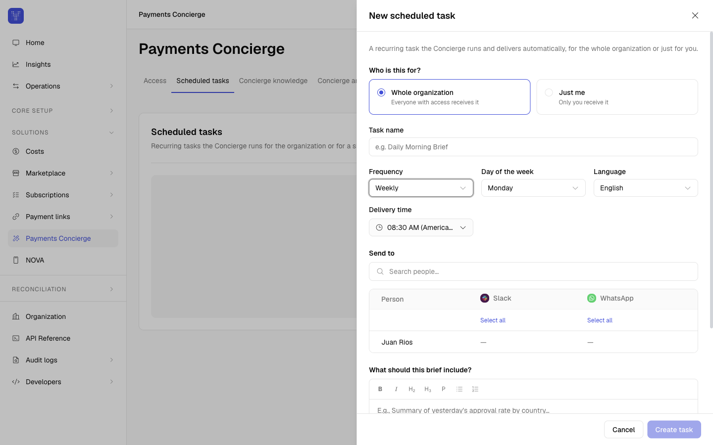</Frame>

        <Frame>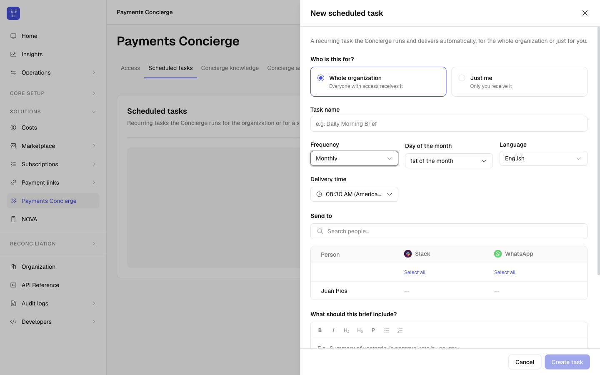</Frame>
      </Step>
      <Step title="What should this brief include?">
        Describe, en lenguaje sencillo, qué debe cubrir el reporte, por ejemplo: *"Resumen de la tasa de aprobación de ayer por país."*

        <Frame>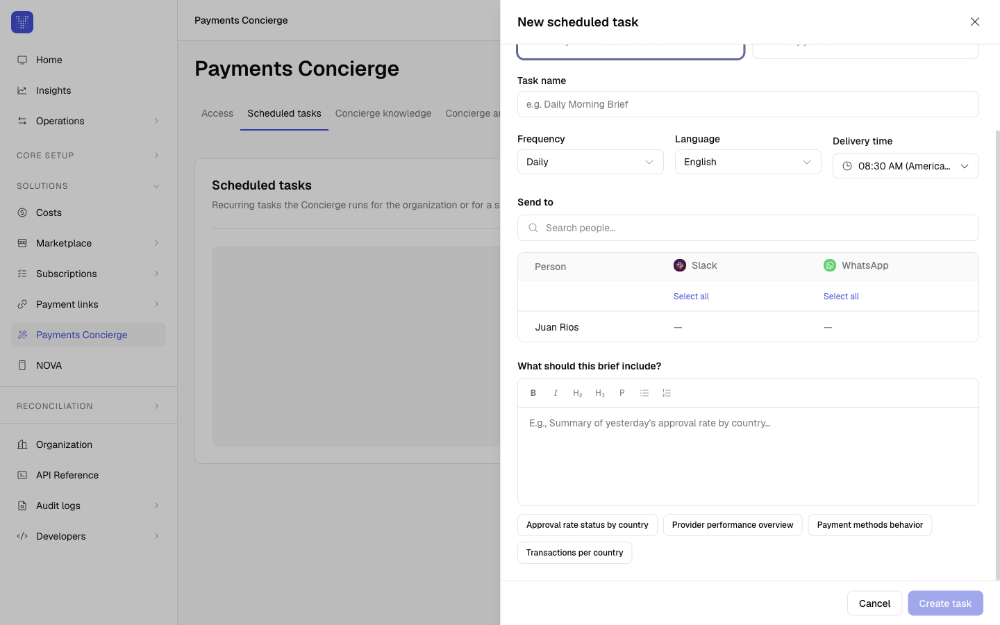</Frame>
      </Step>
      <Step title="Send to">
        Elige las personas y los chats grupales que lo reciben, por canal (Slack, WhatsApp), o usa **Select all**.
      </Step>
      <Step title="Create task">
        Selecciona **Create task**.
      </Step>
    </Steps>

    <Frame>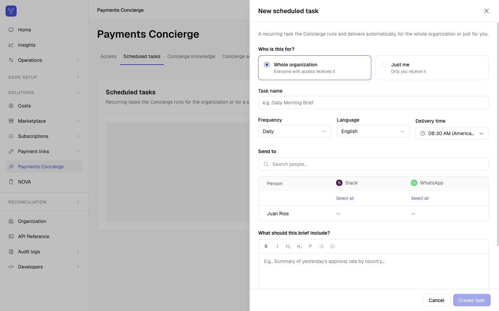</Frame>

    Puedes editar, pausar, reanudar o eliminar cualquier tarea en cualquier momento, y aquí verás todas las tareas de tu organización.
  </Tab>
  <Tab title="Concierge knowledge">
    Los productos, el tono y las políticas que el Concierge aplica en cada conversación. Usa esta pestaña para darle al Concierge contexto de negocio, por ejemplo los mercados en los que operas, los métodos de pago que priorizas y el tono que quieres que use. Escríbelo en el editor y selecciona **Save context**, y el Concierge lo aplicará en todas partes.

    <Frame>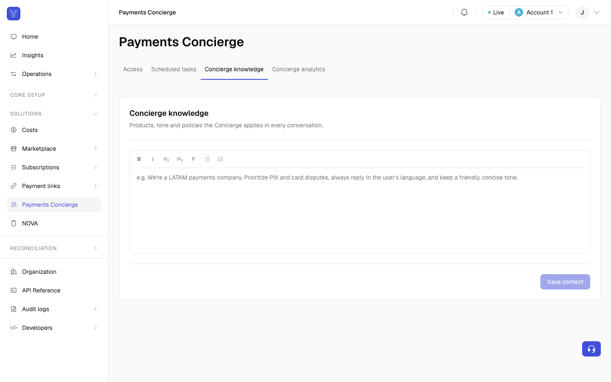</Frame>
  </Tab>
</Tabs>

## Para members {#for-members}

Como member, la sección Payment Concierge es una sola página enfocada en ti: los canales donde el Concierge puede contactarte y tus propias tareas programadas. No ves la configuración de Access ni de Concierge knowledge de toda la organización.

<Frame>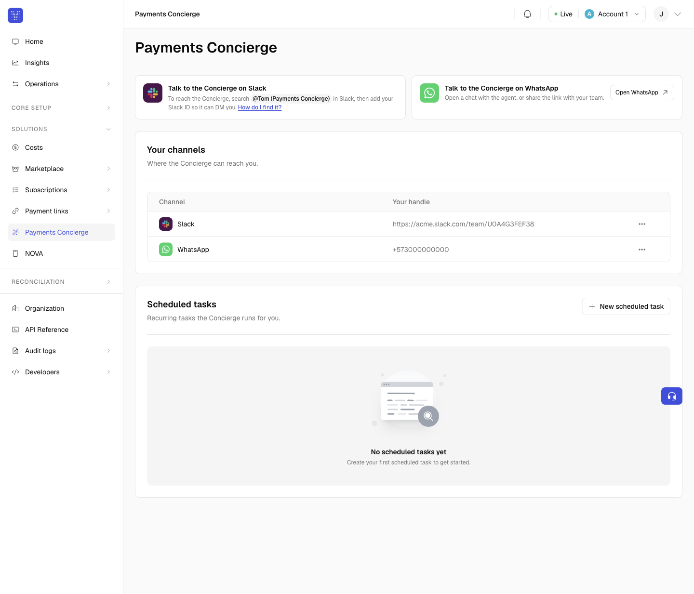</Frame>

**Tus canales.** Configura tu propia identidad para que el Concierge pueda contactarte en los canales que tu admin habilitó. No necesitas conocer ningún formato especial. Cada canal tiene un enlace **How do I find it?** que te muestra exactamente cómo obtener tu ID:

* **Slack**: busca **@Tom (Payments Concierge)** y luego agrega el enlace de tu perfil de Slack para que pueda enviarte mensajes directos.
* **WhatsApp**: abre un chat con el agente desde **Open WhatsApp** y agrega tu número de teléfono con el código de país (por ejemplo `+573000000000`).
* **Telegram**: abre un chat con el agente desde **Open Telegram** y luego agrega tu ID de Telegram.

Estos son tus identificadores personales; no administras los canales de la organización.

**Tus tareas programadas.** Crea tareas recurrentes que el Concierge ejecuta para ti. Tú eliges la frecuencia, la hora de entrega, el idioma y sobre qué informa, y se entrega en tus canales. Solo verás las tareas que son para ti: las que creaste, las que un admin te asignó, además de los resúmenes de toda la organización que llegan a todos. Puedes editar, pausar, reanudar o eliminar tus propias tareas en cualquier momento.

Puedes acceder a Payment Concierge desde el [Yuno Dashboard](https://dashboard.y.uno/).
