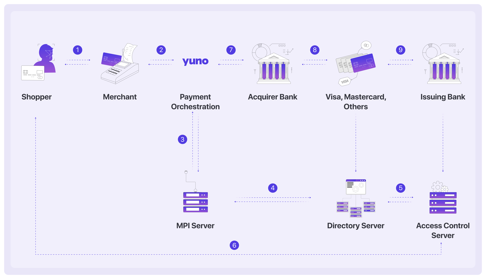

## Qué es 3D Secure {#what-is-3d-secure}

3D Secure (3DS) es un protocolo de seguridad diseñado para evitar el uso fraudulento de tarjetas de crédito en transacciones sin tarjeta presente (CNP). Introducido en 1999, agrega un paso de verificación adicional durante las compras en línea para autenticar a los clientes y reducir el riesgo de fraude. El siguiente flujo presenta un proceso de pago con 3DS:

<Frame></Frame>

## Componentes clave de 3DS {#key-components-of-3ds}

* **Merchant Plugin Interface (MPI)**: Inicia el proceso de verificación e intercambia información de forma segura entre el comercio, el servidor de directorio del esquema y el banco emisor.
* **Scheme Directory Server (DS)**: Actúa como una base de datos centralizada que identifica al banco emisor y determina el método de autenticación.
* **Issuer Access Control Server (ACS)**: Verifica la identidad del titular de la tarjeta durante una transacción 3DS. El ACS evalúa las solicitudes de autenticación y realiza evaluaciones de riesgo según las políticas del banco.

## 3D Secure 2 (3DS2) {#3d-secure-2-3ds2}

Lanzado en 2016, 3D Secure 2 (3DS2) mejora la seguridad y, al mismo tiempo, la experiencia del usuario. A diferencia del 3DS original, que dependía de contraseñas estáticas, 3DS2 introduce la autenticación biométrica y la verificación basada en tokens para un proceso más fluido y seguro.

### Mejoras clave de 3DS2 {#key-improvements-of-3ds2}

* Admite la autenticación mediante biometría, contraseñas de un solo uso y autenticación basada en el riesgo.
* Reduce la fricción en las transacciones con un flujo fluido para los clientes de confianza.
* Mejora la detección de fraude mediante el intercambio de datos detallados entre comercios y bancos.

EMVCo, una organización propiedad de las principales redes de tarjetas, desarrolla y administra 3DS2. Desde octubre de 2022, todas las principales marcas de tarjetas dejaron de admitir el 3DS original, por lo que la integración de 3DS2 es esencial para realizar transacciones seguras.

Yuno ofrece una integración sencilla de 3DS2, que garantiza pagos seguros y sin fricción para tus clientes.

## Beneficios de 3D Secure 2 {#benefits-of-3d-secure-2}

3DS2 mejora la seguridad y, al mismo tiempo, la experiencia del usuario, y adapta el protocolo original a las tecnologías de pago modernas.

### Optimizado para las nuevas tecnologías {#optimized-for-new-technologies}

Diseñado para el auge de los teléfonos inteligentes, 3DS2 permite a los bancos ofrecer autenticación biométrica, como huella dactilar o reconocimiento facial, mediante las apps de banca móvil. Esta flexibilidad permite a los comercios ofrecer métodos de autenticación que se ajustan a las preferencias del usuario, lo que crea una experiencia de checkout más cómoda y segura.

### Capacidades de integración {#integration-capabilities}

3DS2 incluye un componente de SDK que permite la integración nativa en apps móviles, lo que permite a los comercios autenticar transacciones directamente dentro de sus apps. Esto elimina las redirecciones de página completa y garantiza un proceso de checkout fluido e ininterrumpido.

### Datos mejorados para la autenticación {#enhanced-data-for-authentication}

3DS2 permite a las empresas compartir diez veces más datos de la transacción con el banco del titular de la tarjeta. Esto incluye detalles específicos del pago (por ejemplo, la dirección de envío) y datos de contexto (por ejemplo, el ID del dispositivo y el historial de transacciones). Con más datos, los bancos pueden evaluar el riesgo con mayor precisión y, a menudo, autenticar los pagos sin que el cliente tenga que aportar información adicional.

### Flujos de autenticación en 3DS2 {#authentication-flows-in-3ds2}

#### Flujo sin fricción {#frictionless-flow}

En un flujo sin fricción, el sistema verifica la identidad del cliente de forma automática, mediante un intercambio de datos en segundo plano. Como el sistema ya reconoce el dispositivo y la información del usuario, no se necesita ninguna acción adicional.

#### Flujo con desafío {#challenge-flow}

Si los datos disponibles no bastan para verificar al cliente, el sistema activa un flujo con desafío. Esto requiere un paso de autenticación adicional, como una contraseña de un solo uso o una verificación biométrica. También es posible que el cliente sea redirigido a la página del emisor de su tarjeta para una validación adicional.

### Mejor experiencia del usuario y mayores tasas de conversión {#better-user-experience-and-conversion-rates}

Al reducir la fricción en el proceso de autenticación, 3DS2 mejora la experiencia de checkout, reduce las tasas de abandono del carrito y aumenta las tasas de conversión, lo que hace que los pagos en línea sean más seguros y más fáciles de usar.

## 3DS Standalone {#3ds-standalone}

3DS Standalone te permite desacoplar la autenticación 3DS de la autorización del pago, de modo que puedas ejecutar 3DS como un paso independiente. Esto es especialmente útil para los comercios que usan motores internos de fraude o de riesgo para evaluar los resultados de 3DS antes de decidir si continúan con la autorización.

Al usar 3DS Standalone, solo realizas el paso de autenticación con Yuno. Luego recibes los datos de autenticación (como ECI y CAVV) mediante un webhook, que puedes usar para autorizar el pago a través de Yuno o de otro procesador.

### Activar 3DS Standalone {#triggering-3ds-standalone}

Para activar una autenticación standalone, debes incluir el metadato `3DS_ONLY` con el valor `1` en tu solicitud de pago:

```json
{
  ...
  "metadata": [
    {
      "key": "3DS_ONLY",
      "value": "1"
    }
  ]
}
```

Para obtener más detalles sobre cómo integrar y configurar este flujo, consulta la [guía de 3DS Standalone](/es/docs/payment-features/3ds-standalone).
 
