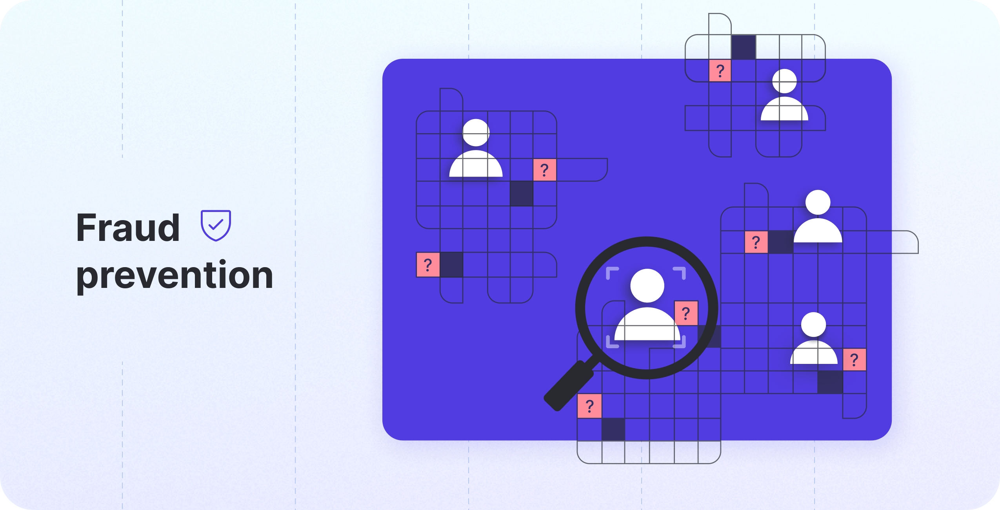

Yuno se integra con servicios externos de detección de fraude para ayudarte a prevenir el fraude en tu proceso de pago. Puedes configurar la verificación de fraude **previa a la autorización** y **posterior a la autorización** a través de tu **proveedor de detección de fraude** preferido.

### Prevención de fraude con Yuno {#fraud-prevention-with-yuno}

Cuando usas el SDK de Yuno, no se requiere desarrollo adicional. Solo agrega el proveedor de detección de fraude a la ruta de pago, y Yuno se encarga del resto.

<Frame></Frame>

Cuando se crea un pago, Yuno genera distintas transacciones según la ruta del método de pago. Si la verificación de fraude está habilitada en la ruta, Yuno crea una transacción `FRAUD_SCREENING` y la asocia con el pago. Esta transacción contiene detalles sobre el resultado de la verificación de fraude, que también puedes ver en los [detalles del pago](/es/docs/basic-concepts/transactions#transaction-types-and-statuses) en tu dashboard de Yuno.

<Note>
**La recopilación del ID de sesión es específica de la ruta**

El SDK solo recopila una huella digital del dispositivo (fingerprint) o `session_id` para los proveedores de fraude configurados en la ruta de fraude activa del comercio. Si necesitas recopilar un `session_id` para un proveedor específico, asegúrate de que ese proveedor esté agregado a la ruta de ese método de pago en tu dashboard de Yuno.
</Note>

### Captura del token de sesión de Forter {#forter-session-token-capture}

Si usas **Forter** para la detección de fraude, el SDK de Yuno ofrece una forma confiable de capturar el token de sesión.

Para asegurarte de que el token se capture correctamente y se asocie con la transacción, debes escuchar el evento `ftr:tokenReady`. Este evento se activa cuando el token de sesión de Forter se genera y está listo para usarse.

```javascript
window.addEventListener('ftr:tokenReady', (event) => {
  const forterToken = event.detail;
  console.log('Forter Session Token ready:', forterToken);
});
```

Usar este listener evita problemas con tokens obsoletos o ausentes, al asegurar que siempre captures el token en el momento correcto durante la inicialización o el desmontaje del componente de Forter.
### Sesión de dispositivo de Risk.js de Checkout.com {#checkoutcom-riskjs-device-session}

Si enrutas pagos con tarjeta a **Checkout.com**, su motor de riesgo puede puntuar cada pago con datos del dispositivo recopilados en tu página de checkout por la biblioteca Risk.js de Checkout.com. El SDK Web de Yuno recopila esa sesión de dispositivo por ti y Yuno la envía a Checkout.com con el pago como `risk.device_session_id`.

Para activarla, abre tu conexión de Checkout.com en el dashboard de Yuno (**Connections**) y completa tres campos:

| Campo | Valor |
| --- | --- |
| **Enable Risk.js device session** | Márcalo. |
| **Public key (Risk.js)** | Tu clave pública de API de Checkout.com (`pk_…`). Es una clave publicable: el SDK la comparte con el navegador del comprador. |
| **Merchant-specific sub-domain (Risk.js)** | Los primeros ocho caracteres de tu ID de cliente de Checkout.com, sin el prefijo `cli_` (para `cli_vkuhvk4vjn2e…` ingresa `vkuhvk4v`). Risk.js se niega a iniciar sin él. |

No se necesita ningún cambio de código de tu lado. A partir del SDK Web 1.11.43, cuando se monta un método de pago enrutado a esa conexión, el SDK carga Risk.js en segundo plano desde `risk.checkout.com` (`risk.sandbox.checkout.com` para claves de sandbox), publica los datos del dispositivo y adjunta el ID de sesión de dispositivo devuelto al token de un solo uso y al pago. Se aplica a todos los métodos de pago enrutados a la conexión (tarjetas, billeteras y métodos de pago alternativos) en los checkouts Full, Lite y Seamless, en Secure Fields y en los botones de billetera.

<Note>
- Risk.js se solicita directamente a Checkout.com, no a través de tu proxy de marca blanca. Si tu página define una Content Security Policy, permite esos dos hosts en `script-src`.
- La recopilación nunca bloquea el checkout: si el script no se carga o Checkout.com no responde a tiempo, el pago se procesa sin una sesión de dispositivo y el SDK registra el fallo.
- Checkout.com conserva una sesión de dispositivo durante 20 minutos. El SDK la recopila cuando se monta el método de pago, así que un checkout que permanece abierto más tiempo que eso paga sin ella.
- Los SDK móviles no recopilan la sesión de dispositivo de Risk.js.
</Note>
