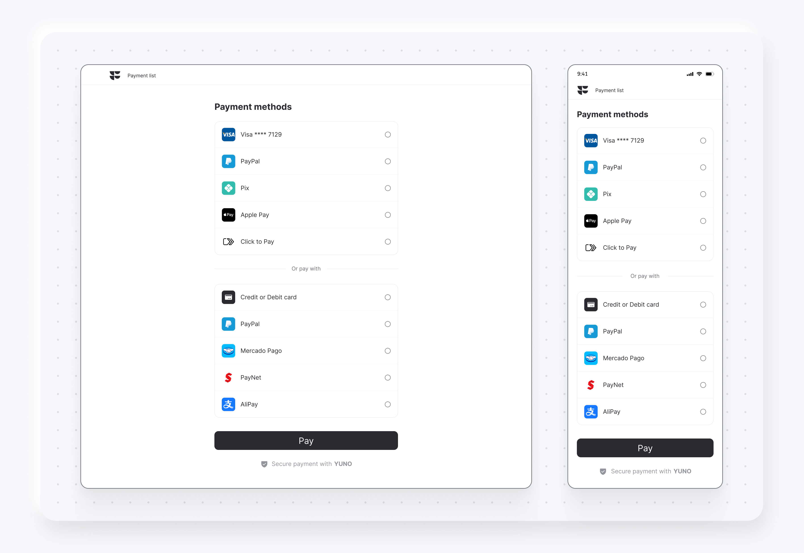

Yuno ofrece una amplia gama de conexiones con diversos procesadores y métodos de pago, y amplía esta cobertura de forma continua. Esta página explica los métodos de pago disponibles, sus capacidades y cómo se organizan dentro de la plataforma de Yuno.

## ¿Qué es un método de pago? {#what-is-a-payment-method}

Para entender mejor el proceso de pago, es fundamental diferenciar entre métodos de pago y procesadores.

* **Método de pago**: un método de pago es una forma de recopilar la información de pago del cliente y enviarla a un procesador para su procesamiento. Los métodos de pago más comunes incluyen:
  * Tarjetas de crédito y débito
  * Billeteras digitales (Apple Pay, Google Pay)
  * Transferencias bancarias (iDeal)
  * Servicios de compra ahora, paga después (Klarna)
  * Métodos de pago regionales (UPI, Pix)
* **Procesadores**: los procesadores actúan como intermediarios entre los bancos del comercio y del cliente: gestionan los reembolsos y las cancelaciones, y se encargan del procesamiento de la información obtenida por el método de pago.

## Diferencias entre métodos de pago {#differences-between-payment-methods}

Los métodos de pago pueden diferir significativamente en su procesamiento. Además, algunos admiten la inscripción y otros no. Los métodos de pago se pueden dividir según sus **características de inscripción** y la **interacción del usuario**.

### Interacción del usuario {#user-interaction}

El flujo de trabajo de los métodos de pago puede variar según las capacidades de cada procesador y las acciones que el cliente debe realizar para completar el pago. Hay dos tipos principales: síncronos y asíncronos.

* **Síncronos**: los métodos de pago síncronos dan un resultado final inmediato cuando el cliente hace clic en **Pay**, y el comercio crea el pago en segundo plano. En estos casos, no necesitas webhooks para conocer el resultado, ya que se entrega en la respuesta del pago.
* **Asíncronos**: los métodos de pago asíncronos, en cambio, requieren un paso adicional del cliente para finalizar el pago. Estos pagos tienen un estado intermedio de `PENDING` hasta que el cliente completa el pago o el procesador notifica a Yuno el resultado final. Para mantenerte al día con estos estados, es importante configurar [Webhooks](/es/docs/basic-concepts/webhooks-1) en tu cuenta de Yuno para recibir actualizaciones al instante.

### Inscripción {#enrollment}

En Yuno, la **inscripción** se refiere al proceso de almacenar la información del método de pago de un cliente para compras futuras. Esto permite que el cliente o el comercio inicien transacciones sin necesidad de que el cliente ingrese información adicional.

* **Métodos de pago inscribibles**: Yuno ofrece varios métodos de pago para la inscripción, entre ellos las **tarjetas de crédito y débito** y métodos alternativos, principalmente billeteras, que permiten a los clientes proporcionar la información de su cuenta para pagos futuros.
* **Métodos de pago no inscribibles**: los métodos de pago que no se pueden inscribir suelen ser métodos alternativos, como los basados en transferencias bancarias o pagos en efectivo, que pueden requerir que el cliente realice una acción en cada pago.

<Frame></Frame>
