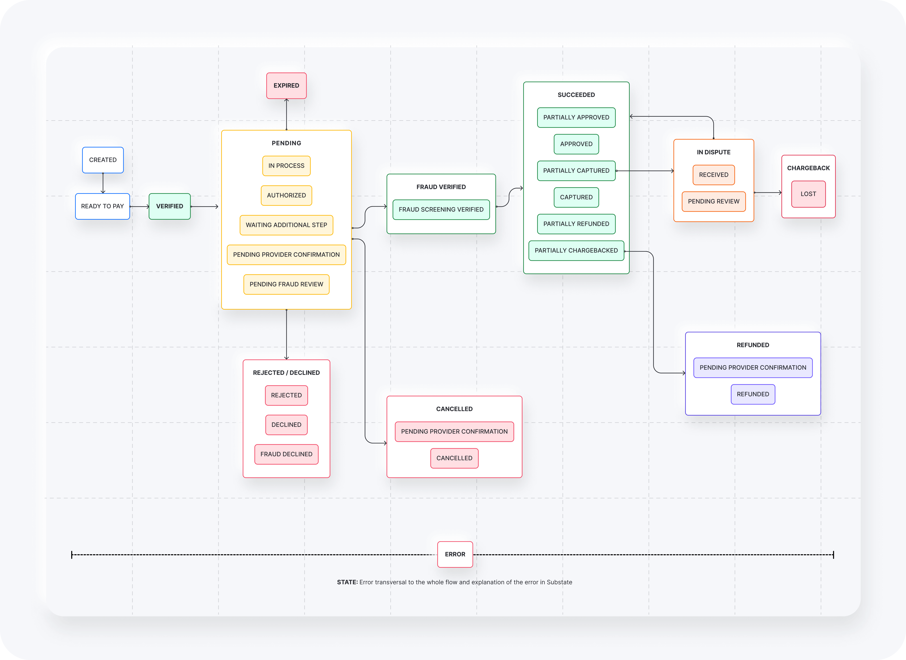

## ¿Qué es un pago? {#what-is-a-payment}

Un pago representa la transacción de un usuario, sin importar los procesadores o métodos de pago que se usen.

Los pagos reúnen los datos esenciales del pedido, como la información del cliente, el monto total, la moneda, los productos, los datos de envío y más. Para entender mejor cómo interactúan los pedidos y los pagos, consulta la página [Transacciones](/docs/basic-concepts/transactions).

## Flujo de un pago {#payment-workflow}

El siguiente flujo muestra los estados posibles de un pago y cómo se conectan. Cada pago tiene un estado que sigue un ciclo de vida estandarizado, lo que garantiza un comportamiento uniforme en todos los métodos de pago. Un pago avanza por una secuencia de estados hasta completarse. El diagrama a continuación explica los resultados posibles según los estados de las transacciones.

<Frame></Frame>

Para obtener más detalles sobre los códigos y mensajes de estado, consulta la [referencia de la API de pagos](/reference/payments/status-and-response-codes/payment).

## Pagos y transacciones {#payments-and-transactions}

Un pago se compone de varias transacciones que determinan su resultado final. Si habilitas distintas conexiones en la ruta de tu método de pago, como prevención de fraude, 3D Secure o proveedores de respaldo, Yuno agrega las transacciones correspondientes al pago. Estas transacciones pasan a formar parte del ciclo de vida del pago.

En la sección [Payments](/docs/using-yuno/dashboard-overview/payments) de tu dashboard de Yuno, puedes ver y exportar todos los detalles de pagos y transacciones.

Para obtener más detalles sobre cómo las transacciones afectan el resultado de los pagos, consulta la sección [Transacciones](/docs/basic-concepts/transactions).