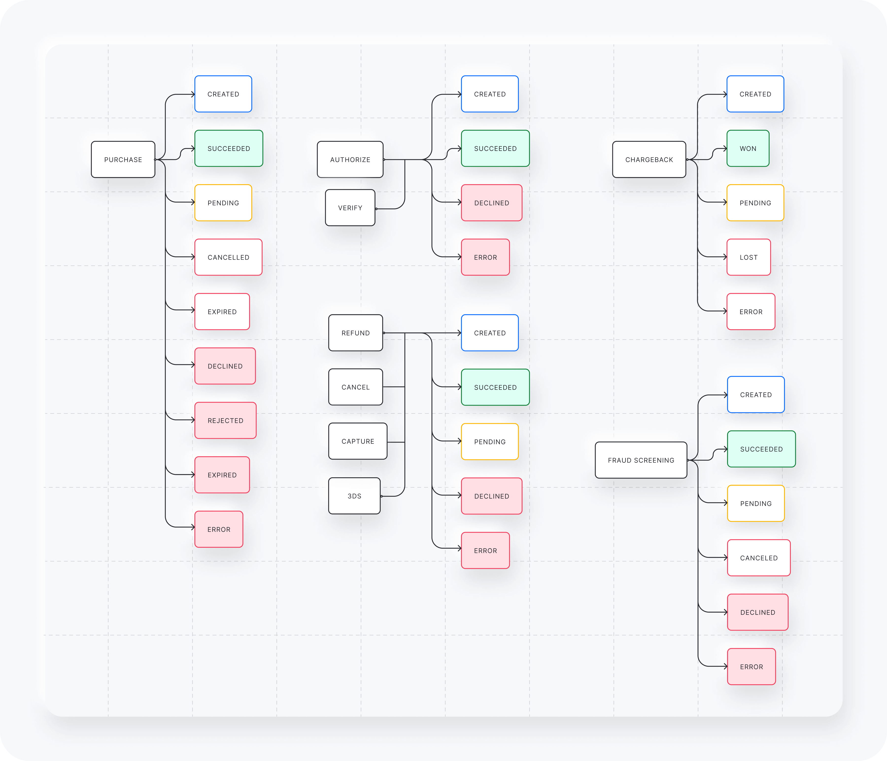

## ¿Qué es una transacción? {#what-is-a-transaction}

Cada pago tiene una o más transacciones asociadas. Un pago en Yuno puede pasar por varios procesadores mediante alternativas de respaldo, reintentos o enrutamiento dividido. Cada uno de estos recorridos puede agregar varias transacciones al pago. Puedes consultar todas las transacciones relacionadas con un pago en la [línea de tiempo del pago](/es/docs/using-yuno/dashboard-overview/payments) del Dashboard de Yuno.

En Yuno, las transacciones se dividen en transacciones **primarias** y **secundarias**. Además, cada transacción puede tener un estado distinto según su etapa de procesamiento.

## Tipos y estados de las transacciones {#transaction-types-and-statuses}

### Transacciones primarias {#primary-transactions}

Las transacciones primarias inician un pago y pueden ser de uno de tres tipos:

* **Purchase**: una transacción de venta estándar.
* **Authorize**: una transacción que se usa para autorizar el monto de un pago que se capturará más adelante.
* **Verify**: una transacción para verificar si el cliente usa un método de pago válido.

### Transacciones secundarias {#secondary-transactions}

Las transacciones secundarias son transacciones adicionales que afectan el resultado final del pago y de la transacción primaria. Las transacciones secundarias pueden ser:

* **Refund**: un reembolso de la transacción inicial, que puede ser total o parcial.
* **Cancel**: una cancelación de una autorización inicial.
* **Capture**: una captura de fondos de una transacción de autorización inicial, que puede ser total o parcial.
* **Chargeback**: una disputa iniciada por el cliente sobre la transacción inicial.
* **3DS**: una verificación 3D Secure (3DS) de una transacción inicial.
* **Fraud screening**: una verificación de fraude de una transacción inicial. Se representan como `FRAUD_SCREENING` en la respuesta de tus pagos.
* **Marketplace transfers**: transferencias independientes dentro de un Marketplace, representadas como `SPLIT_TRANSFER` para transferencias directas y `SPLIT_TRANSFER_REVERSE` para reversos independientes. Las transferencias vinculadas a una transacción de pago también se pueden revertir y se representan como `SPLIT_TRANSFER_REVERSAL`.

A continuación se presentan todos los estados posibles de cada tipo de transacción.

<Frame></Frame>

Consulta la [referencia de la API de transacciones](/reference/payments/status-and-response-codes/transaction) para obtener información más detallada sobre los códigos y mensajes de estado de las transacciones.

La sección [Payments](/es/docs/using-yuno/dashboard-overview/payments) del Dashboard de Yuno te permite ver tus pagos y transacciones. Desde allí también puedes exportar esta información.
