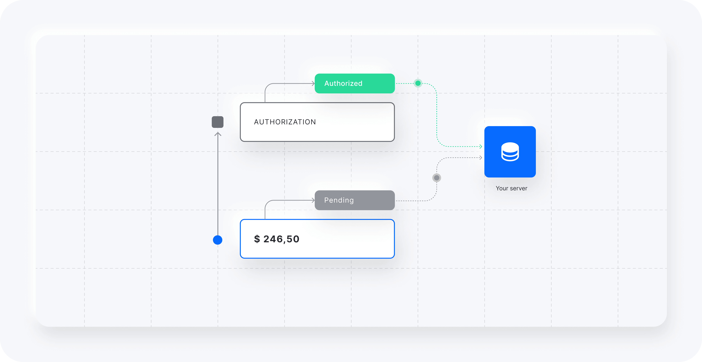

Un webhook es la forma en que Yuno notifica a tu sistema sobre eventos, como un pago autorizado o una suscripción renovada, mediante un `POST` HTTP a una URL que configuras, en lugar de que tu sistema tenga que consultar periódicamente si hay novedades.

<Frame></Frame>

Consulta la [descripción general de webhooks](/docs/webhooks) para conocer el comportamiento de las entregas, cómo configurar uno desde el dashboard o la API, y el catálogo completo de eventos.
