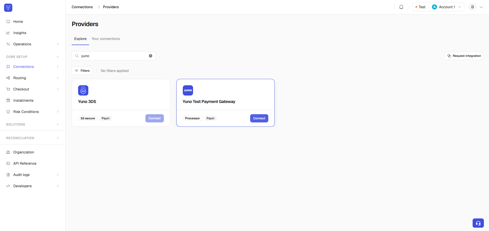
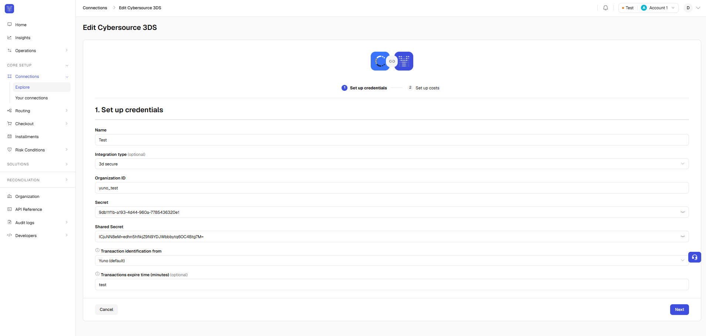
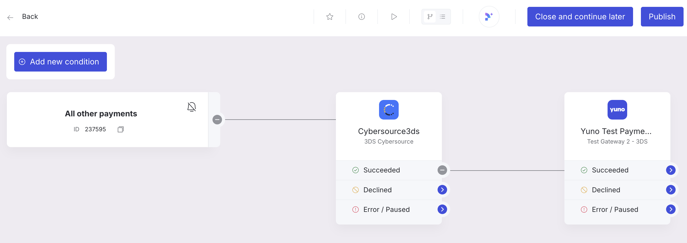
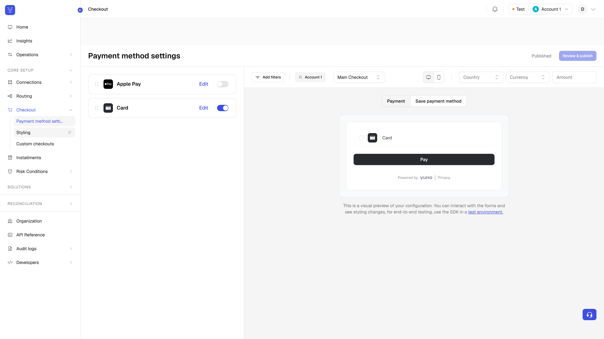

Usa esta guía paso a paso para configurar y probar 3D Secure en Yuno. Configurarás una conexión con 3DS habilitado y las credenciales del proveedor, agregarás 3DS a tu enrutamiento, habilitarás Card en Checkout Builder y validarás pagos con el Yuno Testing Gateway, el Yuno SDK o la API. Incluye tarjetas de prueba por esquema, códigos OTP y notas de solución de problemas para verificar los escenarios sin fricción y con desafío.

## Tarjetas de prueba para el flujo 3DS {#testing-cards-for-3ds-flow}

Usa las tarjetas por esquema que aparecen abajo para validar 3DS en sandbox. En el entorno de vista previa, un simulador imita el Directory Server (DS) y el Access Control Server (ACS) para que puedas probar resultados sin fricción y con desafío. Cada tabla muestra el número de tarjeta con los resultados esperados de 3DS2 y las respuestas VERes (Verification Response) y PARes (Payer Authentication Response) de 3DS1. Usa los códigos de contraseña de un solo uso (OTP) del final para completar los escenarios con desafío.

<AccordionGroup>
<Accordion title="Amex">
<table>
  <thead>
    <tr>
      <th>Número de tarjeta</th>
      <th>Respuesta esperada 3DS 2.x</th>
      <th>Respuesta esperada 3DS 1.x DS (VERes)</th>
      <th>Respuesta esperada 3DS 1.x ACS (PARes)</th>
    </tr>
  </thead>
  <tbody>
    <tr><td>341502098634895</td><td>AUTHENTICATED_APPLICATION_FRICTIONLESS</td><td>ENROLLED_Y</td><td>TRANSACTION_STATUS_Y</td></tr>
    <tr><td>348638267931507</td><td>BROWSER_CHALLENGE</td><td>ENROLLED_Y</td><td>TRANSACTION_CHALLENGE_OTP</td></tr>
    <tr><td>345695399207589</td><td>NOT_AUTHENTICATED_APPLICATION_FRICTIONLESS</td><td>ENROLLED_Y</td><td>TRANSACTION_STATUS_N</td></tr>
    <tr><td>349531373081938</td><td>APPLICATION_CHALLENGE</td><td>ENROLLED_Y</td><td>TRANSACTION_STATUS_N</td></tr>
    <tr><td>342316317472410</td><td>APPLICATION_CHALLENGE_SDK_TRANS_ID_INVALID_FORMAT</td><td>ENROLLED_Y</td><td>TRANSACTION_STATUS_N</td></tr>
    <tr><td>347899129656655</td><td>AUTHENTICATED_BROWSER_FRICTIONLESS</td><td>ENROLLED_Y</td><td>TRANSACTION_STATUS_Y</td></tr>
    <tr><td>345197771649926</td><td>NOT_AUTHENTICATED_BROWSER_FRICTIONLESS</td><td>ENROLLED_Y</td><td>TRANSACTION_STATUS_N</td></tr>
    <tr><td>372021106351394</td><td>BROWSER_CHALLENGE</td><td>ENROLLED_Y</td><td>TRANSACTION_CHALLENGE_OTP</td></tr>
    <tr><td>3734123412340000</td><td>NOT_AUTHENTICATED_BROWSER_FRICTIONLESS</td><td>ENROLLED_Y</td><td>TRANSACTION_STATUS_N</td></tr>
    <tr><td>3434567891111005</td><td>BROWSER_CHALLENGE</td><td>ENROLLED_Y</td><td>TRANSACTION_CHALLENGE_OTP</td></tr>
    <tr><td>3794521996036850</td><td>BROWSER_CHALLENGE</td><td>ENROLLED_Y</td><td>TRANSACTION_CHALLENGE_OTP</td></tr>
  </tbody>
</table>
</Accordion>

<Accordion title="Mastercard">
<table>
  <thead>
    <tr>
      <th>Número de tarjeta</th>
      <th>Respuesta esperada 3DS 2.x</th>
      <th>Respuesta esperada 3DS 1.x DS (VERes)</th>
      <th>Respuesta esperada 3DS 1.x ACS (PARes)</th>
    </tr>
  </thead>
  <tbody>
    <tr><td>5333259155643223</td><td>AUTHENTICATED_APPLICATION_FRICTIONLESS</td><td>ENROLLED_Y</td><td>TRANSACTION_STATUS_Y</td></tr>
    <tr><td>5306889942833340</td><td>BROWSER_CHALLENGE</td><td>ENROLLED_Y</td><td>TRANSACTION_CHALLENGE_OTP</td></tr>
    <tr><td>5328720384582224</td><td>NOT_AUTHENTICATED_APPLICATION_FRICTIONLESS</td><td>ENROLLED_Y</td><td>TRANSACTION_STATUS_N</td></tr>
    <tr><td>5267648608924299</td><td>APPLICATION_CHALLENGE</td><td>ENROLLED_Y</td><td>TRANSACTION_STATUS_N</td></tr>
    <tr><td>5187434643593002</td><td>APPLICATION_CHALLENGE_SDK_TRANS_ID_INVALID_FORMAT</td><td>ENROLLED_Y</td><td>TRANSACTION_STATUS_N</td></tr>
    <tr><td>5512459816707531</td><td>AUTHENTICATED_BROWSER_FRICTIONLESS</td><td>ENROLLED_Y</td><td>TRANSACTION_STATUS_Y</td></tr>
    <tr><td>5487971631330522</td><td>NOT_AUTHENTICATED_BROWSER_FRICTIONLESS</td><td>ENROLLED_Y</td><td>TRANSACTION_STATUS_N</td></tr>
    <tr><td>5424184049821670</td><td>BROWSER_CHALLENGE</td><td>ENROLLED_Y</td><td>TRANSACTION_CHALLENGE_OTP</td></tr>
    <tr><td>5204240438720050123</td><td>BROWSER_CHALLENGE</td><td>ENROLLED_Y</td><td>TRANSACTION_CHALLENGE_OTP</td></tr>
    <tr><td>5250548692069390</td><td>BROWSER_CHALLENGE</td><td>ENROLLED_Y</td><td>TRANSACTION_CHALLENGE_OTP</td></tr>
    <tr><td>5641523891636636</td><td>BROWSER_CHALLENGE</td><td>ENROLLED_Y</td><td>TRANSACTION_CHALLENGE_OTP</td></tr>
  </tbody>
</table>
</Accordion>

<Accordion title="Visa">

<Note>
  `N/A` significa que el caso de prueba genera un error de protocolo o de transporte antes de llegar a la etapa del DS o del ACS, por lo que no se devuelve ninguna respuesta del DS/ACS para esa tarjeta.
</Note>

<table>
  <thead>
    <tr>
      <th>Número de tarjeta</th>
      <th>Respuesta esperada 3DS 2.x</th>
      <th>Respuesta esperada 3DS 1.x DS (VERes)</th>
      <th>Respuesta esperada 3DS 1.x ACS (PARes)</th>
    </tr>
  </thead>
  <tbody>
    <tr><td>4556557955726624</td><td>AUTHENTICATED_APPLICATION_FRICTIONLESS</td><td>ENROLLED_Y</td><td>TRANSACTION_STATUS_Y</td></tr>
    <tr><td>4916994064252017</td><td>BROWSER_CHALLENGE</td><td>ENROLLED_Y</td><td>TRANSACTION_CHALLENGE_OTP</td></tr>
    <tr><td>4556104160382032</td><td>NOT_AUTHENTICATED_APPLICATION_FRICTIONLESS</td><td>ENROLLED_Y</td><td>TRANSACTION_STATUS_N</td></tr>
    <tr><td>4024007189449340</td><td>APPLICATION_CHALLENGE</td><td>ENROLLED_Y</td><td>TRANSACTION_STATUS_N</td></tr>
    <tr><td>4024007179872394</td><td>APPLICATION_CHALLENGE_SDK_TRANS_ID_INVALID_FORMAT</td><td>ENROLLED_Y</td><td>TRANSACTION_STATUS_N</td></tr>
    <tr><td>4929251897047956</td><td>AUTHENTICATED_BROWSER_FRICTIONLESS</td><td>ENROLLED_Y</td><td>TRANSACTION_STATUS_Y</td></tr>
    <tr><td>4716429323842524</td><td>NOT_AUTHENTICATED_BROWSER_FRICTIONLESS</td><td>ENROLLED_Y</td><td>TRANSACTION_STATUS_N</td></tr>
    <tr><td>4234123412340003</td><td>BROWSER_CHALLENGE</td><td>ENROLLED_Y</td><td>TRANSACTION_CHALLENGE_OTP</td></tr>
    <tr><td>4604633194219929</td><td>BROWSER_CHALLENGE</td><td>ENROLLED_Y</td><td>TRANSACTION_CHALLENGE_OTP</td></tr>
    <tr><td>4485436455354151</td><td>BROWSER_FRICTIONLESS_MISSING_DS_TRANS_ID</td><td>N/A</td><td>N/A</td></tr>
    <tr><td>4556962659911995</td><td>APPLICATION_FRICTIONLESS_MISSING_SDK_TRANS_ID</td><td>ENROLLED_Y</td><td>TRANSACTION_STATUS_N</td></tr>
    <tr><td>4539837572943550</td><td>BROWSER_FRICTIONLESS_MISSING_DS_TRANS_ID</td><td>ENROLLED_Y</td><td>TRANSACTION_STATUS_N</td></tr>
    <tr><td>4024007176265022</td><td>BROWSER_CHALLENGE_MISSING_ACS_URL</td><td>ENROLLED_Y</td><td>TRANSACTION_STATUS_N</td></tr>
    <tr><td>4716125059847899</td><td>THREE_RI</td><td>ENROLLED_Y</td><td>TRANSACTION_STATUS_N</td></tr>
    <tr><td>4556362626719763</td><td>PROTOCOL_ERROR</td><td>ENROLLED_Y</td><td>TRANSACTION_STATUS_N</td></tr>
    <tr><td>4234123412340000</td><td>AUTHENTICATED_BROWSER_FRICTIONLESS</td><td>ENROLLED_Y</td><td>TRANSACTION_STATUS_Y</td></tr>
    <tr><td>4234123412340006</td><td>UNAVAILABLE_BROWSER_FRICTIONLESS</td><td>ENROLLED_Y</td><td>TRANSACTION_STATUS_U</td></tr>
    <tr><td>4234123412340007</td><td>ATTEMPTED_BROWSER_FRICTIONLESS</td><td>ENROLLED_Y</td><td>TRANSACTION_STATUS_A</td></tr>
    <tr><td>4234123412340001</td><td>NOT_ENROLLED</td><td>ENROLLED_N</td><td>N/A</td></tr>
    <tr><td>4234123412340002</td><td>NOT ENROLLED (VeRes es el error 404 "Card account number not found in card ranges from Directory Server")</td><td>ENROLLED_N (NOT APPLICABLE)</td><td>N/A</td></tr>
    <tr><td>4234123412340100</td><td>MISSING_ROOT</td><td>N/A</td><td>N/A</td></tr>
    <tr><td>4234123412340101</td><td>MISSING_MESSAGE</td><td>N/A</td><td>N/A</td></tr>
    <tr><td>4234123412340102</td><td>INVALID_MESSAGE</td><td>N/A</td><td>N/A</td></tr>
    <tr><td>4234123412340103</td><td>MISSING_VERSION</td><td>N/A</td><td>N/A</td></tr>
    <tr><td>4234123412340104</td><td>ILLEGAL_VERSION</td><td>N/A</td><td>N/A</td></tr>
    <tr><td>4234123412340105</td><td>MISSING_URL</td><td>N/A</td><td>N/A</td></tr>
    <tr><td>4234123412340106</td><td>ILLEGAL_URL</td><td>N/A</td><td>N/A</td></tr>
    <tr><td>4234123412340107</td><td>MISSING_ENROLLED</td><td>N/A</td><td>N/A</td></tr>
    <tr><td>4234123412340108</td><td>ILLEGAL_ENROLLED</td><td>N/A</td><td>N/A</td></tr>
    <tr><td>4234123412340109</td><td>ILLEGAL_EXTENSION</td><td>N/A</td><td>N/A</td></tr>
    <tr><td>4234123412340200</td><td>ERROR_CUSTOM</td><td>N/A</td><td>N/A</td></tr>
    <tr><td>4234123412340201</td><td>ERROR_1</td><td>N/A</td><td>N/A</td></tr>
    <tr><td>4234123412340202</td><td>ERROR_2</td><td>N/A</td><td>N/A</td></tr>
    <tr><td>4234123412340203</td><td>ERROR_3</td><td>N/A</td><td>N/A</td></tr>
    <tr><td>4234123412340204</td><td>ERROR_4</td><td>N/A</td><td>N/A</td></tr>
    <tr><td>4234123412340205</td><td>ERROR_5</td><td>N/A</td><td>N/A</td></tr>
    <tr><td>4234123412340206</td><td>ERROR_6</td><td>N/A</td><td>N/A</td></tr>
    <tr><td>4234123412340220</td><td>ERROR_CUSTOM_WITH_DIFFERENT_MESSAGE_ID</td><td>N/A</td><td>N/A</td></tr>
    <tr><td>4234123412340250</td><td>ERROR_50</td><td>N/A</td><td>N/A</td></tr>
    <tr><td>4234123412340251</td><td>ERROR_51</td><td>N/A</td><td>N/A</td></tr>
    <tr><td>4234123412340252</td><td>ERROR_52</td><td>N/A</td><td>N/A</td></tr>
    <tr><td>4234123412340253</td><td>ERROR_53</td><td>N/A</td><td>N/A</td></tr>
    <tr><td>4234123412340258</td><td>ERROR_58</td><td>N/A</td><td>N/A</td></tr>
    <tr><td>4234123412340298</td><td>ERROR_98</td><td>N/A</td><td>N/A</td></tr>
    <tr><td>4234123412340299</td><td>ERROR_99</td><td>N/A</td><td>N/A</td></tr>
    <tr><td>4234123412340300</td><td>IREQ_CUSTOM</td><td>N/A</td><td>N/A</td></tr>
    <tr><td>4234123412340301</td><td>IREQ_ENROLLED_Y</td><td>N/A</td><td>N/A</td></tr>
    <tr><td>4234123412340350</td><td>IREQ_50</td><td>N/A</td><td>N/A</td></tr>
    <tr><td>4234123412340351</td><td>IREQ_51</td><td>N/A</td><td>N/A</td></tr>
    <tr><td>4234123412340352</td><td>IREQ_52</td><td>N/A</td><td>N/A</td></tr>
    <tr><td>4234123412340353</td><td>IREQ_53</td><td>N/A</td><td>N/A</td></tr>
    <tr><td>4234123412340354</td><td>IREQ_54</td><td>N/A</td><td>N/A</td></tr>
    <tr><td>4234123412340355</td><td>IREQ_55</td><td>N/A</td><td>N/A</td></tr>
    <tr><td>4234123412340356</td><td>IREQ_56</td><td>N/A</td><td>N/A</td></tr>
    <tr><td>4234123412340358</td><td>IREQ_58</td><td>N/A</td><td>N/A</td></tr>
    <tr><td>4234123412340398</td><td>IREQ_98</td><td>N/A</td><td>N/A</td></tr>
    <tr><td>4234123412340399</td><td>IREQ_99</td><td>N/A</td><td>N/A</td></tr>
    <tr><td>4234123412340400</td><td>UNSUPPORTED_VERSION</td><td>N/A</td><td>N/A</td></tr>
    <tr><td>4234123412340401</td><td>UNRECOGNIZED_CRITICAL_EXTENSION</td><td>N/A</td><td>N/A</td></tr>
    <tr><td>4234123412340402</td><td>SERVER_ERROR</td><td>N/A</td><td>N/A</td></tr>
    <tr><td>4234123412340403</td><td>TIMEOUT</td><td>N/A</td><td>N/A</td></tr>
  </tbody>
</table>
</Accordion>

<Accordion title="Diners">
<table>
  <thead>
    <tr>
      <th>Número de tarjeta</th>
      <th>Respuesta esperada 3DS 2.x</th>
      <th>Respuesta esperada 3DS 1.x DS (VERes)</th>
      <th>Respuesta esperada 3DS 1.x ACS (PARes)</th>
    </tr>
  </thead>
  <tbody>
    <tr><td>3095000000000000</td><td>AUTHENTICATED_APPLICATION_FRICTIONLESS</td><td>ENROLLED_Y</td><td>TRANSACTION_STATUS_Y</td></tr>
    <tr><td>3095000000000001</td><td>BROWSER_CHALLENGE</td><td>ENROLLED_Y</td><td>TRANSACTION_CHALLENGE_OTP</td></tr>
    <tr><td>3095000000000002</td><td>NOT_AUTHENTICATED_APPLICATION_FRICTIONLESS</td><td>ENROLLED_Y</td><td>TRANSACTION_STATUS_N</td></tr>
    <tr><td>3095000000000005</td><td>AUTHENTICATED_BROWSER_FRICTIONLESS</td><td>ENROLLED_Y</td><td>TRANSACTION_STATUS_Y</td></tr>
    <tr><td>3095000000000006</td><td>NOT_AUTHENTICATED_BROWSER_FRICTIONLESS</td><td>ENROLLED_Y</td><td>TRANSACTION_STATUS_N</td></tr>
  </tbody>
</table>
</Accordion>

<Accordion title="JCB">
<table>
  <thead>
    <tr>
      <th>Número de tarjeta</th>
      <th>Respuesta esperada 3DS 2.x</th>
      <th>Respuesta esperada 3DS 1.x DS (VERes)</th>
      <th>Respuesta esperada 3DS 1.x ACS (PARes)</th>
    </tr>
  </thead>
  <tbody>
    <tr><td>3528000000000000</td><td>AUTHENTICATED_APPLICATION_FRICTIONLESS</td><td>ENROLLED_Y</td><td>TRANSACTION_STATUS_Y</td></tr>
    <tr><td>3528000000000001</td><td>BROWSER_CHALLENGE</td><td>ENROLLED_Y</td><td>TRANSACTION_CHALLENGE_OTP</td></tr>
    <tr><td>3528000000000002</td><td>NOT_AUTHENTICATED_APPLICATION_FRICTIONLESS</td><td>ENROLLED_Y</td><td>TRANSACTION_STATUS_N</td></tr>
    <tr><td>3528000000000005</td><td>AUTHENTICATED_BROWSER_FRICTIONLESS</td><td>ENROLLED_Y</td><td>TRANSACTION_STATUS_Y</td></tr>
    <tr><td>3528000000000006</td><td>NOT_AUTHENTICATED_BROWSER_FRICTIONLESS</td><td>ENROLLED_Y</td><td>TRANSACTION_STATUS_N</td></tr>
  </tbody>
</table>
</Accordion>

<Accordion title="Ranges">
<table>
  <thead>
    <tr>
      <th>Inicio del rango</th>
      <th>Fin del rango</th>
      <th>Esquema</th>
    </tr>
  </thead>
  <tbody>
    <tr><td>340000000000000</td><td>349999999999999</td><td>Amex</td></tr>
    <tr><td>370000000000000</td><td>379999999999999</td><td>Amex</td></tr>
    <tr><td>2221000000000000</td><td>2223000000000022</td><td>Mastercard</td></tr>
    <tr><td>2223000000000024</td><td>2720999999999999</td><td>Mastercard</td></tr>
    <tr><td>5100000000000000</td><td>5111111111111117</td><td>Mastercard</td></tr>
    <tr><td>5111111111111119</td><td>5599999999999999</td><td>Mastercard</td></tr>
    <tr><td>4000000000000000</td><td>4111110000000210</td><td>Visa</td></tr>
    <tr><td>4111110000000212</td><td>4234123412339999</td><td>Visa</td></tr>
    <tr><td>4234123412340000</td><td>4234123412349999</td><td>Visa</td></tr>
    <tr><td>4234123412350000</td><td>4999999999999999</td><td>Visa</td></tr>
    <tr><td>3000000000000000</td><td>3099999999999999</td><td>Diners</td></tr>
    <tr><td>3528000000000000</td><td>3589009999999999</td><td>JCB</td></tr>
  </tbody>
</table>
</Accordion>

<Accordion title="3DS2 OTP Codes">
<table>
  <thead>
    <tr>
      <th>Código OTP</th>
      <th>Estado de la transacción</th>
      <th>Motivo del estado de la transacción</th>
      <th>ECI</th>
      <th>authenticationValue</th>
    </tr>
  </thead>
  <tbody>
    <tr><td>1234</td><td>Y</td><td>/</td><td>01</td><td>JAmi21makAifmwqo2120cjq1AAA=</td></tr>
    <tr><td>1111</td><td>N</td><td>01</td><td>01</td><td>/</td></tr>
    <tr><td>2222</td><td>R</td><td>01</td><td>01</td><td>/</td></tr>
    <tr><td>3333</td><td>U</td><td>01</td><td>01</td><td>/</td></tr>
    <tr><td>4444</td><td>A</td><td>01</td><td>01</td><td>Qm181okmdyqh6yQmYuq1890QAAA=</td></tr>
  </tbody>
</table>
Los mismos códigos OTP son válidos para los escenarios de Visa, Mastercard y Amex.
</Accordion>

<Accordion title="3DS1 OTP Codes">
<table>
  <thead>
    <tr>
      <th>Código OTP</th>
      <th>Estado de la transacción</th>
      <th>CAVV</th>
      <th>Algoritmo CAVV</th>
      <th>ECI</th>
    </tr>
  </thead>
  <tbody>
    <tr><td>1234</td><td>Y</td><td>VGhpcyBpcyBhIHRlc3QgYmFzZTY=</td><td>7</td><td>05</td></tr>
    <tr><td>1111</td><td>N</td><td>/</td><td>/</td><td>/</td></tr>
  </tbody>
</table>
</Accordion>
</AccordionGroup>

## Set up the 3D Secure connections {#set-up-the-3d-secure-connections}

Primero, configuraremos una conexión con 3DS habilitado en el dashboard de Yuno. Inicia sesión en tu dashboard y ve a Connections. En este caso, usaremos Yuno Test Payment Gateway como proveedor, así que búscalo y haz clic en **Connect**.

<Frame></Frame>

Asigna un nombre a la conexión y habilita la casilla de credenciales de 3D Secure. Proporciona los siguientes datos. Si necesitas credenciales de prueba, contáctanos y te las proporcionaremos:

* Nombre del comercio (Merchant Name)
* URL del comercio (Merchant URL)
* Código de país del comercio (Merchant Country Code)
* MCC
* Marca (Brand)
* Acquirer BIN
* ID del comercio del adquirente (Acquirer Merchant ID)
* ID del comercio (Merchant ID)
* ID del canal de procesamiento (Processing Channel ID) (opcional)
* Código de país del adquirente (Acquirer Country Code)
* SIRET (opcional)

<Note>
Los valores **Acquirer BIN** y **Acquirer Merchant ID** son específicos de cada marca y están registrados en el Directory Server de cada esquema de tarjeta. Un BIN registrado para una marca no funciona para otra, y los identificadores de membresía, como el ICA de Mastercard o el Seller ID de Amex, no son BIN del adquirente. Consulta [Configuración de 3D Secure para tus pagos](/docs/security-and-compliance/3d-secure#requirements) para saber cómo solicitar los valores correctos a tu adquirente.
</Note>

Haz clic en **Next** para completar todos los pasos y en **Save** para guardar tu conexión.

Luego, configura tu proveedor de 3DS (en este ejemplo usaremos Cybersource 3DS). En Connections, selecciona el proveedor y haz clic en **Connect**.

Asigna un nombre a la conexión y selecciona **3D Secure** en Integration type. Con la información de tu proveedor de 3DS, completa:

* ID de la organización (Organization ID)
* Secreto (Secret)
* Secreto compartido (Shared Secret)
* Origen de la identificación de la transacción (Transaction identification from)
* Tiempo de expiración de las transacciones en minutos (Transactions expire time) (opcional)

<Frame></Frame>

## Configurar el enrutamiento {#configure-routing}

* Ve a Routing y busca la ruta Card en la pestaña Published o Not Published. Haz clic en **View** o **Set Up** y luego en **Create new route**.
* Agrega un paso a la ruta: selecciona **Cybersource 3DS** (o tu proveedor) y haz clic en **Select**.
* Luego, en la ruta de "Succeeded", agrega **Yuno Test Payment Gateway** y haz clic en **Select**.
* Haz clic en **Publish** para guardar tus cambios.

<Frame></Frame>

## Configurar Checkout Builder {#configure-checkout-builder}

Ve a Checkout Builder, habilita el método de pago Card y luego haz clic en **Review & publish** para guardar tus cambios.

<Frame></Frame>

## Probar 3DS con Yuno {#testing-3ds-with-yuno}

Puedes probar 3D Secure de tres maneras:

* Yuno Testing Gateway: usa el gateway configurado arriba (solo sandbox).
* Yuno SDK: crea un pago en tu aplicación con el Yuno SDK.
* Yuno API: usa los endpoints [Create Customer](/reference/customers/create-customer) y [Create Payment](/es/reference/payments/create-payment) para ejecutar un flujo 3DS.

Consulta las [Tarjetas de prueba para el flujo 3DS](#testing-cards-for-3ds-flow) de arriba para ver las tarjetas y los códigos OTP que debes usar.