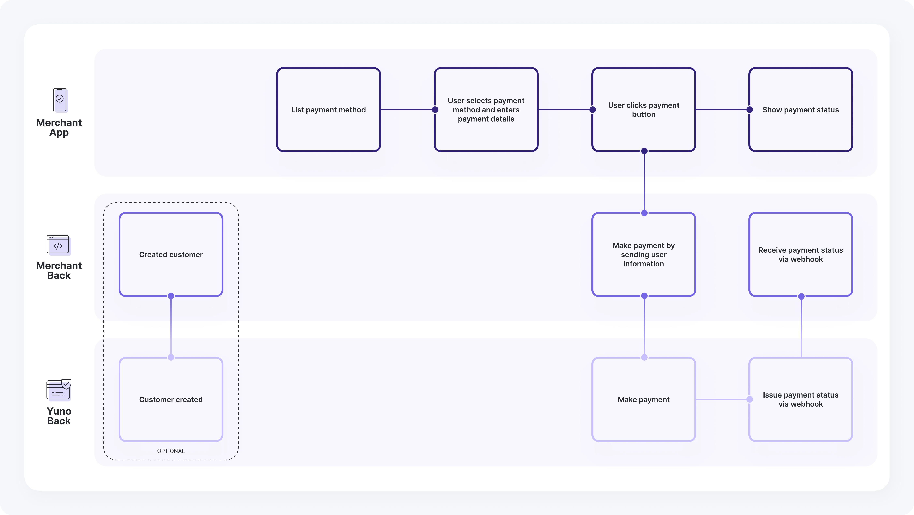
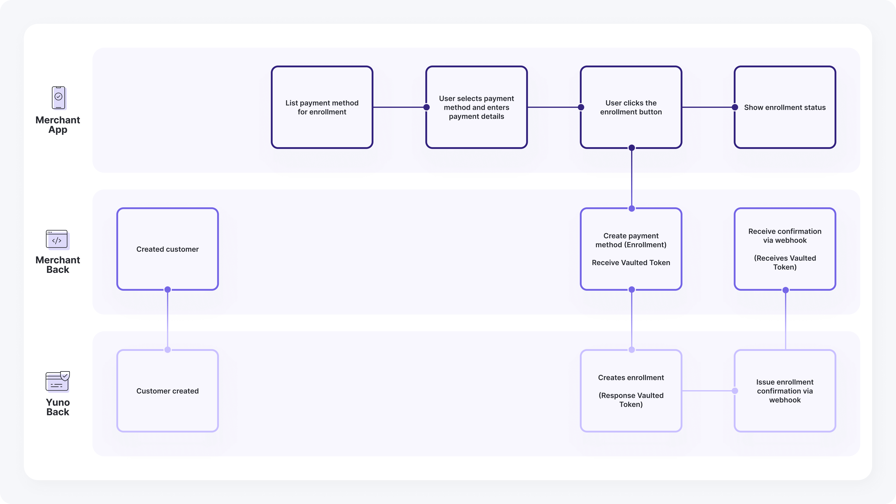

## Cómo funciona {#how-it-works}

Si eres desarrollador, puedes usar nuestro Direct Flow para seguir usando tu checkout y conectarte a nuestros servicios solo mediante una conexión de servidor a servidor.

Tu empresa debe contar con certificación PCI para usar nuestro servicio de pagos con tarjeta de servidor a servidor. Envía tu certificado AOC a tu gerente de cuenta antes de comenzar la implementación.

<Danger>
Siempre recomendamos usar los SDK de Yuno en lugar de las integraciones Direct Flow. Los SDK de Yuno cumplen con PCI y simplifican el proceso de pago al gestionar todas las complejidades, como la prevención de fraude, 3DS y los requisitos específicos de cada proveedor de pago. Direct Flow exige que los comercios gestionen estos aspectos de forma manual, lo que aumenta la complejidad y el riesgo.
</Danger>

Para cada implementación, recomendamos tomar el `status` y el `sub_status` del pago como referencia principal del [estado del pago](/es/reference/payments/status-and-response-codes/payment). Un pago puede tener distintas [transacciones](/es/reference/payments/status-and-response-codes/transaction) asociadas, por lo que, al centrarte en el **status/sub\_status** del pago, obtienes el estado más reciente sin importar cuántas transacciones se hayan realizado, lo que te da información clara para tomar decisiones. Con esta integración, también puedes [inscribir tarjetas de crédito](/es/docs/direct-integration-use-cases/direct-flow#enrollment) para compras futuras (también disponible solo para comercios con certificación PCI).

## Pago {#payment}

<Frame></Frame>

<Steps>
  <Step title="Crea un cliente">
    **[Opcional]**: El primer paso es crear un cliente para asociar métodos de pago. Usa el endpoint [Create Customer](/es/reference/customers/create-customer) para recibir un ID único.
    * Puedes omitir este paso si el cliente ya existe.
    * También puedes enviar la información del cliente directamente en el pago sin crear un objeto.
    <Warning>
      La creación del cliente es obligatoria para generar un `vaulted_token`.
    </Warning>
  </Step>

  <Step title="Crea el pago">
    Muestra los métodos de pago habilitados en tu cuenta de Yuno. Una vez seleccionado uno, crea un pago con los detalles del pedido, la información del cliente, el monto y más, usando el endpoint [Create Payment](/es/reference/payments/create-payment).
    * Consulta la [sección de ejemplos](/es/reference/payments/payment-examples) para ver los detalles de implementación.
    * Usa un `vaulted_token` para los métodos ya inscritos.
    
    Durante la integración, usa el **status** y el **sub_status** del pago como referencia principal del estado del pago.
  </Step>
</Steps>

### Flujo DIRECT vs REDIRECT {#direct-vs-redirect-workflow}

Al usar la integración Direct en Yuno, tienes dos opciones de `workflow`:

* **DIRECT**: Devolvemos la respuesta sin procesar de los proveedores para que puedas construir la experiencia como quieras con los datos sin filtrar.
* **REDIRECT**: Aunque también devolvemos la respuesta directa de los proveedores, además ofrecemos a los comercios la posibilidad de usar un enlace de redirección proporcionado por Yuno, donde nos encargamos de la experiencia de pago solo para ese pago. Puedes encontrar esa URL en el campo `payment_method.payment_method_detail.<type>.redirect_url` de la respuesta del pago, donde `<type>` es la categoría del método de pago: `ticket`, `bank_transfer`, `wallet` o `bnpl`.

Ambos flujos admiten tarjetas (incluidas las tarjetas con 3DS) y métodos de pago alternativos (PSE, Nequi, Mercado Pago, PIX, etc.). Para las tarjetas con 3DS, ambos flujos requieren certificación PCI.

<Note>
  **Datos de pago de PIX**

  Para PIX, la respuesta del pago devuelve los datos que se muestran al pagador en el objeto `payment_method.payment_method_detail.bank_transfer`. El [ejemplo de PIX](/es/reference/payments/payment-examples/bank-transfer#pix) usa el flujo `REDIRECT` y devuelve estos campos:

  * `provider_image`: URL proporcionada por el proveedor. En el ejemplo, apunta al código QR.
  * `beneficiary_name`, `beneficiary_document_type`, `beneficiary_document`, `bank_name`, `bank_account`: Detalles de la cuenta del titular que recibe el pago. Estos campos pueden ser `null`, como en el ejemplo de PIX.
  * `payment_instruction`: Instrucciones de pago relacionadas con el pago.
  * `redirect_url`: Página de pago alojada por Yuno, que se usa con el flujo `REDIRECT`.

  Con el flujo `DIRECT`, la respuesta sin filtrar del proveedor también se devuelve en `provider_data.raw_response`. Consulta el [objeto Payment](/es/reference/payments/the-payment-object) para ver las descripciones completas de los campos.
</Note>

### Complementos importantes {#important-add-ons}

* **Webhooks**: Recomendamos configurar los [Webhooks](/docs/webhooks) en tu dashboard de Yuno. Los webhooks son la mejor forma de asegurar que tu sistema esté al día con el progreso y el estado de los pagos. Como las notificaciones de eventos se activan automáticamente, tu sistema no necesitará hacer solicitudes repetidas a Yuno.

* **Device Fingerprints**: Los device fingerprints del cliente se usan para la prevención de fraude. Normalmente se generan usando JavaScript de terceros en el checkout. Si usas una **integración Direct** y quieres admitir proveedores de fraude en el [flujo de pago](/es/reference/payments/create-payment), puedes usar este objeto para especificar la información necesaria. En las integraciones que usan el checkout de Yuno, el valor se obtiene automáticamente, por lo que no debes enviar este campo.

  * A continuación se muestra un extracto parcial del cuerpo de la solicitud, centrado en el objeto `device_fingerprints`:

    ```json
    [...]
    "customer_payer": {
        "merchant_customer_id": "1690161049",
        "first_name": "Giovanna",
        "last_name": "Bartell",
        "email": "Lisandro_Leannon58@hotmail.com",
         "device_fingerprints": [
            {
                "provider_id": "MERCADO_PAGO",
                "id": "20a6c463-dd0c-4323-9115-03668d178856"
            },
            {
                "provider_id": "CLEARSALE",
                "id": "92d2ea4b-4bf7-494b-aaea-c48276135941"
            }     
      }, 
    [...]
    ```
    <br />

* **three\_d\_secure\_setup\_id**: Usa nuestro JS solo para obtener el `three_d_secure_setup_id` y luego gestiona el pago como una integración solo con API. El flujo Direct solo está disponible para comercios con certificación PCI. Ofrece una forma sencilla de crear un pago y validar la información del usuario, y requiere que el comercio realice una sola solicitud para crear el pago. Para implementar correctamente la integración Direct, sigue los pasos descritos en la sección [Pago](#payment) anterior y proporciona la información requerida según las instrucciones. Este servicio no es necesario para la implementación de 3DS con el SDK de Yuno.

## Inscripción {#enrollment}

<Frame></Frame>

<Steps>
  <Step title="Crea un cliente">
    Asocia métodos de pago creando un cliente (si aún no existe) con el endpoint [Create Customer](/es/reference/customers/create-customer).
  </Step>

  <Step title="Inscribe un método de pago">
    <Note>
      **Integración Direct Flow**
      
      Esta función solo está disponible para inscribir tarjetas de comercios con certificación PCI.
    </Note>
    Inscribe el método de pago mediante el endpoint [Enroll Payment Method](/es/reference/payment-methods-direct-workflow/enroll-payment-method-api). Recibirás un `vaulted_token` para compras futuras.
  </Step>
</Steps>