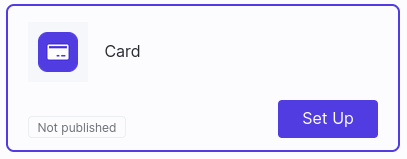
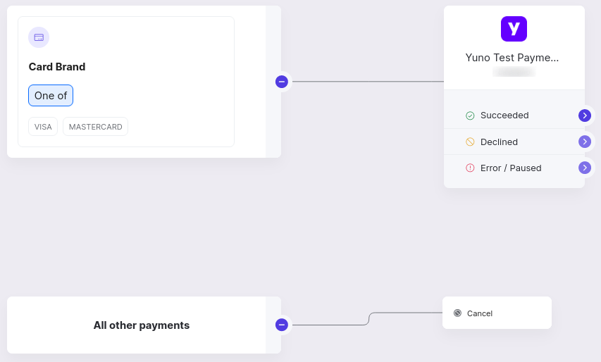
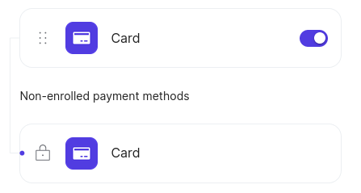

Para probar pagos con **Card** en general, Yuno ofrece el **Yuno Test Payment Gateway**. Funciona como una conexión, pero está disponible **solo** en el entorno de sandbox.

## Conectar con Yuno {#connecting-with-yuno}

No se requieren API keys ni credenciales para conectar el Yuno Test Payment Gateway.

## Información general {#general-information}

| Propiedad | Detalles |
|:---|:---|
| **Países** | Disponible para todos los países. |
| **Monedas** | Todas las monedas están disponibles. |
| **Tipos de tarjeta** | Crédito, débito y prepago. |
| **Datos de prueba** | Consulta la [información de la tarjeta](/es/docs/direct-integration-use-cases/yuno-testing-gateway#test-card-payments-with-yuno-testing-gateway) para ver los números de tarjeta de prueba y las respuestas esperadas. |

## Configuración de la integración {#integration-configuration}

Para conectar el Yuno Test Payment Gateway desde el dashboard:

1. Inicia sesión en [dashboard.y.uno](http://dashboard.y.uno/).
2. Ve a **Connections** y selecciona **Yuno Test Payment Gateway**.
3. Haz clic en **Connect**.
4. Ingresa un **Name** para la conexión.
5. Haz clic en **Connect**.

## Entorno de producción {#production-environment}

Esta conexión está disponible solo para pruebas en sandbox y no se puede usar en producción.

## Configurar el Yuno Test Payment Gateway {#set-up-the-yuno-test-payment-gateway}

1. Completa la [Configuración de la integración](/es/docs/direct-integration-use-cases/yuno-testing-gateway#integration-configuration) del Test Payment Gateway.
2. Después de establecer la conexión, debes designar el Yuno Test Payment Gateway como tu proveedor de pagos con tarjeta en la sección de enrutamiento. Accede a [Routing](https://dashboard.y.uno/routing) en el Yuno Dashboard, selecciona **Not published**, busca la opción **Card** y haz clic en **Set Up**.

<Frame></Frame>

3. Crea una nueva ruta para **Card**. Si no sabes cómo crearla, consulta [Configurar el enrutamiento dinámico](/es/docs/using-yuno/dashboard-overview/routing#configuring-the-dynamic-routing).
   1. En el dashboard de Routing, agrega condiciones para activar el pago con tarjeta. Por ejemplo, puedes usar la marca de la tarjeta o el país como condiciones.
   2. Para la condición creada, agrega el Yuno Test Payment Gateway.
   3. Para las opciones de **All other payments**, selecciona **Cancel**. La siguiente imagen muestra un ejemplo de configuración de enrutamiento donde se usó la condición de marca de tarjeta, aceptando pagos con las marcas Visa y Mastercard.

<Frame></Frame>

4. Ahora debes hacer que las tarjetas estén disponibles para pruebas. Accede a [Checkout builder](https://dashboard.y.uno/checkout-builder) en el Yuno Dashboard.  Activa el interruptor de **Card** y publica el checkout con el botón **Publish**.

<Frame></Frame>

Usa la guía [Crear pago](/es/docs/direct-integration-use-cases/create-payment-basic) para aprender a probar pagos con tarjeta.

## Probar pagos con tarjeta con el Yuno Testing Gateway {#test-card-payments-with-yuno-testing-gateway}

En esta página encontrarás una guía paso a paso para crear un pago con tarjeta usando el [Yuno Testing Gateway](/es/docs/direct-integration-use-cases/yuno-testing-gateway).

[Yuno Testing Gateway](/es/docs/direct-integration-use-cases/yuno-testing-gateway) es una solución de Yuno para probar pagos con tarjeta en general. Funciona como una conexión. Sin embargo, solo está disponible en el entorno de sandbox.

### Requisitos {#requirements}

Antes de comenzar con los pasos descritos en esta guía, necesitas:

* Acceder a tus [credenciales de API](/es/docs/using-yuno/settings/developers-credentials) en el Yuno Dashboard, que se componen de:
  * `public-api-key`
  * `private-secret-key`
  * `account_id`
* Configurar la conexión del Yuno Testing Gateway en tu cuenta del Yuno Dashboard. Encuentras una guía paso a paso para conectarlo en la [sección Configuración de la integración](/es/docs/direct-integration-use-cases/yuno-testing-gateway#integration-configuration).
* [Crear una ruta](/es/docs/using-yuno/dashboard-overview/routing#configuring-the-dynamic-routing) para el Yuno Testing Gateway, para definirlo como tu proveedor de pagos con tarjeta. Encuentras una guía paso a paso para hacerlo en la sección [Configurar el Yuno Testing Gateway](/es/docs/direct-integration-use-cases/yuno-testing-gateway#set-up-the-yuno-test-payment-gateway).
* [Configurar el checkout builder](/es/docs/using-yuno/dashboard-overview/checkout-builder) para que el Yuno Testing Gateway esté disponible.

El proceso de creación de un pago normalmente requiere completar los dos pasos que se indican a continuación.

1. [Crea un cliente](/es/reference/customers/create-customer)
2. [Crear el pago](/es/reference/payments/create-payment)

### Crear un pago {#create-a-payment}

#### 1. Crear un cliente {#1-create-a-customer}

Usa [Crear cliente](/es/reference/customers/create-customer) para registrar la información del cliente. Deberás proporcionar la información personal del cliente. Además, también debes enviar el `merchant_customer_id`, un identificador único del cliente usado en tu sistema.

<Note>
**Información complementaria del cliente**

Al crear un **Customer**, cierta información no es obligatoria, pero puede mejorar la experiencia de pago del usuario si se proporciona. El teléfono, la dirección de facturación y la dirección de envío son ejemplos de datos no obligatorios que puedes proporcionar. Si agregas información opcional, ten en cuenta los campos obligatorios que la acompañan.
</Note>

Al final del proceso de creación del cliente, recibirás un `id`, que identifica al usuario dentro del sistema de Yuno. Usa el `id` para inicializar el checkout.

Si estás creando un pago para un usuario existente que ya fue creado y ya tiene un `id`, puedes omitir este paso.

#### 2. Crear un pago {#2-create-a-payment}

Crearás un pago usando el [endpoint Create Payment](/es/reference/payments/create-payment). A continuación encuentras una descripción más detallada de cómo crear un pago.

Proporciona la información relacionada con el cliente, incluido el objeto `customer_payer` que contiene el `id` del paso 1.

Algunos objetos no son obligatorios al crear un pago. Sin embargo, si proporcionas esta información, la experiencia de pago del usuario mejorará. Ten en cuenta los campos obligatorios si deseas proporcionar esta información.

#### 2.1 Elegir el tipo de captura {#21-choose-the-capture-type}

Yuno ofrece dos opciones para la captura del pago:

* Un solo paso: la autorización y la captura se realizan simultáneamente. Solo necesitas crear el pago. La autorización y la captura se realizan automáticamente. Para la opción de un solo paso, debes enviar `payment_method.detail.card.capture` como `true` en la solicitud.
* Dos pasos: la autorización y la captura se realizan en momentos distintos. Si deseas procesar el pago en dos pasos, envía `payment_method.detail.card.capture` como `false` cuando [crees el pago](/es/reference/payments/create-payment) y luego usa la solicitud [Capture Authorization](/es/reference/payments/capture-authorization) para completar el proceso.

#### 2.2 Definir el flujo de trabajo del pago {#22-define-the-payment-workflow}

Al crear el pago, debes indicar qué integración de Yuno estás usando. Debes indicarlo mediante el atributo `workflow`, que puede ser:

* `SDK_CHECKOUT`: si usas el Yuno SDK para crear el pago (el valor por defecto).
* `DIRECT`: si usas una integración back-to-back. Para usar este flujo de trabajo, debes cumplir con PCI.
* `REDIRECT`: si usas una integración back-to-back y redirección del proveedor.

Indica la información del método de pago mediante el objeto `payment_method`. Selecciona el `type` del pago igual a `CARD` según la [lista de tipos de pago](/es/reference/payment-type-list). Además, debes agregar la información de la tarjeta en el objeto `detail.card`.

Puedes usar la descripción del pago o datos específicos de la tarjeta para obtener el resultado deseado al probar un pago con el Yuno Test Payment Gateway. Las siguientes secciones describen cada enfoque en detalle.

<Note>
**Proceso del sistema de Yuno**

El sistema de Yuno sigue un proceso secuencial: primero examina los datos de la tarjeta y después evalúa la descripción proporcionada. Por lo tanto, si hay una discrepancia entre el estado indicado por los datos de la tarjeta y por la descripción en un pago de prueba, Yuno dará prioridad al estado asociado con los datos de la tarjeta y lo reflejará.
</Note>

##### 2.2.1 - Descripción del pago {#221---payment-description}

Para obtener el resultado de pago deseado mediante la descripción del pago, debes definir el resultado esperado como la descripción del pago que creas. Por ejemplo, si estás probando un pago y esperas un resultado exitoso, la descripción del pago debe ser "SUCCEEDED". Encontrarás todas las opciones disponibles en la sección [Códigos de transacción](/es/reference/payments/status-and-response-codes/transaction#transaction-codes).

###### Simular un contracargo {#simulate-a-chargeback}

En sandbox, puedes simular un contracargo después de una compra exitosa configurando la **description** del pago. El disparador es el campo de descripción, no el monto ni el número de tarjeta.

Usa este formato como `description` del pago:

```
SUCCEEDED+CHARGEBACK <outcome>
```

Reemplaza `<outcome>` por uno de los valores de la tabla siguiente. La compra se realiza con éxito primero. Unos dos minutos después, Yuno crea una transacción `CHARGEBACK` en ese pago y emite los eventos de webhook relacionados.

| Resultado de la descripción | Estado de CHARGEBACK | response_code de CHARGEBACK | Estado del pago | sub_status del pago |
| --- | --- | --- | --- | --- |
| `action_required` | `CREATED` | `ACTION_REQUIRED` | `IN_DISPUTE` | `RECEIVED` |
| `review` | `PENDING` | `IN_REVIEW` | `IN_DISPUTE` | `PENDING_REVIEW` |
| `won` | `WON` | `REVIEW_WON` | `SUCCEEDED` | `APPROVED` |
| `lost` | `LOST` | `REVIEW_LOST` | `CHARGEBACK` | `LOST` |

Ejemplos:

* `SUCCEEDED+CHARGEBACK action_required`
* `SUCCEEDED+CHARGEBACK review`
* `SUCCEEDED+CHARGEBACK won`
* `SUCCEEDED+CHARGEBACK lost`

Si el resultado después de `CHARGEBACK` falta o no se reconoce, Yuno recurre a `action_required`.

En las pruebas, el `reason` del contracargo observado es `REQUESTED_BY_CUSTOMER`.

<Note>
**Los datos de la tarjeta se evalúan primero**

Yuno evalúa los datos de la tarjeta antes que la descripción del pago, por lo que la tarjeta decide el resultado inicial de la autorización. La tarjeta no detiene la simulación del contracargo: aproximadamente un minuto después la descripción toma el control, el pago pasa a `SUCCEEDED` y el contracargo aún llega aproximadamente un minuto después. Combina la descripción `SUCCEEDED+CHARGEBACK <outcome>` con una [tarjeta de prueba SUCCEEDED](/es/docs/direct-integration-use-cases/yuno-testing-gateway#2-2-define-the-payment-workflow) (o un prefijo de tarjeta SUCCEEDED equivalente) para que el estado del pago sea estable durante todo el flujo.
</Note>

<Tip>
Confirma que tu endpoint de webhook en sandbox reciba `payment.chargeback`. Configura el endpoint en tu propia URL de sandbox y luego completa un contracargo simulado de principio a fin. Consulta [Descripción general de webhooks](/es/docs/webhooks), [Configurar webhooks](/es/docs/webhooks/configure-webhooks) y los [ejemplos de webhook de contracargo](/es/docs/webhooks/object-and-examples#chargeback-webhook-v2). Para conocer los estados de disputa y las acciones del comercio después de que llega el contracargo, consulta [Gestión de contracargos](/es/docs/payouts-and-disputes/chargeback-management).
</Tip>

##### 2.2.2 - Detalles de la tarjeta {#222---card-detail}

Otra opción para obtener los resultados de pago esperados es usar una de las tarjetas de prueba que proporciona Yuno. En las tablas siguientes encuentras una lista de tarjetas y sus datos para usar con el Yuno Testing Gateway. La columna **Código de respuesta de la transacción** define el estado del pago devuelto cuando usas la tarjeta correspondiente.

<AccordionGroup>
<Accordion title="Visa">
<table>
  <thead>
    <tr>
      
      <th>Número</th>
      <th>Fecha de vencimiento</th>
      <th>Código de seguridad</th>
      <th>Nombre del titular de la tarjeta</th>
      <th>Código de respuesta de la transacción</th>
    </tr>
  </thead>
  <tbody>
    <tr>
      
      <td>4507990000000002</td>
      <td>11/28</td>
      <td>123</td>
      <td>John Doe</td>
      <td>SUCCEEDED</td>
    </tr>
    <tr>
      
      <td>4507990000000010</td>
      <td>11/28</td>
      <td>123</td>
      <td>John Doe</td>
      <td>INSUFFICIENT_FUNDS</td>
    </tr>
    <tr>
      
      <td>4507990000000028</td>
      <td>11/28</td>
      <td>123</td>
      <td>John Doe</td>
      <td>DECLINED_BY_BANK</td>
    </tr>
    <tr>
      
      <td>4507990000000036</td>
      <td>11/28</td>
      <td>123</td>
      <td>John Doe</td>
      <td>DO_NOT_HONOR</td>
    </tr>
    <tr>
      
      <td>4507990000000044</td>
      <td>11/28</td>
      <td>123</td>
      <td>John Doe</td>
      <td>INVALID_SECURITY_CODE</td>
    </tr>
    <tr>
      
      <td>4507990000000051</td>
      <td>11/28</td>
      <td>123</td>
      <td>John Doe</td>
      <td>INVALID_CARD_DATA</td>
    </tr>
    <tr>
      
      <td>4507990000000069</td>
      <td>11/28</td>
      <td>123</td>
      <td>John Doe</td>
      <td>REPORTED_STOLEN</td>
    </tr>
    <tr>
      
      <td>4507990000000077</td>
      <td>11/28</td>
      <td>123</td>
      <td>John Doe</td>
      <td>ERROR</td>
    </tr>
  </tbody>
</table>
</Accordion>

<Accordion title="Mastercard (datos de prueba)">
<table>
    <thead>
    <tr>
      
      <th>Número</th>
      <th>Fecha de vencimiento</th>
      <th>Código de seguridad</th>
      <th>Nombre del titular de la tarjeta</th>
      <th>Código de respuesta de la transacción</th>
    </tr>
  </thead>
  <tbody>
    <tr>
      
      <td>5252440000000002</td>
      <td>11/28</td>
      <td>123</td>
      <td>John Doe</td>
      <td>SUCCEEDED</td>
    </tr>
    <tr>
      
      <td>5252440000000010</td>
      <td>11/28</td>
      <td>123</td>
      <td>John Doe</td>
      <td>INSUFFICIENT_FUNDS</td>
    </tr>
    <tr>
      
      <td>5252440000000028</td>
      <td>11/28</td>
      <td>123</td>
      <td>John Doe</td>
      <td>DECLINED_BY_BANK</td>
    </tr>
    <tr>
      
      <td>5252440000000036</td>
      <td>11/28</td>
      <td>123</td>
      <td>John Doe</td>
      <td>DO_NOT_HONOR</td>
    </tr>
    <tr>
      
      <td>5252440000000044</td>
      <td>11/28</td>
      <td>123</td>
      <td>John Doe</td>
      <td>INVALID_SECURITY_CODE</td>
    </tr>
    <tr>
      
      <td>5252440000000051</td>
      <td>11/28</td>
      <td>123</td>
      <td>John Doe</td>
      <td>INVALID_CARD_DATA</td>
    </tr>
    <tr>
      
      <td>5252440000000069</td>
      <td>11/28</td>
      <td>123</td>
      <td>John Doe</td>
      <td>REPORTED_STOLEN</td>
    </tr>
    <tr>
      
      <td>5252440000000077</td>
      <td>11/28</td>
      <td>123</td>
      <td>John Doe</td>
      <td>ERROR</td>
    </tr>
  </tbody>
</table>
</Accordion>

<Accordion title="American Express">
<table>
  <thead>
    <tr>
      
      <th>Número</th>
      <th>Fecha de vencimiento</th>
      <th>Código de seguridad</th>
      <th>Nombre del titular de la tarjeta</th>
      <th>Código de respuesta de la transacción</th>
    </tr>
  </thead>
  <tbody>
    <tr>
      
      <td>370000000000002</td>
      <td>11/28</td>
      <td>1234</td>
      <td>John Doe</td>
      <td>SUCCEEDED</td>
    </tr>
    <tr>
      
      <td>370000000000010</td>
      <td>11/28</td>
      <td>1234</td>
      <td>John Doe</td>
      <td>INSUFFICIENT_FUNDS</td>
    </tr>
    <tr>
      
      <td>370000000000028</td>
      <td>11/28</td>
      <td>1234</td>
      <td>John Doe</td>
      <td>DECLINED_BY_BANK</td>
    </tr>
    <tr>
      
      <td>370000000000036</td>
      <td>11/28</td>
      <td>1234</td>
      <td>John Doe</td>
      <td>DO_NOT_HONOR</td>
    </tr>
    <tr>
      
      <td>370000000000044</td>
      <td>11/28</td>
      <td>1234</td>
      <td>John Doe</td>
      <td>INVALID_SECURITY_CODE</td>
    </tr>
    <tr>
      
      <td>370000000000051</td>
      <td>11/28</td>
      <td>1234</td>
      <td>John Doe</td>
      <td>INVALID_CARD_DATA</td>
    </tr>
    <tr>
      
      <td>370000000000069</td>
      <td>11/28</td>
      <td>1234</td>
      <td>John Doe</td>
      <td>REPORTED_STOLEN</td>
    </tr>
    <tr>
      
      <td>370000000000077</td>
      <td>11/28</td>
      <td>1234</td>
      <td>John Doe</td>
      <td>ERROR</td>
    </tr>
  </tbody>
</table>
</Accordion>

<Accordion title="Diners">
<table>
  <thead>
    <tr>
      <th>Número</th>
      <th>Fecha de vencimiento</th>
      <th>Código de seguridad</th>
      <th>Nombre del titular de la tarjeta</th>
      <th>Código de respuesta de la transacción</th>
    </tr>
  </thead>
  <tbody>
    <tr>

      <td>3647166000000002</td>
      <td>11/28</td>
      <td>123</td>
      <td>John Doe</td>
      <td>SUCCEEDED</td>
    </tr>
    <tr>

      <td>3647166000000010</td>
      <td>11/28</td>
      <td>123</td>
      <td>John Doe</td>
      <td>INSUFFICIENT_FUNDS</td>
    </tr>
    <tr>

      <td>3647166000000028</td>
      <td>11/28</td>
      <td>123</td>
      <td>John Doe</td>
      <td>DECLINED_BY_BANK</td>
    </tr>
    <tr>

      <td>3647166000000036</td>
      <td>11/28</td>
      <td>123</td>
      <td>John Doe</td>
      <td>DO_NOT_HONOR</td>
    </tr>
    <tr>

      <td>3647166000000044</td>
      <td>11/28</td>
      <td>123</td>
      <td>John Doe</td>
      <td>INVALID_SECURITY_CODE</td>
    </tr>
    <tr>

      <td>3647166000000051</td>
      <td>11/28</td>
      <td>123</td>
      <td>John Doe</td>
      <td>INVALID_CARD_DATA</td>
    </tr>
    <tr>

      <td>3647166000000069</td>
      <td>11/28</td>
      <td>123</td>
      <td>John Doe</td>
      <td>REPORTED_STOLEN</td>
    </tr>
    <tr>

      <td>3647166000000077</td>
      <td>11/28</td>
      <td>123</td>
      <td>John Doe</td>
      <td>ERROR</td>
    </tr>
  </tbody>
  </table>
</Accordion>

<Accordion title="UATP">
<table>
  <thead>
    <tr>
      
      <th>Número</th>
      <th>Fecha de vencimiento</th>
      <th>Código de seguridad</th>
      <th>Nombre del titular de la tarjeta</th>
      <th>Código de respuesta de la transacción</th>
    </tr>
  </thead>
  <tbody>
    <tr>
      
      <td>1139000000000002</td>
      <td>11/28</td>
      <td>123</td>
      <td>John Doe</td>
      <td>SUCCEEDED</td>
    </tr>
    <tr>
      
      <td>1139000000000010</td>
      <td>11/28</td>
      <td>123</td>
      <td>John Doe</td>
      <td>INSUFFICIENT_FUNDS</td>
    </tr>
    <tr>
      
      <td>1139000000000028</td>
      <td>11/28</td>
      <td>123</td>
      <td>John Doe</td>
      <td>DECLINED_BY_BANK</td>
    </tr>
    <tr>
      
      <td>1139000000000036</td>
      <td>11/28</td>
      <td>123</td>
      <td>John Doe</td>
      <td>DO_NOT_HONOR</td>
    </tr>
    <tr>
      
      <td>1139000000000044</td>
      <td>11/28</td>
      <td>123</td>
      <td>John Doe</td>
      <td>INVALID_SECURITY_CODE</td>
    </tr>
    <tr>
      
      <td>1139000000000051</td>
      <td>11/28</td>
      <td>123</td>
      <td>John Doe</td>
      <td>INVALID_CARD_DATA</td>
    </tr>
    <tr>
      
      <td>1139000000000069</td>
      <td>11/28</td>
      <td>123</td>
      <td>John Doe</td>
      <td>REPORTED_STOLEN</td>
    </tr>
    <tr>
      
      <td>1139000000000077</td>
      <td>11/28</td>
      <td>123</td>
      <td>John Doe</td>
      <td>ERROR</td>
    </tr>
  </tbody>
</table>
</Accordion>
</AccordionGroup>

<Note>
Para probar los reintentos de suscripciones y la cancelación por reintentos agotados con estas tarjetas, consulta [Probar reintentos en sandbox](/es/docs/payment-features/subscriptions/retries#testing-retries-in-sandbox).
</Note>

##### 2.2.3 - Tarjetas de prueba 3DS {#223---3ds-test-cards}

Usa estas tarjetas y códigos OTP para probar los flujos de 3DS en nuestro entorno de preview mediante un simulador Netcetera Demo Merchant (NDM), configurado para simular un Directory Server y/o ACS con esquemas predefinidos y números de tarjeta de prueba. No se conecta a DS/ACS de prueba externos, solo ayuda a completar los flujos de 3DS con fines de prueba.

<AccordionGroup>
<Accordion title="Amex">
<table>
  <thead>
    <tr>
      <th>Número de tarjeta</th>
      <th>Respuesta esperada 3DS 2.x</th>
      <th>Respuesta esperada 3DS 1.x DS (VERes)</th>
      <th>Respuesta esperada 3DS 1.x ACS (PARes)</th>
    </tr>
  </thead>
  <tbody>
    <tr><td>341502098634895</td><td>AUTHENTICATED_APPLICATION_FRICTIONLESS</td><td>ENROLLED_Y</td><td>TRANSACTION_STATUS_Y</td></tr>
    <tr><td>348638267931507</td><td>BROWSER_CHALLENGE</td><td>ENROLLED_Y</td><td>TRANSACTION_CHALLENGE_OTP</td></tr>
    <tr><td>345695399207589</td><td>NOT_AUTHENTICATED_APPLICATION_FRICTIONLESS</td><td>ENROLLED_Y</td><td>TRANSACTION_STATUS_N</td></tr>
    <tr><td>349531373081938</td><td>APPLICATION_CHALLENGE</td><td>ENROLLED_Y</td><td>TRANSACTION_STATUS_N</td></tr>
    <tr><td>342316317472410</td><td>APPLICATION_CHALLENGE_SDK_TRANS_ID_INVALID_FORMAT</td><td>ENROLLED_Y</td><td>TRANSACTION_STATUS_N</td></tr>
    <tr><td>347899129656655</td><td>AUTHENTICATED_BROWSER_FRICTIONLESS</td><td>ENROLLED_Y</td><td>TRANSACTION_STATUS_Y</td></tr>
    <tr><td>345197771649926</td><td>NOT_AUTHENTICATED_BROWSER_FRICTIONLESS</td><td>ENROLLED_Y</td><td>TRANSACTION_STATUS_N</td></tr>
    <tr><td>372021106351394</td><td>BROWSER_CHALLENGE</td><td>ENROLLED_Y</td><td>TRANSACTION_CHALLENGE_OTP</td></tr>
    <tr><td>3734123412340000</td><td>NOT_AUTHENTICATED_BROWSER_FRICTIONLESS</td><td>ENROLLED_Y</td><td>TRANSACTION_STATUS_N</td></tr>
    <tr><td>3434567891111005</td><td>BROWSER_CHALLENGE</td><td>ENROLLED_Y</td><td>TRANSACTION_CHALLENGE_OTP</td></tr>
    <tr><td>3794521996036850</td><td>BROWSER_CHALLENGE</td><td>ENROLLED_Y</td><td>TRANSACTION_CHALLENGE_OTP</td></tr>
  </tbody>
</table>
</Accordion>

<Accordion title="Mastercard (3DS)">
<table>
  <thead>
    <tr>
      <th>Número de tarjeta</th>
      <th>Respuesta esperada 3DS 2.x</th>
      <th>Respuesta esperada 3DS 1.x DS (VERes)</th>
      <th>Respuesta esperada 3DS 1.x ACS (PARes)</th>
    </tr>
  </thead>
  <tbody>
    <tr><td>5333259155643223</td><td>AUTHENTICATED_APPLICATION_FRICTIONLESS</td><td>ENROLLED_Y</td><td>TRANSACTION_STATUS_Y</td></tr>
    <tr><td>5306889942833340</td><td>BROWSER_CHALLENGE</td><td>ENROLLED_Y</td><td>TRANSACTION_CHALLENGE_OTP</td></tr>
    <tr><td>5328720384582224</td><td>NOT_AUTHENTICATED_APPLICATION_FRICTIONLESS</td><td>ENROLLED_Y</td><td>TRANSACTION_STATUS_N</td></tr>
    <tr><td>5267648608924299</td><td>APPLICATION_CHALLENGE</td><td>ENROLLED_Y</td><td>TRANSACTION_STATUS_N</td></tr>
    <tr><td>5187434643593002</td><td>APPLICATION_CHALLENGE_SDK_TRANS_ID_INVALID_FORMAT</td><td>ENROLLED_Y</td><td>TRANSACTION_STATUS_N</td></tr>
    <tr><td>5512459816707531</td><td>AUTHENTICATED_BROWSER_FRICTIONLESS</td><td>ENROLLED_Y</td><td>TRANSACTION_STATUS_Y</td></tr>
    <tr><td>5487971631330522</td><td>NOT_AUTHENTICATED_BROWSER_FRICTIONLESS</td><td>ENROLLED_Y</td><td>TRANSACTION_STATUS_N</td></tr>
    <tr><td>5424184049821670</td><td>BROWSER_CHALLENGE</td><td>ENROLLED_Y</td><td>TRANSACTION_CHALLENGE_OTP</td></tr>
    <tr><td>5204240438720050123</td><td>BROWSER_CHALLENGE</td><td>ENROLLED_Y</td><td>TRANSACTION_CHALLENGE_OTP</td></tr>
    <tr><td>5250548692069390</td><td>BROWSER_CHALLENGE</td><td>ENROLLED_Y</td><td>TRANSACTION_CHALLENGE_OTP</td></tr>
    <tr><td>5641523891636636</td><td>BROWSER_CHALLENGE</td><td>ENROLLED_Y</td><td>TRANSACTION_CHALLENGE_OTP</td></tr>
  </tbody>
</table>
</Accordion>

<Accordion title="Visa">
<table>
  <thead>
    <tr>
      <th>Número de tarjeta</th>
      <th>Respuesta esperada 3DS 2.x</th>
      <th>Respuesta esperada 3DS 1.x DS (VERes)</th>
      <th>Respuesta esperada 3DS 1.x ACS (PARes)</th>
    </tr>
  </thead>
  <tbody>
    <tr><td>4556557955726624</td><td>AUTHENTICATED_APPLICATION_FRICTIONLESS</td><td>ENROLLED_Y</td><td>TRANSACTION_STATUS_Y</td></tr>
    <tr><td>4916994064252017</td><td>BROWSER_CHALLENGE</td><td>ENROLLED_Y</td><td>TRANSACTION_CHALLENGE_OTP</td></tr>
    <tr><td>4556104160382032</td><td>NOT_AUTHENTICATED_APPLICATION_FRICTIONLESS</td><td>ENROLLED_Y</td><td>TRANSACTION_STATUS_N</td></tr>
    <tr><td>4024007189449340</td><td>APPLICATION_CHALLENGE</td><td>ENROLLED_Y</td><td>TRANSACTION_STATUS_N</td></tr>
    <tr><td>4024007179872394</td><td>APPLICATION_CHALLENGE_SDK_TRANS_ID_INVALID_FORMAT</td><td>ENROLLED_Y</td><td>TRANSACTION_STATUS_N</td></tr>
    <tr><td>4929251897047956</td><td>AUTHENTICATED_BROWSER_FRICTIONLESS</td><td>ENROLLED_Y</td><td>TRANSACTION_STATUS_Y</td></tr>
    <tr><td>4716429323842524</td><td>NOT_AUTHENTICATED_BROWSER_FRICTIONLESS</td><td>ENROLLED_Y</td><td>TRANSACTION_STATUS_N</td></tr>
    <tr><td>4234123412340003</td><td>BROWSER_CHALLENGE</td><td>ENROLLED_Y</td><td>TRANSACTION_CHALLENGE_OTP</td></tr>
    <tr><td>4604633194219929</td><td>BROWSER_CHALLENGE</td><td>ENROLLED_Y</td><td>TRANSACTION_CHALLENGE_OTP</td></tr>
    <tr><td>4485436455354151</td><td>BROWSER_FRICTIONLESS_MISSING_DS_TRANS_ID</td><td></td><td></td></tr>
    <tr><td>4556962659911995</td><td>APPLICATION_FRICTIONLESS_MISSING_SDK_TRANS_ID</td><td>ENROLLED_Y</td><td>TRANSACTION_STATUS_N</td></tr>
    <tr><td>4539837572943550</td><td>BROWSER_FRICTIONLESS_MISSING_DS_TRANS_ID</td><td>ENROLLED_Y</td><td>TRANSACTION_STATUS_N</td></tr>
    <tr><td>4024007176265022</td><td>BROWSER_CHALLENGE_MISSING_ACS_URL</td><td>ENROLLED_Y</td><td>TRANSACTION_STATUS_N</td></tr>
    <tr><td>4716125059847899</td><td>THREE_RI</td><td>ENROLLED_Y</td><td>TRANSACTION_STATUS_N</td></tr>
    <tr><td>4556362626719763</td><td>PROTOCOL_ERROR</td><td>ENROLLED_Y</td><td>TRANSACTION_STATUS_N</td></tr>
    <tr><td>4234123412340000</td><td>AUTHENTICATED_BROWSER_FRICTIONLESS</td><td>ENROLLED_Y</td><td>TRANSACTION_STATUS_Y</td></tr>
    <tr><td>4234123412340006</td><td>UNAVAILABLE_BROWSER_FRICTIONLESS</td><td>ENROLLED_Y</td><td>TRANSACTION_STATUS_U</td></tr>
    <tr><td>4234123412340007</td><td>ATTEMPTED_BROWSER_FRICTIONLESS</td><td>ENROLLED_Y</td><td>TRANSACTION_STATUS_A</td></tr>
    <tr><td>4234123412340001</td><td>NOT_ENROLLED</td><td>ENROLLED_N</td><td></td></tr>
    <tr><td>4234123412340002</td><td>NOT ENROLLED (VeRes es el error 404 "Card account number not found in card ranges from Directory Server")</td><td>ENROLLED_N (NOT APPLICABLE)</td><td></td></tr>
    <tr><td>4234123412340100</td><td>MISSING_ROOT</td><td></td><td></td></tr>
    <tr><td>4234123412340101</td><td>MISSING_MESSAGE</td><td></td><td></td></tr>
    <tr><td>4234123412340102</td><td>INVALID_MESSAGE</td><td></td><td></td></tr>
    <tr><td>4234123412340103</td><td>MISSING_VERSION</td><td></td><td></td></tr>
    <tr><td>4234123412340104</td><td>ILLEGAL_VERSION</td><td></td><td></td></tr>
    <tr><td>4234123412340105</td><td>MISSING_URL</td><td></td><td></td></tr>
    <tr><td>4234123412340106</td><td>ILLEGAL_URL</td><td></td><td></td></tr>
    <tr><td>4234123412340107</td><td>MISSING_ENROLLED</td><td></td><td></td></tr>
    <tr><td>4234123412340108</td><td>ILLEGAL_ENROLLED</td><td></td><td></td></tr>
    <tr><td>4234123412340109</td><td>ILLEGAL_EXTENSION</td><td></td><td></td></tr>
    <tr><td>4234123412340200</td><td>ERROR_CUSTOM</td><td></td><td></td></tr>
    <tr><td>4234123412340201</td><td>ERROR_1</td><td></td><td></td></tr>
    <tr><td>4234123412340202</td><td>ERROR_2</td><td></td><td></td></tr>
    <tr><td>4234123412340203</td><td>ERROR_3</td><td></td><td></td></tr>
    <tr><td>4234123412340204</td><td>ERROR_4</td><td></td><td></td></tr>
    <tr><td>4234123412340205</td><td>ERROR_5</td><td></td><td></td></tr>
    <tr><td>4234123412340206</td><td>ERROR_6</td><td></td><td></td></tr>
    <tr><td>4234123412340220</td><td>ERROR_CUSTOM_WITH_DIFFERENT_MESSAGE_ID</td><td></td><td></td></tr>
    <tr><td>4234123412340250</td><td>ERROR_50</td><td></td><td></td></tr>
    <tr><td>4234123412340251</td><td>ERROR_51</td><td></td><td></td></tr>
    <tr><td>4234123412340252</td><td>ERROR_52</td><td></td><td></td></tr>
    <tr><td>4234123412340253</td><td>ERROR_53</td><td></td><td></td></tr>
    <tr><td>4234123412340258</td><td>ERROR_58</td><td></td><td></td></tr>
    <tr><td>4234123412340298</td><td>ERROR_98</td><td></td><td></td></tr>
    <tr><td>4234123412340299</td><td>ERROR_99</td><td></td><td></td></tr>
    <tr><td>4234123412340300</td><td>IREQ_CUSTOM</td><td></td><td></td></tr>
    <tr><td>4234123412340301</td><td>IREQ_ENROLLED_Y</td><td></td><td></td></tr>
    <tr><td>4234123412340350</td><td>IREQ_50</td><td></td><td></td></tr>
    <tr><td>4234123412340351</td><td>IREQ_51</td><td></td><td></td></tr>
    <tr><td>4234123412340352</td><td>IREQ_52</td><td></td><td></td></tr>
    <tr><td>4234123412340353</td><td>IREQ_53</td><td></td><td></td></tr>
    <tr><td>4234123412340354</td><td>IREQ_54</td><td></td><td></td></tr>
    <tr><td>4234123412340355</td><td>IREQ_55</td><td></td><td></td></tr>
    <tr><td>4234123412340356</td><td>IREQ_56</td><td></td><td></td></tr>
    <tr><td>4234123412340358</td><td>IREQ_58</td><td></td><td></td></tr>
    <tr><td>4234123412340398</td><td>IREQ_98</td><td></td><td></td></tr>
    <tr><td>4234123412340399</td><td>IREQ_99</td><td></td><td></td></tr>
    <tr><td>4234123412340400</td><td>UNSUPPORTED_VERSION</td><td></td><td></td></tr>
    <tr><td>4234123412340401</td><td>UNRECOGNIZED_CRITICAL_EXTENSION</td><td></td><td></td></tr>
    <tr><td>4234123412340402</td><td>SERVER_ERROR</td><td></td><td></td></tr>
    <tr><td>4234123412340403</td><td>TIMEOUT</td><td></td><td></td></tr>
  </tbody>
</table>
</Accordion>

<Accordion title="Diners">
<table>
  <thead>
    <tr>
      <th>Número de tarjeta</th>
      <th>Respuesta esperada 3DS 2.x</th>
      <th>Respuesta esperada 3DS 1.x DS (VERes)</th>
      <th>Respuesta esperada 3DS 1.x ACS (PARes)</th>
    </tr>
  </thead>
  <tbody>
    <tr><td>3095000000000000</td><td>AUTHENTICATED_APPLICATION_FRICTIONLESS</td><td>ENROLLED_Y</td><td>TRANSACTION_STATUS_Y</td></tr>
    <tr><td>3095000000000001</td><td>BROWSER_CHALLENGE</td><td>ENROLLED_Y</td><td>TRANSACTION_CHALLENGE_OTP</td></tr>
    <tr><td>3095000000000002</td><td>NOT_AUTHENTICATED_APPLICATION_FRICTIONLESS</td><td>ENROLLED_Y</td><td>TRANSACTION_STATUS_N</td></tr>
    <tr><td>3095000000000005</td><td>AUTHENTICATED_BROWSER_FRICTIONLESS</td><td>ENROLLED_Y</td><td>TRANSACTION_STATUS_Y</td></tr>
    <tr><td>3095000000000006</td><td>NOT_AUTHENTICATED_BROWSER_FRICTIONLESS</td><td>ENROLLED_Y</td><td>TRANSACTION_STATUS_N</td></tr>
  </tbody>
</table>
</Accordion>

<Accordion title="JCB">
<table>
  <thead>
    <tr>
      <th>Número de tarjeta</th>
      <th>Respuesta esperada 3DS 2.x</th>
      <th>Respuesta esperada 3DS 1.x DS (VERes)</th>
      <th>Respuesta esperada 3DS 1.x ACS (PARes)</th>
    </tr>
  </thead>
  <tbody>
    <tr><td>3528000000000000</td><td>AUTHENTICATED_APPLICATION_FRICTIONLESS</td><td>ENROLLED_Y</td><td>TRANSACTION_STATUS_Y</td></tr>
    <tr><td>3528000000000001</td><td>BROWSER_CHALLENGE</td><td>ENROLLED_Y</td><td>TRANSACTION_CHALLENGE_OTP</td></tr>
    <tr><td>3528000000000002</td><td>NOT_AUTHENTICATED_APPLICATION_FRICTIONLESS</td><td>ENROLLED_Y</td><td>TRANSACTION_STATUS_N</td></tr>
    <tr><td>3528000000000005</td><td>AUTHENTICATED_BROWSER_FRICTIONLESS</td><td>ENROLLED_Y</td><td>TRANSACTION_STATUS_Y</td></tr>
    <tr><td>3528000000000006</td><td>NOT_AUTHENTICATED_BROWSER_FRICTIONLESS</td><td>ENROLLED_Y</td><td>TRANSACTION_STATUS_N</td></tr>
  </tbody>
</table>
</Accordion>

<Accordion title="Ranges">
<table>
  <thead>
    <tr>
      <th>Rango inicial</th>
      <th>Rango final</th>
      <th>Esquema</th>
    </tr>
  </thead>
  <tbody>
    <tr><td>340000000000000</td><td>349999999999999</td><td>Amex</td></tr>
    <tr><td>370000000000000</td><td>379999999999999</td><td>Amex</td></tr>
    <tr><td>2221000000000000</td><td>2223000000000022</td><td>Mastercard</td></tr>
    <tr><td>2223000000000024</td><td>2720999999999999</td><td>Mastercard</td></tr>
    <tr><td>5100000000000000</td><td>5111111111111117</td><td>Mastercard</td></tr>
    <tr><td>5111111111111119</td><td>5599999999999999</td><td>Mastercard</td></tr>
    <tr><td>4000000000000000</td><td>4111110000000210</td><td>Visa</td></tr>
    <tr><td>4111110000000212</td><td>4234123412339999</td><td>Visa</td></tr>
    <tr><td>4234123412340000</td><td>4234123412349999</td><td>Visa</td></tr>
    <tr><td>4234123412350000</td><td>4999999999999999</td><td>Visa</td></tr>
    <tr><td>3000000000000000</td><td>3099999999999999</td><td>Diners</td></tr>
    <tr><td>3528000000000000</td><td>3589009999999999</td><td>JCB</td></tr>
  </tbody>
</table>
</Accordion>

<Accordion title="3DS2 OTP Codes">
<table>
  <thead>
    <tr>
      <th>Código OTP</th>
      <th>Estado de la transacción</th>
      <th>Motivo del estado de la transacción</th>
      <th>ECI</th>
      <th>authenticationValue</th>
    </tr>
  </thead>
  <tbody>
    <tr><td>1234</td><td>Y</td><td>/</td><td>01</td><td>JAmi21makAifmwqo2120cjq1AAA=</td></tr>
    <tr><td>1111</td><td>N</td><td>01</td><td>01</td><td>/</td></tr>
    <tr><td>2222</td><td>R</td><td>01</td><td>01</td><td>/</td></tr>
    <tr><td>3333</td><td>U</td><td>01</td><td>01</td><td>/</td></tr>
    <tr><td>4444</td><td>A</td><td>01</td><td>01</td><td>Qm181okmdyqh6yQmYuq1890QAAA=</td></tr>
  </tbody>
</table>

Los mismos códigos OTP son válidos para los escenarios de Visa, Mastercard y Amex.
</Accordion>

<Accordion title="3DS1 OTP Codes">
<table>
  <thead>
    <tr>
      <th>Código OTP</th>
      <th>Estado de la transacción</th>
      <th>CAVV</th>
      <th>Algoritmo CAVV</th>
      <th>ECI</th>
    </tr>
  </thead>
  <tbody>
    <tr><td>1234</td><td>Y</td><td>VGhpcyBpcyBhIHRlc3QgYmFzZTY=</td><td>7</td><td>05</td></tr>
    <tr><td>1111</td><td>N</td><td>/</td><td>/</td><td>/</td></tr>
  </tbody>
</table>
</Accordion>
</AccordionGroup>

#### 3. Verificar el estado del pago {#3-check-the-payment-status}

Después de realizar la solicitud a [Create Payment](/es/reference/payments/create-payment), puedes verificar el estado del pago analizando `status` y `sub_status` de la respuesta. Consulta la página [Estado del pago](/es/reference/payments/status-and-response-codes/payment) para ver todas las opciones que puedes recibir en la respuesta a la solicitud de creación del pago.

Dependiendo del procesador y del método de pago, el estado puede tardar en actualizarse. Por lo tanto, es posible que debas usar endpoints para recuperar el estado del pago. Para ello, puedes usar los endpoints [Retrieve Payment by ID](/es/reference/payments/retrieve-payment-by-id) o [Retrieve Payment by merchant_order_id](/es/reference/payments/retrieve-payment-by-merchant-order-id). Otra opción es usar webhooks para recibir notificaciones después de cada evento. Yuno recomienda usar webhooks para monitorear mejor los pagos asíncronos. Consulta la guía de [Webhooks](/es/docs/webhooks/configure-webhooks) para aprender a configurar la solución de webhooks que ofrece Yuno.