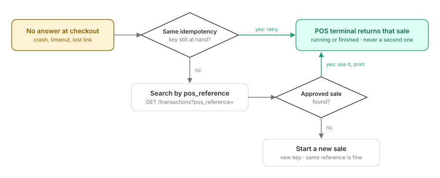
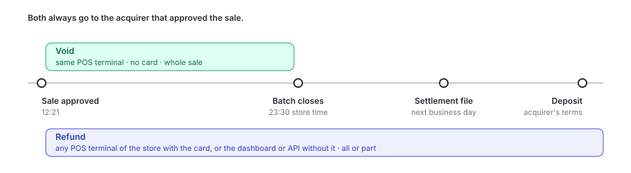

En el tipo Local, tu sistema de checkout se comunica únicamente con la terminal POS, dentro de la tienda. Nunca se comunica con el adquirente y nunca toca los datos de la tarjeta ni el PIN. Esta página enumera lo que envía tu sistema de checkout, lo que recibe y las reglas que evitan que se cobre dos veces a un titular de la tarjeta.

Las llamadas siguientes se pueden realizar directamente desde tu software de checkout, o a través del Yuno SDK de tu plataforma si prefieres una biblioteca cliente en lugar de HTTP directo. Si tu sistema de checkout ya habla un protocolo de terminal, la Yuno Payment App puede exponer esa misma interfaz, de modo que tu software de checkout cambie lo menos posible. La interfaz siguiente es la que Yuno ofrece para las nuevas integraciones.

## Transporte y emparejamiento {#transport-and-pairing}

- **Red de la tienda:** HTTPS hacia la dirección IP de la terminal POS en el puerto 8443, con TLS mutuo.
- **Cable:** USB o RS-232, con los mismos mensajes, cada uno firmado con la clave del sistema de checkout.

Cada terminal POS acepta comandos de un solo sistema de checkout emparejado. Para emparejar, un supervisor abre **Settings › Pair checkout** en la terminal, que muestra un código de seis dígitos y el inicio del fingerprint del certificado de la terminal. Tu sistema de checkout verifica el fingerprint, envía el código junto con una solicitud de certificado y almacena el certificado de cliente que recibe. A partir de ese momento, cada llamada usa ese certificado. Emparejar un nuevo sistema de checkout revoca el anterior.

## Las llamadas {#the-calls}

| Llamada | Qué hace |
| --- | --- |
| `POST /pairing` | Empareja este sistema de checkout con la terminal POS (una vez por caja) |
| `GET /status` | ¿Está lista la terminal? Durante una venta: en qué paso está y qué ve el titular de la tarjeta |
| `POST /sales` | Inicia una venta y espera el resultado |
| `POST /sales/abort` | Cancela la venta mientras la terminal aún espera la tarjeta |
| `POST /voids` | Anula una venta aprobada antes de que se cierre su lote |
| `POST /refunds` | Reembolsa todo o parte de una venta, con la tarjeta |
| `POST /batches/close` | Cierra los lotes de la terminal (si tu tienda cierra desde el checkout) |
| `GET /transactions?pos_reference=` | Busca una venta por tu referencia, por ejemplo después de una caída |
| `GET /transactions/{payment_id}/receipt` | Líneas del comprobante para reimprimir |

## Una venta {#a-sale}

```json Request · POST /sales
{
  "amount": { "value": 125.00, "currency": "USD" },
  "pos_reference": "ORD-48213",
  "cashier_id": "0457",
  "installments": { "count": 6 }
}
```

Campos opcionales: `installments` cuando el cliente eligió un plan en el checkout, y `subscription` (el ID de un plan) para iniciar una suscripción con esta venta; consulta [Pagos y eventos](/es/docs/in-person/payments-and-events#subscriptions-started-in-store).

La llamada permanece abierta mientras el cliente paga (hasta 120 segundos para la tarjeta) y devuelve el resultado cuando la venta termina. Configura el tiempo de espera HTTP de tu sistema de checkout por encima de ese valor, por ejemplo 150 segundos.

```json Response (approved)
{
  "payment_id": "4f8a2c6e-1b3d-4e5f-9a7c-2d4e6f8a0b13",
  "pos_reference": "ORD-48213",
  "status": "SUCCEEDED",
  "sub_status": "APPROVED",
  "response_code": "SUCCEEDED",
  "amount": { "value": 125.00, "currency": "USD" },
  "installments": { "count": 6 },
  "card": { "brand": "VISA", "lfd": "4242", "entry_mode": "CHIP", "cardholder_verification": "ONLINE_PIN" },
  "acquirer": { "code": "ACQUIRER_A", "acquirer_merchant_id": "8012345", "acquirer_terminal_id": "TA104512" },
  "authorization_code": "004312",
  "retrieval_reference_number": "627412003812",
  "receipt": { "cardholder_copy": ["..."], "merchant_copy": ["..."] }
}
```

El `payment_id` lo crea la terminal POS cuando se inicia la venta y es el mismo ID que ves en la API de Pagos, los webhooks y los reportes. Guárdalo junto con tu pedido.

| Resultado (`status` / `sub_status`) | Qué ocurrió | Qué hace el sistema de checkout |
| --- | --- | --- |
| `SUCCEEDED` / `APPROVED` | Aprobado | Cierra el ticket, imprime |
| `DECLINED` / `DECLINED` | Rechazado; `response_code` indica el motivo | Muestra el motivo, ofrece otra tarjeta u otro medio de pago |
| `CANCELED` / `ABORTED` | Cancelado antes de la tarjeta, o no hubo tarjeta a tiempo | No se cobró nada; vuelve a empezar cuando estés listo |
| `ERROR` / `REVERSED_BY_TIMEOUT` | El adquirente no respondió; la terminal revirtió con el mismo adquirente | No queda ningún cobro; inténtalo de nuevo, el siguiente intento puede ir a otro adquirente |

Una venta rechazada es una respuesta `200` normal, no un error. Los errores (`TERMINAL_BUSY`, `NOT_PAIRED`, `NO_ACQUIRER_AVAILABLE`…) significan que no se inició ninguna venta.

## Nunca cobres dos veces {#never-charge-twice}

<Frame caption="Qué hace el sistema de checkout cuando perdió la respuesta de una venta.">
  
</Frame>

- **Envía una clave de idempotencia** (`X-Idempotency-Key`) con cada venta y guárdala junto con el ticket. Si se cae tu conexión, reintenta con la misma clave: la terminal devuelve la venta que ya está en curso o terminada en lugar de iniciar otra.
- **Después de una caída o de una respuesta perdida, verifica antes de cobrar.** Llama a `GET /transactions?pos_reference=ORD-48213`. Si hay una venta aprobada, úsala; inicia una venta nueva solo si no hay ninguna o si la última terminó sin aprobación.
- **Reutilizar tu referencia está permitido** después de un rechazo, una cancelación o un tiempo de espera agotado (el cliente prueba con otra tarjeta). Solo se rechaza si esa referencia ya tiene una venta aprobada.

## Anulaciones y reembolsos {#voids-and-refunds}

<Frame caption="Cuándo se puede anular una venta y cuándo solo se puede reembolsar.">
  
</Frame>

|  | Anulación | Reembolso |
| --- | --- | --- |
| Cuándo | Antes de que se cierre el lote de la venta | En cualquier momento después de la venta |
| Dónde | La terminal POS que realizó la venta | Cualquier terminal POS de la tienda con ese adquirente, o el Dashboard y la API |
| Tarjeta | No es necesaria | Presente en la terminal y verificada contra la original; no es necesaria desde el Dashboard ni la API |
| Monto | La venta completa | Total o parcial |
| Va a | El adquirente original de la venta, siempre | El adquirente original de la venta, siempre |
| Pago posteriormente | `CANCELED` | `REFUNDED`, o `SUCCEEDED` / `PARTIALLY_REFUNDED` |

Las anulaciones y los reembolsos nunca siguen las reglas de enrutamiento: van al adquirente que aprobó la venta. Si el adquirente rechaza o no responde, la venta se mantiene como estaba.

## Cierre de lote {#batch-close}

Yuno Cloud mantiene un lote abierto por terminal y día hábil. De forma predeterminada se cierra cada noche a la hora de corte definida para la tienda; tu sistema de checkout también puede cerrarlo con `POST /batches/close`, y una terminal apagada a la hora de corte es cerrada por Yuno en su nombre. Después del cierre, el adquirente liquida el lote y una venta ya no se puede anular, solo reembolsar.

## Comprobantes {#receipts}

La terminal devuelve las líneas del comprobante y tu sistema de checkout las imprime; las terminales con impresora también pueden imprimirlas. La copia del titular de la tarjeta incluye la marca de la tarjeta y los últimos cuatro dígitos, la etiqueta de la aplicación y el AID, el modo de entrada, el plan de cuotas, el código de autorización y la referencia; no incluye el ID completo del comercio ni de la terminal. El texto del encabezado y del pie proviene de la configuración de la tienda.
