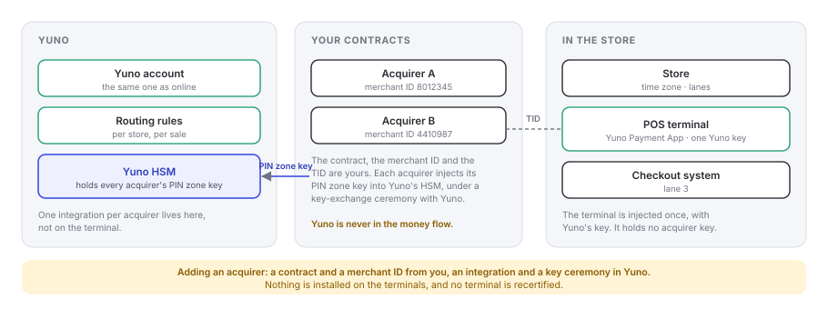
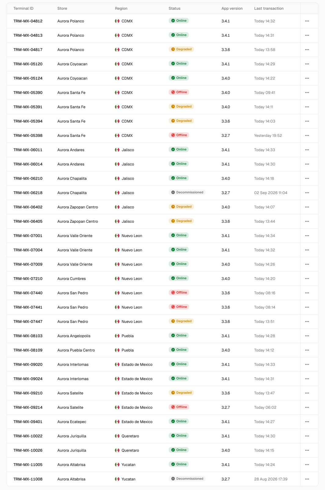

Seis pasos desde tu cuenta de Yuno hasta una primera venta en un terminal POS. La mayoría es configuración con tu contacto en Yuno; el único código está de tu lado del [tipo de integración](/es/docs/in-person/ways-to-integrate) que elijas.

<Frame caption="Lo que registras: tiendas, tu contrato con cada adquirente y una clave de Yuno en cada terminal POS. Las claves de PIN de los adquirentes viven en el HSM de Yuno.">
  
</Frame>

<Steps>
  <Step title="Usa tu cuenta de Yuno">
    Los pagos presenciales viven en la misma cuenta, las mismas claves de API y el mismo dashboard que tus pagos en línea. No hay nada nuevo que crear. Si eres nuevo en Yuno, [configura tu cuenta](/es/docs/quickstart) primero.
  </Step>
  <Step title="Registra tiendas, adquirentes y terminales POS">
    Cada tienda recibe un identificador, y para cada tienda registras los adquirentes con los que trabajas y el ID de comercio que te dio cada uno. Yuno integra y certifica al adquirente; el contrato con él es tuyo.
    Cada carril recibe un terminal POS, y cada adquirente emite los IDs de terminal (TID) de la tienda. Los TID se guardan en Yuno, que pone el correcto en cada venta; no se instala nada por adquirente en el terminal. El registro se hace en el dashboard, o desde una lista de números de serie para flotas grandes. Solo los terminales registrados pueden comunicarse con Yuno.
  </Step>
  <Step title="Instala la Yuno Payment App y la clave">
    La app se firma mediante el proceso de firma del fabricante del terminal y se distribuye a través del administrador de parque del fabricante o de tu propia gestión de dispositivos. El terminal recibe una sola vez la clave de Yuno; la clave de zona de PIN de cada adquirente va en cambio al módulo de seguridad de hardware de Yuno, en una ceremonia de claves entre ese adquirente y Yuno. Consulta [Terminales POS y flota](/es/docs/in-person/terminals).
  </Step>
  <Step title="Define las reglas de enrutamiento">
    Qué adquirentes puede usar cada tienda y cómo elegir entre ellos: tienda, monto, método de pago, rango de tarjeta, salud del adquirente. Las reglas viven en Yuno Cloud y se aplican allí en cada venta, así que un cambio entra en vigor en la siguiente venta. Los planes de cuotas, los métodos de pago y tu marca para las pantallas del terminal llegan a cada terminal cuando se conecta de nuevo.
  </Step>
  <Step title="Conecta tu sistema de checkout">
    Para el tipo Local, el sistema de checkout de cada carril se empareja una vez con su terminal POS para que solo él pueda iniciar ventas allí. Para el tipo Cloud, tu servidor llama a la API de Payments. Consulta [Conecta tu sistema de checkout](/es/docs/in-person/connect-your-checkout-system).
  </Step>
  <Step title="Prueba en sandbox y sal a producción">
    Los terminales de sandbox ejecutan la misma app contra el simulador de adquirentes de Yuno, con tarjetas de prueba que producen aprobaciones, rechazos y tiempos de espera agotados a demanda. Pasa una tienda a producción cuando sus terminales se reporten en línea y una venta de prueba se concilie. Consulta [Pruebas](/es/docs/in-person/get-started#testing) más abajo.
  </Step>
</Steps>

<Frame caption="Una vez registrado, cada terminal POS aparece en la vista de flota con su tienda, región, estado, versión de la app y última venta.">
  
</Frame>

## Qué construyes {#what-you-build}

Los cuatro tipos de integración comparten el mismo pago, webhooks, dashboard y conciliación, y puedes ejecutar más de uno: por ejemplo Local en tus tiendas y Standalone como respaldo en el mismo terminal. Empezar por la conciliación es lo más rápido, porque no cambia nada en tus tiendas.

| Tipo de integración | Qué es | Qué construyes | Qué ofrece Yuno |
| --- | --- | --- | --- |
| **Local** | Tu sistema de checkout envía el monto al terminal POS de la tienda, por la red de la tienda o por cable, y recibe el resultado para imprimir | Las llamadas en tu sistema de checkout: venta, anulación, reembolso, estado, recuperación ([Conecta tu sistema de checkout](/es/docs/in-person/connect-your-checkout-system)) | La Yuno Payment App, enrutamiento, integraciones con adquirentes, registro del pago, webhooks, conciliación |
| **Cloud** | Tu servidor crea el pago presencial mediante la API de Payments; Yuno lo envía a un terminal POS de esa tienda y recibes el resultado por webhook | Una llamada a la API y un manejador de webhooks, que probablemente ya tienes para el pago en línea | Lo mismo, más la entrega de la venta al terminal |
| **Standalone** | El cajero ingresa el monto en el terminal POS; sin ninguna integración | Nada | Lo mismo |
| **Conciliación primero** | Yuno concilia las ventas de tus terminales actuales contra los archivos de liquidación de tus adquirentes, antes de que ningún terminal ejecute la Yuno Payment App | Acceso a los archivos de liquidación de tus adquirentes y una exportación de tus ventas actuales | La coincidencia por tienda y adquirente, y las vistas de conciliación |

## Pruebas {#testing}

- **Terminales de sandbox.** Un terminal POS registrado se puede cambiar a sandbox: la misma app, las mismas pantallas, contra el simulador de adquirentes de Yuno en lugar del adquirente. No se mueve dinero real.
- **Tarjetas de prueba.** Un conjunto de tarjetas de prueba produce un resultado fijo cada una: aprobado, rechazado con un motivo dado, tiempo de espera agotado, cuotas ofrecidas o no. Pide el conjunto a tu contacto en Yuno.
- **Webhooks.** Las ventas en sandbox envían los mismos eventos que las reales, así que tu manejador se puede probar de extremo a extremo antes de que la primera tienda salga a producción.
- **Conciliación.** El simulador produce un archivo de liquidación para las ventas en sandbox, así que la vista de conciliación se puede revisar antes de que lleguen los archivos reales.

Antes de salir a producción, ejecuta al menos estos casos desde tu sistema de checkout: venta aprobada, venta rechazada, venta cancelada antes de la tarjeta, tiempo de espera del adquirente (reversado), anulación, reembolso total y parcial, venta en cuotas, cierre de lote y un reinicio del checkout en medio de una venta (tu sistema de checkout debe recuperar el resultado, no cobrar de nuevo).

## Lista de verificación para salir a producción {#go-live-checklist}

- Los terminales POS se reportan en línea en la vista de flota, con la versión de la app esperada.
- Cada terminal tiene la clave de Yuno inyectada, y la tienda tiene un TID registrado para cada adquirente al que puede enrutar.
- El sistema de checkout de cada carril está emparejado con su terminal POS (tipo Local).
- Una venta en cada tipo de integración que uses llega a tu webhook con `channel: IN_PERSON`.
- Las reglas de enrutamiento de la tienda están publicadas.
- Cada adquirente ejecutó contigo sus pruebas de aceptación: venta, anulación, reembolso y cierre de lote.
- Una venta en sandbox se concilió; la entrega del archivo de liquidación real del adquirente está confirmada.
- Los recibos se imprimen con el texto que configuraste.
