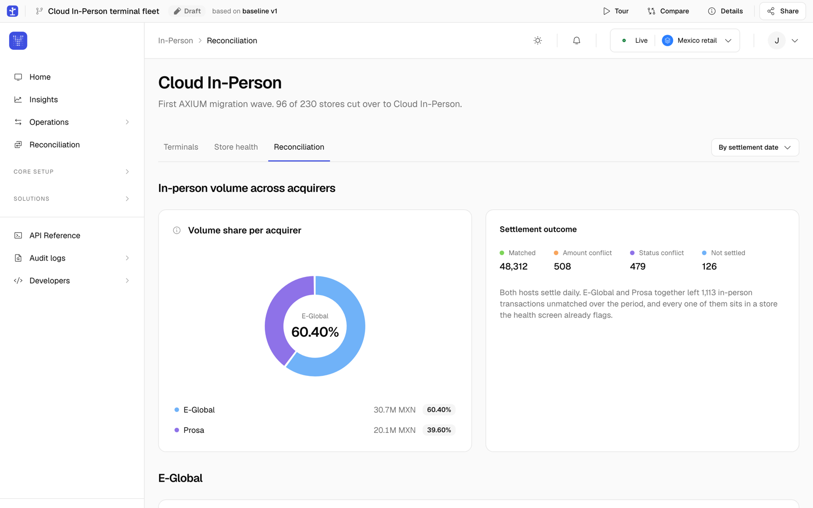
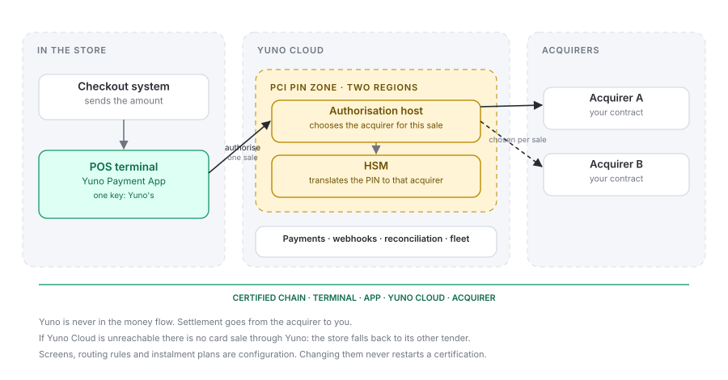

Acepta pagos con tarjeta en las terminales POS que tus tiendas ya tienen, enruta cada venta al adquirente que elijas y ve todo, en tienda y en línea, en una sola cuenta de Yuno.

<Info>
  **Dos términos que se usan en toda esta documentación.** La **terminal POS** es el dispositivo Android para tarjetas que está en el mostrador; la **Yuno Payment App** se ejecuta en él. El **sistema de caja** es el software de tu caja registradora, donde el cajero registra la compra. En la mayoría de las tiendas, el sistema de caja le indica a la terminal POS cuánto debe cobrar.
</Info>

## Qué obtienes {#what-you-get}

<CardGroup cols={3}>
  <Card title="Tus terminales POS">
    La Yuno Payment App se ejecuta en las terminales POS Android que ya tienes, de proveedores como Verifone e Ingenico. Yuno no vende ni alquila hardware.
  </Card>
  <Card title="Enrutamiento multiadquirente en tienda">
    Conserva tus contratos de adquirencia. Tus reglas de enrutamiento deciden, venta por venta, qué adquirente la procesa: por tienda, monto, método y estado del adquirente.
  </Card>
  <Card title="Una sola vista, en tienda y en línea">
    Los pagos en tienda llegan a la misma cuenta que los pagos en línea, vinculados al mismo cliente. Una tarjeta guardada en el mostrador se puede cobrar en línea, y al revés. Ves quién paga, dónde y cómo, algo que tus terminales por sí solos nunca te mostraron.
  </Card>
</CardGroup>

Cada venta en tienda es un `payment` de Yuno, con el mismo identificador, los mismos estados, eventos y webhooks que uno en línea. Lo que cambia es el `channel` (`IN_PERSON`) y los datos de tienda y terminal que lo acompañan.

<Frame caption="Conciliación por tienda y adquirente en el dashboard de Yuno.">
  
</Frame>

## Funcionalidades {#features}

<CardGroup cols={3}>
  <Card title="Enrutamiento multiadquirente">
    Por venta, según tienda, monto, método, rango de tarjeta y estado del adquirente. Una venta rechazada nunca se envía a otro adquirente; una que agota el tiempo de espera se revierte con el mismo.
  </Card>
  <Card title="Cuotas">
    Planes de cuotas del catálogo del adquirente que procesa la venta. El plan se puede elegir en tu sistema de caja, en la terminal antes del PIN, o justo antes de que se autorice la venta.
  </Card>
  <Card title="Suscripciones">
    Inicia una suscripción en el mostrador: el primer cobro en la terminal POS y los siguientes en línea, sobre la misma suscripción de Yuno.
  </Card>
  <Card title="Visibilidad del cliente entre canales">
    La misma tarjeta se reconoce en tienda y en línea, así que sabes quién paga en cada canal y puedes llevar las compras en tienda a fidelización, analítica y servicio.
  </Card>
  <Card title="Tarjetas guardadas y el vault">
    Con el consentimiento del cliente, la tarjeta se guarda como token en el vault de Yuno, nunca como número de tarjeta de tu lado. El mismo token funciona en tienda y en línea, para cobros posteriores, propinas y suscripciones.
  </Card>
  <Card title="Métodos de pago a demanda">
    Tarjetas con chip y contactless, con cuotas. Los métodos locales, como QR y billeteras, se agregan por mercado y siguen la especificación de su proveedor.
  </Card>
  <Card title="Marca blanca">
    Tu marca en cada pantalla y recibo, por configuración, nunca por código y nunca con una nueva certificación.
  </Card>
  <Card title="Gestión de flota">
    Cada terminal POS por tienda: en línea o sin conexión, versión de la app, IDs de adquirente, estado de las claves, última venta. Actualizaciones por etapas, por grupo.
  </Card>
  <Card title="Conciliación">
    Autorizado, liquidado y depositado por tienda y adquirente, conciliado automáticamente. Puede comenzar antes de que la app esté en un solo terminal.
  </Card>
  <Card title="La misma plataforma que en línea">
    El mismo pago, los mismos estados, webhooks, reportes y dashboard. Filtra por `channel`.
  </Card>
</CardGroup>

Qué significan para tu integración el cliente compartido, el vault y las suscripciones iniciadas en tienda se explica en [Entre canales](/es/docs/in-person/across-channels). A qué paquete pertenece cada uno y qué necesita de ti se explica en [Soluciones](/es/docs/in-person/solutions).

## Cómo funciona {#how-it-works}

<Frame caption="Cada venta se autoriza a través de Yuno Cloud, que elige el adquirente para esa venta y traduce el PIN. La terminal solo guarda la clave de Yuno.">
  
</Frame>

- **La venta comienza en tu sistema de caja**, como hoy, o en la propia terminal POS. Tu sistema de caja habla con la terminal dentro de la tienda; Yuno nunca se conecta a tu sistema de caja, a la red de tu tienda ni a tus sistemas centrales.
- **La terminal POS envía una sola autorización a Yuno Cloud.** Guarda una única clave, la de Yuno, y nunca habla directamente con un adquirente.
- **Yuno Cloud elige el adquirente para esa venta** con las reglas que defines: tienda, monto, método de pago, rango de tarjeta y el estado en vivo de cada adquirente. El PIN se traduce dentro de un módulo de seguridad de hardware a la clave del adquirente que procese la venta, y nunca está en claro en ningún lugar.
- **La terminal responde a tu sistema de caja** con el resultado y los datos del recibo. Yuno registra el pago, envía tus webhooks y después concilia el archivo de liquidación del adquirente contra él.

## Qué se ejecuta dónde {#what-runs-where}

| En la terminal POS (Yuno Payment App) | En Yuno Cloud |
| --- | --- |
| Lee la tarjeta con el kernel certificado del proveedor | Elige el adquirente para cada venta, según las reglas que publicas |
| Muestra los planes de cuotas enviados desde Yuno Cloud | Traduce el PIN en un módulo de seguridad de hardware a la clave de ese adquirente |
| Recibe el PIN en el teclado seguro, bajo la clave de Yuno | Envía la autorización por su propio enlace a cada adquirente |
| Envía una autorización y luego entrega las líneas del recibo | Registra el pago, envía webhooks, reportes y el dashboard |
| No guarda ninguna clave de adquirente y nunca habla con un adquirente | Concilia archivos de liquidación y administra clientes, flota y actualizaciones |
| Nunca almacena la tarjeta; sale de la terminal cifrada | Guarda la tarjeta como token en el vault de Yuno, cuando el cliente lo autoriza |

Yuno Cloud interviene en cada venta, y eso permite que una venta vaya a un adquirente distinto al de la anterior sin tocar la terminal. También es lo que convierte las terminales en una flota: un solo conjunto de reglas, una sola señal de estado, un solo registro de cada venta, en el mismo lugar que tus pagos en línea. El host funciona en dos regiones; si no se puede acceder a él, la terminal no puede aceptar una tarjeta y la tienda recurre a su otro medio de cobro.

## Cómo fluye una venta {#how-a-sale-flows}

<Steps>
  <Step title="Comienza la venta">
    Tu sistema de caja envía el monto y tu referencia a la terminal POS.
  </Step>
  <Step title="El cliente paga">
    Chip o contactless, cuotas donde apliquen, PIN en el teclado seguro bajo la clave de Yuno. La terminal envía la venta a Yuno Cloud una sola vez.
  </Step>
  <Step title="Yuno Cloud elige el adquirente y autoriza">
    Según tus reglas para esa tienda: monto, método, rango de tarjeta y estado del adquirente. Un módulo de seguridad de hardware traduce el PIN a la clave de ese adquirente, y Yuno envía una sola autorización.
  </Step>
  <Step title="Recibes el resultado dos veces">
    En el sistema de caja para el recibo, y como un pago de Yuno con `channel: IN_PERSON`, con los mismos webhooks que en línea.
  </Step>
  <Step title="Yuno concilia">
    El archivo de liquidación del adquirente se concilia por tienda y adquirente, y se enumeran las diferencias.
  </Step>
</Steps>

La secuencia completa, con contactless, cuotas, anulaciones, reembolsos y lo que ocurre cuando una venta falla, está en [Flujo de pago](/es/docs/in-person/payment-flow).

## Tipos de integración {#integration-types}

|  | Dónde comienza la venta |
| --- | --- |
| **Local** | Tu sistema de caja, por la red de la tienda o por cable |
| **Cloud** | Tu servidor, a través de la API de Payments |
| **Standalone** | En la terminal POS, sin integración |
| **Conciliación primero** | Tus terminales y adquirentes actuales, conciliados por Yuno |

Cómo elegir se explica en [Tipos de integración](/es/docs/in-person/ways-to-integrate). Cómo se comunica tu sistema de caja con la terminal POS se explica en [Conecta tu sistema de caja](/es/docs/in-person/connect-your-checkout-system). A qué paquete pertenece cada tipo y qué necesita cada paquete de ti se explica en [Soluciones](/es/docs/in-person/solutions).

## En un teléfono: Tap to Pay {#on-a-phone-tap-to-pay}

¿Sin terminal POS? El teléfono Android o el iPhone del comercio también pueden aceptar pagos contactless, con el mismo enrutamiento, el mismo objeto de pago y la misma conciliación. Funciona con su propia infraestructura de aceptación certificada y se ofrece bajo tu marca o la de un adquirente. Consulta [Tap to Pay](/es/docs/in-person/tap-to-pay/overview).

## Cobertura de un vistazo {#coverage-at-a-glance}

|  |  |
| --- | --- |
| **Regiones** | Latinoamérica y Europa. Cada país es su propia cadena de certificación, por adquirente |
| **Adquirentes** | Los adquirentes con los que trabajas; Yuno integra y certifica nuevos adquirentes a demanda |
| **Terminales POS** | Terminales POS Android que aceptan aplicaciones de pago externas, de proveedores como Ingenico y Verifone |
| **Métodos de pago** | Chip y PIN, contactless y cuotas; métodos locales como QR y billeteras por mercado |

Detalles y cumplimiento normativo: [Cobertura y preguntas frecuentes](/es/docs/in-person/coverage-and-faq).

<CardGroup cols={2}>
  <Card title="Soluciones" href="/es/docs/in-person/solutions">
    Consulta See, Orchestrate, Unify y Connect: qué hace cada paquete y qué necesita de ti.
  </Card>
  <Card title="Primeros pasos" href="/es/docs/in-person/get-started">
    Desde tu cuenta de Yuno hasta la primera venta en tienda.
  </Card>
  <Card title="Tipos de integración" href="/es/docs/in-person/ways-to-integrate">
    Local, cloud, standalone o conciliación primero, y cómo elegir.
  </Card>
  <Card title="Conecta tu sistema de caja" href="/es/docs/in-person/connect-your-checkout-system">
    Emparejamiento, las llamadas que hace tu sistema de caja, recuperación tras una caída, anulaciones, reembolsos y cierre de lote.
  </Card>
  <Card title="Flujo de pago" href="/es/docs/in-person/payment-flow">
    Una venta con chip y PIN, paso a paso, y dónde se elige el adquirente.
  </Card>
  <Card title="Pagos y eventos" href="/es/docs/in-person/payments-and-events">
    Cómo se ve un pago en tienda, clientes y suscripciones, códigos de rechazo y webhooks.
  </Card>
  <Card title="Terminales POS y flota" href="/es/docs/in-person/terminals">
    Qué terminales, instalación y claves, marca blanca, actualizaciones sin recertificación.
  </Card>
  <Card title="Conciliación" href="/es/docs/in-person/reconciliation">
    Cómo se concilia cada venta contra el archivo de liquidación del adquirente, y los resultados posibles.
  </Card>
  <Card title="Cobertura y preguntas frecuentes" href="/es/docs/in-person/coverage-and-faq">
    Regiones, adquirentes, terminales, cumplimiento normativo y las preguntas más frecuentes.
  </Card>
</CardGroup>
