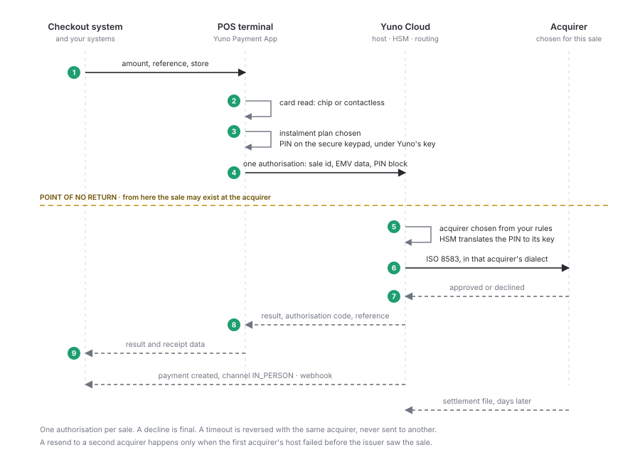
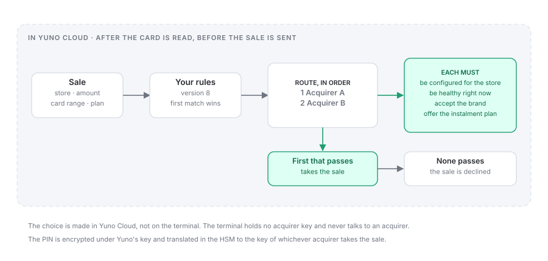
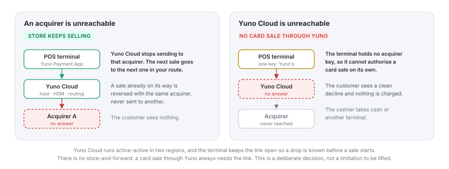

Una venta con chip y PIN, paso a paso. Un toque contactless por debajo del límite de la marca sigue el mismo camino sin el paso del PIN.

<Frame caption="Una venta con chip y PIN. La línea ámbar es el punto sin retorno: desde ahí la venta ya puede existir en el adquirente.">
  
</Frame>

<Steps>
  <Step title="Inicio de la venta">
    Tu sistema de checkout envía el monto y una referencia a la terminal POS (o lo hace tu servidor, en el tipo Cloud, o el cajero lo ingresa a mano). La terminal muestra el monto y los métodos de pago habilitados para la tienda.
  </Step>
  <Step title="Lectura de la tarjeta">
    Con chip o contactless, en el kernel certificado de la terminal. El rango de la tarjeta leído aquí es uno de los datos para elegir el adquirente.
  </Step>
  <Step title="Cuotas">
    Se muestran los planes disponibles para esta tarjeta y tienda; el cliente elige uno y confirma el monto mensual y el total. Si tu sistema de checkout ya envió un plan, la terminal lo usa y no pregunta.
  </Step>
  <Step title="PIN">
    Se ingresa en el teclado seguro y se cifra con la clave de Yuno. La terminal no guarda ninguna clave de adquirente, por lo que el PIN aún no está ligado a un adquirente.
  </Step>
  <Step title="Una autorización a Yuno Cloud">
    La terminal envía la venta una sola vez: id de la venta, datos EMV y bloque de PIN. Este es el punto sin retorno; desde aquí la venta ya puede existir en el adquirente.
  </Step>
  <Step title="Yuno Cloud elige el adquirente y autoriza">
    Tus reglas para esa tienda eligen el adquirente: monto, método, rango de tarjeta, plan de cuotas y estado del adquirente. Un módulo de seguridad de hardware traduce el PIN a la clave de ese adquirente, y Yuno envía una autorización ISO 8583 en el dialecto de ese adquirente. Si el adquirente no responde, la venta se revierte con ese mismo adquirente, porque el emisor puede haberla visto ya.
  </Step>
  <Step title="Resultado">
    La terminal muestra el resultado y entrega el resultado y las líneas del recibo a tu sistema de checkout.
  </Step>
  <Step title="Pago registrado, webhook enviado">
    Yuno crea el pago con `channel: IN_PERSON`, guarda los identificadores del adquirente, lo vincula al cliente y envía los mismos eventos que un pago online. El registro se escribe en Yuno Cloud al autorizarse la venta, por lo que no hay que reportar nada después.
  </Step>
  <Step title="Lote, liquidación y conciliación">
    La venta se une al lote abierto de esa terminal y día hábil, que Yuno Cloud mantiene. El adquirente te liquida directamente, y Yuno compara su archivo de liquidación con cada venta, por tienda. Consulta [Conciliación](/es/docs/in-person/reconciliation).
  </Step>
</Steps>

<Note>
  **Una tarjeta rechazada es una venta nueva.** En tienda, el rechazo del emisor es definitivo: el cliente está allí presente y un segundo intento le corresponde a él. Una venta se reenvía a un segundo adquirente en un solo caso, cuando el host del primer adquirente falló antes de que el emisor la viera. El enrutamiento mejora el costo y la resiliencia entre ventas, no el resultado de una sola.
</Note>

## Cómo se elige el adquirente {#how-the-acquirer-is-chosen}

La elección se hace en Yuno Cloud, para cada venta, después de leer la tarjeta y antes de enviar la venta. La primera regla que coincide da una lista ordenada de adquirentes, y gana el primero que puede tomar la venta. Las anulaciones y los reembolsos se saltan este paso: van al adquirente original de la venta.

<Frame caption="El adquirente se elige en Yuno Cloud, según tus reglas, después de leer la tarjeta y antes de enviar la venta.">
  
</Frame>

## Chip y contactless {#chip-and-contactless}

|  | Chip (insertar) | Contactless (acercar) |
| --- | --- | --- |
| **PIN** | Según lo exija la tarjeta | No por debajo del límite contactless de la marca; por encima, la tarjeta pide el PIN en el teclado o que se inserte la tarjeta |
| **Cuotas** | Se ofrecen cuando la tarjeta y los planes de la tienda lo permiten | Igual; se eligen antes del PIN |
| **Elección del adquirente** | En Yuno Cloud, después de leer la tarjeta | En Yuno Cloud, después de leer la tarjeta |
| **Uso típico** | Compras más grandes, cuotas | Compras pequeñas, rapidez en el mostrador |

El límite contactless lo fijan las marcas de tarjeta por mercado y lo aplica la configuración del kernel de la terminal.

## Cuotas {#instalments}

Los planes de cuotas se ofrecen desde el catálogo de los adquirentes configurados para esa tienda: planes sin intereses financiados por el comercio, o los planes propios del emisor, según los admitan cada adquirente y tarjeta. Una venta con cuotas solo se enruta a un adquirente que ofrezca el plan. El plan se puede elegir en tu sistema de checkout, en la terminal antes del PIN, o justo antes de autorizar la venta, y el plan elegido aparece en el pago y en el recibo.

## Otros métodos de pago {#other-payment-methods}

Además de las tarjetas con chip y contactless, la terminal POS acepta los métodos locales que usa tu mercado, como pagos con QR y billeteras. Cada uno se agrega por mercado, siguiendo la especificación de API del proveedor, y aparece en la terminal como una opción más. Sus pagos siguen los mismos estados, webhooks y conciliación que las tarjetas.

## Anulaciones, reembolsos y cancelaciones {#voids-refunds-and-cancellations}

| Acción | Dónde | Resultado |
| --- | --- | --- |
| Cancelar antes de leer la tarjeta | Sistema de checkout, servidor o terminal | Nada salió de la terminal; no se cobra nada |
| Revertir tras un timeout | Automático, por la terminal | Se envía al mismo adquirente; el pago muestra `ERROR` / `REVERSED_BY_TIMEOUT`; no queda ningún cobro |
| Anular antes de que cierre el lote | Sistema de checkout, la misma terminal POS, sin tarjeta | Se envía al adquirente original; el pago muestra `CANCELED` y nunca se liquida |
| Reembolso en la terminal | Sistema de checkout, con la tarjeta presente | Se envía al adquirente original; vinculado al pago original |
| Reembolso sin tarjeta | Dashboard o API | Se envía al adquirente original; vinculado al pago original |

Las anulaciones y los reembolsos nunca siguen las reglas de enrutamiento: siempre van al adquirente que aprobó la venta.

## Cierre de lote {#batch-close}

Yuno Cloud mantiene un lote abierto por terminal y día hábil. Se cierra cada noche en el horario de corte definido para la tienda, o cuando lo pide el cajero o tu sistema de checkout. **Una terminal apagada en el horario de corte la cierra Yuno en su nombre**, y conoce su nuevo número de lote en su próximo registro; la terminal guarda localmente su propio estado de lote, que es lo que decide si una operación es una anulación o un reembolso. Una vez cerrado un lote, sus ventas solo se pueden reembolsar, no anular. Si los totales del adquirente difieren de los nuestros, la diferencia aparece en la conciliación.

## Dos tarjetas en una venta {#two-cards-on-one-sale}

Una compra pagada con dos tarjetas son dos pagos con la misma referencia de orden, uno tras otro, cada uno enrutado y autorizado por separado. Si la segunda tarjeta es rechazada, el primer pago se mantiene; reembólsalo si se abandona la venta.

## Comprobantes {#receipts}

La terminal produce las líneas del recibo (tarjeta enmascarada, marca, etiqueta de la aplicación, monto, plan de cuotas, código de autorización, fecha y hora) y las entrega al sistema de checkout para imprimirlas. El texto y el diseño del recibo son configuración; nunca tocan el núcleo certificado.

## Cuando algo sale mal {#when-something-goes-wrong}

<Frame caption="Dos caídas distintas. Perder un adquirente permite que la tienda siga vendiendo; perder Yuno Cloud detiene las ventas con tarjeta a través de Yuno.">
  
</Frame>

| Qué ocurre | Qué ve el cliente | Qué hace Yuno |
| --- | --- | --- |
| El emisor rechaza | El motivo y "prueba con otra tarjeta" | Registra el pago rechazado y envía el webhook |
| No hay respuesta del adquirente | "No pudimos confirmar el pago" | Yuno revierte con el mismo adquirente; no queda ningún cobro; la siguiente venta va a otro adquirente |
| El cajero cancela antes de leer la tarjeta | "Pago cancelado" | Nada salió de la terminal |
| Se retira la tarjeta a mitad de la lectura | "Inserta tu tarjeta de nuevo" | No se cobró nada |
| La tienda pierde su conexión con Yuno | Un rechazo limpio, antes de leer la tarjeta | No hay ventas con tarjeta a través de Yuno hasta que vuelva el enlace; no se cobra nada y el cajero acepta otro medio de pago |
| Un adquirente está caído | Nada, si otro adquirente puede tomar la venta | Yuno omite ese adquirente en las ventas nuevas hasta que se recupere |
| La red de la tienda está caída | Un rechazo limpio | No se cobra nada; el cajero acepta otro método |
