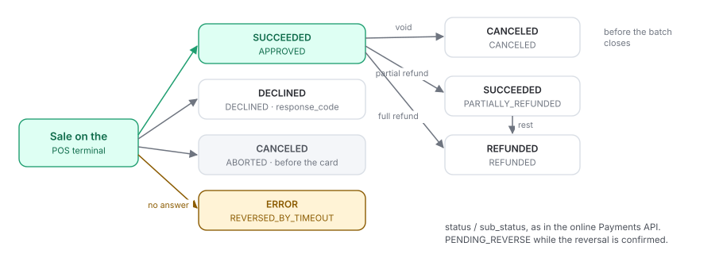

Las ventas en tienda usan el mismo recurso `payment` que las ventas en línea, con los mismos `status` y `sub_status`. Lo nuevo es el `channel` y un bloque `in_person`, para que puedas filtrar, informar y conciliar por tienda, y ver al mismo cliente en todos los canales, sin una integración aparte.

## El pago {#the-payment}

```json Payment (in-person)
{
  "id": "4f8a2c6e-1b3d-4e5f-9a7c-2d4e6f8a0b13",
  "account_id": "5beead35-0cd5-4e1c-9a13-b8f48f7f8f3a",
  "channel": "IN_PERSON",
  "status": "SUCCEEDED",
  "sub_status": "APPROVED",
  "merchant_order_id": "ORD-48213",
  "amount": { "currency": "USD", "value": 125.00, "refunded": 0 },
  "customer_payer": { "id": "33a9e979-5c1b-4f0e-9d2a-7b3c1e8f6a20" },
  "payment_method": {
    "type": "CARD",
    "detail": {
      "card": {
        "entry_mode": "CHIP",
        "cardholder_verification": "ONLINE_PIN",
        "installments": 6,
        "authorization_code": "004312",
        "retrieval_reference_number": "627412003812",
        "card_data": {
          "brand": "VISA",
          "iin": "450799",
          "lfd": "4242",
          "type": "CREDIT",
          "payment_account_reference": "V0010013022298169667651235942"
        },
        "emv": { "aid": "A0000000031010", "application_label": "VISA CREDIT" }
      }
    }
  },
  "in_person": {
    "store_id": "7d1c0f5e-3b6a-4e2f-9d4b-2a8e6c1f0b93",
    "terminal_id": "9b2e4d6f-1a3c-4e5b-8d7f-0c2a4e6b8d13",
    "lane": "3",
    "business_date": "2026-10-14",
    "batch_number": "000118",
    "routing": { "selected_acquirer": "ACQUIRER_A", "rule_name": "Instalments to Acquirer A" }
  },
  "transactions": [
    {
      "type": "PURCHASE",
      "status": "SUCCEEDED",
      "provider_id": "ACQUIRER_A",
      "response_code": "SUCCEEDED",
      "provider_data": {
        "iso8583_response_code": "00",
        "stan": "003812",
        "acquirer_merchant_id": "8012345",
        "acquirer_terminal_id": "TA104512"
      }
    }
  ],
  "created_at": "2026-10-14T18:41:07Z"
}
```

| Campo | Qué contiene |
| --- | --- |
| `id` | Lo crea la terminal POS cuando se inicia la venta; el mismo ID que recibió el sistema de checkout |
| `channel` | `IN_PERSON` para toda venta realizada en una terminal POS; los pagos en línea conservan su canal actual |
| `customer_payer` | El cliente de Yuno al que pertenece la tarjeta, el mismo que ves en los pagos en línea |
| `payment_method.detail.card` | Modo de entrada (`CHIP`, `CONTACTLESS`), cómo se verificó al titular de la tarjeta, cuotas, código de autorización, tarjeta enmascarada, la referencia de cuenta de pago de la tarjeta y la aplicación EMV |
| `in_person` | Dónde y cuándo: tienda, terminal, caja, fecha hábil, lote y qué regla eligió al adquirente |
| `transactions[].provider_data` | Los identificadores del adquirente (STAN, RRN, ID de comercio y de terminal) y su código de respuesta sin procesar, usados para la conciliación |
| `merchant_order_id` | La referencia que envió tu sistema de checkout, para que puedas vincular el pago con tu propia orden |

El PIN, el número completo de la tarjeta, la fecha de vencimiento y el criptograma de la tarjeta nunca llegan a tu sistema de checkout ni a tus servidores.

## Clientes, tarjetas guardadas y suscripciones {#customers-stored-cards-and-subscriptions}

Una venta en tienda se vincula con el mismo `customer_payer` que los pagos en línea de ese cliente, a través de la referencia de cuenta de pago de la tarjeta, dentro de tu propia cuenta de Yuno y nunca entre comercios. Con el acuerdo del cliente, la tarjeta se puede guardar como un token y cobrarse en cualquiera de los canales, y una suscripción puede comenzar en el mostrador y facturarse en línea.

Todo esto, y lo que necesita de ti, está en [Entre canales](/es/docs/in-person/across-channels).

## Estados {#statuses}

<Frame caption="Cómo pasa un pago en persona entre estados.">
  
</Frame>

| `status` / `sub_status` | Significado |
| --- | --- |
| `SUCCEEDED` / `APPROVED` | Autorizado por el adquirente |
| `DECLINED` / `DECLINED` | El emisor o el adquirente lo rechazó; `response_code` indica el motivo |
| `CANCELED` / `ABORTED` | Cancelado antes de leer la tarjeta; nada llegó a un adquirente |
| `ERROR` / `REVERSED_BY_TIMEOUT` | No hubo respuesta a tiempo; la terminal revirtió con el mismo adquirente; no queda ningún cobro (`PENDING_REVERSE` mientras se confirma el reverso) |
| `CANCELED` / `CANCELED` | Anulado antes de que se cerrara el lote |
| `REFUNDED` / `REFUNDED` | Reembolsado por completo |
| `SUCCEEDED` / `PARTIALLY_REFUNDED` | Se reembolsó una parte del monto |

## Motivos de rechazo {#decline-reasons}

El código de respuesta de cada adquirente (campo 39 de ISO 8583) se asigna al `response_code` de Yuno, el mismo catálogo que en línea. El valor original se conserva en `provider_data.iso8583_response_code`. Los que más ven los cajeros:

| `response_code` | ISO 8583 | Qué hace el cajero |
| --- | --- | --- |
| `DO_NOT_HONOR` | 05 | Pide otra tarjeta |
| `INSUFFICIENT_FUNDS` | 51 | Pide otra tarjeta o un monto menor |
| `EXPIRED_CARD` | 54 | Pide otra tarjeta |
| `INCORRECT_PIN` | 55 | Inicia una venta nueva para que el cliente pueda ingresar el PIN de nuevo |
| `PIN_TRIES_EXCEEDED` | 75 | Pide otra tarjeta; la tarjeta está bloqueada por PIN |
| `PIN_REQUIRED` | 65 | Sin contacto rechazado: inserta la tarjeta e ingresa el PIN |
| `PROVIDER_TIMEOUT` | 68 o sin respuesta | No se cobró nada; inténtalo de nuevo |

## Lista de pagos en persona {#list-in-person-payments}

La lista de pagos se filtra por canal, tienda, terminal y fecha hábil, de modo que el día de una tienda se obtiene con una sola llamada.

```bash List a store's in-person payments
curl "https://api.y.uno/v1/payments?account_id=<account_id>&channel=IN_PERSON&store_id=<store_id>&business_date=2026-10-14" \
  -H "public-api-key: $PUBLIC_API_KEY" \
  -H "private-secret-key: $PRIVATE_SECRET_KEY"
```

## Eventos {#events}

Tu endpoint de webhook existente recibe los pagos en tienda sin ningún cambio: mismo sobre, misma firma (`x-hmac-signature`), mismos reintentos. Filtra por `data.payment.channel` si quieres tratarlos de forma distinta.

| Evento (`type_event`) | Cuándo | Notas |
| --- | --- | --- |
| `payment.purchase` | Una venta terminó, aprobada o rechazada | Igual que en línea; lee `status` y `sub_status` |
| `payment.cancel` | Una venta fue anulada | Igual que en línea |
| `payment.refund` | Se realizó un reembolso, en la terminal o desde el Dashboard o la API | Igual que en línea |
| `payment.reverse` | Se revirtió una autorización con tiempo de espera agotado | En persona. No queda ningún cobro |
| `terminal.online` / `terminal.offline` | Cambia la conexión de una terminal POS con Yuno | En persona. También visible en el Dashboard |
| `terminal.app_updated` | Una terminal POS instaló una nueva versión de la app | En persona |
| `host.degraded` / `host.recovered` | Los tiempos de espera o errores de un adquirente superan el umbral, o se recuperan | En persona. Las terminales dejan de elegir un adquirente que está caído |
| `batch.closed` | Un lote se cerró en el adquirente | En persona. Incluye los totales de la terminal y del adquirente |
| `reconciliation.difference_detected` | Un archivo de liquidación dejó una diferencia para una tienda y un adquirente | En persona |

```json Webhook: payment.purchase (in-person)
{
  "type": "payment",
  "type_event": "payment.purchase",
  "account_id": "5beead35-0cd5-4e1c-9a13-b8f48f7f8f3a",
  "retry": 0,
  "version": 2,
  "data": {
    "payment": {
      "id": "4f8a2c6e-1b3d-4e5f-9a7c-2d4e6f8a0b13",
      "channel": "IN_PERSON",
      "status": "SUCCEEDED",
      "sub_status": "APPROVED",
      "merchant_order_id": "ORD-48213",
      "amount": { "currency": "USD", "value": 125.00 },
      "customer_payer": { "id": "33a9e979-5c1b-4f0e-9d2a-7b3c1e8f6a20" },
      "in_person": { "store_id": "7d1c0f5e-3b6a-4e2f-9d4b-2a8e6c1f0b93", "lane": "3" }
    }
  }
}
```

## Entrega e idempotencia {#delivery-and-idempotency}

- Los eventos se firman y se reintentan igual que tus webhooks en línea; elimina duplicados con la `idempotency_key` del pago.
- Cuando una terminal POS no pudo comunicarse con Yuno, sus ventas se informan cuando se reconecta, con su `created_at` original. Cada venta conserva el ID que le dio la terminal, por lo que un informe repetido nunca crea un segundo pago.
- El orden de llegada no está garantizado entre terminales; el orden por pago sí.
