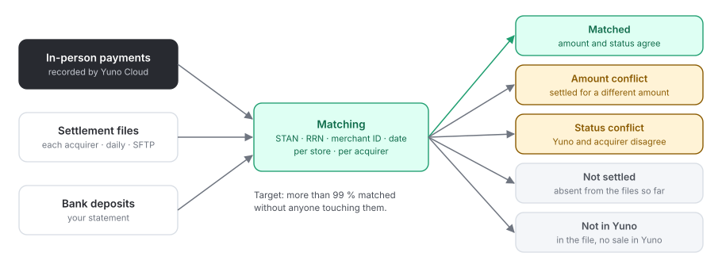
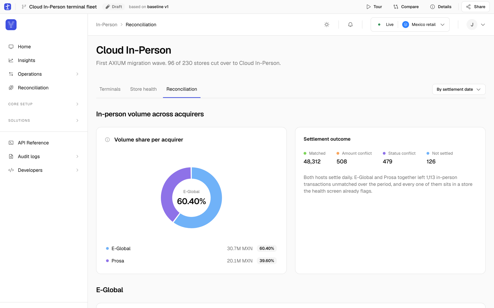
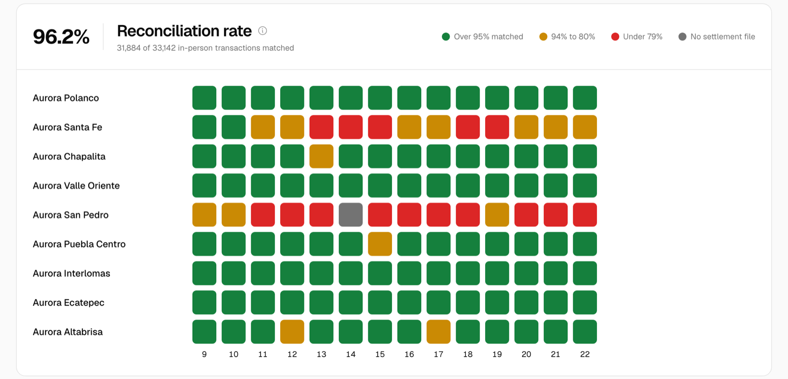
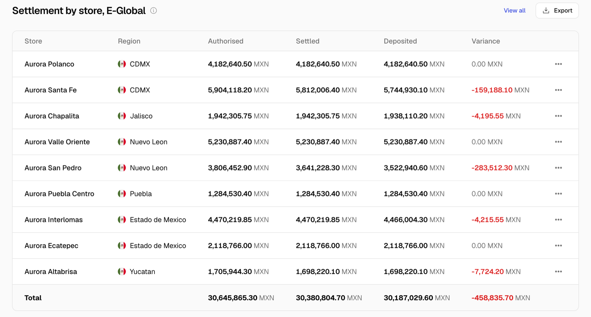

Cada venta en tienda se concilia con lo que el adquirente liquidó y con lo que llegó a tu banco, por tienda y por adquirente. Es la misma conciliación que usas para los pagos en línea, extendida a la tienda, y puede comenzar con tu flota actual antes de que cualquier terminal POS ejecute la Yuno Payment App.

<Frame caption="Los pagos, los archivos de liquidación y los depósitos se concilian por tienda y adquirente en cinco resultados.">
  
</Frame>

## Cómo se concilia una venta {#how-a-sale-is-matched}

| Lo que tiene Yuno | De dónde proviene |
| --- | --- |
| El pago, con tienda, terminal, adquirente y monto | Registrado en Yuno Cloud cuando se autoriza la venta |
| Número de seguimiento del sistema (STAN) y referencia de recuperación (RRN) | Devueltos por el adquirente en la autorización, almacenados en el pago |
| ID de comercio y de terminal, fecha hábil, lote | Los identificadores del adquirente para la venta |
| El archivo de liquidación, con comisiones | Obtenido de cada adquirente a diario por SFTP |
| El depósito | Tu extracto bancario de la cuenta en la que paga cada adquirente |

Una venta coincide cuando la línea del adquirente tiene el mismo STAN, RRN, ID de comercio y fecha que el pago. La conciliación es automática; el objetivo es que más del 99 % de las ventas coincidan sin que nadie intervenga.

## Resultados {#outcomes}

| Resultado | Significado | Qué hacer |
| --- | --- | --- |
| **Conciliada** | Autorizada, liquidada y el monto coincide | Nada |
| **Conflicto de monto** | Liquidada por un monto distinto del autorizado (comisiones, reembolso parcial) | Revisa la diferencia; por lo general es una comisión o un reembolso parcial |
| **Conflicto de estado** | Yuno registró un resultado y el adquirente liquidó otro (por ejemplo, una venta revertida que igual se liquidó) | Plantéalo al adquirente; Yuno conserva la evidencia |
| **No liquidada** | Autorizada, pero ausente de los archivos de liquidación hasta ahora | Espera el siguiente archivo (una venta cerca de la medianoche suele llegar en el archivo del día siguiente); después del plazo de liquidación, reclámala como una cuenta por cobrar |
| **No está en Yuno** | Está en el archivo del adquirente, pero Yuno no tiene ninguna venta para ella | Por lo general es una terminal que aún no usa la Yuno Payment App, o una venta realizada con otra aplicación de pago en la misma tienda |

<Frame caption="Conciliación por tienda y adquirente en el Dashboard de Yuno.">
  
</Frame>

## Por tienda, por adquirente {#per-store-per-acquirer}

<Frame caption="Tasa de conciliación por tienda para un adquirente, día a día: el porcentaje de transacciones en persona conciliadas automáticamente.">
  
</Frame>

<Frame caption="Liquidación por tienda: autorizado, liquidado, depositado y la variación, con la venta detrás de cada diferencia a un clic de distancia.">
  
</Frame>

El Dashboard muestra lo autorizado, lo liquidado y lo depositado lado a lado para cada tienda y cada adquirente, con las diferencias listadas y la venta detrás de cada una a un clic de distancia. Las comisiones se comparan con las tarifas que acordaste con cada adquirente. Las exportaciones siguen el mismo formato que la conciliación en línea, por lo que las herramientas de finanzas creadas para una funcionan con la otra.

## Concilia antes de migrar {#reconcile-before-you-migrate}

La conciliación no necesita la Yuno Payment App en la terminal. Si tus adquirentes entregan archivos de liquidación de tu parque actual, Yuno concilia esas ventas por tienda, contra las autorizaciones que producen tus terminales actuales. Para una flota grande, este suele ser el primer paso: el equipo de finanzas ve el beneficio mientras se programa el despliegue de las terminales. Registra primero tus tiendas y sus ID de comercio, para que cada línea llegue a la tienda correcta.

## Reembolsos, anulaciones y reversos {#refunds-voids-and-reversals}

- Un **reverso por tiempo de espera** (la terminal POS nunca recibió una respuesta) se envía al mismo adquirente y aparece en el pago como `ERROR` / `REVERSED_BY_TIMEOUT`; nunca debería aparecer en un archivo de liquidación. Si aparece, es un conflicto de estado.
- Una **anulación** cancela la venta antes de que se cierre su lote, por lo que nunca se liquida.
- Un **reembolso desde la terminal**, o **desde el Dashboard o la API** sin la tarjeta, se vincula al pago original y se concilia en su propia línea en el siguiente archivo del adquirente.
