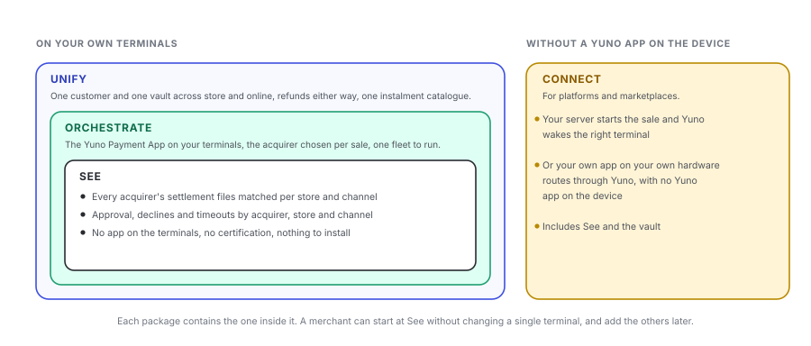

Los pagos presenciales se ofrecen en cuatro paquetes. Cada uno es un paso sobre la misma plataforma, así que lo que empiezas a usar no se descarta cuando agregas el siguiente: el mismo objeto de pago, los mismos webhooks, el mismo dashboard y la misma conciliación funcionan por debajo de los cuatro.

Lo más útil que debes saber antes de seguir leyendo es que **el primer paquete no necesita nada instalado en tus terminales**. Puedes conciliar tu flota actual, con todos los adquirentes y ambos canales, mientras tus terminales siguen exactamente como están.

<Frame caption="Cuatro paquetes. Cada uno contiene al que está dentro de él; Connect es la forma pensada para plataformas, y host to host es la que no necesita ninguna app de Yuno en el dispositivo.">
  
</Frame>

## Compara {#compare}

|  | See | Orchestrate | Unify | Connect |
| --- | --- | --- | --- | --- |
| **Qué hace** | Concilia todos los adquirentes y ambos canales, y muestra la aprobación por adquirente, tienda y canal | Agrega la Yuno Payment App a tus terminales y elige el adquirente por venta | Hace que la tienda y el sitio web sean un solo cliente, un solo vault y un solo conjunto de libros | Permite que una plataforma inicie ventas en tienda desde su propio servidor, o enrute por Yuno las autorizaciones de su propia app |
| **Para quién** | Cualquiera con más de un adquirente o más de un canal, incluidos los comercios que no son dueños de sus terminales | Comercios que son dueños de terminales Android certificados y contratan dos o más adquirentes | Los mismos comercios, una vez que su volumen en línea funciona en Yuno | Plataformas y marketplaces cuyos comercios operan los dispositivos |
| **En tus terminales** | Nada | La Yuno Payment App | La Yuno Payment App | El modo iniciado desde la nube usa la app en una terminal registrada; host to host no necesita ninguna app de Yuno |
| **Necesitas** | Acceso a los archivos de liquidación de cada adquirente y tus tiendas registradas | Tu hardware, tus contratos con adquirentes y tu sistema de caja o kiosco integrado | Tu volumen en línea en Yuno, o Yuno como tu vault | Una llamada a la API y un manejador de webhooks; para dispositivos que pertenecen a un adquirente, el acuerdo de ese adquirente |
| **Certificación** | Ninguna | La cadena la certifica Yuno una vez por adquirente | Incluida en la cadena anterior | Ninguna para ventas iniciadas desde la nube |
| **Primer paso** | Conecta los archivos de liquidación de cada adquirente; nada cambia en tienda | Certifica la cadena con tus adquirentes y luego despliega tienda por tienda | Actívalo cuando tu volumen funcione en Yuno | Una llamada a la API y un manejador de webhooks |

<Info>
  **Dónde empezar.** Si no estás seguro, empieza por **See**. Es el único paquete que no necesita nada de tus tiendas, se paga solo en horas de finanzas, y la línea base de aprobación y costos que produce te dice si el enrutamiento por venta vale la pena para tu flota.

  Cada mercado es su propia cadena de certificación, por adquirente. Dile a tu contacto de Yuno qué mercados y adquirentes necesitas y confirmará la cadena de cada uno.
</Info>

## Cómo se relacionan los paquetes con los tipos de integración {#how-the-packages-map-to-the-integration-types}

Los paquetes son lo que contratas; los [tipos de integración](/es/docs/in-person/ways-to-integrate) son la forma en que una venta llega a la terminal. Se alinean así:

| Paquete | Tipo de integración |
| --- | --- |
| **See** | Conciliación primero: nada cambia en las tiendas |
| **Orchestrate** | Local y Standalone: ambos ejecutan la Yuno Payment App en tus terminales; solo se diferencian en quién le indica el monto |
| **Connect** | Cloud, para ventas iniciadas desde la nube, y host to host para parques de dispositivos sin app de Yuno |

**Unify no es un tipo de integración.** Es una capa sobre el que uses: el mismo cliente, el mismo vault y reembolsos entre canales, ya sea que la venta haya comenzado en tu sistema de caja, en tu servidor o en el propio terminal.

## Cada paquete {#each-package}

<Tabs>
  <Tab title="See">
    **Una vista conciliada de todos los adquirentes y ambos canales.**

    Yuno toma el archivo de liquidación de cada adquirente, lo concilia contra las ventas de esa tienda y te muestra qué coincide, qué se liquidó por un monto distinto, qué aún no se ha liquidado y qué tiene el adquirente que tú no tienes. Las cuotas, el efectivo y el crédito de tienda se contabilizan en lugar de quedar como ruido.

    Además, los mismos datos te dan tasas de aprobación, rechazos y tiempos de espera agotados divididos por adquirente, por tienda y por canal, algo que la mayoría de los comercios con varios adquirentes nunca ha visto en un solo lugar.

    - **Qué necesitas:** acceso a los archivos de liquidación de cada adquirente y tus tiendas registradas en el dashboard.
    - **Qué cambia en tienda:** nada. Sin app, sin certificación, sin hardware nuevo, sin cambios en cómo se toma una venta hoy.
    - **Cómo comienza:** conecta los archivos y registra las tiendas. No hay nada que certificar ni instalar, así que la vista está disponible mientras tu flota sigue exactamente como está.

    Consulta [Conciliación](/es/docs/in-person/reconciliation).
  </Tab>
  <Tab title="Orchestrate">
    **See, más la Yuno Payment App en tus terminales.**

    Tus terminales ejecutan la Yuno Payment App y cada venta se autoriza a través de Yuno Cloud, que elige el adquirente para esa venta según las reglas que defines: tienda, monto, método de pago, rango de tarjeta y el estado en vivo de cada adquirente. Cuando un adquirente está caído, la siguiente venta va a otro. Los planes de cuotas provienen del adquirente que procesa la venta.

    También te da la flota: cada terminal por tienda, en línea o sin conexión, versión de la app, estado de las claves y última venta, con las pantallas con tu marca.

    - **Qué necesitas:** terminales Android cuyo proveedor permita aplicaciones de pago externas, tus propios contratos con adquirentes y tu sistema de caja o kiosco integrado con la terminal.
    - **Qué cambia en tienda:** la aplicación de pago de la terminal. Tu sistema de caja incorpora un puñado de llamadas; los pasos del cajero no cambian.
    - **Cómo comienza:** Yuno certifica la cadena con cada uno de tus adquirentes, una sola vez. Luego la app se despliega por grupo y tú la implementas tienda por tienda a tu propio ritmo.

    Consulta [Tipos de integración](/es/docs/in-person/ways-to-integrate) y [Terminales POS y flota](/es/docs/in-person/terminals).
  </Tab>
  <Tab title="Unify">
    **Orchestrate, más un cliente y un vault entre canales.**

    La misma tarjeta presentada en tienda y en línea es el mismo cliente, identificado mediante la referencia de cuenta de pago de la tarjeta, sin que el número de tarjeta llegue a tus sistemas. Una tarjeta guardada en el mostrador se puede cobrar en línea, y al revés. Una venta hecha en tienda se puede reembolsar desde el dashboard, y una hecha en línea se puede reembolsar en el mostrador. Un solo catálogo de cuotas atiende ambos canales.

    Aquí también viven las suscripciones que comienzan en el mostrador: inscribe al cliente y realiza el primer cobro en la terminal, luego cobra en línea sobre el mismo token.

    - **Qué necesitas:** tu volumen en línea en Yuno, o que Yuno guarde tu vault.
    - **Cómo comienza:** Yuno certifica la cadena con cada uno de tus adquirentes, por mercado, incluidos los requisitos PCI de tarjeta presente. Dile a tu contacto de Yuno qué mercados necesitas.

    Consulta [Entre canales](/es/docs/in-person/across-channels).
  </Tab>
  <Tab title="Connect">
    **Para plataformas y marketplaces cuyos comercios operan el hardware.**

    Dos formas, y se diferencian exactamente en este punto:

    - **Iniciado desde la nube.** Tu servidor crea el pago presencial a través de la API de Payments y Yuno lo entrega a una terminal registrada en esa tienda. Ese terminal ejecuta la Yuno Payment App; lo que evitas es una integración por tienda, no la app. Una integración cubre todos los mercados en los que operas.
    - **Host to host.** Tu propia aplicación de pago en tu propio hardware envía sus autorizaciones a Yuno, que las enruta a los adquirentes. **Ninguna app de Yuno en el dispositivo**: esta es la forma para parques de dispositivos en los que no puedes instalar una app.

    Connect incluye See, de modo que los adquirentes de tus comercios se pueden conciliar antes de que cambie cualquier dispositivo, y el vault, para propinas, cobros posteriores y suscripciones.

    - **Qué necesitas:** una llamada a la API y un manejador de webhooks. Cuando el dispositivo pertenece a un adquirente, ese adquirente debe estar de acuerdo antes de que algo pueda ejecutarse en él.
    - **Cómo comienza:** una llamada a la API y un manejador de webhooks, el mismo par que ya tienes para el modo en línea. Los dispositivos de tus comercios se quedan como están.

    Consulta [Tipos de integración](/es/docs/in-person/ways-to-integrate) y [Conecta tu sistema de caja](/es/docs/in-person/connect-your-checkout-system).
  </Tab>
</Tabs>

## Complementos {#add-ons}

Estos abarcan varios paquetes y se acuerdan por separado, porque cada uno conlleva su propio trabajo de certificación.

| Complemento | Qué es | Qué necesita |
| --- | --- | --- |
| **Aceptación en teléfono** | Una app de marca blanca que acepta tarjetas contactless en un teléfono estándar, sobre la misma nube y el mismo enrutamiento que las terminales | Una marca bajo la cual ofrecerla, la tuya o la de un adquirente, y su propio programa de certificación |
| **Un nuevo país** | Cada mercado es su propia cadena de certificación, por adquirente, con sus propios esquemas locales | Tus adquirentes en ese mercado y la cadena certificada con cada uno |
| **Un nuevo proveedor de terminales** | Un nuevo proveedor es un adaptador a la misma app certificada | Tus modelos confirmados con tu contacto de Yuno |

## Qué no hace Yuno {#what-yuno-does-not-do}

Conviene decirlo con claridad, porque ambos puntos surgen en todas las conversaciones:

- **Yuno nunca está en el flujo del dinero.** Cada adquirente te liquida directamente, bajo tu propio contrato, a tus propias tarifas. Yuno concilia el archivo; no retiene el dinero.
- **Una venta rechazada no se reintenta con otro adquirente.** En tienda el cliente está de pie frente a ti y un rechazo del emisor es definitivo. El enrutamiento se trata de costo y resiliencia entre ventas, no del resultado de una sola. Consulta [Flujo de pago](/es/docs/in-person/payment-flow).

<CardGroup cols={2}>
  <Card title="Cómo funciona" href="/es/docs/in-person/overview">
    El modelo que está por debajo de los cuatro paquetes.
  </Card>
  <Card title="Primeros pasos" href="/es/docs/in-person/get-started">
    Desde tu cuenta de Yuno hasta la primera venta en tienda.
  </Card>
</CardGroup>
