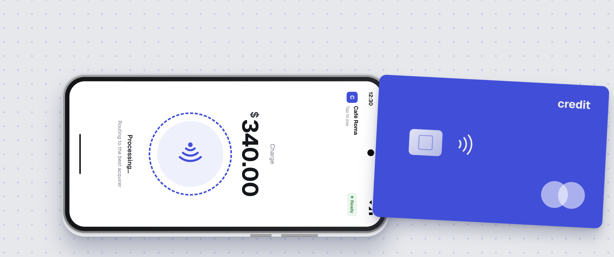
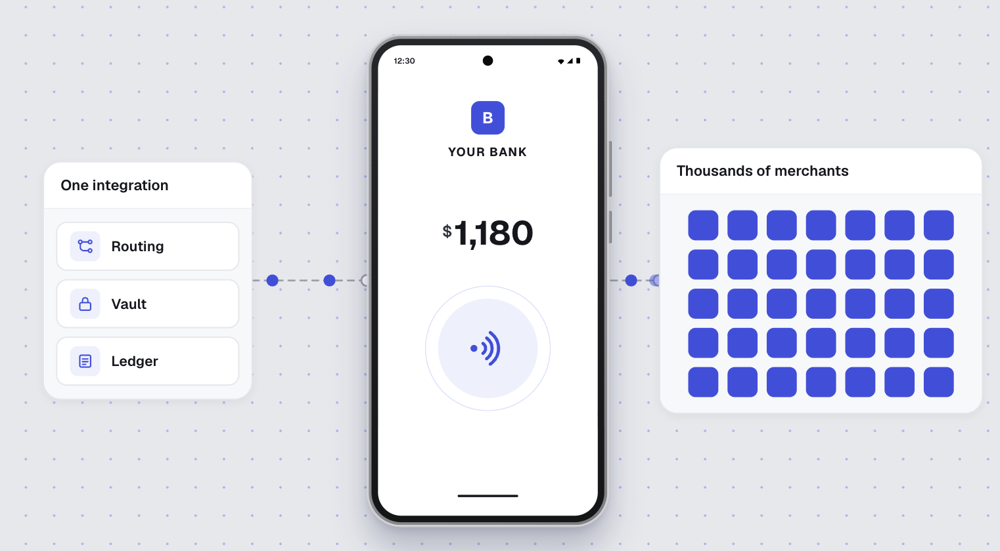
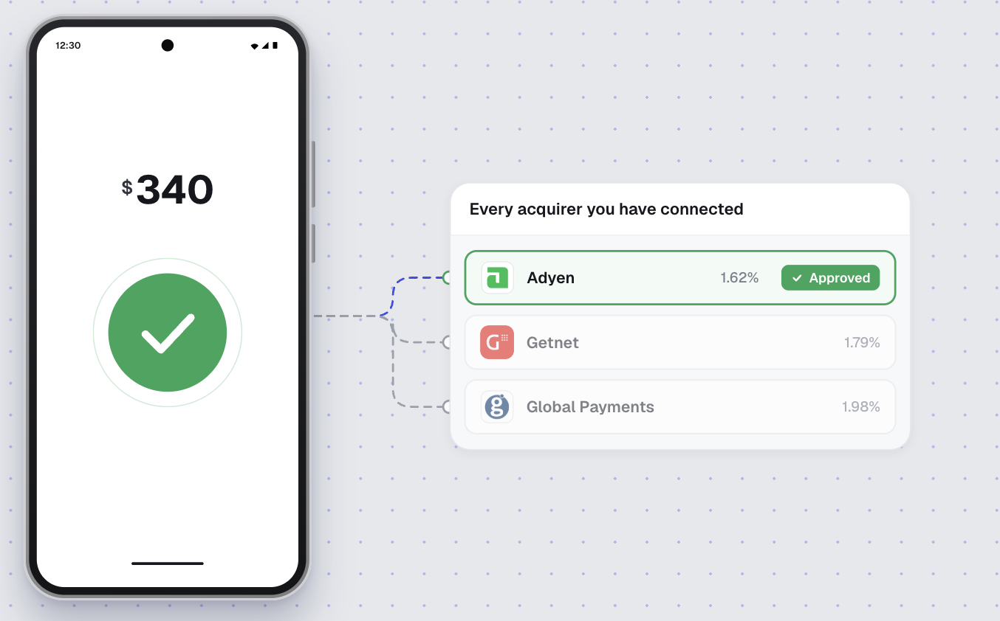
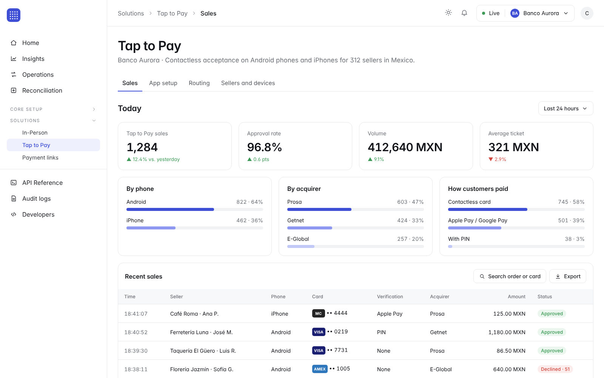
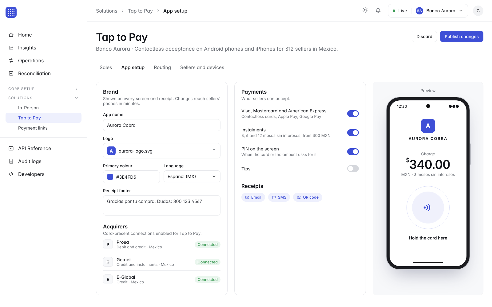
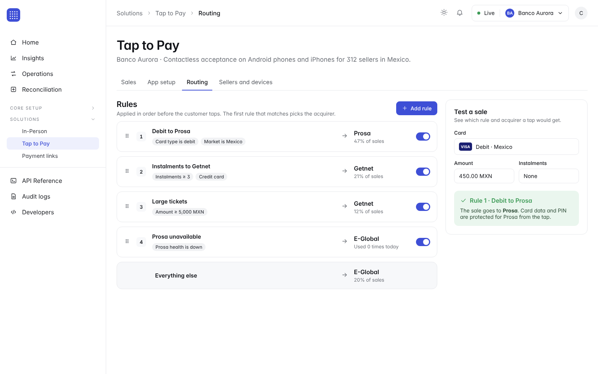
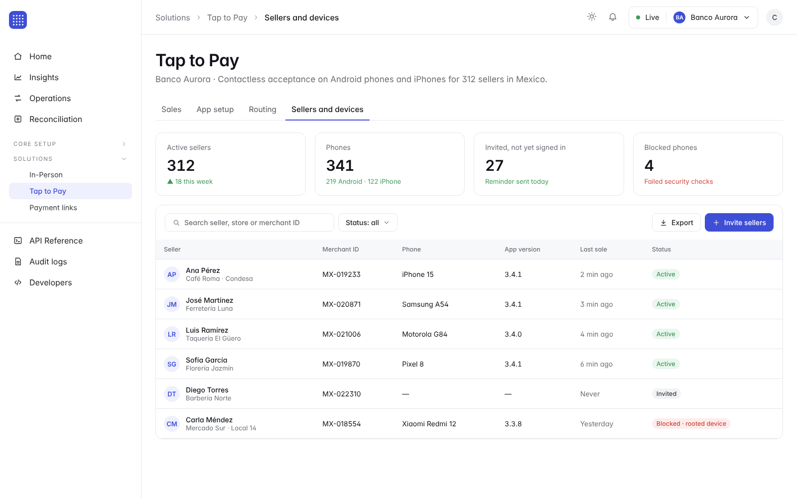

Convierte un teléfono Android o un iPhone en una terminal de pago. Tu cliente acerca una tarjeta contactless, un teléfono o un reloj al teléfono del comercio, la venta va al adquirente que eligen tus reglas y llega a la misma cuenta de Yuno que tus pagos online y de terminales POS.

<Frame caption="El teléfono es la terminal: el cliente acerca su medio de pago y Yuno enruta la venta.">
  
</Frame>

<Note>
  **Tap to Pay se ofrece a través de una marca.** Funciona sobre su propia infraestructura de aceptación certificada, separada de las terminales POS, y se lanza bajo tu marca o la de un adquirente en lugar de venderse por comercio. Habla con tu contacto de Yuno sobre tu mercado y tu adquirente. Los pagos en terminales POS están en [In-Person Payments](/es/docs/in-person/overview).
</Note>

<Info>
  **Dos palabras que se usan en estas páginas.** El **teléfono** es el Android o iPhone del comercio que recibe el pago; el cliente acerca su medio de pago a él. La **app Yuno Tap to Pay** es la app que ejecuta el pago en el teléfono. Los vendedores la descargan desde App Store o Google Play y, una vez que inician sesión, muestra tu marca o la de tu adquirente.
</Info>

## Qué obtienes {#what-you-get}

<CardGroup cols={3}>
  <Card title="Sin hardware" icon="mobile-screen">
    El propio teléfono del comercio es la terminal. No hay nada que comprar, enviar ni mantener, y un vendedor nuevo puede recibir pagos el mismo día en que se registra.
  </Card>
  <Card title="Android y iPhone" icon="mobile-retro">
    Un solo producto en ambas plataformas, con el mismo pago, los mismos eventos y la misma conciliación sin importar qué teléfono tomó la venta.
  </Card>
  <Card title="Tu marca, tus adquirentes" icon="palette">
    Marca blanca por defecto y enrutamiento multiadquirente con los adquirentes con los que ya trabajas.
  </Card>
</CardGroup>

<Frame caption="Una integración, tu marca, todos los comercios que atiendes.">
  
</Frame>

Cada toque es un `payment` de Yuno con `channel: IN_PERSON`, con el mismo identificador, los mismos estados, eventos y webhooks que un pago online o una venta en una terminal POS. Lo que cambia es el modo de entrada (`CONTACTLESS`) y los datos del dispositivo que lo acompañan.

## Funciones {#features}

<CardGroup cols={3}>
  <Card title="Tarjetas contactless y billeteras" icon="wifi">
    Tarjetas contactless, además de Apple Pay, Google Pay y otras billeteras en el teléfono o el reloj del cliente.
  </Card>
  <Card title="PIN en pantalla" icon="lock">
    Cuando el mercado o el monto lo exige, el cliente ingresa el PIN en la pantalla del teléfono, en un teclado seguro que la app del comercio nunca ve.
  </Card>
  <Card title="Enrutamiento multiadquirente" icon="route">
    Por venta, por comercio, mercado, marca de tarjeta y monto, con las mismas reglas de enrutamiento que usas online.
  </Card>
  <Card title="Marca blanca" icon="tags">
    Una vez que el vendedor inicia sesión, tu marca o la de tu adquirente aparece en cada pantalla y recibo. La app en las tiendas tiene un nombre y un ícono neutros.
  </Card>
  <Card title="Cuotas" icon="calendar-days">
    Planes de cuotas del adquirente que toma la venta, elegidos en el teléfono antes del toque, donde el mercado los ofrece.
  </Card>
  <Card title="Recibos digitales" icon="receipt">
    Por email, SMS o código QR, con tu marca.
  </Card>
  <Card title="Reembolsos" icon="rotate-left">
    Desde la app, el dashboard o la API, siempre a través del adquirente que aprobó la venta.
  </Card>
  <Card title="Conciliación" icon="scale-balanced">
    Cada toque se compara con el archivo de liquidación del adquirente, por comercio y adquirente, junto a tus otros pagos.
  </Card>
  <Card title="La misma plataforma que en línea" icon="layer-group">
    El mismo objeto de pago, los mismos webhooks, reportes y dashboard. Filtra por `channel` y por el tipo de dispositivo.
  </Card>
</CardGroup>

## Cómo funciona {#how-it-works}

- **La venta se ejecuta en la app Yuno Tap to Pay** por defecto, ya sea por sí sola o abierta desde tu app con el monto y tu referencia, y Yuno ya la certificó, por lo que tú no certificas nada. Los comercios que quieran el toque dentro de su propia app pueden usar el SDK de Yuno Tap to Pay y certificar su propia app. Consulta [Tipos de integración](/es/docs/in-person/tap-to-pay/ways-to-integrate).
- **Yuno Cloud elige el adquirente** para cada venta con tus reglas de enrutamiento, después de leer la tarjeta y antes de enviar la venta, exactamente como en una terminal POS.
- **El cliente acerca** su tarjeta, teléfono o reloj al teléfono del comercio. Un kernel contactless certificado lee la tarjeta dentro de un entorno protegido del teléfono; el número de tarjeta, el criptograma y el PIN nunca llegan a la app del comercio ni a tus servidores.
- **El adquirente autoriza** y el resultado aparece en el teléfono en un par de segundos. Yuno registra el pago, envía tus webhooks y, más tarde, lo concilia con la liquidación del adquirente.

<Frame caption="Todos los adquirentes que conectas, elegidos por venta según tus reglas de enrutamiento.">
  
</Frame>

## Cómo fluye una venta {#how-a-sale-flows}

<Steps>
  <Step title="El vendedor ingresa el monto" icon="keyboard">
    En la app Yuno Tap to Pay, o tu app le pasa el monto y tu referencia de orden.
  </Step>
  <Step title="Yuno elige el adquirente" icon="route">
    Según tus reglas: comercio, mercado, marca de tarjeta, monto y cuotas.
  </Step>
  <Step title="El cliente acerca su medio de pago" icon="hand-pointer">
    Tarjeta, teléfono o reloj en el área de contacto del teléfono. El PIN en pantalla cuando se requiere.
  </Step>
  <Step title="La venta es aprobada o rechazada" icon="circle-check">
    En el teléfono, y como un pago de Yuno con `channel: IN_PERSON` y los mismos webhooks que online.
  </Step>
  <Step title="Yuno concilia" icon="scale-balanced">
    El archivo de liquidación del adquirente se compara por comercio y adquirente, y se listan las diferencias.
  </Step>
</Steps>

La secuencia completa, incluido dónde acercar el medio de pago, el PIN, los reembolsos y qué ocurre cuando una venta falla, está en [Flujo de pago](/es/docs/in-person/tap-to-pay/payment-flow).

## Administra todo desde el dashboard {#manage-it-from-the-dashboard}

Todo lo relacionado con Tap to Pay está en **Solutions > Tap to Pay** en el dashboard de Yuno.

<Tabs>
  <Tab title="Ventas" icon="chart-line">
    Ventas, tasa de aprobación y volumen en tiempo real, por teléfono, adquirente y forma de pago del cliente, con cada venta y su estado.

    <Frame caption="Ventas por teléfono, adquirente y tipo de pago, con cada venta.">
      
    </Frame>
  </Tab>
  <Tab title="Configuración de la app" icon="sliders">
    Tu marca, las marcas de tarjeta, cuotas, PIN, recibos y adquirentes, con una vista previa en vivo de la pantalla del vendedor.

    <Frame caption="Marca, opciones de pago, recibos y adquirentes, con una vista previa en vivo.">
      
    </Frame>
  </Tab>
  <Tab title="Enrutamiento" icon="route">
    Las reglas que eligen el adquirente antes del toque y un probador para comprobar qué regla recibiría una venta.

    <Frame caption="Reglas de enrutamiento, aplicadas en orden antes del toque.">
      
    </Frame>
  </Tab>
  <Tab title="Vendedores y dispositivos" icon="users">
    Invita a vendedores, consulta sus teléfonos y versiones de la app, y detecta los teléfonos bloqueados por los controles de seguridad.

    <Frame caption="Vendedores, sus teléfonos y su estado.">
      
    </Frame>
  </Tab>
</Tabs>

## Cobertura de un vistazo {#coverage-at-a-glance}

|  |  |
| --- | --- |
| **Plataformas** | Teléfonos y tablets Android con NFC; iPhone XS o posterior |
| **Mercados** | México, Brasil y Ecuador; más mercados bajo demanda. En iPhone, solo donde Apple ofrece Tap to Pay on iPhone ([lista de regiones compatibles de Apple](https://developer.apple.com/tap-to-pay/regions/)) |
| **Marcas de tarjeta** | Visa, Mastercard, American Express, Discover y marcas locales; Elo próximamente |
| **Adquirentes** | Los adquirentes con los que trabajas; Yuno integra y certifica nuevos adquirentes bajo demanda |
| **Métodos de pago** | Tarjetas contactless y billeteras móviles |

Detalles y cumplimiento: [Cobertura y preguntas frecuentes](/es/docs/in-person/tap-to-pay/coverage-and-faq).

<CardGroup cols={3}>
  <Card title="Tipos de integración" href="/es/docs/in-person/tap-to-pay/ways-to-integrate" icon="puzzle-piece">
    La app Yuno Tap to Pay por sí sola o abierta desde tu app, o el SDK dentro de tu app.
  </Card>
  <Card title="Flujo de pago" href="/es/docs/in-person/tap-to-pay/payment-flow" icon="arrows-spin">
    Un toque, paso a paso, dónde acercar el medio de pago en cada teléfono, PIN y reembolsos.
  </Card>
  <Card title="Cobertura y preguntas frecuentes" href="/es/docs/in-person/tap-to-pay/coverage-and-faq" icon="globe">
    Teléfonos, mercados, marcas, certificación y las preguntas que más recibimos.
  </Card>
</CardGroup>
