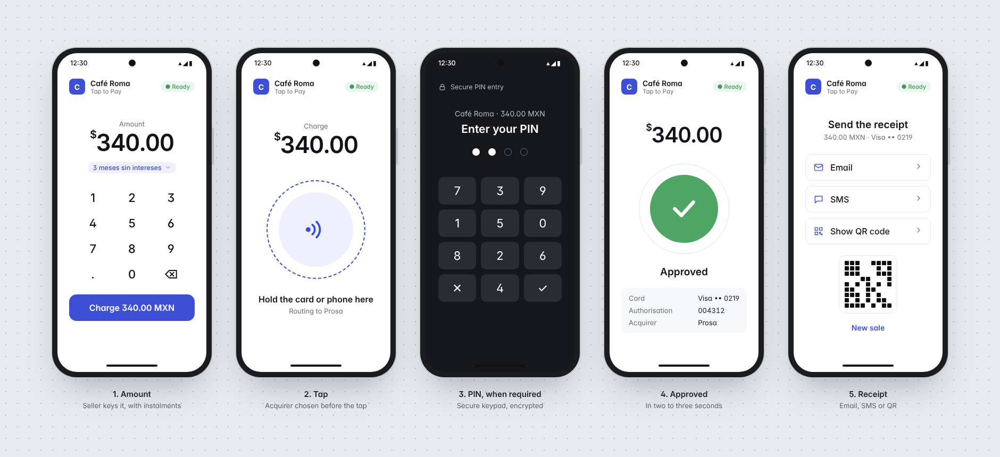

Esta página sigue una venta desde el monto hasta la conciliación y luego cubre los reembolsos y los fallos. El pago que produce es el mismo recurso `payment` que en cualquier otro canal de Yuno.

## Una venta, paso a paso {#a-sale-step-by-step}

<Steps>
  <Step title="El monto" icon="keyboard">
    El vendedor ingresa el monto en la app Yuno Tap to Pay, o tu app lo envía con tu referencia de pedido. Las cuotas, donde se ofrecen, se eligen aquí.
  </Step>
  <Step title="El cliente acerca su medio de pago" icon="hand-pointer">
    La app muestra el monto y dónde acercar el medio de pago. El cliente mantiene su tarjeta, teléfono o reloj sobre el teléfono hasta que confirma la lectura, normalmente en menos de un segundo.
  </Step>
  <Step title="PIN, cuando se requiere" icon="lock">
    Si la tarjeta, el monto o el mercado lo piden, aparece en pantalla un teclado seguro para el PIN. El PIN se cifra mientras se escribe, dentro de la pila de aceptación certificada; tu app y tus servidores nunca lo ven, y nadie en Yuno puede verlo.
  </Step>
  <Step title="Se elige el adquirente y se autoriza la venta" icon="route">
    Yuno Cloud aplica tus reglas de enrutamiento (comercio, mercado, marca de tarjeta, rango de tarjeta, monto, cuotas) después de leer la tarjeta y antes de enviar la venta, exactamente como en una terminal POS. El PIN se traduce a la clave de ese adquirente en un módulo de seguridad de hardware, y el adquirente aprueba o rechaza, normalmente en dos o tres segundos.
  </Step>
  <Step title="El resultado" icon="circle-check">
    Aparece en el teléfono, vuelve a tu app cuando esta abrió la app Tap to Pay y se registra como un pago de Yuno.
  </Step>
  <Step title="Recibo" icon="receipt">
    Por email, SMS o código QR, con tu marca y las referencias del adquirente.
  </Step>
</Steps>

<Frame caption="Una venta en el teléfono, desde el monto hasta el recibo.">
  
</Frame>

## Dónde acerca el cliente su medio de pago {#where-the-customer-taps}

| Teléfono | Dónde acercarlo |
| --- | --- |
| **iPhone** | El frente, cerca de la parte superior de la pantalla. El vendedor gira la pantalla hacia el cliente |
| **Android** | Normalmente la parte trasera, cerca de la cámara o en el centro. La posición cambia según el modelo, por lo que la pantalla del toque la muestra para el teléfono en uso |

<Tip>
  Si no se lee un toque, pide al cliente que mantenga la tarjeta quieta y plana durante un segundo, y que la quite de una funda gruesa o metálica.
</Tip>

## Reembolsos {#refunds}

Reembolsa una venta total o parcialmente desde la lista de ventas de la app, el dashboard o la API. El cliente no necesita acercar su medio de pago de nuevo.

Los reembolsos siempre van al adquirente que aprobó la venta original, sin importar lo que digan tus reglas de enrutamiento hoy.

Los estados, los códigos de rechazo y los webhooks son los mismos que en las ventas de terminales POS: consulta [Pagos y eventos](/es/docs/in-person/payments-and-events).

## Cuando una venta no se completa {#when-a-sale-does-not-complete}

| Qué ocurre | Resultado |
| --- | --- |
| El cliente retira la tarjeta demasiado pronto | La app pide acercarla de nuevo; nada llega al adquirente |
| El adquirente rechaza | `DECLINED`, con el motivo en `response_code`. El vendedor pide otra tarjeta |
| No hay respuesta del adquirente a tiempo | La venta se revierte con el mismo adquirente y termina como `ERROR` / `REVERSED_BY_TIMEOUT`; no queda ningún cobro |
| El teléfono no tiene conexión | La app no inicia el toque. Tap to Pay necesita una conexión de datos en cada venta |
| La app se cierra durante la venta | El pago conserva su estado final en Yuno; consúltalo por el ID del pago o por webhook |

Una venta rechazada es definitiva con ese adquirente: una autorización solo va a un adquirente. El enrutamiento funciona entre ventas, para equilibrar costo, programas de cuotas y salud del adquirente.
