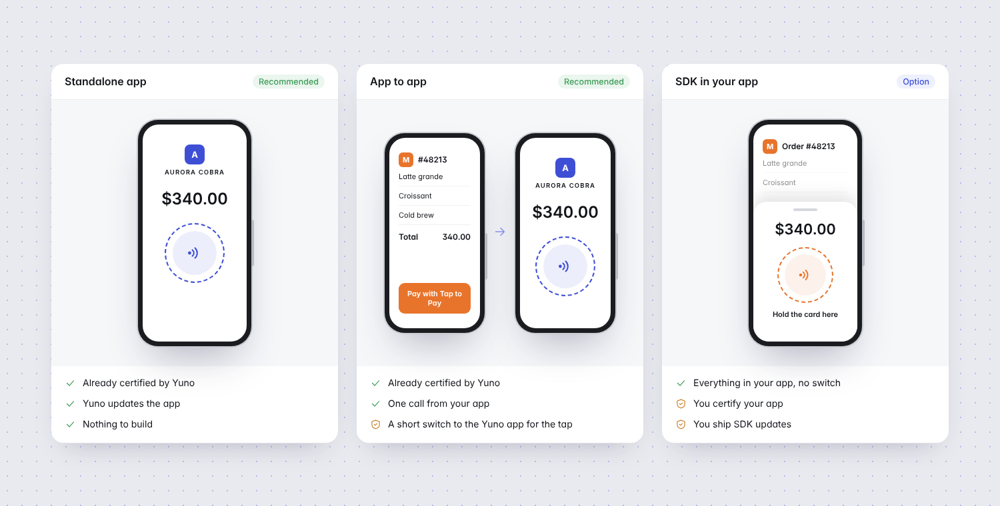
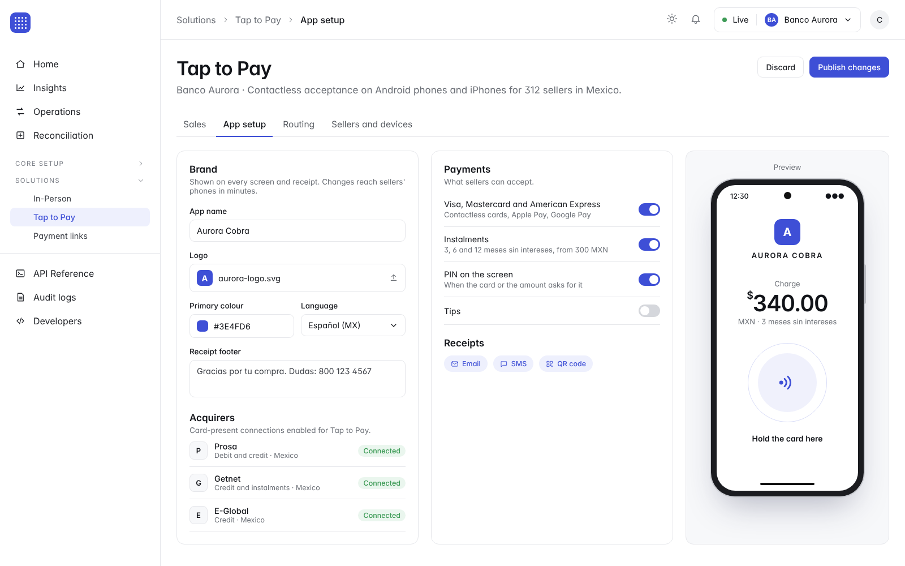
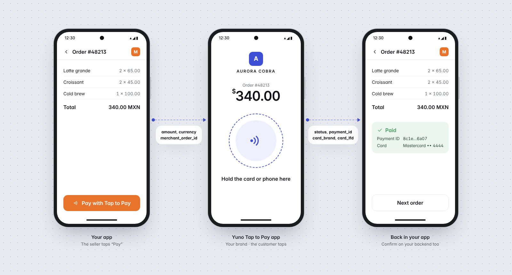

Hay tres formas de ofrecer Tap to Pay. Se diferencian en una sola cosa: **qué app lee la tarjeta**.

- **App Tap to Pay** y **Abrir desde tu app** (recomendado). La tarjeta la lee la app Yuno Tap to Pay, que Yuno certifica y mantiene, y que muestra tu marca una vez que el vendedor inicia sesión. Los vendedores la usan por sí sola, o, en Android, tu app la abre para el toque y recibe el resultado. No certificas nada.
- **SDK integrado**. La tarjeta se lee dentro de tu propia app, con el SDK de Yuno Tap to Pay. El vendedor nunca cambia de app, pero como tu app ahora lee tarjetas, se certifica tu app antes de salir a producción.

Los tres comparten el mismo objeto de pago, enrutamiento, webhooks, dashboard y conciliación, así que puedes empezar con la app y agregar el SDK después.

<CardGroup cols={3}>
  <Card title="App Tap to Pay" icon="mobile-screen">
    **Recomendado.** Los vendedores cobran en la app Yuno Tap to Pay, con tu marca después de iniciar sesión. Nada que construir, nada que certificar.
  </Card>
  <Card title="Abrir desde tu app" icon="arrow-right-arrow-left">
    **Recomendado si los vendedores ya usan una app de Android tuya.** Abre la app Tap to Pay para el toque y recibe el resultado. Nada que certificar; un breve cambio entre apps. Solo Android.
  </Card>
  <Card title="SDK integrado" icon="code">
    **Opción.** La tarjeta se lee dentro de tu app, sin cambiar de app. Tu app se certifica y publica las actualizaciones del SDK.
  </Card>
</CardGroup>

<Frame caption="La tarjeta la lee la app Yuno Tap to Pay, o tu app con el SDK.">
  
</Frame>

## Compara {#compare}

|  | App Tap to Pay | Abrir desde tu app (Android) | SDK integrado |
| --- | --- | --- | --- |
| **Cómo trabaja el vendedor** | Ingresa el monto en la app Tap to Pay | Registra la venta en tu app como siempre; la app Tap to Pay se abre para el toque | Registra la venta y toma el toque en tu app |
| **Apps en el teléfono del vendedor** | La app Tap to Pay | La tuya y la app Tap to Pay | La tuya |
| **Qué construyes** | Nada | Un traspaso del monto y del ID de la orden, y el manejo del resultado | La integración del SDK y las pantallas alrededor del toque |
| **Certificación** | Ninguna para ti: Yuno certifica la app Tap to Pay | Ninguna para ti: Yuno certifica la app Tap to Pay | Tu app: PCI MPoC en Android, la aprobación de Tap to Pay de Apple en iPhone |
| **Actualizaciones** | Yuno | Yuno | Tú publicas las actualizaciones del SDK según el calendario de Yuno |
| **Cambio de app** | No | Sí, brevemente, para el toque | No |
| **Ideal para** | Bancos, adquirentes y plataformas que ofrecen Tap to Pay a muchos vendedores; vendedores sin app | Comercios y plataformas cuyos vendedores ya usan su app, que quieren salir a producción rápido | Comercios que quieren toda la experiencia en su app y pueden certificarla |

<Info>
  **¿Cuál elegir?** Empieza con la **app Tap to Pay**: los vendedores cobran sin trabajo de certificación de tu parte. Si tus vendedores ya registran ventas en tu app de Android, usa **Abrir desde tu app** para que nunca escriban el monto dos veces. Elige el **SDK integrado** cuando una experiencia en una sola app justifique certificar tu app y mantener el SDK actualizado.
</Info>

## Cada tipo en detalle {#each-type-in-detail}

<Tabs>
  <Tab title="App Tap to Pay" icon="mobile-screen">
    El vendedor inicia sesión en la app Yuno Tap to Pay, ingresa el monto y entrega el teléfono al cliente. Nada que integrar.

    <Steps>
      <Step title="Configuras la app" icon="sliders">
        Marca (logo, colores, nombre), adquirentes habilitados, reglas de enrutamiento, planes de cuotas y texto del recibo, desde el dashboard de Yuno.
      </Step>
      <Step title="Los vendedores la descargan" icon="download">
        La app Yuno Tap to Pay, desde la App Store o Google Play. La ficha de la tienda es neutral; tu marca aparece cuando el vendedor inicia sesión. Cada vendedor recibe una invitación desde el dashboard o se crea mediante la API, con sus IDs de comercio y de adquirente.
      </Step>
      <Step title="Los vendedores cobran" icon="hand-pointer">
        Monto, descripción opcional y cuotas, y toque. El recibo se envía por email, SMS o QR.
      </Step>
      <Step title="Ves cada venta" icon="chart-line">
        En el dashboard y mediante webhooks, con el vendedor y el dispositivo que la realizó.
      </Step>
    </Steps>

    <Frame caption="Configura la app desde el dashboard. Los vendedores reciben los cambios en minutos.">
      
    </Frame>

    **Es bueno saber:** la app también muestra las ventas del día del vendedor y le permite hacer el reembolso de una venta.

  </Tab>
  <Tab title="Abrir desde tu app (Android)" icon="arrow-right-arrow-left">
    <Note>
      **Solo Android.**
    </Note>

    Tu app de Android entrega la venta a la app Yuno Tap to Pay con el monto y tu referencia de orden. El cliente toca, y la app Yuno Tap to Pay devuelve el resultado a tu app. Tu app nunca toca datos de la tarjeta, así que no hay nada que certificar de tu lado.

    <Steps>
      <Step title="Tu app envía la venta" icon="paper-plane">
        Monto, moneda y tu referencia de orden.
      </Step>
      <Step title="La app Yuno Tap to Pay procesa el pago" icon="hand-pointer">
        Elige el adquirente con tus reglas, muestra la pantalla del toque y, cuando se requiere, el teclado para el PIN.
      </Step>
      <Step title="Tu app recibe el resultado" icon="reply">
        Estado, ID del pago, código de autorización y tarjeta enmascarada, en el resultado de la actividad. El vendedor vuelve a tu app.
      </Step>
      <Step title="Yuno registra la venta" icon="database">
        El mismo pago y los mismos webhooks, con tu referencia de orden, para que tu backend pueda confirmar el resultado de servidor a servidor.
      </Step>
    </Steps>

    <Frame caption="Tu app entrega la venta y recibe el resultado.">
      
    </Frame>

    | Dirección | Campos |
    | --- | --- |
    | De tu app a la app Yuno Tap to Pay | `amount`, `currency`, `merchant_order_id`, `installments` (opcional), `customer_email` (opcional, para el recibo) |
    | De la app Yuno Tap to Pay a tu app | `status`, `sub_status`, `payment_id`, `merchant_order_id`, `authorization_code`, `card_brand`, `card_lfd`, `entry_mode` |

    ```kotlin Android
    val intent = Intent("com.yuno.taptopay.action.PAY").apply {
        setPackage(TAP_TO_PAY_PACKAGE) // package name of the Yuno Tap to Pay app you use
        putExtra("amount", "125.00")
        putExtra("currency", "MXN")
        putExtra("merchant_order_id", "ORD-48213")
    }
    taptopayLauncher.launch(intent) // result in the ActivityResult extras
    ```

    Tu contacto en Yuno te da el nombre del paquete que debes usar. **Confirma siempre el resultado desde tu backend** con el ID del pago o el webhook antes de entregar la mercancía: el retorno a tu app puede perderse si el vendedor la cierra.

  </Tab>
  <Tab title="SDK integrado" icon="code">
    El SDK de Yuno Tap to Pay se ejecuta dentro de tu app de Android o iOS. Tú diseñas las pantallas alrededor del toque, y el vendedor nunca sale de tu app.

    <Steps>
      <Step title="Integra el SDK" icon="code">
        Agrega el SDK de Yuno Tap to Pay a tu app y llámalo con el monto y tu referencia de orden. El SDK muestra la pantalla del toque y, cuando se requiere, el teclado seguro para el PIN, y devuelve el resultado.
      </Step>
      <Step title="Certifica tu app" icon="shield-check">
        En Android, un laboratorio acreditado evalúa tu app para PCI MPoC antes de salir a producción. Yuno te da la documentación y apoya la evaluación. En iPhone, tu app necesita la aprobación de Tap to Pay on iPhone de Apple.
      </Step>
      <Step title="Certifica con el adquirente" icon="certificate">
        Yuno ejecuta la certificación con el adquirente para tu app, igual que para la app Yuno Tap to Pay.
      </Step>
      <Step title="Mantén el SDK actualizado" icon="arrows-rotate">
        Publica las actualizaciones del SDK en tu app según el calendario de lanzamientos de Yuno. Las actualizaciones y nuevas funciones en tu app mantienen la certificación; un cambio significativo en la forma de usar el SDK puede requerir una nueva evaluación.
      </Step>
    </Steps>

    **Es bueno saber:** la certificación cubre tu app, no a cada uno de tus vendedores, así que agregar vendedores o tiendas no activa una nueva.

  </Tab>
</Tabs>
