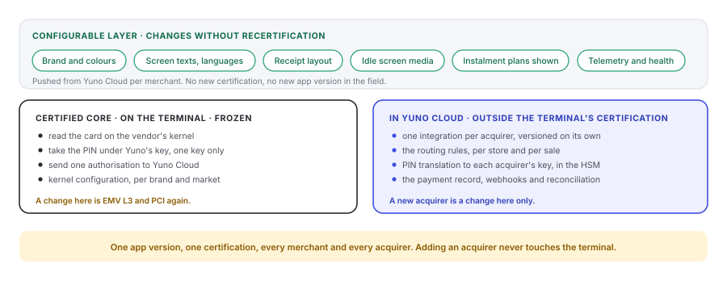
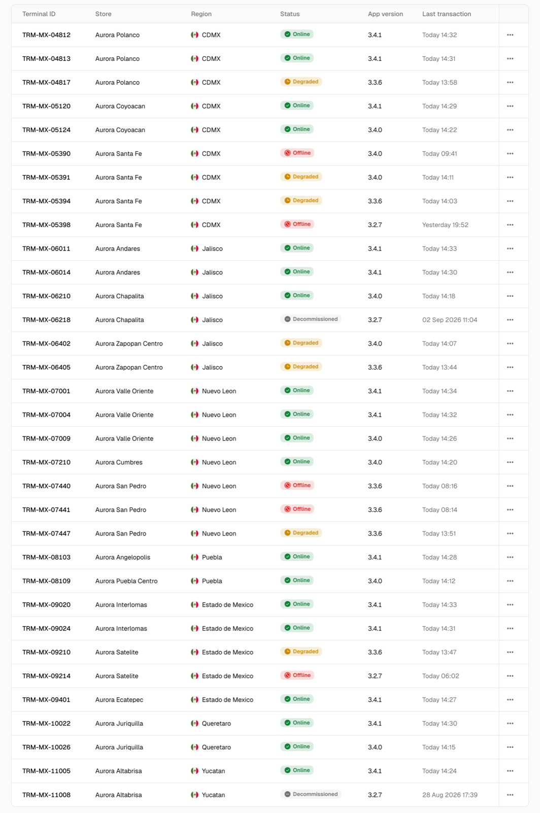
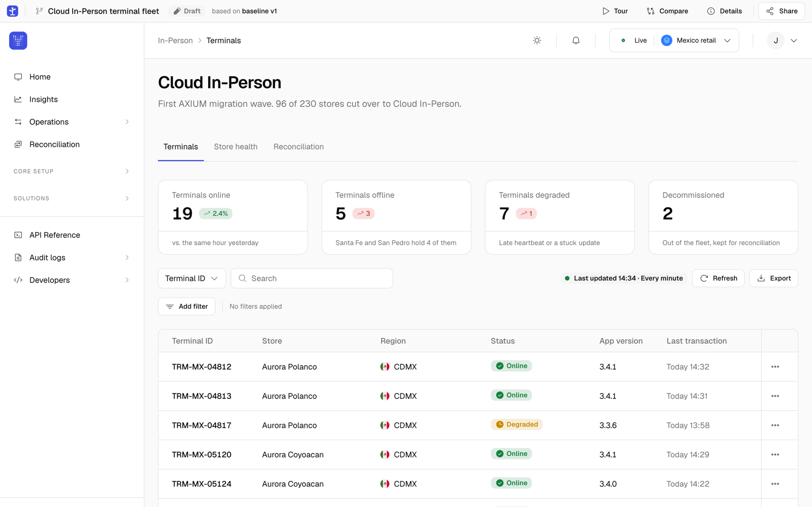
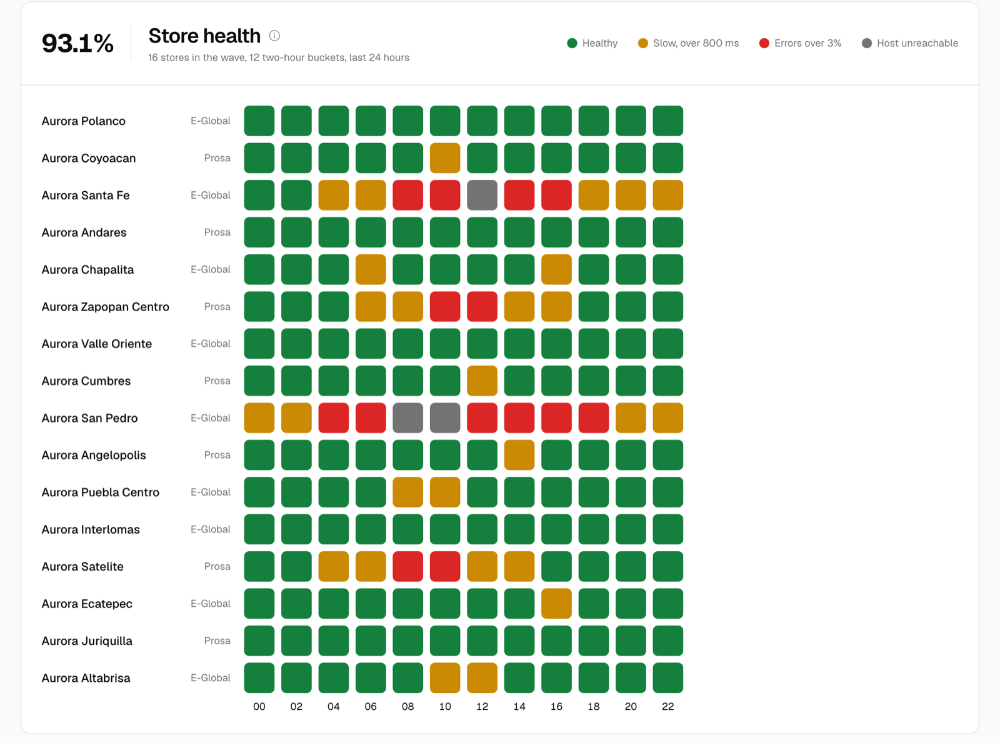
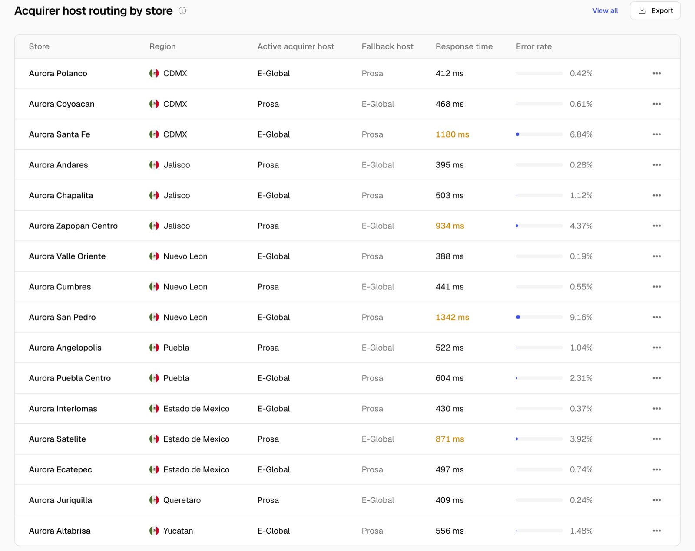
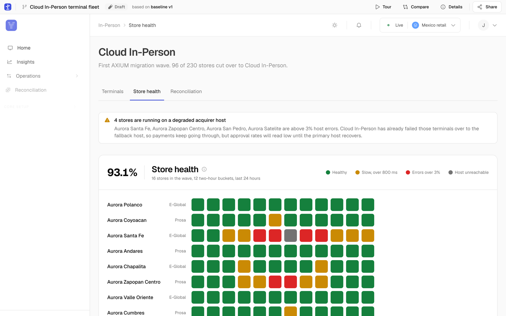

La Yuno Payment App se ejecuta en las terminales POS que ya tienes. Esta página cubre qué terminales, cómo llegan la app y las claves a las terminales, qué puedes personalizar con tu marca y qué ves de la flota.

## Qué terminales POS {#which-pos-terminals}

La Yuno Payment App se ejecuta en terminales POS Android cuyo fabricante permite aplicaciones de pago externas, como las terminales de Verifone e Ingenico. Funcionan los formatos de mostrador, portátil y PIN pad.

| La terminal necesita | Por qué |
| --- | --- |
| Android, con el SDK de pagos del fabricante | La app se ejecuta como una aplicación Android y llega al lector de tarjetas a través del SDK |
| Un PIN pad aprobado PCI PTS | El PIN se captura y se cifra en el teclado seguro de la terminal |
| Una aprobación EMV Nivel 1 y 2 vigente | La app usa el kernel certificado del fabricante para leer tarjetas con chip y contactless |
| El permiso del fabricante para instalar aplicaciones de pago externas | La app se firma y se distribuye a través del programa del fabricante |

La app se comunica con el kernel EMV certificado de cada fabricante mediante un adaptador, así que un fabricante nuevo es un adaptador nuevo, no una app nueva. Yuno nunca modifica el kernel. Si estás eligiendo hardware nuevo, envía a tu contacto en Yuno la lista de modelos y lo confirmará antes de que compres.

## Cómo llega la app a una terminal POS {#how-the-app-reaches-a-pos-terminal}

<Steps>
  <Step title="Registro">
    Cada terminal se registra en Yuno en una tienda y un carril, mediante un código de inscripción o desde una lista de números de serie. Solo las terminales registradas pueden comunicarse con Yuno Cloud, por un canal seguro con una identidad por dispositivo.
  </Step>
  <Step title="Instalación">
    La Yuno Payment App se firma mediante el proceso de firma del fabricante y se distribuye a la flota a través del administrador de parque del fabricante o de tu propia gestión de dispositivos, con tu aprobación. Tú conservas la propiedad y el mantenimiento del hardware.
  </Step>
  <Step title="Claves">
    La terminal recibe una sola vez la clave de Yuno, mediante la inyección remota de claves del fabricante. No guarda ninguna clave de adquirente: la clave de zona de PIN de cada adquirente vive en el módulo de seguridad de hardware de Yuno, inyectada en una ceremonia de claves entre ese adquirente y Yuno. Una terminal informa si su clave está presente, y una sin clave no puede procesar una tarjeta.
  </Step>
  <Step title="Configuración">
    La tienda, los métodos de pago habilitados, los planes de cuotas y la marca se publican desde Yuno Cloud. Las reglas de enrutamiento no se envían a la terminal en absoluto; se aplican en Yuno Cloud en cada venta, así que un cambio de regla entra en vigor en la siguiente venta de todas las tiendas a la vez.
  </Step>
  <Step title="Salida a producción">
    La terminal se reporta en línea, aparece en la vista de flota y procesa su primera venta. Desde entonces envía al dashboard su estado de salud, la versión de la app y la última venta.
  </Step>
</Steps>

## Qué puedes personalizar con tu marca y qué nunca cambia {#what-you-can-brand-and-what-never-changes}

La app tiene dos capas. El núcleo certificado (leer la tarjeta, capturar el PIN con la clave de Yuno, enviar un mensaje a Yuno Cloud) queda congelado una vez certificado, porque un cambio en él reinicia las certificaciones de las marcas de tarjeta y de PCI. Todo lo que ve un cliente o un cajero está fuera de él y es configuración. Las integraciones con adquirentes están fuera de la terminal por completo, en Yuno Cloud, y por eso agregar un adquirente nunca toca la flota.

<Frame caption="Las pantallas, la marca y las reglas cambian sin tocar el núcleo certificado. El núcleo cambia solo con una nueva certificación.">
  
</Frame>

| Configurable por comercio, sin recertificación | Congelado tras la certificación |
| --- | --- |
| Logo, colores y logotipo en cada pantalla, incluida la pantalla de inactividad | Lectura de la tarjeta con chip o contactless |
| Textos de pantalla e idiomas | Captura del PIN en el teclado seguro |
| Texto y diseño del recibo | El mensaje a cada adquirente |
| Métodos de pago habilitados y planes de cuotas | Configuración del kernel: métodos de verificación, límites, tipo de terminal |
| Reglas de enrutamiento por tienda | Agregar un tipo de transacción, como propinas o cashback |
| Telemetría y reportes de salud | Agregar un adquirente (una nueva certificación con ese adquirente) |

La marca blanca es la opción predeterminada: sin marca de Yuno en la terminal a menos que la pidas.

## Requisitos de red {#network-requirements}

- La terminal POS necesita HTTPS saliente a `*.y.uno` y nada más. Nunca se conecta a un adquirente: los enlaces con los adquirentes son de Yuno Cloud, uno por adquirente, y su tipo se acuerda con cada adquirente en el onboarding.
- No entra nada desde internet. En el tipo Local, tu sistema de checkout se conecta a la terminal en la red de la tienda (puerto 8443) o por cable; Yuno no está en esa ruta.
- Ethernet, Wi-Fi o datos móviles, según lo que admita la terminal; una terminal con más de una vía cambia de una a otra por sí sola.

## Actualizaciones {#updates}

Las versiones que tocan solo la capa configurable se publican como cualquier actualización de app: primero a un grupo de terminales, luego a la flota, y se instalan solo entre ventas y sin un lote abierto. Las versiones que tocan el núcleo certificado son poco frecuentes, se planifican con los adquirentes y se certifican antes de publicarse. La integración de cada adquirente tiene su propio versionado, y cada terminal muestra en el dashboard qué combinación certificada ejecuta. Los cambios en las reglas de enrutamiento no son versiones de la app: son configuración publicada desde Yuno Cloud.

## Vistas de la flota en el dashboard {#fleet-views-in-the-dashboard}

<Frame caption="La flota completa, una fila por terminal POS: tienda, región, estado, versión de la app, última transacción, con filtros y exportación.">
  
</Frame>

<Frame caption="Terminales POS: cada terminal por tienda, en línea o sin conexión, versión de la app, última venta.">
  
</Frame>

<Frame caption="Salud de las tiendas en las últimas 24 horas: una fila por tienda, una celda por intervalo de dos horas, con color según la salud del host del adquirente al que se enruta.">
  
</Frame>

<Frame caption="Enrutamiento de hosts de adquirentes por tienda: host activo, respaldo, tiempo de respuesta y tasa de error.">
  
</Frame>

<Frame caption="Salud de las tiendas: aprobación, rechazos y tiempos de espera agotados por tienda y por adquirente.">
  
</Frame>

Los eventos de terminal (`terminal.online`, `terminal.offline`, `terminal.app_updated`) también llegan a tu endpoint de webhook, para que tus propias herramientas de operaciones puedan reaccionar sin consultar el dashboard. Consulta [Pagos y eventos](/es/docs/in-person/payments-and-events).
