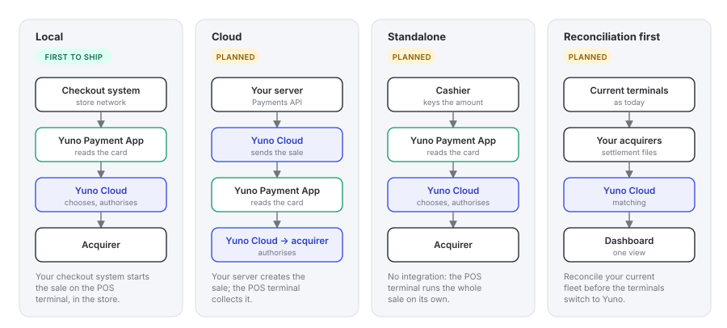
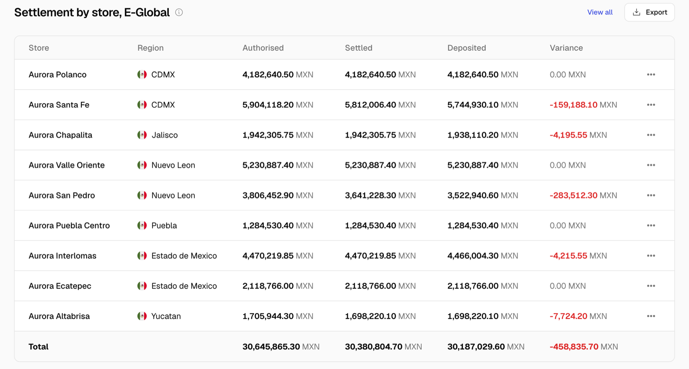

La forma en que una venta llega a la terminal POS depende de lo que uses en tienda. Los cuatro tipos comparten el mismo objeto de pago, webhooks, dashboard y conciliación, así que un comercio puede empezar con uno y agregar otro después. En todos los tipos la Yuno Payment App lee la tarjeta y Yuno Cloud elige el adquirente y autoriza; lo que cambia es quién le indica a la terminal cuánto cobrar.

<Frame caption="Cuatro tipos de integración. Se diferencian en quién inicia la venta; la autorización, el enrutamiento y la conciliación son los mismos.">
  
</Frame>

## Compara {#compare}

|  | Local | Cloud | Standalone | Conciliación primero |
| --- | --- | --- | --- | --- |
| **Dónde comienza la venta** | Tu sistema de caja | Tu servidor | En la terminal POS | Tu configuración actual |
| **Qué se comunica con la terminal POS** | Tu sistema de caja, en la tienda | Yuno Cloud | Nadie; el cajero | No cambia nada |
| **Se ejecuta en** | Tus terminales, Yuno Payment App | Tus terminales, Yuno Payment App | Tus terminales, Yuno Payment App | Tus terminales y app actuales |
| **Tú construyes** | Las llamadas en tu sistema de caja | Una llamada a la API y un manejador de webhooks | Nada | Nada |
| **Si la tienda pierde su conexión con Yuno** | Ninguna venta con tarjeta a través de Yuno hasta que vuelva | Ninguna venta con tarjeta hasta que vuelva | Ninguna venta con tarjeta hasta que vuelva | No se ve afectado |
| **Enrutamiento multiadquirente** | Sí | Sí | Sí | No |
| **Primer paso** | Integra tu sistema de caja con la terminal | Una llamada a la API y un manejador de webhooks | Registra las terminales; nada que construir | Conecta los archivos de liquidación de tus adquirentes |
| **Ideal para** | Cadenas minoristas con su propio software de caja | Sistemas de caja en la nube, plataformas, retiro de órdenes, caja móvil | Mostradores pequeños, tiendas temporales, respaldo | Cualquier flota, antes de los demás o junto con ellos |

<Info>
  **¿Cuál es para ti?** Si tu software de caja se ejecuta en la tienda, elige **Local** y conserva **Standalone** como el respaldo de la misma app. Si tu caja se ejecuta en la nube, o eres una plataforma cuyos comercios son dueños de las terminales, elige **Cloud**. **Conciliación primero** te da el beneficio financiero sobre tu flota actual mientras las terminales cambian. La integración en línea que ya tienes no cambia.

  **Conciliación primero es la forma más rápida de empezar**, porque no cambia nada en tus tiendas: conecta los archivos de liquidación y la vista está disponible mientras tus terminales siguen como están. A qué paquete pertenece cada tipo y qué necesita cada uno de ti se explica en [Soluciones](/es/docs/in-person/solutions).
</Info>

## Cada tipo en detalle {#each-type-in-detail}

<Tabs>
  <Tab title="Local">
    Tu sistema de caja inicia la venta y recibe el resultado a través de la interfaz local de la terminal POS, por la red de la tienda o por cable, de la misma forma en que la mayoría de las cajas registradoras ya hablan con su terminal.

    <Steps>
      <Step title="El sistema de caja envía la venta">
        Monto, moneda y tu referencia. La tienda y el carril ya los conoce la terminal.
      </Step>
      <Step title="La terminal POS procesa el pago">
        Tarjeta, cuotas, PIN, autorización con el adquirente elegido.
      </Step>
      <Step title="El sistema de caja recibe el resultado">
        Aprobado o rechazado, código de autorización, tarjeta enmascarada, plan de cuotas y las líneas del recibo. El sistema de caja imprime.
      </Step>
      <Step title="Yuno registra la venta">
        El mismo pago, los mismos webhooks, más la referencia que envió tu sistema de caja para que puedas vincularla con tu propia orden.
      </Step>
    </Steps>

    | Dirección | Campos |
    | --- | --- |
    | Sistema de caja a la terminal POS | monto, moneda, referencia, cajero, plan de cuotas (opcional) |
    | Terminal POS al sistema de caja | estado, motivo, código de autorización, tarjeta enmascarada, modo de entrada, plan de cuotas, adquirente y sus IDs, líneas del recibo |

    **Tú construyes:** las llamadas descritas en [Conecta tu sistema de caja](/es/docs/in-person/connect-your-checkout-system). **Si se cae el enlace con Yuno:** el sistema de caja y la terminal siguen comunicándose entre sí por la red de la tienda, pero no se puede autorizar una venta con tarjeta, así que la terminal la rechaza limpiamente y no se cobra nada.

  </Tab>
  <Tab title="Cloud">
    Tu servidor crea el pago presencial a través de la API de Payments y Yuno lo entrega a una terminal POS en esa tienda. Úsalo cuando tu software de caja se ejecuta en la nube y no puede llegar a la terminal por la red de la tienda.

    <Steps>
      <Step title="Tu servidor crea el pago">
        Con la tienda y el carril (o una terminal específica), el monto y la referencia de tu orden.
      </Step>
      <Step title="Yuno lo envía a la terminal POS">
        Cada terminal mantiene abierta una conexión segura con Yuno Cloud; la venta llega por esa conexión y el monto aparece en la pantalla.
      </Step>
      <Step title="La terminal POS procesa el pago">
        Exactamente como en los otros tipos: la Yuno Payment App lee la tarjeta y recibe el PIN bajo la clave de Yuno, y Yuno Cloud elige el adquirente, traduce el PIN y autoriza la venta.
      </Step>
      <Step title="Recibes el resultado">
        Por webhook, y en el pago a través de la API.
      </Step>
    </Steps>

    ```bash Create an in-person payment
    curl -X POST https://api.y.uno/v1/payments \
      -H "public-api-key: $PUBLIC_API_KEY" \
      -H "private-secret-key: $PRIVATE_SECRET_KEY" \
      -H "X-Idempotency-Key: $(uuidgen)" \
      -H "Content-Type: application/json" \
      -d '{
        "account_id": "<account_id>",
        "channel": "IN_PERSON",
        "merchant_order_id": "ORD-48213",
        "amount": { "currency": "USD", "value": 125.00 },
        "in_person": { "store_id": "<store_id>", "lane": "3" }
      }'
    ```

    **Opciones en la solicitud.** `in_person` acepta un `terminal_id`, o un `store_id` y un `lane`, y Yuno elige la terminal de ese carril. `options` te permite omitir la pantalla de cuotas (`"installments": "SKIP"`), elegir adónde va el recibo (`"receipt": "CHECKOUT" | "TERMINAL" | "NONE"`) y mostrar tu propia referencia en la terminal (`"display_reference": "ORD-48213"`).

    **La venta en la terminal tiene su propio ciclo de vida.**

    | Estado | Significado |
    | --- | --- |
    | `CREATED` | Aceptada por Yuno, aún no está en la pantalla de la terminal |
    | `IN_PROGRESS` | En la terminal; el cliente está pagando |
    | `SUCCEEDED` / `DECLINED` | El adquirente respondió; el pago incluye el resultado |
    | `CANCELED` | Cancelada desde tu servidor o por el cajero antes de leer la tarjeta |
    | `EXPIRED` | Nadie pagó dentro del tiempo de espera; no se cobró nada |

    **Cancela desde tu servidor.** `POST /v1/payments/{id}/cancel` retira de la pantalla de la terminal una venta que aún está en `CREATED` o `IN_PROGRESS`, siempre que la tarjeta no se haya leído. Después de leer la tarjeta, la venta se completa o se rechaza; usa un reembolso en su lugar.

    **Tiempos de espera.** La terminal espera hasta 120 segundos al cliente. Si no recibes ningún webhook dentro de los 150 segundos posteriores a la solicitud, consulta el pago por su `id` antes de reintentar, y reutiliza el mismo `X-Idempotency-Key` en cualquier reintento para que nunca se cree una segunda venta.

    **Tú construyes:** una llamada a la API y un manejador de webhooks. **Si se cae el enlace con Yuno:** no se puede iniciar una venta, y una venta que ya está en la terminal tampoco se puede autorizar; no se cobra nada.

  </Tab>
  <Tab title="Standalone">
    La terminal POS ejecuta toda la venta por sí solo: el cajero ingresa el monto, el cliente paga, y la terminal muestra el resultado y entrega los datos del recibo. El pago aparece en el dashboard y en tus webhooks como cualquier otro.

    **Tú construyes:** nada. **Uso típico:** mostradores pequeños, tiendas temporales y el respaldo cuando un sistema de caja está caído.

  </Tab>
  <Tab title="Conciliación primero">
    Conecta los adquirentes detrás de tus terminales actuales y obtén conciliación por tienda antes de que un solo terminal ejecute la Yuno Payment App.

    <Steps>
      <Step title="Archivos de los adquirentes">
        Tus adquirentes entregan sus archivos de liquidación a Yuno por SFTP, por ID de comercio.
      </Step>
      <Step title="Ventas de tu parque">
        Tus autorizaciones actuales llegan a Yuno desde tus sistemas existentes o como exportaciones, por tienda.
      </Step>
      <Step title="Conciliado por tienda">
        Autorizado, liquidado y depositado lado a lado, con las diferencias enumeradas. Consulta [Conciliación](/es/docs/in-person/reconciliation).
      </Step>
    </Steps>

<Frame caption="Liquidación por tienda para un adquirente: autorizado, liquidado, depositado y la diferencia.">
      
    </Frame>

    **Tú construyes:** nada más allá de dar acceso a los archivos. **Uso típico:** flotas grandes que quieren el beneficio financiero mientras se programa el despliegue de terminales.

  </Tab>
</Tabs>

## Diseña tu integración {#design-your-integration}

Decisiones en el orden en que surgen. La mayoría requiere una conversación con tu contacto de Yuno, no código.

<Steps>
  <Step title="Cuenta y tiendas">
    Una cuenta de Yuno, la misma que usas en línea. Las tiendas y los carriles se registran para que cada pago indique dónde ocurrió.
  </Step>
  <Step title="Adquirentes">
    Los adquirentes con los que trabaja cada tienda. Tú conservas los contratos y los IDs de comercio; Yuno integra y certifica la Yuno Payment App con cada adquirente antes de enrutar hacia él.
  </Step>
  <Step title="Terminales POS">
    Terminales Android que aceptan aplicaciones de pago externas. Consulta [Terminales POS y flota](/es/docs/in-person/terminals).
  </Step>
  <Step title="Tipo de integración">
    Local, Cloud, Standalone o Conciliación primero, según la tabla anterior.
  </Step>
  <Step title="Reglas de enrutamiento y métodos de pago">
    Las reglas que Yuno aplica por venta (tienda, monto, método de pago, estado del adquirente), los planes de cuotas y los métodos de pago locales de cada tienda.
  </Step>
  <Step title="Webhooks">
    Tu endpoint existente recibe los pagos en tienda sin ningún cambio. Filtra por `channel` si quieres tratarlos de forma distinta. Consulta [Pagos y eventos](/es/docs/in-person/payments-and-events).
  </Step>
  <Step title="Conciliación y dashboard">
    Los archivos de liquidación de cada adquirente se concilian por tienda; las terminales, el estado de las tiendas y la conciliación son visibles en el dashboard. Consulta [Conciliación](/es/docs/in-person/reconciliation).
  </Step>
</Steps>
