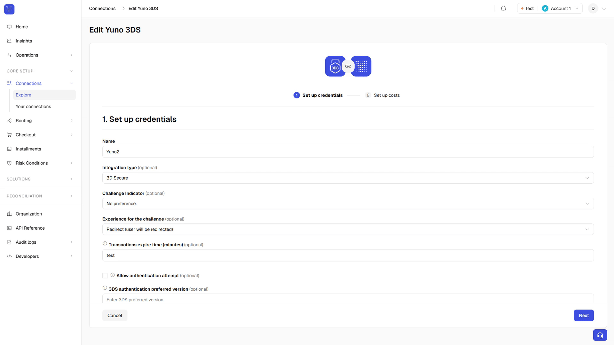
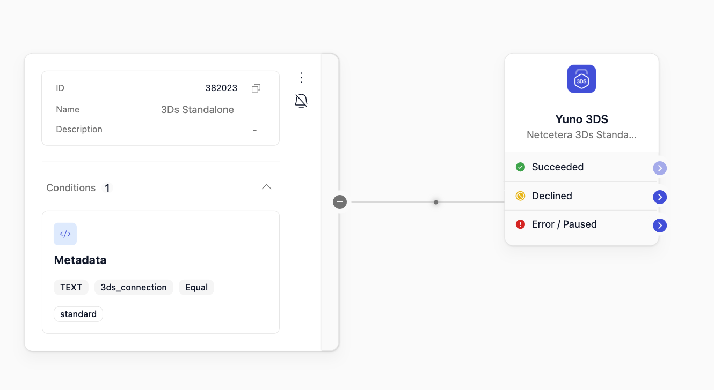

3DS Standalone ejecuta únicamente el paso de autenticación 3D Secure: no interviene ningún proveedor de pago y no se realiza ninguna autorización. La respuesta devuelve el resultado de la autenticación (criptograma ECI + CAVV y datos relacionados). El comercio usa este resultado para decidir qué hacer a continuación, por ejemplo, reenviarlo a su adquirente.

El flujo usa el endpoint estándar `/payments`. Lo que se ejecuta depende de cómo esté configurada la ruta. Para standalone, la ruta debe resolverse **únicamente** a la conexión de Yuno 3DS, sin ningún proveedor de pago asociado, de modo que solo se ejecute la autenticación.

## Configuración en el Dashboard {#dashboard-configuration}

### Paso 1: Crear la conexión de Yuno 3DS {#step-1-create-the-yuno-3ds-connection}

Ve a **Dashboard → Connections → Add Connection** y selecciona **Yuno 3DS**. Marca la casilla **"Yuno 3DS Standalone"**, completa los datos del adquirente y haz clic en **Next**.

Los **datos del adquirente** son los datos de registro de 3DS que te proporciona tu adquirente. Para el proveedor predeterminado (Netcetera), los campos son:

- **Acquirer BIN**: el Número de Identificación Bancaria que se usa para compensar y liquidar la transacción, junto con el país donde tiene licencia.
- **Acquirer Merchant ID**: el número de afiliación que proporciona el adquirente.
- **Merchant Category Code (MCC)**: el código que representa la categoría de tu comercio, proporcionado por el adquirente.
- **Merchant Name**: el nombre comercial oficial que realiza la transacción.
- **Merchant URL**: el sitio web o la plataforma en línea del comercio.
- **Merchant Country Code**: el país donde se procesa el pago ([ISO 3166-1](https://en.wikipedia.org/wiki/ISO_3166-1)).

<Frame></Frame>

### Paso 2: Configurar la ruta {#step-2-configure-the-route}

Ve a **Dashboard → Routing** y crea una ruta **CARD** que dirija todas las transacciones a la conexión de Yuno 3DS. La rama que gestiona el tráfico standalone debe resolverse **únicamente** a la conexión de Yuno 3DS: sin ningún proveedor de pago.

<Note>
Es posible que ya tengas una ruta CARD que apunta a un proveedor de pago y quieras que la autenticación standalone coexista con ella. Puedes aislar el tráfico standalone con un grupo de condiciones sobre metadata (por ejemplo `3ds_connection = standard`) que apunte únicamente a la conexión de Yuno 3DS.
</Note>

<Frame></Frame>

#### Selección de una conexión específica (más de una conexión 3DS Standalone) {#selecting-a-specific-connection-more-than-one-3ds-standalone-connection}

Es posible que tengas **más de una conexión 3DS Standalone** configurada, por ejemplo, una configurada en **Data Only** y otra **sin preferencia** (estándar). En ese caso, el enrutador no puede decidir por sí solo cuál usar, así que controla la selección de forma explícita con **metadata**.

El mecanismo tiene dos partes que siempre deben funcionar en conjunto:

1. **En la ruta:** agrega un grupo de condiciones por cada conexión que coincida con una clave de metadata. Por ejemplo, `3ds_connection = standard` para una conexión y un valor distinto para la otra. Cada valor dirige el tráfico a la conexión que quieras.
2. **En las solicitudes:** agrega una entrada `metadata` que lleve la misma clave y el mismo valor. Debe enviarse tanto en la solicitud de 3DS Setup como en la solicitud a `/payments`, y debe ser **idéntica en ambas**.

<Warning>
El 3DS Setup y el pago se enrutan de forma independiente. Si el `metadata` enviado en el 3DS Setup no coincide con el `metadata` enviado en `/payments`, cada llamada puede resolverse a una conexión distinta. El Setup y el pago se ejecutarían entonces en conexiones diferentes y la autenticación no se completaría. Envía siempre el **mismo** `metadata` en ambas llamadas para que seleccionen la **misma** conexión de la ruta.
</Warning>

`metadata` es un arreglo JSON de entradas `{ "key", "value" }`. Envía la misma entrada en el Setup y en el pago:

```json
"metadata": [
  {
    "key": "3ds_connection",
    "value": "standard"
  }
]
```

<Note>
Esto aplica cuando tienes una sola conexión 3DS Standalone. Si **la ruta no tiene otros grupos de condiciones además de ella** (ni otras conexiones ni condicionales), esta selección mediante metadata no es necesaria. La ruta se resuelve a esa conexión automáticamente.

La ruta también puede combinar la conexión 3DS Standalone con otros condicionales, por ejemplo una segunda conexión standalone. En ese caso, usa el mecanismo de metadata descrito arriba para aislarla y seleccionarla.
</Note>

## Flujo standalone (con 3DS Setup) {#standalone-flow-using-3ds-setup}

El flujo standalone se ejecuta mediante un **3DS Setup** que produce un `three_d_secure_setup_id`, el cual luego se referencia en el pago.

### 1. Generar un 3DS Setup {#1-generate-a-3ds-setup}

El 3DS Setup tiene dos valores posibles en el campo `type`. La diferencia es **quién recopila los datos del navegador y del dispositivo** que se usan para la autenticación:

<div className="code-nowrap-table dense-table">

| `type` | Qué hace | Cuándo usarlo |
| :--- | :--- | :--- |
| `STANDARD` (predeterminado) | Yuno (a través del proveedor de 3DS) se encarga de la recopilación de datos del dispositivo. La respuesta devuelve un `collect_url` y un `token`; el comercio debe completar la recopilación cargando ese `collect_url` con el `token`. | El flujo estándar: deja que Yuno o el proveedor de 3DS dirija la recopilación de datos del dispositivo. |
| `MERCHANT_PROVIDED` | El comercio envía por su cuenta todos los datos requeridos (`browser_info` y `device_fingerprints`), por lo que no se realiza ningún paso de recopilación de datos del dispositivo. | Cuando un proveedor de 3DS ya recopila estos datos por su cuenta y te los entrega. |

</div>

<Note>
Si tienes más de una conexión 3DS Standalone, incluye el `metadata` en esta solicitud (como se muestra a continuación). Esto enruta el Setup a la conexión prevista. Recuerda enviar el **mismo** `metadata` más adelante en la solicitud a `/payments`.
</Note>

#### Type STANDARD {#type-standard}

Yuno realiza la recopilación de datos del dispositivo. El comercio debe completarla accediendo al `collect_url` devuelto en la respuesta y usando el `token` que también se entrega allí.

`STANDARD` es el valor predeterminado, por lo que el campo `type` puede omitirse.

**Solicitud**

```bash
curl --location 'https://api-staging.y.uno/v1/three-d-secure/setups' \
--header 'X-idempotency-key: idempotency-key' \
--header 'public-api-key: api-key' \
--header 'private-secret-key: secret-key' \
--header 'Content-Type: application/json' \
--data '{
    "account_id": "account_id",
    "type": "STANDARD",
    "card": {
        "holder_name": "TEST CUSTOMER",
        "number": "4916994064252017",
        "expiration_month": 12,
        "expiration_year": 26,
        "security_code": "123"
    },
    "metadata": [
        {
            "key": "3ds_connection",
            "value": "standard"
        }
    ]
}'
```

<CodeGroup>

```json Netcetera 3DS
{
    "three_d_secure_setup_id": "59192489-3713-4d1b-894b-ac15ac5b6f6f",
    "collect_url": "https://ndm-prev.3dss-non-prod.cloud.netcetera.com/acs/3ds-method",
    "token": "eyJ0aHJlZURTTWV0aG9kTm90aWZpY2F0aW9uVVJMIjoiaHR0cHM6Ly9zYW5kYm94LnkudW5vL25ldGNldGVyYS0zZHMtd2ViaG9vay92MS9zdGFydCIsInRocmVlRFNTZXJ2ZXJUcmFuc0lEIjoiNTkxOTI0ODktMzcxMy00ZDFiLTg5NGItYWMxNWFjNWI2ZjZmIn0",
    "provider_id": "NETCETERA_3DS",
    "timeout_value": 3000,
    "account_id": "account_id"
}
```

```json Cybersource 3DS
{
    "three_d_secure_setup_id": "06bc1782-b00d-4ef7-9b56-78f066821d2e",
    "collect_url": "https://cas.client.cardinaltrusted.com/centinelapi/V1/Cruise/Collect",
    "token": "eyJhbGciOiJIUzI1NiIsInR5cCI6IkpXVCJ9...",
    "provider_id": "CYBERSOURCE_3DS",
    "timeout_value": 3000,
    "account_id": "05327270-54f8-4189-b2fc-492864ecfc47"
}
```

```json Checkout.com 3DS
{
    "three_d_secure_setup_id": "eae7eca3-902b-475d-a2ea-a434aa57391b",
    "collect_url": "",
    "token": "",
    "provider_id": "CHECKOUT_COM_3DS",
    "timeout_value": 3000,
    "account_id": "05327270-54f8-4189-b2fc-492864ecfc47"
}
```

</CodeGroup>

**Completar la recopilación de datos del dispositivo**

Después de recibir el `collect_url` y el `token`, completa la recopilación de datos del dispositivo (el 3DS Method) **antes** de crear el pago.

<Note>
**Implementación sugerida (solo como referencia, no es un contrato fijo).** El nombre exacto del campo y la mecánica pueden variar según el proveedor de 3DS. Valida con el proveedor que uses. La idea general: renderiza un iframe oculto y envía automáticamente un formulario que hace POST del token al `collect_url`. Espera el período indicado por `timeout_value` y luego continúa con la creación del pago.

```html
<!-- Hidden iframe that receives the collection POST -->
<iframe name="ddc-iframe" style="display:none"></iframe>

<!-- Auto-submitting form: POST the token to the collect_url -->
<form id="ddc-form" target="ddc-iframe" method="POST" action="COLLECT_URL">
  <input type="hidden" name="threeDSMethodData" value="TOKEN">
</form>

<script>
  document.getElementById('ddc-form').submit();
  // wait up to timeout_value (e.g. 3000) before continuing to create the payment
</script>
```
</Note>

<Note>
Si el proveedor devuelve un `collect_url` y un `token` **vacíos** (por ejemplo `CHECKOUT_COM_3DS` arriba), no hay paso de recopilación. Omítelo y pasa directamente a crear el pago.
</Note>

#### Type MERCHANT_PROVIDED {#type-merchantprovided}

El comercio envía por su cuenta todos los datos requeridos (`browser_info` y `device_fingerprints`), por lo que no se realiza ningún paso de recopilación de datos del dispositivo.

<Note>
Usa `device_fingerprints` solo cuando un proveedor de 3DS que recopila estos datos por su cuenta (es decir, que no usa el `collect_url`) te entrega el `id` del fingerprint. Reenvía ese `id` aquí. El `provider_id` debe coincidir con el proveedor de 3DS configurado en la conexión.
</Note>

**Solicitud**

```bash
curl --location 'https://api-staging.y.uno/v1/three-d-secure/setups' \
--header 'X-idempotency-key: idempotency-key' \
--header 'public-api-key: api-key' \
--header 'private-secret-key: secret-key' \
--header 'Content-Type: application/json' \
--data '{
    "account_id": "account_id",
    "type": "MERCHANT_PROVIDED",
    "card": {
        "holder_name": "TEST CUSTOMER",
        "number": "4556557955726624",
        "expiration_month": 12,
        "expiration_year": 26,
        "security_code": "123"
    },
    "browser_info": {
        "user_agent": "Mozilla/5.0 (Windows NT 10.0; Win64; x64) AppleWebKit/537.36",
        "accept_header": "text/html,application/xhtml+xml,application/xml;q=0.9,*/*;q=0.8",
        "color_depth": "24",
        "screen_height": "1080",
        "screen_width": "1920",
        "language": "es-CO",
        "java_enabled": false,
        "javascript_enabled": true,
        "browser_time_difference": "300",
        "platform": "WEB"
    },
    "device_fingerprints": [
        {
            "id": "3dae048e-b95e-47c6-8064-ea7f1aa16e90",
            "provider_id": "NETCETERA_3DS"
        }
    ],
    "metadata": [
        {
            "key": "3ds_connection",
            "value": "standard"
        }
    ]
}'
```

**Respuesta**

```json
{
    "three_d_secure_setup_id": "59192489-3713-4d1b-894b-ac15ac5b6f6f",
    "account_id": "account_id",
    "type": "MERCHANT_PROVIDED",
    "browser_info": {
        "user_agent": "Mozilla/5.0 (Windows NT 10.0; Win64; x64) AppleWebKit/537.36",
        "accept_header": "text/html,application/xhtml+xml,application/xml;q=0.9,*/*;q=0.8",
        "color_depth": "24",
        "screen_height": "1080",
        "screen_width": "1920",
        "language": "es-CO",
        "javascript_enabled": true,
        "java_enabled": false,
        "browser_time_difference": "300",
        "platform": "WEB"
    },
    "device_fingerprints": [
        {
            "provider_id": "NETCETERA_3DS",
            "id": "3dae048e-b95e-47c6-8064-ea7f1aa16e90"
        }
    ]
}
```

### 2. Crear el pago {#2-create-the-payment}

Crea el pago usando el `three_d_secure_setup_id` generado en el paso anterior. Como la ruta se resuelve únicamente a la conexión de Yuno 3DS (sin proveedor de pago), solo se ejecuta la autenticación y se devuelve el resultado de 3DS. No se realiza ninguna autorización.

<Warning>
**Método de pago:** como este es un flujo de autenticación 3DS standalone, la tarjeta debe estar disponible para él. Envía el `card_data` en la solicitud o referencia un método de pago que haya sido **inscrito (guardado en vault) previamente**. **No** envíes `vault_on_success: true`: este flujo no lo admite.
</Warning>

<Warning>
Si usaste `metadata` en el 3DS Setup para seleccionar una conexión específica, **debes** enviar el **mismo** `metadata` aquí. De lo contrario, el pago podría enrutarse a una conexión 3DS Standalone distinta de la del Setup.
</Warning>

**Solicitud**

```bash
curl --location 'https://api-staging.y.uno/v1/payments' \
--header 'X-idempotency-key: idempotency-key' \
--header 'public-api-key: api-key' \
--header 'private-secret-key: secret-key' \
--header 'Content-Type: application/json' \
--data '{
    "account_id": "account-code",
    "description": "3DS",
    "country": "CO",
    "merchant_order_id": "order_id",
    "merchant_reference": "merchant_reference",
    "workflow": "DIRECT",
    "callback_url": "https://www.example.com",
    "amount": {
        "currency": "COP",
        "value": "27500"
    },
    "metadata": [
        {
            "key": "3ds_connection",
            "value": "standard"
        }
    ],
    "customer_payer": {
        "id": "customer_id"
    },
    "payment_method": {
        "type": "CARD",
        "detail": {
            "card": {
                "three_d_secure": {
                    "three_d_secure_setup_id": "59192489-3713-4d1b-894b-ac15ac5b6f6f"
                },
                "card_data": {
                    "holder_name": "TEST CUSTOMER",
                    "number": "4916994064252017",
                    "expiration_month": 12,
                    "expiration_year": 26,
                    "security_code": "123"
                }
            }
        }
    }
}'
```

<Note>
**Workflow:** una autenticación **frictionless** o **data-only** se resuelve en línea (los ejemplos se ejecutaron con `workflow: DIRECT`) y el resultado llega en la respuesta del pago. Un **challenge** requiere que el titular de la tarjeta realice una acción, por lo que el pago devuelve `PENDING` con un `redirect_url` y `checkout.sdk_action_required: true`. Gestiónalo con un workflow que admita redirección (`REDIRECT`) o con el Yuno SDK (consulta [Resultados de la autenticación → Challenge](#challenge)).
</Note>

El `status` / `sub_status` de nivel superior del pago te indican el resultado, y el resultado de 3DS está en `payment_method.payment_method_detail.card.three_d_secure`:

- **Frictionless / Data Only** → `status: SUCCEEDED`, `sub_status: THREE_D_SECURE_VERIFIED`.
- **Challenge** → `status: PENDING`, `sub_status: WAITING_ADDITIONAL_STEP`, con `checkout.sdk_action_required: true` y un `redirect_url` (se resuelve más tarde; consulta [Notificación por webhook](#webhook-notification)).
- **Autenticación fallida o rechazada** → `status: DECLINED`.

Un pago standalone se resuelve finalmente en `SUCCEEDED` / `THREE_D_SECURE_VERIFIED` (autenticación completada) o en `DECLINED` (autenticación fallida o rechazada). El estado a nivel de transacción y los códigos de respuesta de 3DS siguen la referencia estándar de Yuno: [Estados de transacción y códigos de respuesta](/reference/payments/status-and-response-codes/transaction). Algunos códigos de ejemplo son `SUCCEEDED_THREE_D_SECURE`, `CHALLENGE_REQUIRED`, `AUTHENTICATION_FAILED_THREE_D_SECURE` y `REJECTED_THREE_D_SECURE_REQUIRED`.

## Resultados de la autenticación {#authentication-outcomes}

### Frictionless {#frictionless}

Objeto `three_d_secure` (dentro del detalle de la tarjeta):

```json
"three_d_secure": {
    "version": "2.3.1",
    "electronic_commerce_indicator": "05",
    "cryptogram": "MTIzNDU2Nzg5MDA5ODc2NTQzMjE=",
    "transaction_id": "7f5e8c1a-5c98-411e-b54b-dbff770ea045",
    "directory_server_transaction_id": "fbaa20f0-09c4-48bd-b0fd-01fdbf9188cf",
    "pares_status": "Y",
    "acs_id": "ab4a9485-afdb-4003-a619-3aaeea0670d7"
}
```

<Accordion title="Ver la respuesta completa del pago">
```json
{
    "id": "7f524e10-534c-4a3f-aad8-14128156a958",
    "account_id": "5d8960b3-ca3c-4b8b-9891-0c190d4dae1c",
    "description": "3DS",
    "country": "CO",
    "status": "SUCCEEDED",
    "sub_status": "THREE_D_SECURE_VERIFIED",
    "merchant_order_id": "order-833aaade-323d-40c2-9f2c-49f5964bd055",
    "created_at": "2026-06-26T23:43:09.385435Z",
    "updated_at": "2026-06-26T23:43:10.424600Z",
    "amount": {
        "captured": 0.00,
        "currency": "COP",
        "refunded": 0.00,
        "value": 27500.00
    },
    "checkout": {
        "session": "",
        "sdk_action_required": false
    },
    "payment_method": {
        "type": "CARD",
        "payment_method_detail": {
            "card": {
                "verify": false,
                "capture": true,
                "installments": 1,
                "card_data": {
                    "holder_name": "TEST CUSTOMER",
                    "iin": "45565579",
                    "lfd": "6624",
                    "number_length": 16,
                    "brand": "VISA",
                    "scheme": "VISA",
                    "issuer_name": "BANCO BILBAO VIZCAYA ARGENTARIA BBVA",
                    "country_code": "ES",
                    "category": "GOLD",
                    "type": "CREDIT",
                    "three_d_secure": {
                        "version": "2.3.1",
                        "electronic_commerce_indicator": "05",
                        "cryptogram": "MTIzNDU2Nzg5MDA5ODc2NTQzMjE=",
                        "transaction_id": "7f5e8c1a-5c98-411e-b54b-dbff770ea045",
                        "directory_server_transaction_id": "fbaa20f0-09c4-48bd-b0fd-01fdbf9188cf",
                        "pares_status": "Y",
                        "acs_id": "ab4a9485-afdb-4003-a619-3aaeea0670d7"
                    },
                    "fingerprint": "85749aa9-c233-4e72-99b9-cbc1065500b6",
                    "expiration_month": 12,
                    "expiration_year": 26
                }
            }
        }
    },
    "transactions": {
        "id": "6036a7d1-c3f2-4817-a73a-4402c24ea070",
        "type": "THREE_D_SECURE",
        "status": "SUCCEEDED",
        "category": "CARD",
        "amount": 27500.00,
        "provider_id": "NETCETERA_3DS",
        "response_code": "SUCCEEDED_THREE_D_SECURE",
        "response_message": "3DS validation successful",
        "merchant_reference": "merchant-17912e48-74b9-4435-996a-2fc1f44e1468"
    },
    "callback_url": "https://www.example.com",
    "workflow": "DIRECT",
    "metadata": [
        {
            "key": "3ds_connection",
            "value": "standard"
        }
    ],
    "simplified_mode": false
}
```
</Accordion>

**Resumen del flujo:**
1. Se envía la solicitud de autenticación al ACS.
2. El ACS autentica mediante análisis de riesgo, sin interacción del usuario.
3. Devuelve los datos completos (criptograma, ECI, dsTransID, versión) con `pares_status = Y`; el pago es `SUCCEEDED` / `THREE_D_SECURE_VERIFIED`.
4. El resultado está disponible en la respuesta del pago. Traslado de responsabilidad = **sí**.

### Data Only {#data-only}

Objeto `three_d_secure` (dentro del detalle de la tarjeta):

```json
"three_d_secure": {
    "version": "2.3.1",
    "electronic_commerce_indicator": "04",
    "cryptogram": "MTIzNDU2Nzg5MDA5ODc2NTQzMjE=",
    "transaction_id": "a6f1faa7-2690-4d57-a589-311a3a62dedf",
    "directory_server_transaction_id": "fcf62fd5-4ff7-429c-9882-2dadf92f7ee3",
    "pares_status": "I",
    "acs_id": "9caec967-14e2-4eed-bc35-3fa231c60c14"
}
```

<Accordion title="Ver la respuesta completa del pago">
```json
{
    "id": "37372cdc-415d-46ad-95af-96b9de106ef1",
    "account_id": "5d8960b3-ca3c-4b8b-9891-0c190d4dae1c",
    "description": "3DS",
    "country": "CO",
    "status": "SUCCEEDED",
    "sub_status": "THREE_D_SECURE_VERIFIED",
    "merchant_order_id": "order-b3cb9c62-4c9c-4e48-89fa-f6bb09725c9d",
    "created_at": "2026-06-26T23:45:21.558465Z",
    "updated_at": "2026-06-26T23:45:22.373691Z",
    "amount": {
        "captured": 0.00,
        "currency": "COP",
        "refunded": 0.00,
        "value": 27500.00
    },
    "checkout": {
        "session": "",
        "sdk_action_required": false
    },
    "payment_method": {
        "type": "CARD",
        "payment_method_detail": {
            "card": {
                "verify": false,
                "capture": true,
                "installments": 1,
                "card_data": {
                    "holder_name": "TEST CUSTOMER",
                    "iin": "49169940",
                    "lfd": "2017",
                    "number_length": 16,
                    "brand": "VISA",
                    "scheme": "VISA",
                    "issuer_name": "PRIVATE OJSC BANK ASIA ALLIANCE BANK",
                    "country_code": "UZ",
                    "category": "CLASSIC",
                    "type": "DEBIT",
                    "three_d_secure": {
                        "version": "2.3.1",
                        "electronic_commerce_indicator": "04",
                        "cryptogram": "MTIzNDU2Nzg5MDA5ODc2NTQzMjE=",
                        "transaction_id": "a6f1faa7-2690-4d57-a589-311a3a62dedf",
                        "directory_server_transaction_id": "fcf62fd5-4ff7-429c-9882-2dadf92f7ee3",
                        "pares_status": "I",
                        "acs_id": "9caec967-14e2-4eed-bc35-3fa231c60c14"
                    },
                    "fingerprint": "b966eb1f-aea6-4d66-8532-0b76cdf9dc72",
                    "expiration_month": 12,
                    "expiration_year": 26
                }
            }
        }
    },
    "transactions": {
        "id": "85d030b5-3d34-4fdb-bb4f-a6dfcad243bb",
        "type": "THREE_D_SECURE",
        "status": "SUCCEEDED",
        "category": "CARD",
        "amount": 27500.00,
        "provider_id": "NETCETERA_3DS",
        "response_code": "SUCCEEDED_THREE_D_SECURE",
        "response_message": "3DS validation successful",
        "merchant_reference": "merchant-d2d686aa-d441-49f1-9b66-2608473b848d"
    },
    "callback_url": "https://www.example.com",
    "workflow": "DIRECT",
    "metadata": [
        {
            "key": "3ds_connection",
            "value": "standard"
        }
    ],
    "simplified_mode": false
}
```
</Accordion>

**Resumen del flujo:**
1. Solo se comparten los datos del navegador y del dispositivo con el emisor para alimentar sus modelos de riesgo: no ocurre una autenticación real.
2. El flujo continúa como frictionless y devuelve un resultado (`SUCCEEDED` / `THREE_D_SECURE_VERIFIED`, `pares_status = I`).
3. Traslado de responsabilidad = **NO**: el comercio conserva la responsabilidad por fraude. Normalmente ECI 04.

### Challenge {#challenge}

El pago regresa como `PENDING` con un `redirect_url` y `checkout.sdk_action_required: true`. En este punto, el objeto `three_d_secure` contiene los datos del challenge (`pares_status: C`, ECI vacío y un `cryptogram` que contiene la solicitud de challenge codificada):

```json
"three_d_secure": {
    "version": "2.3.1",
    "electronic_commerce_indicator": "",
    "cryptogram": "eyJhY3NUcmFuc0lEIjoiZTVmMDIzZDItMjlhNy00ODRlLWFhODgtMDlmYjdlOTRhODFmIiwiY2hhbGxlbmdlV2luZG93U2l6ZSI6IjA1IiwibWVzc2FnZVR5cGUiOiJDUmVxIiwibWVzc2FnZVZlcnNpb24iOiIyLjMuMSIsInRocmVlRFNTZXJ2ZXJUcmFuc0lEIjoiNDk5NGZmNGUtZWFkZC00MzFmLWJiMjEtY2MwMjY5YWZiMTJlIn0",
    "transaction_id": "4994ff4e-eadd-431f-bb21-cc0269afb12e",
    "directory_server_transaction_id": "d0a1890a-1e38-4c1c-9e05-e2019a04e772",
    "pares_status": "C",
    "acs_id": "e5f023d2-29a7-484e-aa88-09fb7e94a81f"
}
```

<Accordion title="Ver la respuesta completa del pago">
```json
{
    "id": "1b5de250-2e52-4622-9c21-a30c70804d9a",
    "account_id": "5d8960b3-ca3c-4b8b-9891-0c190d4dae1c",
    "description": "3DS",
    "country": "CO",
    "status": "PENDING",
    "sub_status": "WAITING_ADDITIONAL_STEP",
    "merchant_order_id": "order-87af5f63-6679-4a3b-b436-3a1c9b72c823",
    "created_at": "2026-06-26T23:47:51.448941Z",
    "updated_at": "2026-06-26T23:47:52.397292Z",
    "amount": {
        "captured": 0.00,
        "currency": "COP",
        "refunded": 0.00,
        "value": 27500.00
    },
    "checkout": {
        "session": "39d9a15c-0ef0-4b10-b0bb-b64090b82f53",
        "sdk_action_required": true
    },
    "payment_method": {
        "type": "CARD",
        "payment_method_detail": {
            "card": {
                "verify": false,
                "capture": true,
                "installments": 1,
                "redirect_url": "https://checkout.sandbox.y.uno/payment?session=2e42a863-54e7-4607-8391-e504a2166b3e&3ds=true",
                "card_data": {
                    "holder_name": "TEST CUSTOMER",
                    "iin": "49169940",
                    "lfd": "2017",
                    "number_length": 16,
                    "brand": "VISA",
                    "scheme": "VISA",
                    "issuer_name": "PRIVATE OJSC BANK ASIA ALLIANCE BANK",
                    "country_code": "UZ",
                    "category": "CLASSIC",
                    "type": "DEBIT",
                    "three_d_secure": {
                        "version": "2.3.1",
                        "electronic_commerce_indicator": "",
                        "cryptogram": "eyJhY3NUcmFuc0lEIjoiZTVmMDIzZDItMjlhNy00ODRlLWFhODgtMDlmYjdlOTRhODFmIiwiY2hhbGxlbmdlV2luZG93U2l6ZSI6IjA1IiwibWVzc2FnZVR5cGUiOiJDUmVxIiwibWVzc2FnZVZlcnNpb24iOiIyLjMuMSIsInRocmVlRFNTZXJ2ZXJUcmFuc0lEIjoiNDk5NGZmNGUtZWFkZC00MzFmLWJiMjEtY2MwMjY5YWZiMTJlIn0",
                        "transaction_id": "4994ff4e-eadd-431f-bb21-cc0269afb12e",
                        "directory_server_transaction_id": "d0a1890a-1e38-4c1c-9e05-e2019a04e772",
                        "pares_status": "C",
                        "acs_id": "e5f023d2-29a7-484e-aa88-09fb7e94a81f"
                    },
                    "fingerprint": "b966eb1f-aea6-4d66-8532-0b76cdf9dc72",
                    "expiration_month": 12,
                    "expiration_year": 26
                }
            }
        }
    },
    "transactions": {
        "id": "01aa5d77-1c91-4d95-9b5d-fbf1c7e863e2",
        "type": "THREE_D_SECURE",
        "status": "PENDING",
        "category": "CARD",
        "amount": 27500.00,
        "provider_id": "NETCETERA_3DS",
        "response_code": "CHALLENGE_REQUIRED",
        "response_message": "Transaction waiting for the challenge completion",
        "merchant_reference": "merchant-b2ceeae3-b3bb-4de5-b7d3-51ba87179781"
    },
    "callback_url": "https://www.example.com",
    "workflow": "REDIRECT",
    "metadata": [
        {
            "key": "3ds_connection",
            "value": "standard"
        }
    ],
    "simplified_mode": false
}
```
</Accordion>

<Note>
Una vez que el titular de la tarjeta completa el challenge, el resultado **final** se entrega mediante el webhook del pago (consulta [Notificación por webhook](#webhook-notification) más abajo). Si es exitoso, el pago muestra `status: SUCCEEDED` / `THREE_D_SECURE_VERIFIED`, con un `electronic_commerce_indicator` y un `cryptogram` / CAVV completos, `pares_status: Y` y `has_challenge: true`. Si el challenge falla, el pago muestra `status: DECLINED`.
</Note>

**Resumen del flujo:**
1. La respuesta del pago regresa como `PENDING` / `WAITING_ADDITIONAL_STEP` (`response_code: CHALLENGE_REQUIRED`), con `checkout.sdk_action_required: true` y un `redirect_url`.
2. El titular de la tarjeta debe completar el challenge del emisor:
   - **Con el Yuno SDK:** el SDK renderiza el challenge automáticamente.
   - **Con un workflow que admita redirección (`REDIRECT`):** redirige al titular de la tarjeta al `redirect_url` devuelto en la respuesta del pago para que pueda completar el challenge.
3. El titular de la tarjeta completa el challenge (OTP, biometría, Out-of-Band, Decoupled, Passkeys/FIDO-SPC). Es asíncrono.
4. Al terminar, el titular de la tarjeta regresa a tu `callback_url`. El resultado final de la autenticación se entrega mediante el webhook del pago (`payment.purchase`), o léelo con `GET /v1/payments/{id}`.
5. Si es exitoso (`pares_status = Y`), el pago es `SUCCEEDED` / `THREE_D_SECURE_VERIFIED` y el traslado de responsabilidad = **sí**. Si el challenge falla, el pago es `DECLINED`. Hasta que llegue el resultado, el comercio ve el pago como `PENDING`.

### Fallida o rechazada {#failed--rejected}

1. El ACS devuelve un resultado no autenticado (`pares_status N` / `R`) o la autenticación es rechazada.
2. El pago se resuelve en `DECLINED`; la transacción lleva un código de respuesta de fallo como `AUTHENTICATION_FAILED_THREE_D_SECURE` o `REJECTED_THREE_D_SECURE_REQUIRED`.
3. Sin traslado de responsabilidad: no hay una autenticación exitosa.

## Recepción del resultado {#receiving-the-result}

Para **frictionless** y **data-only**, el resultado de `three_d_secure` está disponible de inmediato en la respuesta del pago (`status: SUCCEEDED`). Para un **challenge**, el resultado se entrega de forma asíncrona cuando el titular de la tarjeta termina (consulta [Notificación por webhook](#webhook-notification)). Como alternativa, consulta periódicamente `GET /v1/payments/{id}` para leer el resultado final de `three_d_secure`.

## Notificación por webhook {#webhook-notification}

El resultado de la autenticación se entrega mediante la notificación de pago estándar de Yuno: el **mismo webhook que ya usas para las actualizaciones de estado del pago**. No existe un webhook específico de 3DS. El evento es una notificación `payment` con `type_event: "payment.purchase"`. El pago está en `data.payment` y el resultado de 3DS está en `data.payment.transactions.payment_method.payment_method_detail.card.three_d_secure`.

<Note>
Para una autenticación **rechazada** se entrega el mismo webhook (`payment.purchase`); solo cambia el estado. El pago es `DECLINED` y la transacción lleva un código de respuesta de fallo como `AUTHENTICATION_FAILED_THREE_D_SECURE` o `REJECTED_THREE_D_SECURE_REQUIRED`.
</Note>

**Ejemplo: autenticación exitosa (después de un challenge completado)**

<Accordion title="Ver el payload del webhook">
```json
{
    "type": "payment",
    "type_event": "payment.purchase",
    "account_id": "5d8960b3-ca3c-4b8b-9891-0c190d4dae1c",
    "retry": 0,
    "version": 2,
    "data": {
        "payment": {
            "id": "b5f22a56-285f-4ea5-a26c-0651a53c0771",
            "account_id": "5d8960b3-ca3c-4b8b-9891-0c190d4dae1c",
            "description": "3DS",
            "country": "CO",
            "status": "SUCCEEDED",
            "sub_status": "THREE_D_SECURE_VERIFIED",
            "merchant_order_id": "order-781223d2-4ade-436b-9ac1-a7f675ae0339",
            "created_at": "2026-06-26T23:50:39.456437Z",
            "updated_at": "2026-06-26T23:50:59.882628Z",
            "amount": {
                "currency": "COP",
                "value": 27500,
                "refunded": 0,
                "captured": 0
            },
            "checkout": {
                "session": "1ae63f1a-d587-4ee3-8fe1-7871e4dbd39f",
                "sdk_action_required": true
            },
            "transactions": {
                "id": "4aaad7e2-95c9-4499-af1d-7d8147c29a61",
                "type": "THREE_D_SECURE",
                "status": "SUCCEEDED",
                "category": "CARD",
                "amount": 27500,
                "provider_id": "NETCETERA_3DS",
                "response_code": "SUCCEEDED_THREE_D_SECURE",
                "response_message": "3DS validation successful",
                "merchant_reference": "merchant-14b2aa13-ee69-41d5-9d6c-48a2e0bde1ee",
                "payment_method": {
                    "type": "CARD",
                    "payment_method_detail": {
                        "card": {
                            "verify": false,
                            "capture": true,
                            "installments": 1,
                            "card_data": {
                                "holder_name": "TEST CUSTOMER",
                                "iin": "49169940",
                                "lfd": "2017",
                                "number_length": 16,
                                "brand": "VISA",
                                "scheme": "VISA",
                                "issuer_name": "PRIVATE OJSC BANK ASIA ALLIANCE BANK",
                                "country_code": "UZ",
                                "category": "CLASSIC",
                                "type": "DEBIT",
                                "three_d_secure": {
                                    "version": "2.3.1",
                                    "electronic_commerce_indicator": "02",
                                    "cryptogram": "JAmi21makAifmwqo2120cjq1AAA=",
                                    "transaction_id": "6cf8f7dd-0d15-40f1-a520-55e89e048942",
                                    "directory_server_transaction_id": "b24df687-0a2d-43be-b555-82aef699dfbc",
                                    "liability_shift": null,
                                    "authentication_created_at": null,
                                    "has_challenge": true,
                                    "authentication_id": null,
                                    "pares_status": "Y",
                                    "acs_id": "afa24c2f-fb84-4d33-8399-74e60a1e0380",
                                    "strong_customer_authentication_exemptions": null,
                                    "cavv_algorithm": null,
                                    "ds_risk_score": null
                                },
                                "fingerprint": "b966eb1f-aea6-4d66-8532-0b76cdf9dc72",
                                "expiration_month": 12,
                                "expiration_year": 26
                            }
                        }
                    }
                },
                "connection_data": {
                    "id": "636226c6-a02b-4ef1-8925-9ec4a499fd59",
                    "name": "Yuno 3DS Standalone"
                }
            },
            "callback_url": "https://www.example.com",
            "workflow": "REDIRECT",
            "metadata": [
                {
                    "key": "3ds_connection",
                    "value": "standard"
                }
            ]
        }
    }
}
```
</Accordion>

## Campos de la respuesta {#response-fields}

| Campo | Significado |
| :--- | :--- |
| `version` | La versión del protocolo 3D Secure usada para la autenticación (p. ej. 2.1.0 / 2.2.0 / 2.3.1). Las versiones más recientes habilitan métodos de challenge adicionales (OOB, Passkeys/FIDO, etc.). |
| `electronic_commerce_indicator` (ECI) | Indica el resultado de la autenticación y quién asume la responsabilidad por fraude. Visa: 05 autenticado / 06 intentado / 07 no autenticado. Mastercard: 02 autenticado / 01 intentado / 00 no autenticado. Vacío mientras un challenge sigue pendiente. |
| `cryptogram` | El CAVV/AAV: prueba criptográfica generada por el emisor de que la autenticación se realizó. Es único por transacción; se envía al adquirente en la autorización para validar el 3DS. Mientras un challenge está pendiente, este campo contiene la solicitud de challenge codificada. |
| `transaction_id` | El 3DS Server Transaction ID (`threeDSServerTransID`): identificador de la transacción 3DS asignado por el 3DS Server en 3DS2. Correlaciona los mensajes AReq/ARes. (Este es el valor de 3DS2; el "XID" heredado de 3DS1 es un campo distinto.) |
| `directory_server_transaction_id` (dsTransID) | Identificador único de transacción asignado por el Directory Server (Visa/Mastercard) en 3DS2. Es un valor obligatorio que debe viajar en la autorización junto con el criptograma. |
| `pares_status` | Resultado de la autenticación (transStatus de EMVCo): Y autenticado, N fallido, A intentado, U no disponible, R rechazado, C challenge requerido, I solo datos. |
| `acs_id` | Identificador del ACS (Access Control Server) del emisor que procesó la autenticación. Se usa como referencia y trazabilidad del ACS que respondió. |
| `has_challenge` | Indica si la autenticación pasó por un challenge (`true`) o fue frictionless / data-only (`false`). Está presente en el payload del webhook. |
| `liability_shift` | Resumen Boolean de los resultados de responsabilidad descritos arriba: `true` cuando la responsabilidad por fraude se trasladó al emisor, `false` cuando el comercio la conserva. También puede ser `null`, incluso en algunos casos de autenticación exitosa; si ves `null` de forma inesperada y dependes de este campo para la gestión de contracargos, contacta al soporte de Yuno. |

## Pruebas (sandbox) {#testing-sandbox}

El sandbox de 3DS usa tarjetas de prueba específicas para forzar cada resultado, y las tarjetas dependen del proveedor de 3DS configurado en la conexión.

### Netcetera (predeterminado) {#netcetera-default}

Titular `TEST CUSTOMER`, vencimiento `12/26`, CVV `123`:

| Número de tarjeta | Resultado |
| :--- | :--- |
| `4556557955726624` | Frictionless |
| `4916994064252017` | Challenge / Data Only |

### Cybersource {#cybersource}

Titular `John Doe`, vencimiento `01/26`, CVV `123`:

| Número de tarjeta | Resultado |
| :--- | :--- |
| `4000000000001000` | Frictionless |
| `4000000000001091` | Challenge |

### Checkout.com {#checkoutcom}

| Número de tarjeta | Resultado |
| :--- | :--- |
| `4485040371536584` | Frictionless |
| `4242424242424242` | Challenge |

Para un challenge en el sandbox, complétalo con la contraseña `Checkout1!`. Consulta la documentación de tarjetas de prueba 3DS de Checkout.com para ver el vencimiento, el CVV y más tarjetas.
