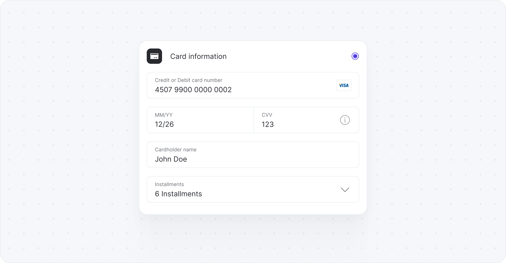

En esta sección descubrirás cómo Yuno admite pagos en cuotas, ofreciéndote a ti y a tus clientes la flexibilidad de hacer compras grandes más accesibles. Explora los beneficios de esta función y comprende la diferencia entre las cuotas del "comercio" y del "proveedor" para una solución de pago a la medida.

## Acepta pagos con tarjeta en cuotas {#accept-card-payments-in-installments}

Yuno admite pagos en cuotas, lo que te permite repartir el costo de una compra en un período más largo. Es una excelente forma de hacer más accesible una compra grande o de liberar flujo de caja para otros gastos. En un pago con una [promoción de Yuno](/es/docs/payment-features/promotions), el plan de cuotas se calcula sobre el monto que paga el cliente, `amount.value` menos `discount_amount`.

<Frame></Frame>

### Cuotas del comercio vs. del proveedor {#merchant-vs-provider-installments}

La implementación de las cuotas varía según su origen y tus acuerdos comerciales. Hay dos opciones que los comercios pueden usar, una definida por ellos mismos y otra según la definición de los proveedores:

* **[Comercio](/es/docs/payment-features/installments/merchant-installments)**: en este caso, el comercio gestiona sus propias opciones de cuotas a través de procesadores de pago individuales, y determina las opciones de cuotas disponibles para los clientes dentro de Yuno.
* **[Proveedor](/es/docs/payment-features/installments/provider-installments)**: cuando el comercio no tiene acuerdos de cuotas predefinidos, recurre a las opciones de cuotas del procesador de pago. Trabajamos con el proveedor que elijas para acceder a las cuotas disponibles que ofrecerás a tus clientes en cada transacción.

Para obtener más información sobre cómo configurar cada opción, puedes acceder a las páginas de [Cuotas del comercio](/es/docs/payment-features/installments/merchant-installments) o de [Cuotas del proveedor](/es/docs/payment-features/installments/provider-installments).
