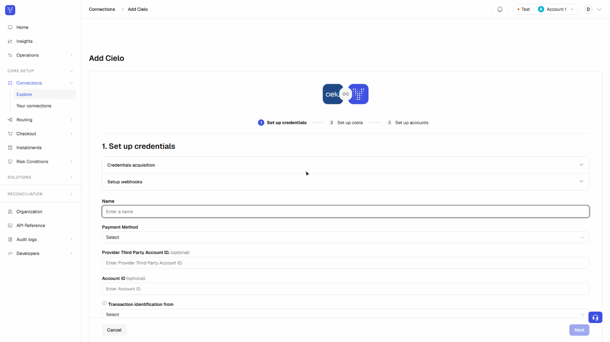
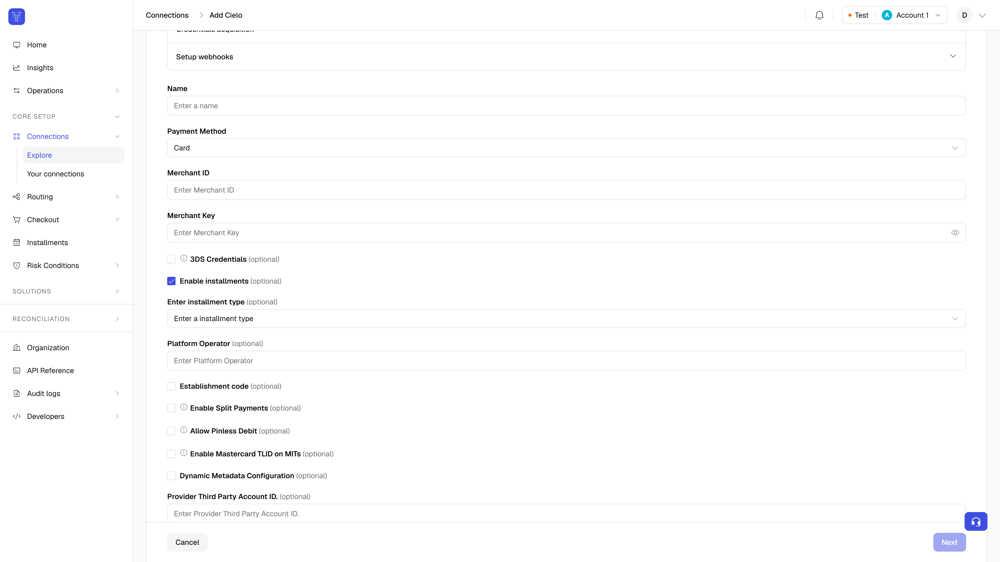

Puedes usar las opciones de cuotas del comercio cuando tú, como comercio, tienes tus propios acuerdos comerciales y capacidades de cuotas definidos en tus procesadores de pago. En este caso, eres responsable de manejar la lógica de las opciones de cuotas disponibles para cada transacción. Al crear el pago, informarás a Yuno el número de cuotas disponibles entre las que los clientes pueden elegir.

<Frame></Frame>

## ¿Cómo usar las cuotas del comercio? {#how-to-use-merchant-installments}

Según la forma en que te conectas a Yuno, el proceso para configurar las cuotas puede variar. A continuación, presentamos cómo informar a Yuno la opción de cuotas para el flujo Direct y la integración con el SDK.

### Flujo Direct {#direct-workflow}

Cuando usas una [integración Direct](/es/docs/direct-integration-use-cases/direct-flow), tú gestionas la experiencia de checkout del front-end. En este caso, informarás a Yuno el número de cuotas al crear el pago con el endpoint [Create Payment](/es/reference/payments/create-payment). El número de cuotas se definirá mediante el parámetro `payment_method.detail.card.installments`.

### Integración con el SDK {#sdk-integration}

Cuando usas el SDK de Yuno, Yuno es responsable de presentar al cliente las opciones de cuotas disponibles para cada pago. Por lo tanto, debes informar a Yuno qué cuotas estarán disponibles para tu cuenta. En este caso, la configuración de cuotas se realiza desde el [Dashboard de Yuno](https://auth.y.uno/u/login?). Para realizar esta configuración, ejecuta los dos pasos que se describen a continuación.

1. Primero, al configurar la [conexión](/es/docs/using-yuno/dashboard-overview/connections) de tu proveedor en el Dashboard de Yuno, debes habilitar la opción de cuotas. Así, Yuno mostrará la opción de cuotas cuando el cliente elija la opción de tarjeta de crédito en el formulario del checkout con SDK.

<Frame></Frame>

2. Después de habilitar las cuotas, debes crear un plan de cuotas con el endpoint [Create Installments Plan](/reference/installments/create-installments-plan). Al crear un plan, especificarás la moneda aceptada, los montos, las marcas de tarjeta, las fechas, etc. Una vez que el plan esté activo, Yuno lo aplica automáticamente a los pagos que coincidan y presenta al cliente las opciones de cuotas correspondientes.

<Warning>
**Integración con Secure Fields SDK**

Cuando uses la integración con Secure Fields SDK, deberás [habilitar la opción de cuotas](/docs/sdks/customization/secure-fields/payment-secure-fields) al iniciar el proceso de checkout.
</Warning>

Para las cuotas creadas por el comercio, también tienes la posibilidad de especificar el plan para cada sesión mediante una de estas opciones:

* el `plan_id` al [crear la sesión](/es/reference/checkout-sessions/create-checkout-session).
* una `plan structure` al [crear la sesión de checkout](/es/reference/checkout-sessions/create-checkout-session).

<Danger>
**Enrutamiento con proveedores de respaldo**

Al configurar tu [ruta](/es/docs/using-yuno/dashboard-overview/routing) para el método de pago Tarjeta, es importante recordar que, si tienes un proveedor de respaldo mientras usas cuotas, intentaremos realizar un pago de respaldo si la primera transacción es rechazada. Por lo tanto, es fundamental asegurarte de que ambos proveedores admitan la cantidad de cuotas configurada para tu cuenta. Si no es así, puedes configurar rutas distintas para cada escenario y evitar problemas.
</Danger>
