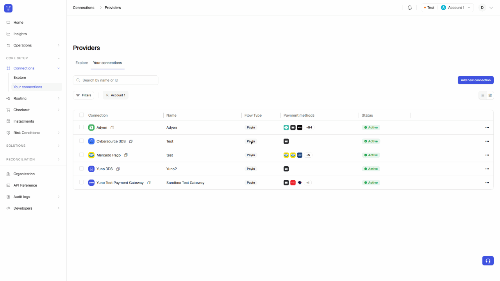
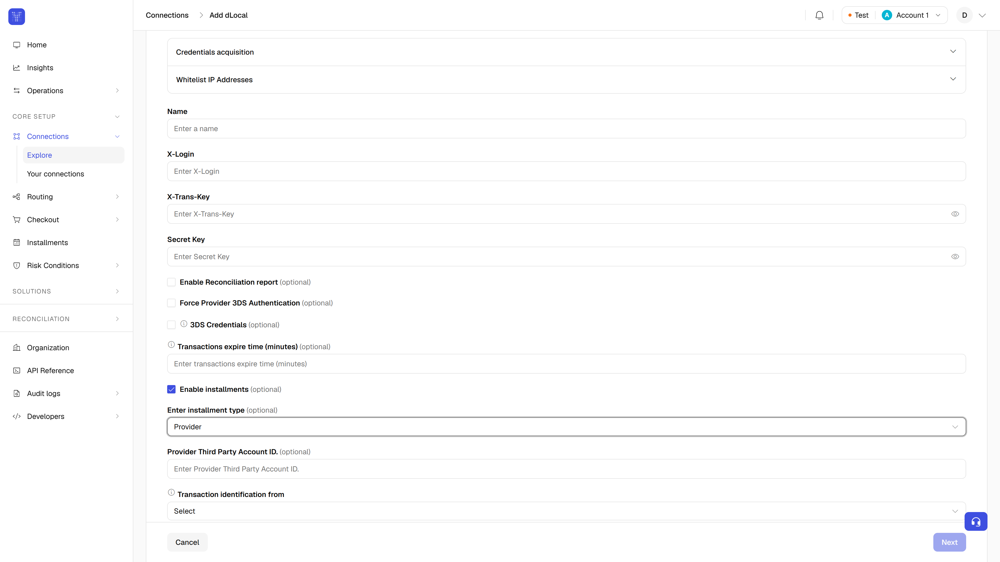

Las cuotas del **proveedor** se usan cuando el comercio no tiene un acuerdo comercial para un conjunto definido de cuotas, por lo que utiliza las cuotas definidas por el procesador de pago. Yuno consulta al proveedor que elijas para obtener las cuotas disponibles que ofrecerás a tus clientes en cada transacción.

<Frame></Frame>

### ¿Cómo usar las cuotas del proveedor? {#how-to-use-provider-installments}

Al configurar la [conexión](/es/docs/using-yuno/dashboard-overview/connections) de tu proveedor en el Dashboard de Yuno, puedes habilitar las cuotas disponibles para el proveedor, de modo que podamos usarlas en el formulario de tarjeta de crédito del SDK para que el cliente elija. En este escenario no es necesario crear un plan, ya que Yuno usará el plan definido por tu procesador de pago.

<Warning>
**Secure Fields SDK**

Cuando uses la integración con Secure Fields SDK, deberás [habilitar la opción de cuotas](/docs/sdks/customization/secure-fields/payment-secure-fields) al iniciar el proceso de checkout.
</Warning>

Esta opción no está habilitada para todos los proveedores, solo para los que tienen servicios de cuotas a los que Yuno puede acceder para obtener la información. Si consideras que un proveedor debería tener esta función habilitada, comunícate con tu account manager.

<Frame></Frame>

<Danger>
**Advertencia sobre la configuración de enrutamiento**

Al configurar tu [ruta](/es/docs/using-yuno/dashboard-overview/routing) para el método de pago Tarjeta, recuerda que no se admite tener un respaldo para un proveedor que usa "cuotas del proveedor", ya que cada proveedor maneja distintos tipos de planes de cuotas. Esto puede causar un error de procesamiento en el respaldo.
</Danger>
