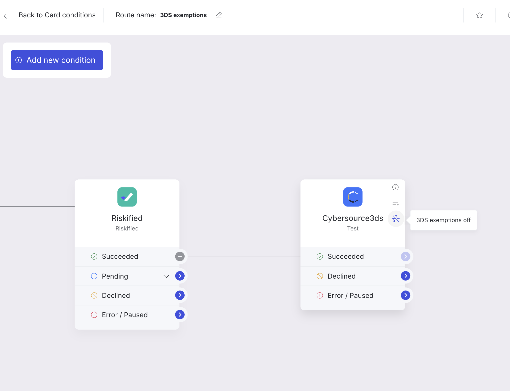

## Entender las exenciones de SCA {#understanding-sca-exemptions}

Bajo la Directiva de Servicios de Pago 2 (PSD2) de la Unión Europea, la Strong Customer Authentication (SCA) es obligatoria para los pagos electrónicos con el fin de mejorar la seguridad y reducir el fraude. Sin embargo, PSD2 contempla escenarios específicos, conocidos como exenciones de SCA, en los que las transacciones pueden omitir los requisitos de autenticación estándar. Estas exenciones están diseñadas para agilizar el proceso de pago de las transacciones de bajo riesgo y mejorar la experiencia del usuario sin comprometer la seguridad.

## Indicador de solicitud de desafío {#challenge-request-indicator}

El arreglo `strong_customer_authentication_exemptions` permite a los comercios especificar su preferencia sobre la aplicación de las exenciones de Strong Customer Authentication (SCA) durante una transacción. Con este campo, los comercios pueden solicitar que ciertas transacciones queden exentas de los desafíos de autenticación estándar, lo que mejora la experiencia del cliente y reduce la fricción durante el proceso de pago.

## Valores permitidos {#allowed-values}

El arreglo `strong_customer_authentication_exemptions` acepta los siguientes valores, cada uno correspondiente a una exención de SCA específica:

* **`LOW_VALUE`**: indica que el monto de la transacción está por debajo del umbral de bajo valor definido por PSD2 (normalmente menos de €30).
* **`TRANSACTION_RISK_ANALYSIS`**: indica que se realizó un Transaction Risk Analysis (TRA) y que la transacción se considera de bajo riesgo.
* **`STRONG_CUSTOMER_AUTHENTICATION`**: indica que la responsabilidad de la autenticación se delegó a un tercero de confianza que ya realizó la SCA.
* **`OUT_OF_SCOPE`**: indica que la responsabilidad de la autenticación no debe tenerse en cuenta.
* **`SECURE_CORPORATE`**: indica que el pago se realiza con una tarjeta corporativa segura que no está asignada a una persona.
* **`TRUSTED_BENEFICIARY`**: indica que el comercio se agregó a la lista de beneficiarios de confianza del cliente después de una SCA inicial.
* **`RECURRING_PAYMENT`**: indica que la transacción es un pago recurrente de monto fijo al mismo beneficiario.

<Note>
**Cartes Bancaires Safe'R (Francia)**

Safe'R es un programa de Cartes Bancaires (CB) construido sobre EMV 3DS 2.x y TRA. No existe un indicador `SAFER` dedicado en la API de Yuno. Para solicitar flujos elegibles para Safe'R, usa la exención `TRANSACTION_RISK_ANALYSIS` e incluye los campos de datos de riesgo de CB en tu solicitud de pago.

Proporciona la mayor cantidad posible de los siguientes datos para maximizar la elegibilidad:

* `customer_payer.ip_address`
* `customer_payer.email`
* `customer_payer.phone`
* `customer_payer.billing_address.*`
* `customer_payer.shipping_address.*`
* `customer_payer.browser_info.*` (para flujos web)
</Note>

## Ejemplo de implementación {#implementation-example}

Las exenciones de Strong Customer Authentication provienen de una de estas fuentes:

* **\[Recomendado]**: el análisis previo de un proveedor de fraude en tu ruta de pago:
  * <Frame></Frame>
* Definirlas al crear solicitudes de pago mediante la API. Asegúrate de que el valor seleccionado refleje con exactitud la naturaleza de la transacción. Por ejemplo:

```json
{
  [...],
  "payment_method": {
        "type": "CARD",
        "detail": {
            "card": {
                "card_data": {
                    "holder_name": "Paco",
                    "number": "4871049999999910",
                    "expiration_month": 3,
                    "expiration_year": 30,
                    "security_code": "737"
                },
               "three_d_secure": {
                        "strong_customer_authentication_exemptions": ["LOW_VALUE"]
                    }
            }
        }
    }
[...]
}
```

En este ejemplo, `strong_customer_authentication_exemptions` está configurado como LOW\_VALUE, lo que indica que la transacción cumple los requisitos de la exención por pago de bajo valor.

### Consideraciones {#considerations}

* *Decisión final del emisor*: aunque los comercios pueden solicitar una exención con el campo `strong_customer_authentication_exemptions`, el emisor de la tarjeta tiene la autoridad final para aceptar o rechazar la exención según su evaluación de riesgo y sus políticas de cumplimiento.
* *Implicaciones de responsabilidad*: solicitar una exención puede afectar la responsabilidad en caso de transacciones fraudulentas. Es fundamental entender que, si se concede una exención, es posible que no se aplique el traslado de responsabilidad asociado a la SCA. La respuesta del pago lo refleja en el campo `three_d_secure.liability_shift`, consulta [3DS Standalone: Response fields](/es/docs/payment-features/3ds-standalone#response-fields).
* *Cumplimiento normativo*: asegúrate de que el uso de este campo se ajuste a las regulaciones regionales, como PSD2 en Europa, y de que tu implementación cumpla los requisitos y umbrales específicos definidos para cada tipo de exención.
