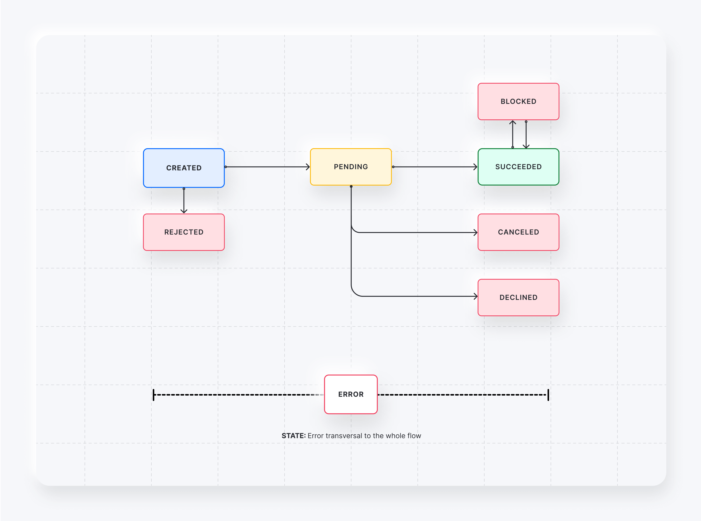

Esta funcionalidad permite que los **comercios dividan los pagos entre varios destinatarios**, lo cual es especialmente útil en modelos de marketplace donde las transacciones deben repartirse entre distintos vendedores o partes interesadas. Los comercios pueden especificar cómo se divide el pago, incluidos los montos, los destinatarios y las tarifas aplicables.

La funcionalidad de pago dividido depende de la compatibilidad del proveedor de pago seleccionado. Yuno actúa únicamente como orquestador del pago, no como procesador. Asegúrate de que tu proveedor admita pagos divididos antes de usar esta funcionalidad.

## Características principales {#key-features}

Las características principales de split payments marketplace incluyen:

* **Pagos divididos**: Define cómo se distribuye el monto total del pago entre los distintos destinatarios.
* **Configuración flexible**: Admite divisiones basadas en montos absolutos y divisiones con cálculo automático.
* **Auto Split Configuration**: Define reglas a nivel de destinatario (porcentaje, fijo o mixto) para automatizar el cálculo de las divisiones sin especificar montos en cada solicitud de pago.
* **Integración con proveedores**: Las divisiones pueden ser ejecutadas por proveedores de pago que admitan esta funcionalidad.
* **Manejo detallado de tarifas**: El sistema permite ajustar con precisión cómo se gestionan las tarifas de transacción y los contracargos. En cada entrada de la división, el objeto `liability` define quién paga la tarifa de transacción (`processing_fee`: `MERCHANT`, `RECIPIENT` o `SHARED`) y si el destinatario es responsable de los contracargos (`chargebacks`). Consulta [Integración de pagos divididos](#3-payment-split-integration).
* **Transferencia de onboarding**: Permite transferir onboardings entre distintos destinatarios.

Para usar esta funcionalidad, debes **incorporar primero a tus destinatarios** para el pago dividido y **luego crear el pago** especificando la información necesaria.

## 1. Onboarding {#1-onboarding}

El modelo de onboarding de Yuno está diseñado para ayudar a los marketplaces a conectar y gestionar sin fricciones a sus **subcomercios** a través de **múltiples proveedores de pago**. El elemento central de este sistema es el **objeto recipient**, que representa a cada subcomercio individual dentro del ecosistema del marketplace.

* Cada **propietario de marketplace** está representado en **Yuno como una organización**.
* Dentro de una organización se pueden crear una o más cuentas, cada una configurada con su propio conjunto de **conexiones** a proveedores de pago (por ejemplo, Stripe, Adyen, dLocal).
* Para cada cuenta, el marketplace puede registrar uno o más **destinatarios**, que son los subcomercios que se incorporarán.
* Cada **destinatario** se vincula luego de forma individual a una o más **conexiones**, según los procesadores de pago que vaya a usar.

Esta **arquitectura** permite:

* Un proceso de onboarding único y unificado.
* Seguimiento independiente del estado por proveedor.
* Escalar fácilmente las operaciones de subcomercios entre proveedores.

Este diseño garantiza flexibilidad, transparencia y trazabilidad completa durante todo el ciclo de vida del onboarding. El [endpoint de recipients](/es/reference/recipients-for-marketplace/create-recipient-1) se usa para crear y gestionar el perfil de cada subcomercio y para activar los flujos de onboarding específicos de cada proveedor.

<Note>
  **Recipients, Sellers y Payouts.** Los destinatarios son el modelo de subcomercio: los incorporas por proveedor y los referencias en `split_marketplace` y en [Transferencias independientes](#4-standalone-transfers). [Sellers (Franchise)](/es/reference/sellers/manage-sellers) es una funcionalidad distinta: un comercio franquicia registra identidades de seller por proveedor para que Yuno resuelva el `merchant_id` correcto de la conexión al momento del pago. [Payouts](/es/docs/payouts-and-disputes/payouts) es una API independiente que envía fondos a beneficiarios mediante métodos de retiro bancarios, con tarjeta o con billetera.
</Note>

### Flujos de onboarding {#onboarding-flows}

Yuno ofrece dos flujos de onboarding para subcomercios, con flexibilidad según el estado actual del subcomercio con los proveedores de pago.

1. **Cuentas ya incorporadas**: Si un subcomercio ya completó el proceso de onboarding con un proveedor específico (por ejemplo, mediante un dashboard o una plataforma externa), el marketplace puede enviar el `recipient_id` correspondiente durante la creación. En este caso no se requiere ningún onboarding adicional y el estado se establece de inmediato en `SUCCEEDED` (`onboardings.type`=`PREVIOUSLY_ONBOARDED`).

2. **Onboarding dinámico**: Si no se proporcionan credenciales, Yuno iniciará el proceso de onboarding para el proveedor elegido (`onboardings.type`=`ONE_STEP_ONBOARDING` o `TWO_STEP_ONBOARDING`). Este proceso puede incluir:
   1. Envío de un formulario o redirección a una página de onboarding alojada.
   2. Carga de documentación legal o financiera.
   3. Finalización de los pasos de validación KYC/KYB.

A lo largo del ciclo de vida del onboarding, un destinatario puede pasar por varios estados que reflejan la situación actual del proceso:

<div className="code-nowrap-table dense-table">

| Estado      | Descripción                                                                  |
| ----------- | ---------------------------------------------------------------------------- |
| `CREATED`   | Estado inicial tras la creación; el proceso de onboarding aún no ha comenzado. |
| `PENDING`   | A la espera de la revisión del proveedor tras el envío de datos.            |
| `SUCCEEDED` | El destinatario está completamente incorporado y activo.                    |
| `DECLINED`  | El proveedor rechazó el onboarding y no se puede reintentar.                |
| `BLOCKED`   | El proveedor bloqueó explícitamente el onboarding por problemas de cumplimiento. |
| `CANCELED`  | El proceso de onboarding se canceló voluntariamente antes de completarse.   |
| `REJECTED`  | El onboarding falló por datos incorrectos o validaciones fallidas.          |
| `ERROR`     | Ocurrió un error técnico durante el flujo de onboarding.                    |

</div>

Estos estados ayudan al marketplace a entender el ciclo de vida del onboarding y a implementar mecanismos adecuados de reintento, alerta o contingencia cuando sea necesario.

Este enfoque flexible permite a los marketplaces adaptar el proceso de onboarding a sus necesidades operativas, manteniendo el control y la visibilidad.

### Flujo de trabajo {#workflow}

El flujo de trabajo de onboarding sigue un proceso estructurado que garantiza que los subcomercios se integren correctamente en el ecosistema del marketplace. El diagrama a continuación ilustra el flujo completo, desde la configuración inicial hasta el procesamiento del pago.

<Frame></Frame>

**Pasos del flujo de trabajo:**

1. **Configuración de organización y cuenta**: El propietario del marketplace crea una organización en Yuno y configura cuentas con conexiones a proveedores de pago.

2. **Creación del destinatario**: Para cada subcomercio, el marketplace crea un destinatario con el endpoint [Create Recipients API](/es/reference/recipients-for-marketplace/create-recipient-1), especificando uno de los siguientes:

   * `provider_recipient_id` para subcomercios ya incorporados
   * Detalles de la conexión con el proveedor para un nuevo onboarding

3. **Ejecución del onboarding**:

   * **Ya incorporado**: El estado pasa de inmediato a `SUCCEEDED`
   * **Nuevo onboarding**: Yuno inicia el flujo específico del proveedor, con una progresión de estados de `CREATED` → `PENDING` → `SUCCEEDED`

4. **Creación del pago**: Una vez que los destinatarios se incorporaron correctamente (estado `SUCCEEDED`), el marketplace puede crear pagos con el objeto `split_marketplace`.

5. **Procesamiento de la división**: El proveedor de pago ejecuta la división según la distribución definida y transfiere a cada destinatario la parte que le corresponde.

## 2. Auto Split Configuration {#2-auto-split-configuration}

Yuno te permite definir **reglas de división automática** a nivel de destinatario. Cuando se crea un pago sin un `amount` explícito para un destinatario en el arreglo `split_marketplace`, Yuno usa estas reglas para calcular la división automáticamente.

### Tipos de cálculo {#calculation-types}

El objeto `split_configuration` admite tres métodos de cálculo:

<div className="nowrap-col1-table dense-table">

| Tipo | Descripción | Fórmula |
| :--- | :--- | :--- |
| `PERCENTAGE` | Un porcentaje del monto total del pago. | `Split = Total * (Percentage / 100)` |
| `FIXED` | Un monto fijo constante en una moneda específica. | `Split = fixed_amount` |
| `MIXED` | Combina un porcentaje y un monto fijo. | `Split = (Total * (Percentage / 100)) + fixed_amount` |

</div>

### Modo de redondeo {#rounding-mode}

Para garantizar la precisión en distintas monedas, Yuno admite tres estrategias de redondeo para los cálculos automáticos:

<div className="code-nowrap-table dense-table">

| Modo | Descripción | Estrategia |
| :--- | :--- | :--- |
| `STANDARD` | Redondea al número par más cercano (redondeo del banquero). | `HALF_EVEN` |
| `ROUND_UP` | Siempre redondea alejándose de cero. | `CEILING` |
| `ROUND_DOWN` | Siempre redondea hacia cero. | `FLOOR` |

</div>

### Implementación {#implementation}
 
 Puedes definir `split_configuration` al [crear](/es/reference/recipients-for-marketplace/create-recipient-1) o [actualizar](/es/reference/recipients-for-marketplace/update-recipient-1) un destinatario.
 
 <div className="nowrap-col1-table dense-table">

 | Campo | Tipo | Descripción | Obligatorio |
 | :--- | :--- | :--- | :--- |
 | `calculation_type` | `string` (enum) | El método usado para calcular la división: `PERCENTAGE`, `FIXED`, `MIXED`. | **Sí** |
 | `currency` | `string` | Código de moneda ISO 4217. Debe coincidir con la moneda del pago. | **Sí** |
 | `percentage` | `number` | Porcentaje del pago total. | Opcional* |
 | `fixed_amount` | `number` | Monto fijo que se dividirá. | Opcional* |
 | `rounding_mode` | `string` (enum) | Estrategia de redondeo: `STANDARD`, `ROUND_UP`, `ROUND_DOWN`. | Opcional* |

 </div>
 
 <Note>
   *El requisito depende de `calculation_type`:
   - **PERCENTAGE**: `percentage` y `rounding_mode` son obligatorios.
   - **FIXED**: `fixed_amount` es obligatorio.
   - **MIXED**: `percentage`, `fixed_amount` y `rounding_mode` son obligatorios.
 </Note>
 
 ```json Example Recipient with Auto Split
 {
   "merchant_recipient_id": "seller-123",
   "split_configuration": {
     "calculation_type": "PERCENTAGE",
     "percentage": 10.5,
     "rounding_mode": "STANDARD",
     "currency": "USD"
   }
 }
 ```

## 3. Integración de pagos divididos {#3-payment-split-integration}

En esta sección veremos cómo se usa el objeto `split_marketplace` para dividir un [pago](/es/reference/payments/create-payment) entre varios destinatarios. Este objeto es un arreglo en el que cada entrada especifica un destinatario y la parte del pago que le corresponde.

<Note>
  **Pagos con una promoción de Yuno.** La división se calcula sobre el monto que paga el cliente, `amount.value` menos `discount_amount`, y las partes no pueden sumar más que ese monto: de lo contrario, el pago se rechaza con `400`. Consulta [Promociones](/es/docs/payment-features/promotions).
</Note>

<Note>
  En este paso, referencia los destinatarios creados en el Paso 1 (Onboarding).

  Para `type` = `PURCHASE` o `MARKETPLACE`, incluye el `recipient_id` de ese destinatario.

  Para `PAYMENTFEE`, `VAT` y `COMMISSION`, `recipient_id` es opcional.
</Note>

<table class="code-nowrap-table dense-table">
  <thead>
    <tr>
      <th>
        Campo
      </th>

      <th>
        Tipo
      </th>

      <th>
        Descripción
      </th>

      <th>
        Obligatorio
      </th>

      <th>
        Valor de ejemplo
      </th>
    </tr>
  </thead>

  <tbody>
    <tr>
      <td>
        `recipient_id`
      </td>

      <td>
        `string`
      </td>

      <td>
        El identificador único del destinatario dentro del marketplace.

        Usa el ID de un destinatario creado en el Paso 1 (Onboarding) cuando `type` es `PURCHASE` o `MARKETPLACE`.
      </td>

      <td>
        Condicional
      </td>

      <td>
        `rec_test123`
      </td>
    </tr>

    <tr>
      <td>
        `provider_recipient_id`
      </td>

      <td>
        `string`
      </td>

      <td>
        El ID del destinatario según lo proporciona el proveedor de pago, si aplica.
      </td>

      <td>
        Condicional
      </td>

      <td>
        `prov_rec_abc`
      </td>
    </tr>

    <tr>
      <td>
        **Nota:**
      </td>

      <td />

      <td>
        Debes proporcionar `recipient_id` o `provider_recipient_id`.

        Para los propietarios de marketplace (`type`=`COMMISSION`), `provider_recipient_id` es opcional si el proveedor no lo requiere.
      </td>

      <td />

      <td />
    </tr>

    <tr>
      <td>
        `type`\*
      </td>

      <td>
        `enum`
      </td>

      <td>
        El tipo de elemento del detalle de la transacción. Las opciones son `PURCHASE`, `PAYMENTFEE`, `VAT`, `COMMISSION`, `MARKETPLACE`.

        `recipient_id` es obligatorio para `PURCHASE` y `MARKETPLACE`.
      </td>

      <td>
        Condicional
      </td>

      <td>
        `PURCHASE`
      </td>
    </tr>

    <tr>
      <td>
        **Nota:**
      </td>

      <td />

      <td>
        **Consideraciones de propagación**

        * Los elementos se envían al proveedor solo si este admite la transmisión de detalles

        * Estos tipos no afectan el desembolso de fondos, son meramente informativos cuando el proveedor lo permite

        <br />
      </td>

      <td />

      <td />
    </tr>

    <tr>
      <td>
        `merchant_reference`
      </td>

      <td>
        `string`
      </td>

      <td>
        Un identificador de la transacción de pago. Es opcional. Si no se especifica, se usará la referencia del comercio del pago principal para todas las transacciones de la división. (MÁX. 255; MÍN. 3 caracteres).
      </td>

      <td>
        No
      </td>

      <td>
        `AAB01-432245`
      </td>
    </tr>

    <tr>
      <td>
        `amount`
      </td>

      <td>
        `struct`
      </td>

      <td>
        Especifica el monto de la división. **Opcional** si el destinatario tiene un `split_configuration` definido.
      </td>

      <td>
        Condicional
      </td>

      <td />
    </tr>

    <tr>
      <td>
            `value`
      </td>

      <td>
        `number`
      </td>

      <td>
        El valor monetario de la división (por ejemplo, 7500 para 75.00). Obligatorio si se proporciona `amount`.
      </td>

      <td>
        Condicional
      </td>

      <td>
        `7500`
      </td>
    </tr>

    <tr>
      <td>
            `currency`
      </td>

      <td>
        `enum`
      </td>

      <td>
        La moneda en la que se realiza el pago (ISO 4217, 3 caracteres). Obligatorio si se proporciona `amount`.
      </td>

      <td>
        Condicional
      </td>

      <td>
        `COP`
      </td>
    </tr>

    <tr>
      <td>
        `liability`
      </td>

      <td>
        `struct`
      </td>

      <td>
        Información sobre la responsabilidad del destinatario respecto de las tarifas y los contracargos, si aplica.
      </td>

      <td>
        No
      </td>

      <td />
    </tr>

    <tr>
      <td>
            `processing_fee`
      </td>

      <td>
        `enum`
      </td>

      <td>
        Especifica quién es responsable de la tarifa de transacción: `MERCHANT`, `RECIPIENT`, `SHARED`.
      </td>

      <td>
        No
      </td>

      <td>
        `MERCHANT`
      </td>
    </tr>

    <tr>
      <td>
            `chargebacks`
      </td>

      <td>
        `boolean`
      </td>

      <td>
        Indica si el destinatario es responsable de los contracargos (`true` si es responsable).
      </td>

      <td>
        No
      </td>

      <td>
        `false`
      </td>
    </tr>
    <tr>
      <td>
        **Nota:**
      </td>
 
      <td />
 
      <td>
        **Cálculo automático de la división**
 
        Si se omite `amount`, Yuno usará el `split_configuration` del destinatario para calcular la parte. Si ambos están presentes, prevalece el `amount` de la solicitud.
      </td>
 
      <td />
 
      <td />
    </tr>
  </tbody>
</table>

<br />

```json Example using provider recipients directly
{
  "split_marketplace": [
    {
      "provider_recipient_id": "recipient_123",
      "type": "PURCHASE",
      "amount": {
        "value": 750,
        "currency": "EUR"
      }
    },
    {
      "type": "COMMISSION",
      "amount": {
        "value": 30,
        "currency": "EUR"
      }
    }
  ]
}
```

```json Example using Yuno recipients
{
  "split_marketplace": [
    {
      "recipient_id": "4b31a9b8-4cd2-4e47-93cf-03729241bd68",
      "type": "PURCHASE",
      "amount": {
        "value": 750,
        "currency": "EUR"
      }
    },
    {
      "recipient_id": "9104911d-5df9-429e-8488-ad41abea1a4b",
      "type": "COMMISSION",
      "amount": {
        "value": 30,
        "currency": "EUR"
      }
    }
  ]
}
```

```json Example with Implicit Auto-calculation
{
  "split_marketplace": [
    {
      "recipient_id": "4b31a9b8-4cd2-4e47-93cf-03729241bd68",
      "type": "PURCHASE"
      // The amount is omitted, Yuno uses the recipient's split_configuration
    },
    {
      "recipient_id": "9104911d-5df9-429e-8488-ad41abea1a4b",
      "type": "COMMISSION",
      "amount": {
        "value": 50,
        "currency": "USD"
      }
    }
  ]
}
```

### Fallback de destinatario para CARD y PIX {#recipient-fallback-for-card-and-pix}

Para los pagos CARD y PIX creados mediante `POST /v1/payments`, incluida la continuación de esos pagos, un intento que Yuno rechaza con `RECIPIENT_NOT_FOUND` puede continuar a través de una conexión elegible. Yuno rechaza un intento de esta manera, sin enviarlo al proveedor, cuando un destinatario de la división no tiene un onboarding utilizable con el proveedor enrutado (por ejemplo, cuando el único onboarding está `BLOCKED` o `CANCELLED`). No dependas de este fallback para los rechazos devueltos por el proveedor. Cada entrada de la división debe referenciar un `recipient_id` de Yuno, incluidas las entradas `PAYMENTFEE`, `VAT` y `COMMISSION`, donde de otro modo es opcional.

Una conexión de fallback es elegible solo cuando **cada destinatario de la división** tiene exactamente un onboarding activo en esa conexión, y ese onboarding tiene el estado `SUCCEEDED` y un ID de destinatario del proveedor no vacío. Los onboardings en un estado final, como `BLOCKED`, `CANCELLED` o `DECLINED`, no se cuentan. Un onboarding en otra conexión del mismo proveedor no califica. Si especificas `recipient_type`, el onboarding debe coincidir con ese tipo; de lo contrario, el onboarding correspondiente debe ser inequívoco.

Tu ruta configurada tiene prioridad:

- Se sigue un paso siguiente configurado antes de considerar otro proveedor inicial. Una vez que inicia el fallback de destinatario, un paso de pago que no puede resolver a todos los destinatarios en su conexión se rechaza localmente; su ruta configurada puede continuar con el siguiente paso.
- Un grupo de rechazo coincidente o un código de consejo del comercio (merchant advice code) coincidente sigue siendo una detención.
- Para las rutas con porcentajes de asignación configurados, cuando la ruta de un proveedor inicial terminaría de otro modo, Yuno puede seleccionar un proveedor elegible y aún no intentado entre las conexiones del primer paso de la ruta, dentro del mismo conjunto de condiciones. Si la ruta comienza con un paso de fraude o 3DS, Yuno no busca otro proveedor mediante este fallback. No recorre rutas anidadas ni ramas a las que solo se llega por errores. Se excluyen las conexiones en pausa, las conexiones marcadas por un monitor de enrutamiento y las conexiones con asignación de cero por ciento. Si varias conexiones califican, Yuno prueba primero la de mayor asignación.

El fallback conserva el orden, los IDs de destinatario de Yuno y las asignaciones de la división. Yuno resuelve los IDs de destinatario del proveedor para la conexión seleccionada. Por ejemplo, un pago de BRL 100 dividido en BRL 60/40 sigue siendo BRL 60/40 cuando pasa a otro proveedor elegible.

El intento rechazado permanece en las transacciones del pago con el estado `DECLINED`, el código de respuesta `RECIPIENT_NOT_FOUND` y sin ID de transacción del proveedor; no se envía ninguna solicitud a ese proveedor. Cuando el fallback tiene éxito, la siguiente transacción usa la conexión seleccionada con la misma división, y un reembolso se aplica a la transacción aprobada. Si no hay una alternativa elegible ni una continuación configurada, el pago termina sin otro cargo del proveedor. Un pago PIX ya aceptado y a la espera de pago no activa este fallback.

Este comportamiento no se aplica a las divisiones que contienen entradas sin un `recipient_id` de Yuno, incluidas las entradas que usan solo `provider_recipient_id`, ni a la verificación, la captura, el reembolso, la cancelación o la inscripción. No transfiere un pago aceptado a otro proveedor. Un token del proveedor que cambia la conexión seleccionada también impide el fallback a través de esa selección.

### Actualizar el split de una transacción pagada {#update-the-split-of-a-paid-transaction}

Cuando una orden cambia después del pago (por ejemplo, la entrega otro vendedor), puedes reemplazar la división de la transacción pagada con [Actualizar la división de una transacción pagada](/es/reference/recipients-for-marketplace/update-split-marketplace) en lugar de reembolsar y volver a cobrar. Las partes que envíes reemplazan toda la división anterior.

<Note>
  El plazo para cambiar una división lo define el proveedor, no Yuno. Con Zoop, la división se puede cambiar hasta el final del día calendario del pago. Después de que se cierra el plazo, la actualización se rechaza con `409` `SPLIT_UPDATE_WINDOW_CLOSED` y la división no cambia. La actualización se habilita por conexión de proveedor; contacta a Yuno para habilitarla en la tuya.
</Note>

## 3. Transferencia de onboarding {#3-onboarding-transfer}

El objetivo de este flujo es permitir la transferencia de onboardings entre destinatarios de forma controlada y reversible.

El proceso tiene varias etapas. Primero se crea el destinatario inicial con su onboarding (un paso previo). Más adelante, cuando se requiere una transferencia, sigue los pasos para crear el nuevo destinatario, usar el servicio de transferencia y, si es necesario, revertir la operación.

1. **Destinatario y onboarding (antes de cualquier transferencia)**: [Crea el destinatario](/es/reference/recipients-for-marketplace/create-recipient-1) y luego [crea el onboarding](/es/reference/recipients-for-marketplace/create-onboarding).

<Note>
  Este paso ocurre con anticipación, cuando se crea un nuevo destinatario y se le asigna su onboarding. No forma parte de la transferencia en sí.
</Note>

Si decides transferir el onboarding a otro destinatario, continúa con el flujo:

2. **Crea el nuevo destinatario y el onboarding**: Usa los endpoints [crear destinatario](/es/reference/recipients-for-marketplace/create-recipient-1) y [crear onboarding](/es/reference/recipients-for-marketplace/create-onboarding) para configurar el destinatario y el onboarding que recibirán la transferencia.

3. **Transfiere el onboarding**: Usa [transferir onboarding](/es/reference/recipients-for-marketplace/transfer-onboarding) e incluye:

   * `recipient_id`: el ID del destinatario de destino
   * `onboarding_id`: el onboarding que se transferirá

   El onboarding se transferirá al nuevo destinatario.

4. **Revierte la transferencia (opcional)**: Usa [revertir onboarding](/es/reference/recipients-for-marketplace/reverse-onboarding) para revertir la transferencia anterior, proporcionando el mismo `recipient_id` y `onboarding_id`.

El objeto `onboarding` incluye un elemento `history` que almacena la trazabilidad completa del onboarding. Este historial incluye no solo las actualizaciones del objeto, sino también los eventos relacionados con las transferencias entre destinatarios, lo que garantiza una visibilidad completa del ciclo de vida.

## 4. Transferencias independientes {#4-standalone-transfers}

Los comercios suelen necesitar enviar fondos a destinatarios (vendedores, proveedores, contratistas) de forma independiente del ciclo de vida de un pago, directamente desde el saldo de su organización. Esto se conoce como una **Transferencia independiente** o **Forward Transfer**. 

Esta funcionalidad te permite:
- Distribuir los ingresos por ventas entre los vendedores de un marketplace.
- Pagar a contratistas tras trabajos completados (Gig Economy).
- Gestionar la distribución de ingresos por suscripciones o el pago de comisiones a afiliados.
- Ejecutar payouts masivos a varios destinatarios.

### Estados de la transferencia {#transfer-statuses}

Un flujo de transferencia independiente pasa por varios estados según la respuesta del proveedor y las reversiones posteriores:

<div className="code-nowrap-table dense-table">

| Estado      | Descripción                                               | ¿Terminal? |
| ----------- | --------------------------------------------------------- | --------- |
| `CREATED`   | Flujo de transferencia creado, aún no enviado al proveedor. | No        |
| `PENDING`   | Enviado al proveedor, a la espera de confirmación.        | No        |
| `SUCCEEDED` | La transferencia directa se completó correctamente.       | No        |
| `DECLINED`  | El proveedor rechazó la transferencia.                    | Sí        |
| `ERROR`     | Error del proveedor durante el procesamiento.             | Sí        |
| `REVERSED`  | La transacción de reversión se completó correctamente.    | Sí        |

</div>

### Transacciones y reversiones {#transactions-and-reversals}

En el flujo de transferencia independiente, las operaciones directa y de reversión se tratan como transacciones independientes idénticas para mantener un registro de auditoría explícito. Esto significa que:

1. **Transferencia directa (`SPLIT_TRANSFER`):** Creas una transferencia que mueve fondos de tu saldo a la conexión del destinatario. 
2. **Transferencia de reversión (`SPLIT_TRANSFER_REVERSE`):** Puedes revertir total o parcialmente el `SPLIT_TRANSFER` para devolver los fondos a tu saldo. La transferencia directa original _debe estar_ en estado `SUCCEEDED` para que se pueda realizar una reversión.

### Idempotencia {#idempotency}

Tanto la creación como la reversión de transferencias independientes requieren una **clave de idempotencia** mediante el encabezado `X-Idempotency-Key`. Esto te permite reintentar solicitudes de forma segura sin duplicar accidentalmente la distribución de fondos. Estas claves se conservan durante 24 horas. Las solicitudes duplicadas que usen la misma combinación de `account_id` y clave de idempotencia devolverán el objeto de transferencia original.

 
 ## Validaciones
 
 Para garantizar pagos divididos exitosos, se aplican las siguientes validaciones:
 
- **Coincidencia del total de la división**: La suma de todas las divisiones debe coincidir con el monto total del pago.
- **Existencia del destinatario**: Cada `recipient_id` incluido en la división debe corresponder a un destinatario incorporado correctamente.
- **Moneda de Auto Split**: Si un destinatario tiene un `split_configuration`, su `currency` debe coincidir exactamente con el `amount.currency` del pago.
- **Consistencia del monto**: Si proporcionas un `amount.value` para un destinatario con `split_configuration`, debe coincidir con el resultado del cálculo automático.
- **Límites de cada división**: El valor resuelto de cada división individual debe ser mayor que cero y menor o igual que el monto total del pago.
- **Precisión mínima**: Para las divisiones `PERCENTAGE`, el valor calculado debe ser de al menos `0.0001` (mínimo de la plataforma).
- **Campos obligatorios**:
    - Para divisiones manuales (sin `split_configuration`): `amount.value` y `amount.currency` son obligatorios.
    - Si se proporciona `split_configuration` durante la creación del destinatario: `calculation_type` y `currency` son siempre obligatorios.
- **Regla de exclusión**: Debes incluir `recipient_id` o `provider_recipient_id` en cada elemento de la división, pero nunca ambos.
- **Múltiples proveedores**: Para los destinatarios vinculados a varios proveedores de pago, usa el [objeto recipients](/es/reference/recipients-for-marketplace/create-recipient-1) para gestionar la lógica de la división entre conexiones.

## Endpoints de API involucrados {#api-endpoints-involved}

Esta sección enumera los endpoints de API involucrados en la gestión de pagos divididos.

* **[Crear recipients](/es/reference/recipients-for-marketplace/create-recipient-1)**: **POST**: `https://api-sandbox.y.uno/v1/recipients`
* **[Crear onboarding](/es/reference/recipients-for-marketplace/create-onboarding)**: **POST**: `https://api-sandbox.y.uno/v1/recipients/{recipient_id}/onboardings`
* **[Continuar onboarding](/es/reference/recipients-for-marketplace/continue-onboarding)**: **POST**: `https://api-sandbox.y.uno/v1/recipients/{recipient_id}/onboardings/{onboarding_id}/continue`
* **[Crear pago](/es/reference/payments/create-payment)**: **POST**: `https://api-sandbox.y.uno/v1/payments`
* **[Capturar autorización](/es/reference/payments/capture-authorization)**: **POST**: `https://api-sandbox.y.uno/v1/payments/{id}/transactions/{transaction_id}/capture`
* **[Actualizar la división de una transacción pagada](/es/reference/recipients-for-marketplace/update-split-marketplace)**: **PUT**: `https://api-sandbox.y.uno/v1/payments/{payment_id}/transactions/{transaction_id}/split-marketplace`
* **[Reembolsar pago](/es/reference/payments/refund-payment)**: **POST**: `https://api-sandbox.y.uno/v1/payments/{id}/transactions/{transaction_id}/refund`
* **[Cancelar o reembolsar un pago](/es/reference/payments/cancel-or-refund-a-payment)**: **POST**: `https://api-sandbox.y.uno/v1/payments/{id}/cancel-or-refund`
* **[Cancelar o reembolsar un pago con transacción](/es/reference/payments/cancel-or-refund-payment-with-transaction)**: **POST**: `https://api-sandbox.y.uno/v1/payments/{id}/transactions/{transaction_id}/cancel-or-refund`
* **[Transferir onboarding](/es/reference/recipients-for-marketplace/transfer-onboarding)**: **POST**: `https://api-sandbox.y.uno/v1/recipients/{recipient_id}/onboardings/{onboarding_id}/transfer`
* **[Revertir transferencia de onboarding](/es/reference/recipients-for-marketplace/reverse-onboarding)**: **POST**: `https://api-sandbox.y.uno/v1/recipients/{recipient_id}/onboardings/{onboarding_id}/reverse-transfer`
* **[Crear transferencia independiente](/es/reference/transfers/create-standalone-transfer)**: **POST**: `https://api-sandbox.y.uno/v1/split-marketplace/transfers`
* **[Obtener transferencia independiente](/es/reference/transfers/get-standalone-transfer)**: **GET**: `https://api-sandbox.y.uno/v1/split-marketplace/transfers/{transfer_id}`
* **[Revertir transferencia independiente](/es/reference/transfers/reverse-standalone-transfer)**: **POST**: `https://api-sandbox.y.uno/v1/split-marketplace/transfers/{transfer_id}/reverse`
