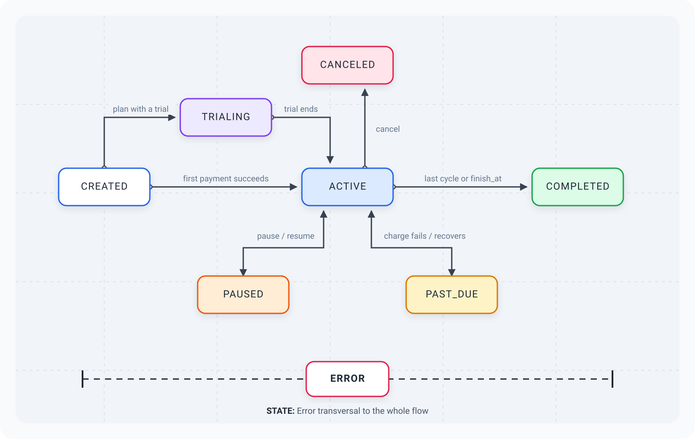

El servicio de suscripciones de Yuno te permite gestionar pagos recurrentes y automatizar la facturación de suscripciones para tus clientes.

<Note>
**Suscripciones vs Stored Credentials**

* **Suscripciones** (esta página): el motor de recurrencia de Yuno. Proporcionas las instrucciones y la frecuencia una sola vez, y Yuno envía automáticamente las transacciones en tu nombre.
* **Stored Credentials**: tú controlas la recurrencia. Eres responsable de enviar cada transacción según tu propio calendario. Consulta [Stored Credentials](/es/docs/payment-features/stored-credentials).
</Note>

## Suscripciones de Yuno {#yuno-subscriptions}

Una suscripción en el entorno de Yuno puede pasar por varias etapas, empezando por su estado de creación. Cuando se crea una suscripción, recibe automáticamente el estado **CREATED**. Sin embargo, es un estado transitorio que permanece activo mientras el pago no se procesa. Después, la suscripción pasará a **ACTIVE** o **CANCELED**, según la confirmación del pago.

Cuando se confirma el pago relacionado con la suscripción, el estado de la suscripción cambia a **ACTIVE**, o a **TRIALING** si comienza dentro de la fase de prueba de un plan, que pasa a **ACTIVE** por sí sola cuando termina la prueba. Permanece activa mientras la suscripción esté dentro de su rango de fechas de disponibilidad y el cliente pague las facturas. Desde ahí puede cambiar a cuatro estados distintos:

* **COMPLETED**: se alcanzó la fecha de finalización de la suscripción. En este caso, la suscripción actual termina y no es posible reactivarla. Si tu cliente quiere seguir usando tu producto o servicio mediante pagos recurrentes, debes crear una nueva suscripción.
* **PAUSED**: en cualquier momento puedes pausar la suscripción. Usa esta opción, por ejemplo, si tu cliente se retrasó en un pago. Siempre puedes activar una suscripción pausada.
* **PAST_DUE**: un cobro recurrente falló y la suscripción está a la espera de recuperación. Sigue facturando, y el siguiente cobro exitoso la devuelve al estado del que venía. Este estado se habilita por cuenta: donde no está habilitado, un cobro fallido deja la suscripción activa mientras se ejecutan los reintentos.
* **CANCELED**: si tu cliente decide cancelar el pago recurrente, puedes cancelar la suscripción. Después de cancelarla, la suscripción termina y no es posible reactivarla.

<Frame>
  
</Frame>

Una suscripción en fase de prueba se comporta como una activa: se puede pausar, entra en `PAST_DUE` cuando un cobro falla y vuelve a `TRIALING` cuando un cobro posterior es exitoso. Cualquier estado no terminal se puede cancelar, y una suscripción creada con `initial_payment_validation: true` pasa directamente de `CREATED` a `CANCELED` si el primer pago falla.

Obtén más información sobre el estado de la suscripción en la página [Estado de la suscripción](/reference/subscriptions/status-subscriptions).

## Integración de suscripciones {#subscription-integration}

Para empezar a usar la función de suscripciones, necesitas una cuenta de Yuno y la integración con la API de Yuno. La API de Yuno ofrece las siguientes operaciones para gestionar tus suscripciones:

* **Crear**: usa el [endpoint Create a Subscription](/reference/subscriptions/create-subscription) para suscribir a un cliente.
* **Crear con el primer pago**: envía un bloque `subscription` en [Create Payment](/es/reference/payments/create-payment) para cobrar al cliente y crear la suscripción en una sola llamada. Consulta [Inicia una suscripción con el primer pago](/es/docs/payment-features/subscriptions/start-with-payment).
* **Pausar**: pausa una suscripción activa con el [endpoint Pause Subscription](/reference/subscriptions/pause-subscription).
* **Reanudar**: reanuda una suscripción pausada previamente con el [endpoint Resume Subscription](/reference/subscriptions/resume-subscription).
* **Cancelar**: cancela una suscripción activa con el [endpoint Cancel Subscription](/reference/subscriptions/cancel-subscription).
* **Consultar**: usa el [endpoint Retrieve Subscription](/reference/subscriptions/retrieve-subscription) para obtener los detalles de una suscripción.
* **Listar**: usa el [endpoint List Subscriptions](/reference/subscriptions/list-subscriptions) para recorrer las suscripciones de una cuenta, filtradas por cliente, estado, plan, fecha de creación o tipo de método de pago.
* **Mantener un motor de facturación externo**: si Stripe Billing ya gestiona tus planes, facturas y cobranza, Yuno puede procesar cada cobro mientras Stripe sigue siendo el motor de suscripciones. Consulta [Procesa suscripciones de Stripe Billing con Yuno](/es/docs/payment-features/subscriptions/stripe-billing).

## Nuevos conceptos {#new-concepts}

* **Suscripciones**: una suscripción implica cobros recurrentes vinculados directamente a un cliente y a un método de pago concreto. Al detenerla o actualizarla, el impacto recae únicamente en ese mismo método de pago.
* **Métodos de pago disponibles**
  * **Inscrito**: los clientes pueden pagar con un método de pago inscrito previamente. Solo se necesita el token almacenado en la bóveda al crear la suscripción para asociarlo con los cobros.
* **Capacidades**:
  * **Frecuencia**: define la frecuencia con la que ocurrirán los cobros de la suscripción (diaria, semanal, mensual o anual; consulta [Create Subscription](/reference/subscriptions/create-subscription) para ver los valores que acepta cada endpoint), especificando el monto que se debe cobrar en el siguiente ciclo de facturación.
  * **Ciclos de facturación**: el número de ciclos de facturación (según el criterio de frecuencia) que se completarán para cumplir la suscripción. Si no se envía ni se define un `end_date`, seguiremos intentando los cobros hasta que se detenga.
  * **Fecha de facturación**: al especificar el objeto `billing_date`, el comercio puede definir la lógica de la fecha exacta de facturación de la suscripción. Es mutuamente excluyente con el objeto de frecuencia.
  * **Disponibilidad**: las fechas de inicio y fin de la suscripción. Si no se definen, ni tampoco los ciclos de facturación, los cobros continuarán hasta que se detenga.
    * Los campos `billing_cycles` y `availability.finish_at` se afectan mutuamente. Si ambos se completan durante la creación de la suscripción, esta pasará al estado COMPLETED al alcanzar el evento más cercano definido en estos campos, ya sea el ciclo de facturación o el `finish_at` correspondiente.
  * **Períodos de prueba**: esta función te permite definir un período en el que tus clientes pueden beneficiarse de un monto reducido. Puede ser parcial o total (por ejemplo, una prueba gratuita). Debes determinar el valor que se reducirá del monto total de cada cobro de la suscripción y los ciclos de facturación a los que se aplicará.
  * **Validación del pago inicial**: un indicador para identificar si la suscripción debe esperar el primer pago para continuar. Es falso por defecto. Si el campo se establece en true, la suscripción debe permanecer en el estado CREATED mientras espera el primer pago de la suscripción.
    * Si el primer pago es exitoso (SUCCEEDED), la suscripción pasa a ACTIVE.
    * Si el primer pago falla (DECLINED/REJECTED), la suscripción pasa a CANCELED.

## Uso de la solución de suscripciones de Yuno {#using-yuno-subscription-solution}

Yuno ofrece funciones de gestión de suscripciones a través de su API. Puedes usar esta API para crear, actualizar y gestionar suscripciones, así como para consultar los detalles y el uso de las suscripciones.

Para usar la solución de suscripciones, normalmente seguirás los pasos que se describen a continuación:

1. Para empezar, [crea un cliente](/es/reference/customers/create-customer). Deberás proporcionar la información personal del cliente y el `merchant_customer_id`, un identificador único del cliente usado en tu sistema. Al completar el proceso de creación del cliente, recibirás un `id` que identifica al usuario dentro del sistema de Yuno. Este `id` se usará para crear la suscripción.
2. Después de crear el cliente, deberás [inscribir una tarjeta de crédito](/es/docs/payment-features/enrollment/enroll-payment-methods) para generar un `vaulted_token` que usarás en la creación de la suscripción.
3. [Crea una suscripción](/reference/subscriptions/create-subscription) para tu cliente y la tarjeta inscrita. En este paso, configurarás la suscripción y definirás el método de pago. Al crear la suscripción, puedes personalizar:
   * El monto que cobra la suscripción.
   * La frecuencia de facturación: diaria, semanal, mensual o anual (consulta [Create Subscription](/reference/subscriptions/create-subscription) para ver los valores que acepta cada endpoint).
   * El número total de ciclos de facturación.
   * La disponibilidad de la suscripción para definir la fecha de inicio y de fin.

<Note>
**También puedes hacerlo en una sola llamada**

Los pasos anteriores llevan al cliente por la inscripción y la creación de la suscripción por separado. Si el cliente se registra y paga en ese momento, puedes enviar las instrucciones de recurrencia en el propio pago: Yuno cobra la tarjeta y crea la suscripción a partir de ese mismo cobro, y nada empieza a facturarse si el pago falla. Esa ruta está documentada solo para pagos con tarjeta sin fricción. Consulta [Inicia una suscripción con el primer pago](/es/docs/payment-features/subscriptions/start-with-payment).
</Note>

<Note>
**Métodos de pago disponibles**

Las suscripciones admiten `CARD`, `PAYPAL_ENROLLMENT` y `PIX_AUTOMATIC` como métodos de pago, los tres mediante instrumentos inscritos previamente (almacenados en la bóveda).

`PIX_AUTOMATIC` factura un mandato de Pix Automático de Brasil. La red restringe su uso a facturación semanal, mensual, trimestral, semestral o anual con un valor de frecuencia de `1`, y Yuno entrega cada instrucción de débito a la red cuatro días antes de la fecha del débito, por lo que no factura como una tarjeta. Consulta [Pix Automático](/es/docs/payment-features/subscriptions/pix-automatico).
</Note>

<Danger>
**Pagos rechazados**

Si un pago de una suscripción creada con [Create Subscription](/reference/subscriptions/create-subscription) es rechazado (incluido el primer intento de pago), la suscripción continuará su calendario para futuros intentos de pago, lo que da al comercio la posibilidad de cobrar al cliente el monto pendiente mediante otro proceso y continuar con la suscripción en curso. Si quieres cancelar una suscripción, puedes usar el [endpoint cancel subscription](/reference/subscriptions/cancel-subscription).

En la ruta de una sola llamada, un primer cobro rechazado no crea ninguna suscripción. Consulta [Inicia una suscripción con el primer pago](/es/docs/payment-features/subscriptions/start-with-payment).
</Danger>

En la respuesta del endpoint [Create Subscription](/reference/subscriptions/create-subscription), recibes un `id` que se usa para identificar la suscripción creada. Usarás el `id` si decides pausar, reanudar o cancelar la suscripción. Si creaste la suscripción con el primer pago, el mismo identificador vuelve como `subscription_code` en la respuesta del pago.

## Eventos de renovación {#renewal-events}

`subscription.active` se envía cuando la suscripción pasa a estar activa por primera vez (en `billing_cycles.current` = 2); no se reenvía en las renovaciones posteriores. Haz seguimiento de cada renovación mediante el webhook `payment.purchase` de cada ciclo (el resultado está en `status`/`sub_status`). Los ciclos de `$0` o de prueba no generan webhook de pago por diseño; en las suscripciones basadas en planes se informan como `subscription.cycle_executed`.

Un cobro de renovación fallido también emite `subscription.past_due` donde ese estado está habilitado para la cuenta, y `subscription.active` (o `subscription.trialing`) de nuevo cuando un cobro posterior recupera la suscripción. Consulta [Webhooks](/docs/webhooks#subscription-events) para ver la lista completa de eventos.

<Note>
**Correspondencia entre `code` e `id`**

Los payloads de los webhooks de suscripción usan `code`, mientras que la API usa `id`, y son los mismos valores: `subscription.code` es igual al `id` devuelto por `POST /v1/subscriptions`, y `customer_payer.code` es igual al `id` del cliente.
</Note>