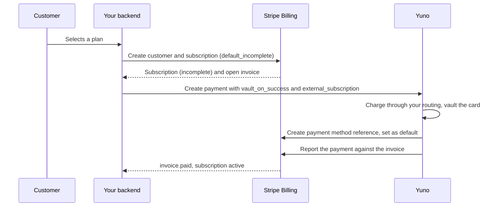
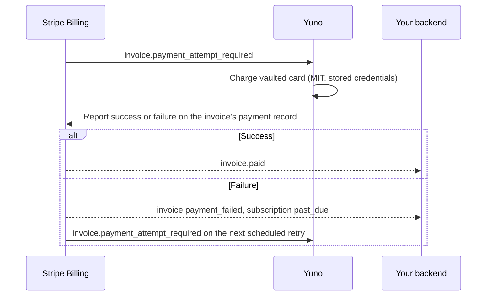

Stripe Billing sigue siendo tu sistema de registro para planes, suscripciones, facturas, impuestos y prorrateo. Yuno ejecuta cada pago de la suscripción: el primer cobro, cada renovación, cada reintento y cada reembolso. Yuno también realiza las llamadas a la API de Stripe que informan cada resultado, por lo que tu backend no llama a las API de registro de pagos de Stripe.

## Antes de empezar {#before-you-start}

Revisa estos puntos según tu caso de uso antes de integrar:

* **Cuenta de Stripe.** Billing debe tener habilitado el **procesamiento de pagos de terceros**. Solicítalo a tu equipo de cuenta de Stripe.
* **Países.** Tu negocio y tus proveedores de pago deben estar en países que Stripe admita para este modo. Consulta los [países admitidos](https://docs.stripe.com/billing/subscriptions/third-party-payment-processing#supported-countries) de Stripe.
* **Checkout.** Los clientes pagan a través de tu checkout de Yuno. Stripe Checkout, la página de factura alojada por Stripe y las tablas de precios de Stripe integradas no funcionan en este modo.
* **Emails a clientes.** Stripe no envía sus emails de recuperación de ingresos para estos pagos. Tú envías los emails de pago fallido y de actualización de tarjeta desde tus propios sistemas.
* **Reintentos.** Stripe Smart Retries no está disponible. En su lugar, configuras un calendario de reintentos personalizado o automatizaciones de Billing.
* **Disputas y reembolsos.** Gestionas ambos en Yuno. Stripe no puede iniciar un reembolso ni gestionar una disputa de un pago que no procesó.
* **Tarifas.** Stripe cobra tarifas de Billing sobre el volumen que procesa Yuno. Consulta [Tarifas de Billing](#billing-fees).
* **Facturas.** Yuno cobra las facturas de las suscripciones de Stripe Billing. Si Stripe pide a Yuno cobrar una factura que no tiene suscripción, Yuno no la cobra y no informa nada a Stripe. Para cobrar una factura única con Yuno, crea el pago tú mismo con el objeto `external_invoice`. Consulta [Pagar una factura de Stripe (recargas)](/es/docs/payment-features/subscriptions/stripe-billing-top-ups).

## Quién hace qué {#who-does-what}

| Área | Stripe Billing | Tu backend | Yuno |
| --- | --- | --- | --- |
| Planes, precios, impuestos, prorrateo | Es responsable | Configura | Ninguna |
| Ciclo de vida de la suscripción y de la factura | Es responsable | Lee webhooks para los derechos de acceso | Ninguna |
| Calendario de reintentos | Lo ejecuta | Lo configura | Ejecuta cada intento |
| Primer pago | Espera el informe | Crea el pago en Yuno con `external_subscription` | Cobra, almacena en bóveda e informa a Stripe |
| Renovaciones | Envía `invoice.payment_attempt_required` | Nada | Cobra como transacción iniciada por el comercio e informa a Stripe |
| Referencia del método de pago en Stripe | La almacena | Nada | La crea y la establece como predeterminada |
| Reembolsos | Registra el reembolso y la nota de crédito | Inicia el reembolso en Yuno | Reembolsa, informa a Stripe y crea la nota de crédito |
| Disputas | Ninguna | Las gestiona en Yuno | Las recibe del proveedor |
| Emails de cobro de deuda y flujo de actualización de tarjeta | Ninguna | Es responsable | Almacena en bóveda la nueva tarjeta y actualiza Stripe |

Para cobrar el pago de una factura específica de Stripe, como una recarga de saldo, consulta [Pagar una factura de Stripe (recargas)](/es/docs/payment-features/subscriptions/stripe-billing-top-ups).

## Cómo funciona {#how-it-works}

El modo de [procesamiento de pagos de terceros](https://docs.stripe.com/billing/subscriptions/third-party-payment-processing) de Stripe permite que un procesador externo ejecute los cobros de las suscripciones de Billing. Yuno es ese procesador.

### Registro y primer pago {#signup-and-first-payment}



### Renovaciones y reintentos {#renewals-and-retries}



Tu backend sigue escuchando los webhooks de Stripe que usa hoy (`invoice.paid`, `customer.subscription.updated` y otros) para los derechos de acceso.

Del lado de Yuno, cada pago creado de esta forma incluye el objeto `external_subscription` en su webhook de pago, para que puedas relacionar un pago de Yuno con una suscripción de Stripe. Consulta [Objeto y ejemplos](/es/docs/webhooks/object-and-examples). Las inscripciones de prueba son la excepción: el webhook de inscripción no incluye el objeto, así que correlaciona mediante el pago de verificación (`verify.payment.id` en la respuesta de la inscripción).

## Requisitos previos {#prerequisites}

* Una cuenta de Yuno con tus proveedores conectados y el enrutamiento publicado.
* Una cuenta de Stripe con Billing y el procesamiento de pagos de terceros habilitados.
* Una **clave de API restringida** de tu cuenta de Stripe, compartida con tu contacto en Yuno durante el onboarding. Yuno la usa para registrar el endpoint de webhook e informar los pagos. Yuno la almacena cifrada y la usa solo para tu cuenta.
* Un **método de pago personalizado** que creas en el Stripe Dashboard, en **Settings → Payment methods → Custom payment methods**. Envía su ID (empieza con `cpmt_`) a tu contacto en Yuno junto con la clave restringida. Yuno lo verifica cuando haces el onboarding y lo usa para los pagos de suscripción de cada método de pago que no tenga un método de pago personalizado propio. Para PayPal, consulta [PayPal](#paypal).

### Permisos de la clave restringida {#restricted-key-permissions}

Da a la clave restringida estos permisos para los pagos de suscripción, renovaciones, reembolsos y cambios de tarjeta. **Write** incluye **Read**. Los nombres de los permisos de Stripe provienen de la [referencia de permisos de API](https://docs.stripe.com/keys/permissions-reference) de Stripe.

| Permiso | Nivel | Permiso de Stripe | Qué hace Yuno con él |
| --- | --- | --- | --- |
| Webhook Endpoints | Write | `webhook_write` | Registra el endpoint de webhook cuando haces el onboarding. |
| Accounts | Read | `connected_account_read` | Lee tu cuenta cuando haces el onboarding. |
| Payment Methods | Write | `payment_method_write` | Verifica tu método de pago personalizado cuando haces el onboarding, luego crea la referencia del método de pago y la asocia al cliente. |
| Subscriptions | Write | `subscription_write` | Lee la suscripción y establece su método de pago predeterminado. |
| Invoices | Write | `invoice_write` | Lee la factura y le asocia cada pago. |
| Payment Records | Write | `payment_records_write` | Informa pagos, reintentos y reembolsos. |
| Credit Notes | Write | `credit_note_write` | Crea la nota de crédito de cada reembolso. |

El onboarding usa solo los tres primeros. Los demás se usan por primera vez cuando Yuno informa un pago o un reembolso, así que un permiso faltante aparece solo entonces, como un informe que falla. Configura todos antes de compartir la clave.

### Eventos de webhook {#webhook-events}

Cuando haces el onboarding, Yuno registra un endpoint de webhook en tu cuenta de Stripe. Recibe dos eventos:

* `invoice.payment_attempt_required`: Stripe pide a Yuno cobrar una factura.
* `customer.subscription.deleted`: la suscripción terminó, por lo que Yuno deja de cobrarla.

Yuno ignora cualquier otro evento. No elimines el endpoint ni quites estos eventos: Yuno se entera de las renovaciones y los reintentos solo a través de ellos.

## Paso 1: Crea la suscripción en Stripe {#step-1-create-the-subscription-in-stripe}

Crea el cliente y la suscripción en Stripe como lo haces hoy, con `payment_behavior: default_incomplete`. Expande `latest_invoice` en la misma llamada: necesitas su `amount_due` y `currency` en el paso 2. Conserva los IDs de `customer` y `subscription`.

<Warning>
  Crea la suscripción al momento del checkout y cobra el pago en la misma sesión. Stripe exige que el primer pago se informe dentro de las **23 horas** posteriores a la creación de la suscripción. Pasado ese plazo, Stripe mueve la suscripción a `incomplete_expired` y tienes que crearla de nuevo.
</Warning>

## Paso 2: Cobra el primer pago con Yuno {#step-2-collect-the-first-payment-with-yuno}

Ejecuta tu checkout normal de Yuno y crea el pago desde tu backend con dos adiciones: `vault_on_success` y el objeto `external_subscription` que vincula el pago con tu suscripción de Stripe. Consulta [Crear pago](/es/reference/payments/create-payment).

```json
{
  "account_id": "<your_account_id>",
  "merchant_order_id": "<your_order_id>",
  "description": "Pro plan, first month",
  "country": "US",
  "amount": { "currency": "USD", "value": 99.00 },
  "customer_payer": { "id": "<yuno_customer_id>" },
  "payment_method": {
    "type": "CARD",
    "token": "<one_time_token_from_sdk>",
    "vault_on_success": true
  },
  "external_subscription": {
    "id": "sub_1QwZzz",
    "customer_id": "cus_RplXYZ"
  }
}
```

### Haz coincidir el monto con la factura {#match-the-amount-to-the-invoice}

Cobra el `amount_due` de la factura, en la moneda de la factura. `amount_due` ya incluye impuestos, descuentos y prorrateo. Si el monto o la moneda del pago difieren de los de la factura, Yuno no informa el pago: se cobra al cliente y la factura queda abierta.

Stripe y Yuno formatean los montos de forma distinta, así que convierte ambos campos:

| Campo | Factura de Stripe | Pago en Yuno |
| --- | --- | --- |
| Monto | Unidades menores: `9900` | Valor decimal: `99.00` |
| Moneda sin decimales (por ejemplo JPY) | `1000` | `1000` |
| Moneda | Minúsculas: `usd` | ISO 4217 en mayúsculas: `USD` |

### Campos de la solicitud {#request-fields}

| Campo | Obligatorio | Notas |
| --- | --- | --- |
| `external_subscription.id` | Sí | El ID de la suscripción en Stripe (`sub_...`). De 3 a 255 caracteres. |
| `external_subscription.customer_id` | No | El cliente de Stripe propietario de la suscripción (`cus_...`). |
| `payment_method.vault_on_success` | Para renovaciones | Yuno se encarga de los cobros recurrentes solo cuando el pago es aprobado **y** la tarjeta se almacena en bóveda. |

<Warning>
  `external_subscription` y el objeto `subscription` son mutuamente excluyentes: enviar ambos devuelve `INVALID_REQUEST`. Usa `subscription` cuando Yuno es el motor de recurrencia, y `external_subscription` cuando lo es Stripe.
</Warning>

Cuando el pago es aprobado, Yuno crea una referencia del método de pago en tu cuenta de Stripe (sin datos de tarjeta), la asocia a la suscripción como su método de pago predeterminado e informa el pago. Luego Stripe marca la primera factura como pagada y activa la suscripción.

### Si falla el informe a Stripe {#if-the-report-to-stripe-fails}

Yuno cobra primero e informa a Stripe después. Un informe que falla nunca deshace el pago: permanece aprobado en Yuno, y Yuno no lo cancela ni lo reembolsa.

* **Reintentos.** Cuando no se puede contactar a Stripe o este devuelve un error, Yuno reintenta el informe por su cuenta, con esperas crecientes, durante un tiempo limitado, y luego se detiene. Yuno no reintenta el informe de un primer pago que Stripe rechaza como inválido, o cuyo monto no es el `amount_due` de la factura. Hasta que se entregue un informe, la factura permanece abierta en Stripe. En el caso de un primer pago, la suscripción también permanece `incomplete`, y Stripe la expira 23 horas después de que la creaste.
* **Antes del informe.** En el caso de un primer pago, Yuno primero crea la referencia del método de pago en Stripe y la establece como predeterminada de la suscripción. Si eso falla, Yuno reintenta durante unos segundos y luego se detiene: no informa nada y no vincula la tarjeta a la suscripción.
* **Sin notificación.** Yuno no te notifica cuando falla un informe. La señal es una factura que permanece abierta en Stripe después de que el pago en Yuno fue aprobado. Si ves una, contacta a tu contacto en Yuno.

Una clave restringida revocada, o sin un permiso que Yuno necesita, hace que los informes fallen mientras los pagos se siguen cobrando. Para cambiar la clave, envía primero la nueva a tu contacto en Yuno, y revoca la anterior solo después de que Yuno confirme el cambio.

### Pagos pendientes {#pending-payments}

Yuno informa un primer pago a Stripe solo cuando es aprobado. Mientras está pendiente, y si termina rechazado, expirado o cancelado, Yuno no informa nada a Stripe y la factura permanece abierta.

Una renovación que queda pendiente se informa a Stripe de inmediato, como un intento sin resultado. Cuando el pago es aprobado, Yuno lo informa como pagado. Si la renovación pendiente termina rechazada, expirada o cancelada, Yuno no informa ese resultado y no cobra las solicitudes posteriores que Stripe envíe para esa factura. Si una factura permanece abierta con un intento pendiente, contacta a tu contacto en Yuno.

### Si no se puede crear la suscripción {#if-the-subscription-cannot-be-created}

Un primer pago puede terminar en `SUCCEEDED` sin una suscripción de Stripe detrás. Yuno capturó el dinero, pero no pudo crear ni activar la suscripción en Stripe. Esto ocurre, por ejemplo, cuando al pago le faltan datos que la suscripción necesita, cuando la cotización de impuestos expiró o no se calcularon los impuestos, o cuando un objeto de Stripe que la suscripción necesita ya no existe. Yuno no reembolsa el pago por su cuenta.

Yuno informa cada uno de estos casos una vez, con el webhook [`subscription.creation_failed`](/es/docs/webhooks/object-and-examples#subscription-creation_failed). Su `data` incluye el `payment_id`, el `external_subscription` que enviaste, un `dead_letter_kind` que nombra la causa, un `reason` legible por personas y `occurred_at`. Para recibirlo, agrega `CREATION_FAILED` a los `subscription_triggers` de tu webhook. Consulta [Eventos de webhook](/es/docs/webhooks/events#subscription).

Cuando llegue el evento, haz una de estas cosas:

* **Corrige la causa y reintenta.** Usa `dead_letter_kind` para encontrar qué falló, corrígelo (por ejemplo, solicita una nueva cotización de impuestos o vuelve a crear el objeto de Stripe faltante) y ejecuta el registro de nuevo con un pago nuevo. Reembolsa el pago original para que el cliente no pague dos veces.
* **Reembolsa.** Si no vas a reintentar, [reembolsa](/es/reference/payments/refund-payment) el pago para que no se cobre al cliente una suscripción que no tiene.

## Pruebas gratuitas {#free-trials}

Cuando el registro inicia con una **prueba**, no hay primer cobro. En su lugar, el disparador es la **verificación de tarjeta de $0** del flujo de inscripción. Crea la suscripción de Stripe con `trial_end` como de costumbre, luego inscribe la tarjeta mediante el endpoint [Inscribir método de pago](/reference/payment-methods-direct-workflow/enroll-payment-method-api) con el objeto `external_subscription` anidado dentro de `verify`:

```json
{
  "account_id": "<your_account_id>",
  "country": "US",
  "type": "CARD",
  "workflow": "DIRECT",
  "card_data": { "...": "..." },
  "verify": {
    "vault_on_success": true,
    "currency": "USD",
    "external_subscription": {
      "id": "sub_1QwZzz",
      "customer_id": "cus_RplXYZ"
    }
  }
}
```

<Info>
  Usa la moneda de la suscripción para la verificación. Las renovaciones se cobran en la moneda de la suscripción.
</Info>

<Warning>
  `verify.vault_on_success` debe ser `true`. Enviar `verify.external_subscription` sin él devuelve `INVALID_PARAMETERS`.
</Warning>

Cuando la verificación es exitosa, Yuno vincula la tarjeta almacenada en bóveda con la suscripción en prueba: su `default_payment_method` en Stripe pasa a ser la referencia de Yuno. No se cobra ni se informa nada, porque no hay ninguna factura pendiente. Al terminar la prueba, Stripe emite la primera factura real y Yuno la cobra con credenciales almacenadas conformes con las redes, como cualquier renovación.

## Renovaciones {#renewals}

Las renovaciones no requieren código de tu parte. Stripe finaliza la factura y envía `invoice.payment_attempt_required`. Yuno cobra la tarjeta almacenada en bóveda como una transacción iniciada por el comercio, a través de tu enrutamiento y cascada de proveedores, e informa el resultado. Cada cobro aparece como un pago normal en tu dashboard de Yuno y en los reportes.

Yuno cobra cada solicitud de Stripe una sola vez. Si Stripe envía el mismo evento de nuevo, Yuno lo ignora. Si Stripe envía una nueva solicitud para una factura que ya está pagada, o cuyo cobro sigue en curso, Yuno tampoco la cobra de nuevo. Una nueva solicitud para una factura cuyo último cobro fue rechazado es el siguiente reintento, y Yuno la cobra.

## Pagos fallidos y reintentos {#failed-payments-and-retries}

Cuando Yuno informa una renovación fallida, la factura permanece abierta y Stripe mueve la suscripción a `past_due`. Luego Stripe envía un nuevo evento `invoice.payment_attempt_required` en cada reintento programado, y Yuno ejecuta cada reintento a través de tu enrutamiento y cascada de proveedores. Yuno informa cada reintento contra el registro de pago existente de la factura.

Configura los reintentos en Stripe con un [calendario de reintentos personalizado](https://dashboard.stripe.com/revenue-recovery/retries) o [automatizaciones de Billing](https://docs.stripe.com/billing/automations). Los Smart Retries y los emails de recuperación de Stripe no funcionan en el modo de procesamiento de terceros. Ambas son limitaciones de Stripe, ajenas a los [Smart Retries](/es/docs/payment-features/subscriptions/retries) de Yuno, que se aplican a las suscripciones gestionadas por Yuno.

### Rechazos definitivos y temporales {#hard-and-soft-declines}

Un calendario de reintentos personalizado se ejecuta igual para cada factura fallida. Stripe no ve el motivo del rechazo, así que una tarjeta robada o una cuenta cerrada recibe los mismos reintentos que unos fondos insuficientes. Las redes de tarjetas limitan los reintentos en rechazos que no pueden tener éxito, y los reintentos repetidos sobre ellos pueden generar tarifas de red adicionales.

Mantén el calendario de reintentos corto, y cancela la suscripción o marca la factura como `uncollectible` cuando el motivo del rechazo en Yuno muestre que un reintento no puede tener éxito.

Yuno no clasifica los rechazos como definitivos o temporales, y un intento fallido llega a Stripe sin motivo ni código: solo que falló, y cuándo. Yuno tampoco omite un reintento después de un rechazo: cobra cada reintento que Stripe pide. Detener los reintentos depende de ti, a partir del motivo del rechazo en Yuno.

### Detecta el último intento {#detect-the-final-attempt}

Stripe no tiene un evento dedicado de "reintentos agotados". Considera un fallo como final cuando:

1. Tu backend recibe `invoice.payment_failed`, o `invoice.updated` cuando usas automatizaciones, y
2. El `next_payment_attempt` de la factura es `null`.

Entonces la suscripción pasa al estado definido en tu configuración de reintentos de Stripe (cancelada, impaga o vencida). Inicia tu propio flujo de cobro de deuda desde este punto.

<Warning>
  Stripe no envía `invoice.payment_attempt_required` mientras una factura tenga `auto_advance` en `false`. Una factura así nunca llega a Yuno: no se cobra nada y no hay ningún error. Vuelve a poner `auto_advance` en `true` para reanudar el cobro.
</Warning>

## Cambia la tarjeta del cliente {#change-the-customers-card}

Usa este flujo para cambiar la tarjeta de una suscripción, incluida una `past_due`:

<Steps>
  <Step title="Lleva al cliente de vuelta a tu checkout de Yuno">
    Envía al cliente a tu propia página de actualización de tarjeta. Stripe no envía este email por ti.
  </Step>
  <Step title="Cobra un nuevo pago o una verificación">
    Crea una verificación, como en una [prueba gratuita](#free-trials), o un pago, con el mismo `external_subscription.id` y `vault_on_success: true`. Una verificación cambia la tarjeta sin cobrar al cliente.
  </Step>
  <Step title="Yuno cambia el valor predeterminado en Stripe">
    Yuno almacena en bóveda la nueva tarjeta y la establece como método de pago predeterminado de la suscripción en Stripe. Las renovaciones continúan con la nueva tarjeta.
  </Step>
</Steps>

<Warning>
  Un pago en este flujo solo cambia la tarjeta. Yuno no lo aplica a la factura abierta, incluso cuando la suscripción está `past_due`, y no lo informa a Stripe. Stripe reintenta la factura según su propio calendario, y Yuno cobra la nueva tarjeta en ese reintento. No cobres el monto adeudado en este pago: el cliente pagaría dos veces. Para cobrar la factura abierta de inmediato, págala con `external_invoice`. Consulta [Pagar una factura de Stripe (recargas)](/es/docs/payment-features/subscriptions/stripe-billing-top-ups).
</Warning>

### Cambia a un método de pago que el cliente ya inscribió {#switch-to-a-payment-method-the-customer-already-enrolled}

Si el cliente ya tiene otro método de pago almacenado en bóveda en Yuno, puedes mover la suscripción a ese método sin llevar al cliente de vuelta al checkout. Llama a [Cambiar el método de pago de una suscripción externa](/reference/subscriptions/change-external-subscription-payment-method) con el ID de la suscripción de Stripe en la ruta, y envía el ID de cliente de Yuno en `customer_payer.id` (no el ID `cus_` de Stripe) y el nuevo `vaulted_token`.

No se realiza ningún pago: Yuno no cobra al cliente y no ejecuta una verificación de $0 ni 3DS. Yuno establece el nuevo método de pago como predeterminado de la suscripción en Stripe, y las próximas renovaciones lo cobran. Si Stripe no confirma el cambio, la suscripción conserva su método de pago anterior y la API devuelve `502` `BILLING_PLATFORM_ERROR`: reintenta con un nuevo `X-Idempotency-Key`.

Esta API se habilita por cuenta. Contacta a tu Key Account Manager para solicitar acceso.

## Portal del cliente {#customer-portal}

El portal del cliente de Stripe funciona con estas suscripciones. Los clientes pueden actualizar la suscripción, cambiar de método de pago, establecer un método de pago predeterminado y cancelar.

<Warning>
  El portal permite a los clientes cambiar a un **método de pago admitido por Stripe**. Stripe procesa ese método de pago por sí mismo, por lo que las renovaciones de la suscripción dejan de pasar por Yuno. Para mantener cada renovación en Yuno, desactiva las actualizaciones del método de pago en la [configuración de tu portal](https://dashboard.stripe.com/settings/billing/portal) y envía a los clientes a tu página de actualización de tarjeta de Yuno.
</Warning>

El portal tampoco puede agregar un descuento a una suscripción con un método de pago personalizado cuando el comportamiento de prorrateo de la sesión del portal es `always_invoice`.

## Qué ves en Stripe {#what-you-see-in-stripe}

Dos cosas en el dashboard de Stripe parecen incorrectas y no lo son:

* **Un pago cancelado en cada factura.** Stripe crea su propio PaymentIntent para cada factura `charge_automatically` y lo cancela una vez que Yuno informa el pago. Cada factura incluye una entrada `Canceled` junto a la de Yuno. Stripe documenta esto como comportamiento esperado. No cambia ni la factura ni el estado de la suscripción.
* **Una entrada de pago por factura, no una por intento.** Yuno informa cada reintento contra el registro de pago existente. Una factura recuperada muestra un pago con el historial de sus intentos, no una entrada fallida más una exitosa.

Si está habilitado para tu organización, el `metadata` que envías también se copia a los registros de pago de Stripe. Consulta [Los metadatos de tu pago en el registro de pago de Stripe](/es/docs/payment-features/subscriptions/stripe-billing-top-ups#your-payment-metadata-on-the-stripe-payment-record).

## Reembolsos {#refunds}

Reembolsa a través de la API o del dashboard de Yuno como con cualquier pago. Yuno informa el reembolso a Stripe y crea la **nota de crédito** correspondiente, para que tus registros de Stripe se mantengan consistentes. Se admiten reembolsos totales y parciales. Para los pagos realizados con `external_invoice` (recargas), consulta [Reembolsos](/es/docs/payment-features/subscriptions/stripe-billing-top-ups#refunds).

## Disputas {#disputes}

Stripe no puede gestionar disputas de pagos que no procesó. Un contracargo en uno de estos pagos te llega a través del proveedor de Yuno que procesó el cobro, y lo gestionas en Yuno. Consulta [Gestión de contracargos](/es/docs/payouts-and-disputes/chargeback-management).

## Tarifas de Billing {#billing-fees}

Stripe cuenta el volumen que procesa Yuno dentro de tu volumen total de Stripe Billing y lo cobra según tu contrato de Billing. Las facturas únicas pagadas a través de un procesador de terceros también se facturan según los precios de Invoicing de Stripe.

## Prueba en sandbox {#test-in-sandbox}

* **Vincula tu sandbox.** Haz el onboarding de tu cuenta sandbox de Yuno con una clave restringida y un ID de método de pago personalizado del modo de prueba de Stripe. Yuno los gestiona, y las facturas de los test clocks de Stripe, igual que las de producción.
* **Registro y renovaciones.** Crea la suscripción en un [test clock](https://docs.stripe.com/billing/testing/test-clocks) de Stripe, paga la primera factura a través de tu checkout sandbox de Yuno y luego avanza el reloj más allá de la fecha de renovación. Verifica que aparezca un nuevo pago en Yuno y que la factura esté pagada en Stripe.
* **Reintentos.** Usa una tarjeta de prueba de Yuno que rechace, luego avanza el reloj más allá de `next_payment_attempt`. Si el evento de reintento no llega, avanza el reloj de nuevo aproximadamente un minuto.
* **Cobro de deuda en tiempo real.** Para validar el cobro de deuda tal como opera producción, crea una suscripción sin test clock con un calendario de reintentos personalizado corto y déjala correr.

## Lista de verificación de integración {#integration-checklist}

<Steps>
  <Step title="Stripe: habilita el procesamiento de pagos de terceros">
    Pídelo a tu equipo de cuenta de Stripe y confirma que el país de tu negocio esté admitido.
  </Step>
  <Step title="Onboarding de Yuno: comparte una clave de API restringida de Stripe y un ID de método de pago personalizado">
    Da a la clave los [permisos que Yuno necesita](#restricted-key-permissions) y envía ambos a tu contacto en Yuno. Yuno registra el endpoint de webhook.
  </Step>
  <Step title="Stripe: configura los reintentos">
    Define un calendario de reintentos personalizado corto o automatizaciones de Billing, y el estado final después del último reintento.
  </Step>
  <Step title="Stripe: restringe el portal del cliente">
    Desactiva las actualizaciones del método de pago para que las renovaciones se mantengan en Yuno.
  </Step>
  <Step title="Backend: crea la suscripción">
    Usa `payment_behavior: default_incomplete` y expande `latest_invoice`.
  </Step>
  <Step title="Backend: crea el primer pago en Yuno">
    Envía `vault_on_success: true`, `external_subscription` y el `amount_due` convertido dentro de las 23 horas.
  </Step>
  <Step title="Backend: gestiona las pruebas gratuitas">
    Inscribe la tarjeta con `verify.external_subscription` para las suscripciones con `trial_end`.
  </Step>
  <Step title="Backend: gestiona el último intento fallido">
    Detecta `next_payment_attempt: null` e inicia tus emails de cobro de deuda y el flujo de actualización de tarjeta.
  </Step>
  <Step title="Prueba en sandbox">
    Cubre el registro, una renovación, una renovación fallida con reintento, un reembolso y una actualización de tarjeta.
  </Step>
</Steps>

## Solución de problemas {#troubleshooting}

| Síntoma | Causa | Solución |
| --- | --- | --- |
| `INVALID_REQUEST` en Crear pago | `external_subscription` y `subscription` enviados en la misma solicitud | Envía solo uno de ellos |
| `INVALID_PARAMETERS` en Inscribir método de pago | `verify.external_subscription` enviado sin `verify.vault_on_success: true` | Establece el indicador en `true` |
| La suscripción permanece `incomplete` y luego pasa a `incomplete_expired` | No se informó ningún pago dentro de las 23 horas posteriores a la creación de la suscripción | Crea la suscripción y cobra el pago en la misma sesión, luego vuelve a crear la expirada |
| Las renovaciones se detienen y no aparece ningún error en ningún lado | La factura tiene `auto_advance: false`, por lo que Stripe nunca envía `invoice.payment_attempt_required` | Vuelve a poner `auto_advance` en `true` |
| Las renovaciones aparecen en Stripe pero no en Yuno | El cliente cambió a un método de pago admitido por Stripe en el portal del cliente | Desactiva las actualizaciones del método de pago en el portal y cobra una nueva tarjeta a través de Yuno |
| Un pago `Canceled` aparece junto a cada pago informado | Stripe cancela su propio PaymentIntent una vez que Yuno informa el pago | Comportamiento esperado, no se requiere ninguna acción |
| Pago aprobado en Yuno, factura aún abierta en Stripe | Yuno no pudo informar el pago: la clave restringida fue revocada o le falta un permiso, Stripe no estaba disponible, o el monto del primer pago no es el `amount_due` de la factura | Contacta a tu contacto en Yuno. Consulta [Si falla el informe a Stripe](#if-the-report-to-stripe-fails) |
| Llega un webhook `subscription.creation_failed` para un pago aprobado | Yuno capturó el pago pero no pudo crear la suscripción de Stripe; `dead_letter_kind` nombra la causa | Corrige la causa y reintenta con un pago nuevo, reembolsando el original, o reembólsalo. Consulta [Si no se puede crear la suscripción](#if-the-subscription-cannot-be-created) |

## PayPal {#paypal}

Puedes cobrar pagos de suscripción con PayPal mediante la integración de Stripe Billing. El primer pago guarda la cuenta de PayPal del cliente, y cada renovación cobra esa cuenta guardada.

PayPal se habilita por organización: tu Technical Account Manager lo activa después de los pasos siguientes.

### Antes de empezar {#before-you-start-1}

Completa estos pasos con tu Technical Account Manager (TAM):

1. **Comparte los datos de tu cuenta de PayPal.** Tanto para sandbox como para producción: tu Merchant ID de PayPal (el payer ID que aparece en tu dashboard de PayPal), la vertical de negocio que PayPal asignó a tu cuenta y si PayPal marca tu cuenta como de alto riesgo. Tu TAM los configura en tu conexión de PayPal en Yuno. Los pagos de suscripción con PayPal no se pueden procesar sin ellos.
2. **Habilita Vault en PayPal.** En las apps de PayPal conectadas a Yuno, sandbox y producción, habilita Vault (guardar métodos de pago). Las renovaciones cobran la cuenta de PayPal guardada, por lo que Vault es obligatorio.
3. **Crea un método de pago personalizado "PayPal" en Stripe.** En el Stripe Dashboard, ve a **Settings → Payment methods → Custom payment methods** y crea uno llamado **PayPal**. Si quieres que los pagos con tarjeta aparezcan como **Card**, crea también uno "Card". Hazlo tanto en modo producción como en modo de prueba, y envía los IDs (empiezan con `cpmt_`) a tu TAM.

Yuno registra estos IDs y ejecuta una prueba en tu sandbox antes de que PayPal se habilite en producción.

### Qué esperar {#what-to-expect}

- Los pagos de suscripción y las renovaciones realizados con PayPal aparecen en Stripe con el nombre de método de pago **PayPal**. Los pagos de recarga aparecen como **Yuno**.
- PayPal no puede verificar una cuenta con un pago de 0.00, como lo hacen las tarjetas. Cuando una suscripción empieza con una prueba, envía un pago de 1.00 en la moneda de la suscripción, con el objeto `external_subscription` de la suscripción. Yuno lo reembolsa automáticamente y no lo informa a Stripe como un pago. Esto se habilita por organización; hasta entonces, el 1.00 no se reembolsa automáticamente.

## No admitido en este modo {#not-supported-in-this-mode}

Según el modo de procesamiento de terceros de Stripe: Stripe Checkout, la página de factura alojada por Stripe, Stripe Smart Retries y los emails de recuperación, las disputas gestionadas por Stripe y los reembolsos iniciados por Stripe. Las tablas de precios de Stripe integradas no son compatibles, porque el checkout es de Yuno.
