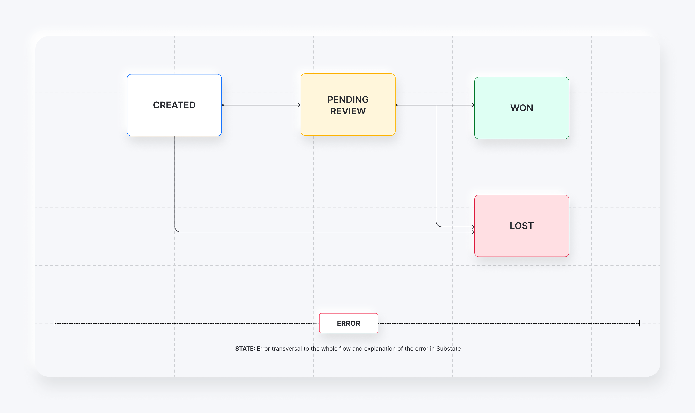

Yuno ofrece una solución unificada y automatizada para gestionar disputas, que te permite administrar los contracargos de todos los proveedores desde un único dashboard. La plataforma de Yuno automatiza los flujos de trabajo, te ayuda a recuperar ingresos y mantiene tu operación lista para auditorías.

## ¿Qué es un contracargo? {#what-is-a-chargeback}

Un contracargo es un reclamo que inicia un cliente a través de su banco emisor por una transacción que considera problemática. Los motivos más comunes son pagos no autorizados, montos incorrectos o disputas con el comercio.

En Yuno, un **contracargo** y una **disputa** son técnicamente lo mismo: ambos representan una transacción cuestionada.\
La diferencia conceptual está en la respuesta del comercio: cuando un comercio entrega documentación para impugnar el contracargo, este se convierte en una **disputa activa**. Sin embargo, la transacción sigue siendo la misma y solo cambia su estado según las acciones realizadas.

## Flujo de trabajo de un contracargo {#chargeback-workflow}

<iframe
  src="https://yuno-diagrams-public.pages.dev/diagrams/payouts-and-disputes/chargeback-management/chargeback-workflow.html"
  style={{ width: "100%", aspectRatio: "1540 / 874" }}
  frameBorder="0"
  allow="fullscreen"
  allowFullScreen
/>

1. **Creación del contracargo**
   * El cliente presenta un reclamo ante su banco emisor
   * El banco notifica al proveedor de pagos
   * El proveedor informa a Yuno sobre el reclamo
   * Yuno registra el contracargo y su estado inicial de transacción es `CREATED`

2. **Notificación al comercio**
   * Yuno notifica al comercio sobre el contracargo y actualiza el estado del pago

3. **Acciones del comercio**
   * El comercio puede:
     * **Enviar evidencia**: entregar documentación que respalde la validez de la transacción, lo que convierte el contracargo en una disputa activa
     * **Aceptar el contracargo**: reconocer el reclamo sin disputarlo y perder los fondos (`LOST`)

4. **Revisión de la evidencia**
   * Si se envía evidencia, el banco emisor revisa la documentación y emite una decisión final (`PENDING_REVIEW`)

5. **Resolución del contracargo o la disputa**
   * **Disputa ganada** (`WON`): el reclamo del cliente se rechaza y la transacción sigue siendo válida
   * **Disputa perdida** (`LOST`): el reclamo del cliente se acepta, lo que resulta en un reembolso al cliente

## Estados de los contracargos {#chargeback-states}

Los estados de los contracargos en Yuno representan las distintas etapas del proceso:

<Frame></Frame>

| **Estado**       | **Descripción**                                                                                              |
| ---------------- | ------------------------------------------------------------------------------------------------------------ |
| `CREATED`        | Se recibió un contracargo; el comercio puede actuar o enviar evidencia si el proveedor lo admite. |
| `PENDING_REVIEW` | Se envió la evidencia y el banco emisor la está revisando.                                         |
| `WON`            | La disputa se resolvió a favor del comercio.                                                           |
| `LOST`           | Se aceptó el reclamo, lo que resultó en un reembolso al cliente.                                               |

<br />

<div className="code-nowrap-table dense-table">

| **Estado del pago** | **Subestado del pago** | **Tipo de transacción** | **Estado de la transacción** | **Descripción**                                                                                            |
| ------------------ | --------------------- | -------------------- | ---------------------- | ---------------------------------------------------------------------------------------------------------- |
| `SUCCEEDED`        | APPROVED              | Chargeback           | Won                    | Disputa de contracargo ganada                                                                                     |
| `IN_DISPUTE`       | RECEIVED              | Chargeback           | Created                | Se recibió un contracargo o una consulta. Se debe entregar una decisión o documentación para iniciar una disputa. |
|                    | PENDING\_REVIEW       | Chargeback           | Pending\_review        | Disputa en revisión por parte del proveedor                                                                          |
| `CHARGEBACK`       | LOST                  | Contracargo           | Lost                   | Expired/Closed/Review\_lost                                                                                |

</div>

## Predisputas (desviaciones) {#predisputes-deflections}

Cuando un proveedor o una red informa explícitamente una desviación de predisputa, Yuno:

* Crea una transacción `CHARGEBACK` con `status = PREVENTED` para que puedas auditar que se evitó un contracargo
* Establece el pago en `status = CHARGEBACK` y `sub_status = LOST` para reflejar el resultado financiero
* Emite solo el webhook de contracargo para la transacción `CHARGEBACK / PREVENTED` (sin un webhook de reembolso aparte)
* Aplica idempotencia para evitar transacciones y notificaciones duplicadas

Detalles adicionales:

* No se requiere evidencia: las desviaciones de predisputa no requieren el envío de evidencia
* Mapeo del ID de disputa: el ID de la disputa es igual al ID de la transacción de contracargo
* Campos opcionales: los webhooks de contracargo pueden incluir `provider_dispute_id` e `is_pre_dispute` para indicar casos con origen en una predisputa

`PREVENTED` se usa solo en transacciones de tipo `CHARGEBACK`. No es un estado final: si el emisor revierte después el resultado y el proveedor informa que la disputa se ganó, la transacción pasa a `WON` y el pago vuelve a `status = SUCCEEDED`.

### Ejemplo de predisputa {#example-predispute}

```json
{
  "transaction": {
    "id": "tx_cb_001",
    "type": "CHARGEBACK",
    "status": "PREVENTED",
    "category": "CARD",
    "amount": 19700,
    "provider_id": "STRIPE",
    "provider_dispute_id": "du_1S2umUCXdfp1jQhWSW3lALH2"
  },
  "payment": {
    "id": "pay_123",
    "status": "CHARGEBACK",
    "sub_status": "LOST",
    "amount": { "currency": "USD", "value": 19700, "refunded": 0, "captured": 19700 }
  }
}
```

## Beneficios clave de gestionar contracargos con Yuno {#key-benefits-of-managing-chargebacks-with-yuno}

Yuno simplifica y optimiza tu gestión de contracargos mediante varias ventajas clave:

### Todas tus disputas en un flujo de trabajo integrado {#all-your-disputes-in-one-integrated-workflow}

Consolida los datos de contracargos de todos tus proveedores de pago en un solo dashboard. Ya sea Visa, Mastercard o un adquirente local, puedes hacer seguimiento, responder y gestionar las disputas de forma centralizada.

### Respuesta ágil a contracargos {#streamlined-chargeback-response}

Automatiza las respuestas a contracargos con la documentación de respaldo adecuada para asegurar que cada disputa se atienda de forma rápida y eficiente.

### Garantiza el cumplimiento normativo {#ensure-compliance}

Cada contracargo, cada respuesta y cada actualización quedan registrados y accesibles. Con registros de auditoría integrados y datos exportables, las revisiones de cumplimiento e internas son más rápidas y sencillas.

## Entiende el código de motivo {#understand-the-reason-code}

Entender el código de motivo de cada contracargo es fundamental, ya que explica por qué el cliente inició la disputa. Conocer estos códigos te permite adaptar mejor tu respuesta y reunir la información necesaria para cada caso. En la [sección de códigos de respuesta de contracargos](/es/docs/payouts-and-disputes/reason-codes) encontrarás una lista completa de todos los códigos posibles que proporcionan los adquirentes. En cada transacción de contracargo podrás encontrar el código de motivo en el campo `response_code`.

## Gestión de evidencia {#evidence-management}

Para disputar un contracargo, el comercio debe enviar evidencia que respalde su caso. En el contexto de los servicios de resolución de disputas, la evidencia es cualquier información o documentación que sustente tu postura en un desacuerdo o reclamo. Presentar evidencia sólida es fundamental para obtener un resultado favorable. Algunos ejemplos de este tipo de evidencia son:

* *Prueba de entrega*: documentos que confirman que un producto fue enviado y recibido por el cliente, como números de seguimiento o confirmaciones de entrega
* *Comunicaciones con el cliente*: registros de correos electrónicos, mensajes de texto o cualquier intercambio que demuestre acuerdos o aclaraciones hechos con el cliente
* *Políticas de reembolso y devolución*: copias de las políticas que el cliente aceptó al momento de la compra, donde se indican las condiciones de devoluciones o reembolsos
* *Prueba de autenticidad*: documentación que verifica la legitimidad de una transacción, como recibos firmados o registros de autenticación

Es fundamental que la evidencia presentada sea clara, relevante y se relacione directamente con el asunto en cuestión. Además, organizar y presentar la evidencia de forma profesional y concisa facilitará su evaluación por parte de las partes involucradas en la resolución de la disputa.

<Note>
**Requisitos de la evidencia**

Los archivos cargados deben cumplir los siguientes criterios:

* *Formato*: el archivo debe estar en formato PDF, codificado en base64
* *Tamaño*: el archivo no debe superar 1 MB
* *Idioma*: la disputa debe estar redactada en inglés o en el idioma local del país
</Note>

### Ejemplo de solicitud para enviar evidencia {#example-request-to-submit-evidence}

```json
POST https://api-sandbox.y.uno/v1/payments/:payment_id/transactions/:transaction_id/dispute

Headers:
  X-Idempotency-Key: <unique-key>
  X-Public-Api-Key: <api-key>
  X-Private-Secret-Key: <secret-key>

Body:
{
  "account_id":"<Your Yuno account_id>",
  "evidence": [
    {
      "file_name": "signed_receipt.pdf",
      "content_type": "application/pdf",
      "content_category": "RECEIPT",
      "content": "JVBERi0xLjMKJcTl8uXrp/Og0MT..."
    }
  ]
}
```

El endpoint devuelve una estructura de respuesta de pago estándar que contiene la información actualizada del pago, incluido el estado del contracargo o la disputa.

### Actualización de la evidencia de una disputa {#updating-dispute-evidence}

Si necesitas agregar evidencia adicional a una disputa existente, puedes usar el endpoint [Update Dispute](/es/reference/payments/update-dispute). Esto te permite entregar documentación complementaria después de haber enviado la disputa inicial.

<Info>
**Notas importantes**

* **El estado no cambia**: agregar evidencia adicional no cambia el estado del contracargo. El estado se mantiene igual sin importar las actualizaciones.
* **Compatibilidad del proveedor**: no todos los proveedores admiten la actualización de disputas. Si un proveedor no admite actualizaciones, recibirás una respuesta de error controlada y el estado del contracargo no cambiará.
* **Consulta de información de la disputa**: usa el endpoint [Retrieve Payment by ID](/es/reference/payments/retrieve-payment-by-id) para verificar el estado actual de un contracargo o una disputa. La respuesta incluye los detalles de la transacción con la información del contracargo.
</Info>

Consulta las secciones de referencia [Disputes API](/es/reference/payments/disputes) y [Update Dispute API](/es/reference/payments/update-dispute) para obtener más información.
