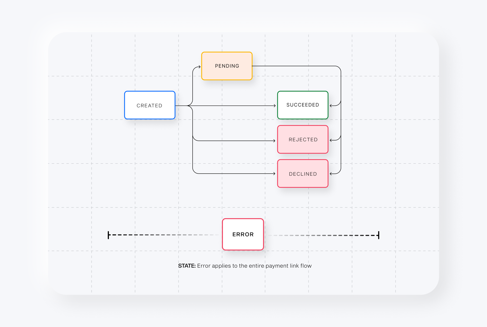

Yuno Payouts es una solución de API diseñada para simplificar el proceso de enviar payouts seguros a distintos beneficiarios, como usuarios, comercios, proveedores y clientes. Con Yuno Payouts, puedes distribuir fondos de forma eficiente a varios destinatarios, garantizar su seguridad y tener el control total de tus operaciones de payout.

La solución Yuno Payout te permite crear solicitudes de payout sin restricciones en el número de registros. Puedes hacer payouts a cualquier banco, tarjeta o billetera. Las opciones de payout están limitadas únicamente por el proveedor que elijas.

## Beneficios de usar Yuno Payouts {#benefits-of-using-yuno-payouts}

* **Centralización**: el servicio Payout te ahorra tiempo y costos al centralizar todas tus operaciones de pago en un solo lugar. Ya no necesitas gestionar los pagos en varios sistemas o interfaces.
* **Información**: mantente informado sobre el estado de los pagos con las notificaciones personalizables de Yuno. Puedes recibir actualizaciones en tiempo real de cualquier cambio en el estado de la orden de pago, según tus preferencias.
* **Localización**: al depositar los fondos directamente en las cuentas bancarias locales de tus socios, puedes pagarles en su moneda preferida, lo que elimina la necesidad de conversiones de moneda extranjera y les ahorra comisiones e impuestos adicionales.

## Cómo funcionan los Payouts {#how-payouts-work}

Un payout en Yuno puede pasar por distintos estados, empezando por su creación. Cuando creas un payout, recibe automáticamente el estado **CREATED**. Sin embargo, el estado **CREATED** es temporal. A medida que Yuno verifica y transfiere la información al proveedor, el estado del payout cambia a **PENDING**.

<Frame></Frame>

Cuando el payout pasa al estado **PENDING**, se realizan una serie de acciones que determinan si el payout será exitoso y transferirá los fondos, o si será bloqueado. A continuación, encuentras la descripción de cada uno de los posibles estados finales:

* **SUCCEEDED**: el proveedor valida la transacción y los fondos se transfieren correctamente a la cuenta del beneficiario. Recibirás una notificación de confirmación.
* **REJECTED**: el payout no se procesó por problemas que Yuno identificó antes de intentar la transferencia. Entre los posibles motivos de un payout rechazado están fondos insuficientes o datos de payout incorrectos, como un número de cuenta equivocado. Tendrás que crear un nuevo payout para realizar la transacción.
* **DECLINED**: se intentó el payout, pero el proveedor se negó a aceptarlo. Entre los motivos de un payout rechazado están una cuenta de beneficiario congelada o cerrada, o que la transacción se haya marcado como un posible fraude. Tendrás que crear un nuevo payout para realizar la transacción.

Conoce más sobre el estado de los payouts en la página [Payouts Status](/es/reference/payouts/payout-workflow).

## Conceptos nuevos {#new-concepts}

* **Beneficiario (Beneficiary)**: equivale al cliente en los payins. Es el objeto que recibe la información del beneficiario del payout. Ejemplo: si el payout es para pagos de salarios, el beneficiario sería el empleado que recibe su salario.
* **Método de retiro (Withdrawal Method)**: la contraparte del método de pago para los payouts. Así como los payins requieren información del método de pago, los payouts requieren información del método de retiro. Envía los campos de la categoría que uses: tarjetas, transferencias bancarias o billeteras.

## Uso de Yuno Payouts {#using-yuno-payouts}

La función Yuno Payouts está disponible mediante la API de Yuno. Puedes usar la API para crear y consultar la información de los payouts. Para usar la solución Payouts, debes cumplir los siguientes requisitos:

* Necesitas una cuenta de Yuno.
* Necesitas integrarte con la [API de Yuno](/es/reference/payouts/create-payout).
* Tener una cuenta con un proveedor externo que admita payouts.

Para usar la solución Payouts, sigue estos pasos:

1. Configura las credenciales del proveedor en la [sección Connections](/es/docs/using-yuno/dashboard-overview/connections) de tu dashboard de Yuno.
   * (Opcional) Agrega una [URL de webhook](/es/docs/webhooks/configure-webhooks) para recibir notificaciones sobre las actualizaciones de las transacciones de payout.
2. Crea el payout con el endpoint [Create Payout](/es/reference/payouts/create-payout). Debes enviar la información del beneficiario, el monto y el método de retiro para realizar el payout.
3. Yuno verificará la información y luego enviará la solicitud de payout al proveedor. El proveedor analizará los fondos disponibles para autorizar el pago.
4. Para consultar el estado actual de los payouts, puedes usar una de las siguientes opciones:
   * El endpoint [Retrieve Payout by ID](/es/reference/payouts/retrieve-payout-by-id), indicando el `id` que recibiste al crear el payout.
   * El endpoint [Retrieve Payout by Merchant Reference](/es/reference/payouts/retrieve-payout-by-merchant-reference), indicando el `merchant_reference` que enviaste al crear el payout.

<Warning>
**Disponibilidad de Yuno Payouts**

Yuno Payouts requiere un análisis de seguridad y riesgo. Para conocer más sobre Yuno Payouts, consultar el soporte del proveedor o solicitar la activación, comunícate con el [equipo de soporte de Yuno](mailto:support@y.uno).
</Warning>

## Payouts referenciados {#referenced-payouts}

Los payouts pueden hacerse a distintos métodos de pago, como cuentas bancarias e incluso tarjetas, según el proveedor. Para los payouts a un método de pago con tarjeta en los que el comercio no tiene los datos de la tarjeta de crédito (por no cumplir con PCI), Yuno les permite enviar el payout si la tarjeta se usó antes en un pago. Esto se llama "payout referenciado".

Para usarlo, primero debes cobrar al cliente con una de las soluciones de Yuno que cumplen con PCI (cualquier [SDK de Yuno](/es/docs/sdks/overview/quickstart)) y luego hacer un payout indicando la transacción original donde Yuno puede encontrar los datos de la tarjeta de crédito.

```json
"withdrawal_method": {
    "type": "STP_PAYOUT",
    "provider_id": "STP",
    "original_transaction_id":"9104911d-5df9-429e-8488-ad41abea1a4b"
  }
```